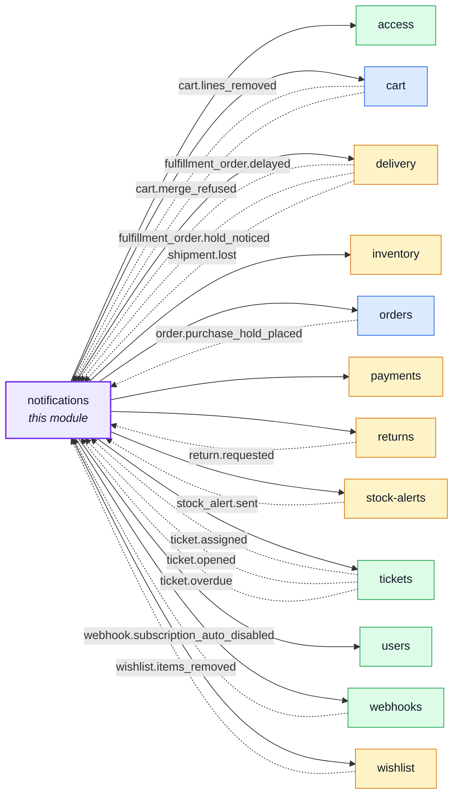
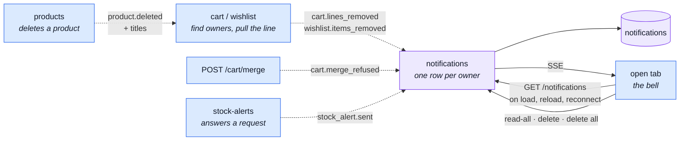
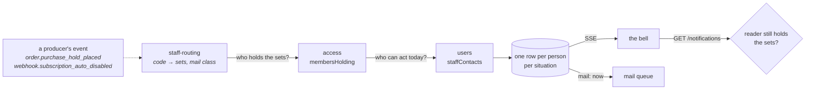
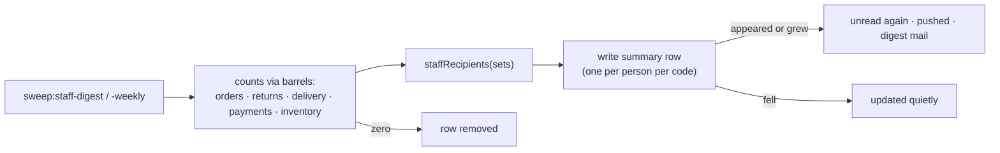

# notifications

::: tip At a glance
**Owns** — the per-user inbox: one row per message, kept until its owner deletes it.
**Depends on** — [`cart`](./cart.md), [`delivery`](./delivery.md), [`orders`](./orders.md), [`stock-alerts`](./stock-alerts.md), [`webhooks`](./webhooks.md) and [`wishlist`](./wishlist.md) for the event names it listens to; [`access`](./access.md) and [`users`](./users.md) to find who a work notice is for.
**Breaks if you change** — nothing outside this folder. No module imports it: a producer announces an event and never calls in.
:::

## Its neighbourhood

<!-- module-graph:notifications:start -->

_Solid arrows are imports. Dotted arrows are domain events — the return path an import
graph cannot see._

<!-- module-graph:notifications:end -->

## The story

A product is deleted, and `cart` and `wishlist` strip it from every list. This module is where
the owner is told:
a row in a per-user inbox that stays until the user deletes it.

Two kinds of message exist, and only one lives here.

|             | Toast                    | Notification                         |
| ----------- | ------------------------ | ------------------------------------ |
| Lives in    | the page's memory        | the database, one row per user       |
| Lasts       | seconds, or until closed | until the owner deletes it           |
| Who sees it | anyone, guests too       | the signed-in owner, on every device |
| Written by  | the frontend             | this module, from a domain event     |

The backend stores a **code and its params, never the sentence**. The frontend translates the code
from its own locale files, like every other API code, so a row survives a language change and this
backend keeps no copy in step with the UI.

`Notification` is a discriminated union on `code`, and each variant types its own `params`:

| `code`                                | `params`                                                         |
| ------------------------------------- | ---------------------------------------------------------------- |
| `notifications.cart-line-removed`     | `{ productId, titles }`                                          |
| `notifications.wishlist-item-removed` | `{ productId, titles }`                                          |
| `notifications.cart-merge-refused`    | `{ lines: [{ productId, requested, titles }] }`                  |
| `notifications.fulfillment-delayed`   | `{ orderId, fulfillmentOrderId, titles, agreedAt, expectedAt? }` |
| `notifications.fulfillment-held`      | `{ orderId, fulfillmentOrderId, notice, message? }`              |
| `notifications.shipment-lost`         | `{ orderId, shipmentId, reason, message?, owed?, expectedAt? }`  |
| `notifications.stock-alert`           | `{ productId, titles }`                                          |

`fulfillment-delayed` is a late preorder's notice ([delivery](./delivery.md#preorders-and-a-moved-date)): it
informs and offers the cancel, and asks nothing. It is written from `fulfillment_order.delayed`, and an
erased account has no inbox to write to.

`notifications.stock-alert` is the answer to a back-in-stock request ([stock-alerts](./stock-alerts.md)),
written from `stock_alert.sent`.

`notifications.fulfillment-held` is a hold the buyer can act on or should read about, written from
`fulfillment_order.hold_noticed` ([delivery](./delivery.md#holds)): `notice` is `check_address` or `delayed`,
`message` is what staff wrote for them. It never carries staff's reason.

`notifications.shipment-lost` is a parcel reported lost or damaged in transit, written from `shipment.lost`
([delivery](./delivery.md#lost-in-transit)): `reason` is `lost` or `damaged`, `message` is what staff wrote for
the buyer, `owed` the titles the shelf could not cover again and `expectedAt` when they are expected. It
never carries staff's note.

The stored `params` is `Mixed` in Mongo, but the document type is the same union
(`NotificationBody` in `model.ts`), so a writer cannot pair a code with another code's params and
the presenter builds each variant without a cast. The SSE `notifications.created` payload is the
same union.

## The pipeline

## Work notices for staff

Some rows are not about the reader as a person but about work that needs doing: `audience: staff`.
They share the table, the stream and the bell with a person's own messages, so there is one feed,
one cap logic and one erasure path.

- **Routing is one table.** `src/modules/notifications/staff-routing.ts` maps each code to the permission sets whose holders
  do that work, whether it mails, and its severity. Administrators (any unrestricted role, by
  property) hear everything; an empty list of sets means administrators only.
- **Who can act.** Of the members found, only live, enabled accounts with an authenticator app armed
  are told: without one their staff role is withheld and they could not do what the notice asks.
- **Mail is the exception.** `now` only where someone must act soon (money, a legal clock,
  security); every other code is the bell alone. There are no per-person mail preferences: the
  choice is made once, in the table. A `now` mail is short: what happened and a link, in the
  recipient's own language, with ids and dates only (no buyer address, no name).
- **Links are shared data.** The staff screens a notice points at are the `staffPages:` block of
  `shared/rules/frontend-links.yaml`, which the frontend's router spec walks; the code-to-screen
  mapping stays in `staff-routing.ts`. A dead event links only when it is about a user; the frontend builds an order link itself.
- **Once per situation.** Each row carries a `dedupeKey` (`<kind>:<entity>`) under a unique
  `{ userId, dedupeKey }` index, so a redelivered event writes nothing, pushes nothing and mails
  nothing a second time.
- **Read at read time.** The row stores the sets that earned it; `GET /notifications` shows it only
  to a member of the same shop who holds one of them _now_. A role taken away hides the notices
  without a write; a promotion shows only what was written after it. `read-all` and delete cover
  both kinds.
- **Retention.** Work notices have their own cap (`NODE_NOTIFICATIONS_STAFF_MAX_PER_USER`) and a TTL
  (`NODE_NOTIFICATIONS_STAFF_TTL_DAYS`), so a flood of them cannot push a person's own messages out.
- **Today's codes.** `notifications.staff.purchase-hold-placed` (mail `now`: abuse defence),
  `notifications.staff.webhook-disabled` (bell only), `notifications.staff.ticket-opened` (mail
  `now`: a person waits), `notifications.staff.ticket-overdue` (mail `now`, once, when that ticket
  passes its due date unclosed; the same people) and `notifications.staff.ticket-assigned` (bell only, the assignee alone).
  `notifications.staff.return-requested` (bell only, the people who decide returns; a withdrawal is
  a right and is not announced) and `notifications.staff.outbox-dead` (bell only, administrators:
  the kernel's `outbox.event_dead` fact, a plain emit because an outbox row about the outbox could
  itself die).
- **Ticket notices.** The ticket codes name their sets per notice (`per-notice` in the route
  table): the set of the opened ticket's kind. Params are the ticket id, its kind and a contact
  message's category, nothing the visitor typed. A contact message that finds no recipient with
  an address is handed to the tickets module's fallback mailbox
  ([`tickets`](./tickets.md#who-is-told)).

## The daily digest

Some work is not an event but a count of what waits. `sweep:staff-digest` (06:30 UTC daily) and
`sweep:staff-weekly` (06:30 UTC Mondays, the late preorders only) read each count from the module
that owns it, through its barrel, and rewrite one **summary row** per person whose role does that
work. The row's `dedupeKey` is its code, so a re-run replaces it instead of piling copies.

- **Appeared or grew** -> unread again, pushed to open tabs, and (for the codes below marked
  `digest`) listed in that person's one digest mail. **Fell or the same** -> quiet. **Zero** ->
  the row is removed. An unchanged re-run mails nothing.
- **Mail is for what is overdue**, not for work in the normal course (B14). The ticket reminder
  (`ticket-overdue`) is that rule applied to a single ticket: see
  [the overdue reminder](./tickets.md#the-overdue-reminder).

| Code                         | Who (set)             | Counts                                                                                                                                                                         | Mail   |
| ---------------------------- | --------------------- | ------------------------------------------------------------------------------------------------------------------------------------------------------------------------------ | ------ |
| `transfers-due`              | `PaymentRecording`    | unpaid bank transfers with `payBy` within `NODE_STAFF_TRANSFER_DUE_HOURS`                                                                                                      | bell   |
| `unshipped`                  | `DeliveryStart`       | paid orders unshipped for `NODE_STAFF_UNSHIPPED_DAYS`                                                                                                                          | digest |
| `returns-undecided`          | `ReturnManagement`    | requests undecided for `NODE_STAFF_RETURN_DECISION_DAYS`                                                                                                                       | digest |
| `withdrawals-awaiting-goods` | `ReturnReceiving`     | approved withdrawals whose goods are not back                                                                                                                                  | bell   |
| `delivery-holds-open`        | `DeliveryManagement`  | staff holds older than `NODE_STAFF_HOLD_OPEN_DAYS` (`heldAt`)                                                                                                                  | digest |
| `awaiting-tracking`          | `DeliveryManagement`  | shipped, tracked-method parcels with no code for `NODE_STAFF_TRACKING_MISSING_HOURS`                                                                                           | bell   |
| `undelivered`                | `DeliveryManagement`  | physical parcels shipped and never marked arrived for `NODE_DELIVERY_UNDELIVERED_REMINDER_DAYS` (the withdrawal window, the guarantee and the PII clock start only on arrival) | digest |
| `stale-refunds`              | `PaymentRefunding`    | provider refunds open past the payment attention threshold                                                                                                                     | digest |
| `low-stock`                  | `InventoryManagement` | products at or under `NODE_LOW_STOCK_THRESHOLD`                                                                                                                                | bell   |
| `preorders-late`             | `OrderEditing`        | waiting preorders and backorders past their date (weekly)                                                                                                                      | digest |

A situation that is a ticket (`manual_refund_owed`, `amount_mismatch`, `refund_refused`, ...) has no
notice code here: `ticket-opened` alerts it. That is why a refused refund has none.

## What decides what

- **Who reaches the inbox.** Only domain events. `cart` knows whose carts held a product, so `cart`
  emits `cart.lines_removed`; `notifications` never listens to `product.deleted` itself.
- **The merge message.** Only for guest-cart lines that could not be added at all (the product
  is not publicly visible: deleted or hidden, `reason: removed`). A sold-out, short or off-sale
  product is added and flagged through its `availability` instead, and a line that landed with another quantity is the cart page's alert to show, not the
  inbox's: it can be seen again later, a vanished product cannot.
- **The product's name.** `product.deleted` carries `titles`, every translated name, read before a
  hard delete drops the translation rows. The notification copies them in: the product is gone, so
  nothing can be looked up afterwards. The reader sees their own language.
- **The cap.** The newest `NODE_NOTIFICATIONS_MAX_PER_USER` rows are kept (default 100); a write
  past that deletes the oldest. Without it one bulk delete can flood an inbox, and the inactivity
  reaper is off by default. GDPR (Art. 5(1)(e)) does not ask for an expiry here: the rows die with
  the account.
- **Read state.** `readAt` is set by `POST /notifications/read-all`, which the bell calls when it
  opens. The badge counts the unread; deleting is separate.
- **Delete is a hard delete.** One field fewer, and no "dismissed but still stored" personal data.
  Another user's id answers the same 404 as one that does not exist.
- **Live push.** `GET /notifications/stream` is Server-Sent Events, keyed by user, authenticated by
  the refresh cookie because an `EventSource` cannot send a header. It carries only what happens
  while a tab is open; `GET /notifications` is still how a tab starts. Per process, like the
  observability stream: a message written by another worker arrives at the next fetch.

## Personal data

A notification says what was in someone's cart, so it is personal data: it is in the account
export (`personalData.collect`) and removed with the account (`personalData.erase`, inside the
hard-delete transaction). A staff member's work notices are exported as a kind and a date only
(`staffNotifications`): their facts name other people's accounts and orders.

## Configuration

| Variable                                | Default | What                                |
| --------------------------------------- | ------- | ----------------------------------- |
| `NODE_NOTIFICATIONS_MAX_PER_USER`       | `100`   | Newest notifications kept per user  |
| `NODE_NOTIFICATIONS_STAFF_MAX_PER_USER` | `200`   | Newest work notices kept per person |
| `NODE_NOTIFICATIONS_STAFF_TTL_DAYS`     | `30`    | How many days a work notice lives   |

## Who can do what

Every rule this module declares and who holds it, role by role. The rule is what a route guard asks for; the set is what a role lists.

<!-- permissions:start -->

| Rule                  | Set               | `guest` | `unverified` | `customer` | `manager` | `warehouse` | `support` | `editor` | `moderator` | `admin` | `operator` | Credential | What it lets them do                                                       |
| --------------------- | ----------------- | ------- | ------------ | ---------- | --------- | ----------- | --------- | -------- | ----------- | ------- | ---------- | ---------- | -------------------------------------------------------------------------- |
| `read:Notification`   | `NotificationOwn` | —       | ✅ own       | ✅ own     | ✅ own    | ✅ own      | ✅ own    | ✅ own   | ✅ own      | ✅ own  | —          | —          | Read the caller's own notifications, follow them live, and mark them read. |
| `delete:Notification` | `NotificationOwn` | —       | ✅ own       | ✅ own     | ✅ own    | ✅ own      | ✅ own    | ✅ own   | ✅ own      | ✅ own  | —          | —          | Delete the caller's own notifications, one or all at once.                 |

✅ held · `own` only the caller’s own rows · ⚡c / ⚡s needs a freshly proved session (critical / sensitive) ·
Credential: ✅ when an API key can be minted with the rule. Generated from the rules and sets in
`src/modules/*/authorization.yaml` and the roles in `shared/authorization-roles.yaml`, asked of the
evaluator — [Authorization](../theory/authorization.md) explains the model.

<!-- permissions:end -->

## Related pages

- [`cart`](./cart.md) — `cart.lines_removed`, and `POST /cart/merge` with `cart.merge_refused`
- [`wishlist`](./wishlist.md) — `wishlist.items_removed`
- [`products`](./products.md) — `product.deleted` and its `titles`
- [Observability](./observability.md) — the SSE stream this one follows
- [Events & Logging](../tools/events-and-logging.md) — why events, and what the bus does not promise
