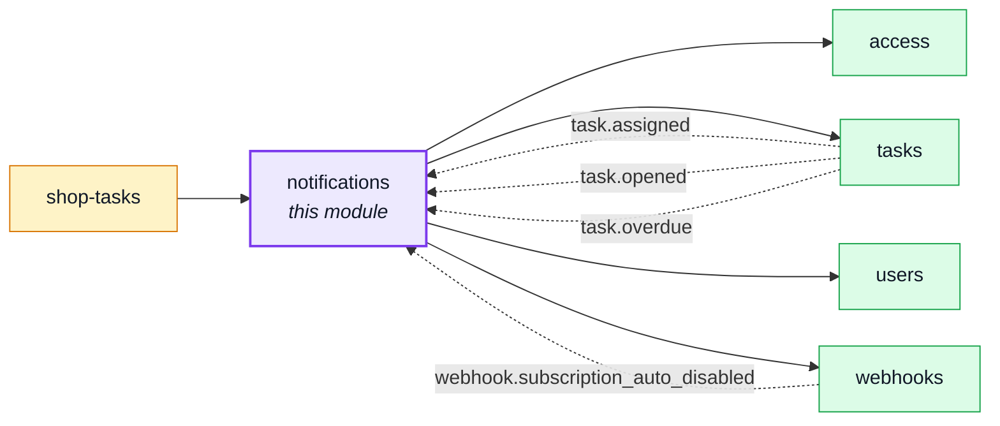
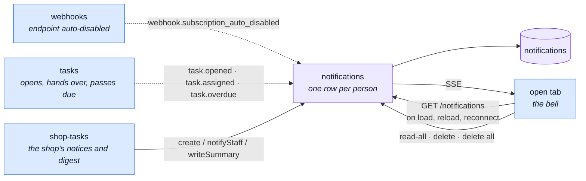
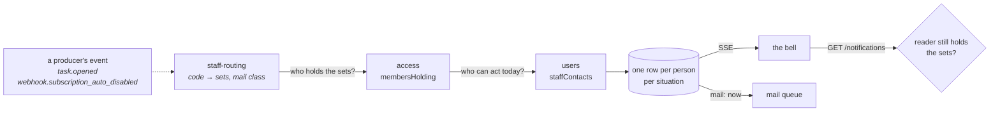

# notifications

::: tip At a glance
**Owns** — the per-user inbox: one row per message, kept until its owner deletes it.
**Depends on** — [`tasks`](./tasks.md) and [`webhooks`](./webhooks.md) for the event names it listens to; [`access`](./access.md) and [`users`](./users.md) to find who a work notice is for.
**Breaks if you change** — [`shop-tasks`](./shop-tasks.md), which writes the shop's notices and digest rows through this module's service. A producer that only announces an event never calls in.
:::

## Its neighbourhood

<!-- module-graph:notifications:start -->

_Solid arrows are imports. Dotted arrows are domain events — the return path an import
graph cannot see._

<!-- module-graph:notifications:end -->

## The story

A webhook endpoint is switched off after too many failures. This module is where the people who
can fix it are told: a row in a per-user inbox that stays until the user deletes it.

Two kinds of message exist, and only one lives here.

|             | Toast                    | Notification                         |
| ----------- | ------------------------ | ------------------------------------ |
| Lives in    | the page's memory        | the database, one row per user       |
| Lasts       | seconds, or until closed | until the owner deletes it           |
| Who sees it | anyone, guests too       | the signed-in owner, on every device |
| Written by  | the frontend             | this module, from a domain event     |

The backend stores a **code and its params, never the sentence**. The frontend translates the code
from its own locale files, like every other API code, so a row survives a language change and this
backend keeps no copy in step with the UI.

`Notification` is a discriminated union on `code`, and each variant types its own `params`. This
module's own codes are the staff work notices, under `notifications.staff.*`:

| `code`                                 | `params`                      |
| -------------------------------------- | ----------------------------- |
| `notifications.staff.webhook-disabled` | `{ subscriptionId }`          |
| `notifications.staff.task-opened`      | `{ taskId, kind, category? }` |
| `notifications.staff.task-overdue`     | the same as `task-opened`     |
| `notifications.staff.task-assigned`    | `{ taskId, kind }`            |
| `notifications.staff.outbox-dead`      | `{ eventName, aggregateId }`  |

A module that sits on top adds its own variants to the union by contract fragment. The shop does:
its buyer messages (a cart line removed, a delayed preorder, a lost parcel, a stock alert) and its
staff notices are in [shop-tasks](./shop-tasks.md#the-notices), under `shop-tasks.*`.

The stored `params` is `Mixed` in Mongo, but the document type is the same union
(`NotificationBody` in `model.ts`), so a writer cannot pair a code with another code's params and
the presenter builds each variant without a cast. The SSE `notifications.created` payload is the
same union.

## The pipeline

## Work notices for staff

Some rows are not about the reader as a person but about work that needs doing: `audience: staff`.
They share the table, the stream and the bell with a person's own messages, so there is one feed,
one cap logic and one erasure path.

- **Routing is one table.** `src/modules/notifications/staff-routing.ts` maps each code to the permission sets whose holders
  do that work, whether it mails, and its severity. Administrators (any unrestricted role, by
  property) hear everything; an empty list of sets means administrators only.
- **Who can act.** Of the members found, only live, enabled accounts with an authenticator app armed
  are told: without one their staff role is withheld and they could not do what the notice asks.
- **Mail is the exception.** `now` only where someone must act soon (money, a legal clock,
  security); every other code is the bell alone. There are no per-person mail preferences: the
  choice is made once, in the table. A `now` mail is short: what happened and a link, in the
  recipient's own language, with ids and dates only (no buyer address, no name).
- **Links are shared data.** The staff screens a notice points at are the `staffPages:` block of
  `shared/rules/frontend-links.yaml`, which the frontend's router spec walks; the code-to-screen
  mapping stays in `staff-routing.ts`. A dead event carries no link from the backend: the frontend maps the event's first segment to a screen itself.
- **Once per situation.** Each row carries a `dedupeKey` (`<kind>:<entity>`) under a unique
  `{ userId, dedupeKey }` index, so a redelivered event writes nothing, pushes nothing and mails
  nothing a second time.
- **Read at read time.** The row stores the sets that earned it; `GET /notifications` shows it only
  to a member of the same shop who holds one of them _now_. A role taken away hides the notices
  without a write; a promotion shows only what was written after it. `read-all` and delete cover
  both kinds.
- **Retention.** Work notices have their own cap (`NODE_NOTIFICATIONS_STAFF_MAX_PER_USER`) and a TTL
  (`NODE_NOTIFICATIONS_STAFF_TTL_DAYS`), so a flood of them cannot push a person's own messages out.
- **This module's codes.** `notifications.staff.webhook-disabled` (bell only),
  `notifications.staff.task-opened` (mail `now`: a person waits), `notifications.staff.task-overdue`
  (mail `now`, once, when that task passes its due date unclosed; the same people),
  `notifications.staff.task-assigned` (bell only, the assignee alone) and
  `notifications.staff.outbox-dead` (bell only, administrators: the kernel's `outbox.event_dead`
  fact, a plain emit because an outbox row about the outbox could itself die). The three task events
  reach `notifications` through the [outbox](../tools/outbox.md), so a failing handler is retried;
  each handler dedupes on its key (`task-opened:<id>` and so on).
- **The shop's codes.** `shop-tasks.staff.*` register their own route with each call, so the table
  above is not theirs: see [shop-tasks](./shop-tasks.md#the-notices) for their sets and mail class.
- **Task notices.** The task codes name their sets per notice (`per-notice` in the route
  table): the set of the opened task's kind. Params are the task id, its kind and a contact
  message's category, nothing the visitor typed. A contact message that finds no recipient with
  an address is handed to the tasks module's fallback mailbox
  ([`tasks`](./tasks.md#who-is-told)).

## Summary rows

Some work is not an event but a count of what waits. A **summary row** is one notice per person per
code whose `dedupeKey` is its code, so a re-run replaces it instead of piling copies. This module
holds the primitives (`writeSummary`, `clearSummary`, `staffRecipients`); the jobs that count, the
codes and the digest mail are the shop's: see [the staff digest](./shop-tasks.md#the-staff-digest).
A summary row's params carry `work`, the filtered list path the bell opens.

## What decides what

- **Who reaches the inbox.** Only domain events, or a module that sits on top calling the
  service. A producer knows whose records are concerned and says so; `notifications` never works
  that out from a bare fact. The shop's buyer messages are described in
  [shop-tasks](./shop-tasks.md#the-notices).
- **The cap.** The newest `NODE_NOTIFICATIONS_MAX_PER_USER` rows are kept (default 100); a write
  past that deletes the oldest. Without it one bulk delete can flood an inbox, and the inactivity
  reaper is off by default. GDPR (Art. 5(1)(e)) does not ask for an expiry here: the rows die with
  the account.
- **Read state.** `readAt` is set by `POST /notifications/read-all`, which the bell calls when it
  opens. The badge counts the unread; deleting is separate.
- **Delete is a hard delete.** One field fewer, and no "dismissed but still stored" personal data.
  Another user's id answers the same 404 as one that does not exist.
- **Live push.** `GET /notifications/stream` is Server-Sent Events, keyed by user, authenticated by
  the refresh cookie because an `EventSource` cannot send a header. A signed-in account is enough:
  the module declares no permission rule, since no signed-in account can lack its own inbox. It carries only what happens
  while a tab is open; `GET /notifications` is still how a tab starts. Per process, like the
  observability stream: a message written by another worker arrives at the next fetch.

## Personal data

A notification can name a person's records, so it is personal data: it is in the account
export (`personalData.collect`) and removed with the account (`personalData.erase`, inside the
hard-delete transaction). A staff member's work notices are exported as a kind and a date only
(`staffNotifications`): their facts name other people's accounts and orders.

## Configuration

| Variable                                | Default | What                                |
| --------------------------------------- | ------- | ----------------------------------- |
| `NODE_NOTIFICATIONS_MAX_PER_USER`       | `100`   | Newest notifications kept per user  |
| `NODE_NOTIFICATIONS_STAFF_MAX_PER_USER` | `200`   | Newest work notices kept per person |
| `NODE_NOTIFICATIONS_STAFF_TTL_DAYS`     | `30`    | How many days a work notice lives   |

## Related pages

- [`shop-tasks`](./shop-tasks.md) — the shop's buyer messages, staff notices and daily digest
- [`tasks`](./tasks.md) — `task.opened`, `task.overdue` and `task.assigned`
- [`webhooks`](./webhooks.md) — `webhook.subscription_auto_disabled`
- [Observability](./observability.md) — the SSE stream this one follows
- [Events & Logging](../tools/events-and-logging.md) — why events, and what the bus does not promise
