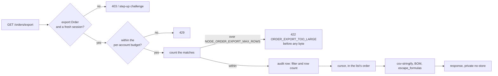
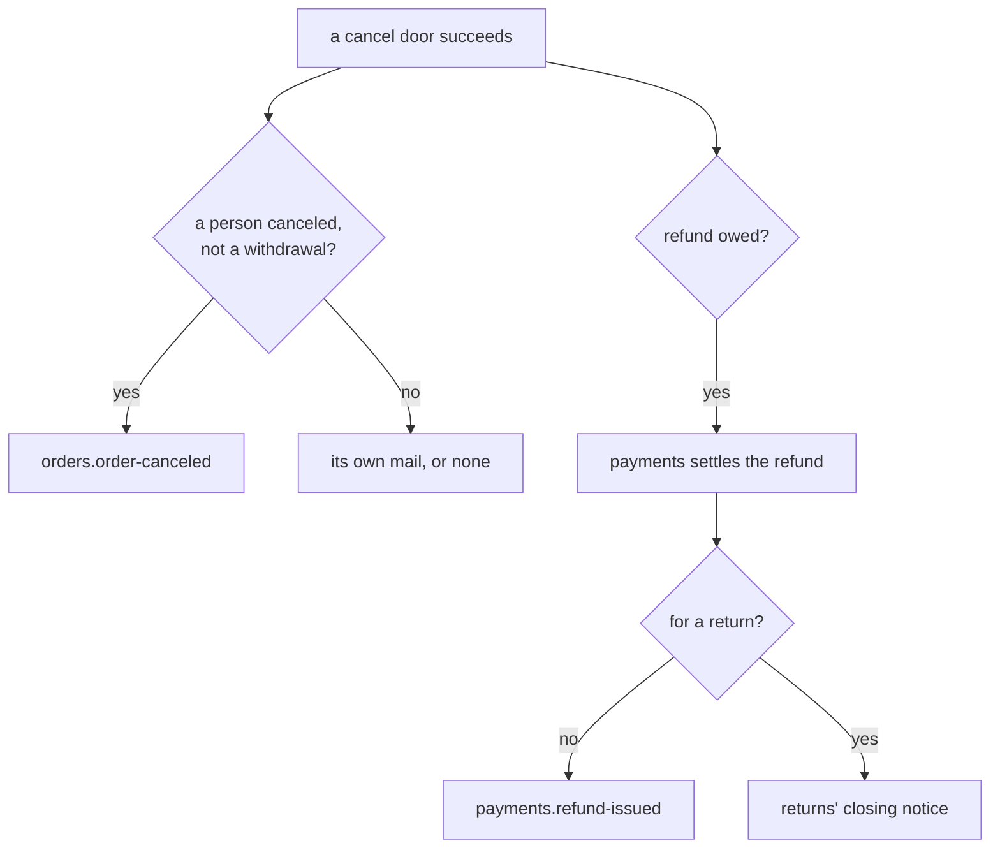

# Creating an order, exports and mails

How an order is created, exported as CSV, shown to other modules and told to the buyer when it is cancelled or refunded.

## Creating an order {#creating-an-order}

Every order, whoever makes it, is written through exactly one function — `placeOrder`
(`services/place.ts`): freeze the lines against the catalogue, hold the stock, allocate the order
number, write the row. A `bank_transfer` order's reference, instructions and payment are
[`payments`'](./payments.md#bank-transfer): its `order.created` listener opens them. **The hold comes before the write, deliberately**: a refused hold then writes
nothing at all — no order to roll back and no order number burned on a sale that never happened.
Everything caller-specific — payment-method validation, the open-order cap (owned by `cart`), resolving a shipping
address or method, cart pre-flight and clearing — stays with the caller; `placeOrder` only takes
what it needs to hold and write. See [Checkout](./cart-checkout.md#the-sequence) for the storefront
path in full.

An order placed through checkout freezes the `termsVersion` in force at placement, as it freezes its
`currency`; a staff-placed order carries none. The label is evidence only together with the
operator's archive of each version's text (CRD Art. 6(9)). `GET /config` shows the version in force
now. See [Terms version](./account.md#terms-version).

A line the shelf only half covered carries what it owes, frozen like the rest of it: `backorderedQuantity`
(how many of `quantity` were owed), `promisedAt` (the product's restock date, else the day it was
placed plus 30 days; stored as that instant, answered as the shop day) and `promiseDated` (whether that was a date the product named). The confirmation
email prints each line's promise, `ships from {date}` for a preorder and `{n} to arrive by {date}` or
`within 30 days` for owed units (CRD Art. 8(7)(a)); `delivery` reads the same frozen fields to make a
fulfillment order of the owed part.

Two frozen addresses ride on the order, both snapshots like the lines (an order keeps where it went
and whom it was billed to, not what the address book says today):

| Field             | Present when                                                | Read by                                |
| ----------------- | ----------------------------------------------------------- | -------------------------------------- |
| `shippingAddress` | a line ships to an address (not digital-only, not a pickup) | the warehouse, the order page          |
| `billingAddress`  | every checkout order                                        | the invoice (Art. 226), the order page |

The split is Shopify's: a digital-only order is invoiced to someone but ships nowhere, so it freezes
no shipping address. Billing is "same as shipping" unless the buyer names another entry
([how checkout resolves it](./cart-checkout.md#the-sequence)); the admin's `POST /orders` runs no
checkout and carries neither. The retention scrub unsets both, with the notes.

Both addresses and the notes are stored encrypted (`pii.ts`, AES-256-GCM, the order `_id` in the
associated data) and decrypted in `applyOrderTransform`'s `after` hook, so no reader sees
ciphertext and `GET /orders` has no `notes` filter: an encrypted field cannot be searched. The
write door is `orderRepository.create`, which every writer goes through. `orders.email` stays
plaintext, because it is filtered and sorted on. Why an explicit codec, not mongoose getters:
`toJSON` would ship ciphertext, copying a foreign subdocument would double-encrypt, and a setter
runs on query filters, so an encrypted path in a filter silently matches nothing. The invoicing
issuers decrypt the order's address (`billingAddressOf`) and re-encrypt it under the invoice's own
id (`invoicing/pii.ts`); only the PDF render decrypts it again.

`POST /orders` is the OTHER caller — the admin path — and it is deliberately minimal: staff raise an
order for someone, or ring up a counter sale (the staff "New order" screen):

- it takes an optional buyer, an email and line items, and nothing else — no payment method, no
  address, no shipping method;
- **no `userId` is a walk-in order** (a counter sale, or money taken outside the app): the order has no
  account, nobody's "My orders" lists it, the confirmation goes to the `email` in the body (staff may
  type the shop's own address) and it freezes in the shop's default language. Its personal data starts
  the retention clock at creation, so the email is not kept forever
  ([the rule](../understand/data-retention-orders.md#walk-in-orders)). Staff then record the cash on it
  ([a payment by hand](./payments-offline.md)), ship and deliver it. A manager can ring up the sale
  without an account lookup; recording the cash needs the payment permission;
- staff may sell a hidden or off-sale product by hand (the shopper's shelf rules are checkout's, not
  this door's); only a removed (soft-deleted) one is refused with `409 ORDER_PRODUCT_UNAVAILABLE`,
  every one named in `details.productIds`. The product is read through the caller's own scope, so a
  role without `display:Product` gets `404` for a hidden or removed product and an order never
  copies a product its caller may not read;
- it holds stock for the default reservation window like any other order, so an unpaid correction
  order is cancelled by the same reservation sweep as an abandoned checkout, and its buyer gets the
  same hold-expiry notice (`orders.order-hold-expired`): they were sent the confirmation, so the
  cancel is told too;
- carrying no address or shipping method, it has no parcel to post: a counter sale is handed over by
  shipping it without tracking, then marking it delivered. Shipping works straight from `paid`.

## The CSV export {#the-csv-export}

`GET /orders/export` answers the list's filters as one `text/csv` file, for reconciliation and the
accountant. A staff-only door, and a sharp one: the file holds every matching customer's email.

| Question              | Answer                                                                                                                                                                                                                                   |
| --------------------- | ---------------------------------------------------------------------------------------------------------------------------------------------------------------------------------------------------------------------------------------- |
| Who                   | `export:Order`: manager and admin, `stepUp: sensitive` (the same tier as exporting your own data). A support desk that can read every order cannot export them (Shopify's separate Export permission)                                    |
| API keys              | Cannot: the step-up needs a session, which a key never has (`requireFreshAuth` refuses without an `authContext`)                                                                                                                         |
| Synchronous, streamed | No file on disk, no reaper, no mailed link: a file that exists can be forgotten and a link forwarded (Art. 5(1)(e)). The account export is a job because it walks every module, not because exports must be                              |
| Route order           | Mounted before `/:id`, or `requireId` answers 404 for the word `export`                                                                                                                                                                  |
| Columns               | The list's, in file order: `createdAt`, `orderNumber`, `status`, `paymentStatus`, `fulfillmentStatus`, `returnStatus`, `email`, `lines`, `units`, `total`, `currency`, `paymentMethod`, `paidAt`. No address: both are encrypted at rest |
| Email                 | Kept: support and reconciliation need it, and the guards above are what make that acceptable                                                                                                                                             |
| Audit                 | `admin.orders.exported`, with the filter and the row count, never a row. An email filter is recorded only as "an email was given"                                                                                                        |
| Limits                | Own per-account budget (`NODE_ORDER_EXPORT_RATE_LIMIT_MAX`, default 10 a window) and a row cap (`NODE_ORDER_EXPORT_MAX_ROWS`, default 20000)                                                                                             |
| Headers               | `Cache-Control: private, no-store` (ASVS 14.3.2)                                                                                                                                                                                         |

**CSV injection.** `zod.email()` accepts `+cmd@example.com`, so the email column can start a
formula in a spreadsheet. The writer's `escape_formulas` prefixes any cell starting with `=`, `+`,
`-` (except a number), `@`, tab or carriage return with `'`. It does not cover `\0` or the
full-width `＝＋－＠` variants: that gap is known and not handled. See
[injection](../understand/defences/injection.md).

## Reads other modules compose {#reads-other-modules-compose}

- `orderService.findManyByIds(ids)` answers each order's number and email, nothing more (no lines,
  no addresses). The staff payments list uses it to name its rows.
- `orderService.paidBuckets`, `productTotals`, `categoryTotals`, `productSeries`, `customerCounts`,
  `cancellationCohort` and `pipeline` are the grouped reads [`stats`](./stats.md) composes: each
  answers a few hundred rows at most, counts live orders only, and dates a sale by `paidAt`.
- `GET /orders` and `POST /orders/search` filter by `createdFrom`/`createdTo` and `paidFrom`/`paidTo`
  (inclusive instants; an unpaid order has no `paidAt`, so no paid bound matches it), by
  `paymentStatus` and `returnStatus`, and sort by `paidAt`. The two statuses are derived on read,
  so each filter value is mapped back to the stored fields behind it (`domain/projections.ts`); the
  integration suite checks every value both ways. `paidAt` is on the wire: the buyer's own fact.
  Scope stays the permission key: `read:Order` alone sees its own orders.
- `GET /orders` sorts by `payBy` (index `{status, payBy}`), which is how the Awaiting-transfer tab
  reads: `?paymentMethod=bank_transfer&status=pending&sort=payBy`.

## The invoice {#the-invoice}

`orderNumber` is Shopify's `#1001`, not a fiscal sequence: gaps are fine, and it names this
order alone. Its year is the shop calendar's (`NODE_SHOP_TIMEZONE`), the same cut the invoice series
uses, so order `2026-x` never gets invoice `2027-y`. The actual tax invoice — a frozen document, its own numbering series, credit notes on
refund — is [`invoicing`](./invoicing.md), a module this one has no import of and no wiring for:
`invoicing` depends on `orders`, never the reverse, and reaches its own `GET /orders/{id}/invoice`
and `GET /orders/{id}/credit-notes` by sharing this module's `/orders` basePath (the same pattern
[`addresses`](./addresses.md) uses on `/account`).

The only trace of that relationship here is `paidAt` (`model.ts`), stamped by `services/status.ts`'s
`markPaid` in the same write that moves an order to `paid` — the proxy `services/actions.ts`'s
`actions.invoice` flag and `services/remove.ts`'s hard-delete refusal both read, so neither has to ask
`invoicing` whether the freeze actually landed.

The placed-order email carries no invoice: nothing is invoiced yet at that point, whatever the
payment method — see [`invoicing`](./invoicing.md) for where the invoice comes from.

## Correcting the shipping address {#correcting-the-shipping-address}

`PUT /orders/{id}/shipping-address` (`update:Order`) replaces where an order ships, for the case a held
`incorrect_address` fulfillment order creates: nothing else could change an address after checkout.
Shopify allows it on a partly fulfilled order too, and Solidus keeps the address a carton shipped to;
the buyer's own edit is a later, optional step.

- Allowed while the order has a shipping address and **units remain to send** (`canCorrectAddress`:
  held and awaiting-stock units count). A parcel already cut keeps the address it went to: each
  [shipment stores its own `destination`](./delivery-acts.md#where-a-parcel-went). Otherwise
  `409 ORDER_ADDRESS_LOCKED`, and `OrderActions.correctAddress` says in advance, so no button is
  offered that the door refuses.
- The country must be on the shop's ship-to list, the one checkout refuses by: VAT is charged at the
  shop's own rates, so a redirect abroad would break what the order was charged.
  `422 ORDER_SHIP_TO_COUNTRY_NOT_SUPPORTED`.
- The new address is encrypted under the order's id like the one it replaces. The staff-only timeline
  row `address_corrected` and the audit row name **who**, never what it says.

## Cancel and refund mails {#cancel-and-refund-mails}

Every cancel and every refund leaves one written trace, and each has exactly one mail:

| What happened                                      | The mail                                                                                                                              | Template                                                 |
| -------------------------------------------------- | ------------------------------------------------------------------------------------------------------------------------------------- | -------------------------------------------------------- |
| The customer, or staff, cancelled                  | what the cancel did to their money: going back, no refund, or nothing charged                                                         | `orders.order-canceled`                                  |
| The reservation sweep cancelled (a hold timed out) | a hold's expiry notice (a card order or a staff-created one); a transfer's is `payments`' (`cause: reservation_expired` on the event) | `orders.order-hold-expired`, `payments.transfer-expired` |
| The customer withdrew before dispatch              | `returns`' withdrawal acknowledgement                                                                                                 | `returns.notice`                                         |
| The account was erased                             | none: the address belongs to an account that no longer exists                                                                         |                                                          |
| Money went back outside a return                   | the amount, and whether it was everything                                                                                             | `payments.refund-issued` (sent by `payments`)            |
| Money went back for a return                       | `returns`' closing notice                                                                                                             | `returns.notice`                                         |

The analytics event follows the same split: only a hold that timed out reports
`order_reservation_expired`. An erasure's cancel, which also has no request behind it, reports
`order_canceled` like any other, and so does a lost-parcel settlement (`markUndeliverable`, which
reports through `afterCancel` too, as the system actor with cause `lost`: the status move hands the
report back up through `delivery`, and `returns`, which owns the transaction, calls it once the
commit lands).

An anonymised order is never mailed: its email is a `.invalid` placeholder (`mailBuyer` skips it), so
any mail to it would only bounce.

The cancelled mail is sent from the `order.canceled` listener (`services/cancel-mail.ts`, the rule
is [Customer mail](../understand/outbox.md#customer-mail)), so it says what is being returned. The refunded
mail belongs to `payments`, which sends it from its own `payment.refunded` listener once the refund settles, so it only ever says what already went back. A paid
cancel therefore sends both, a few moments apart. A refund the provider refused sends nothing: no
money moved.

## Read next

- [orders](./orders.md) — the module's own page
