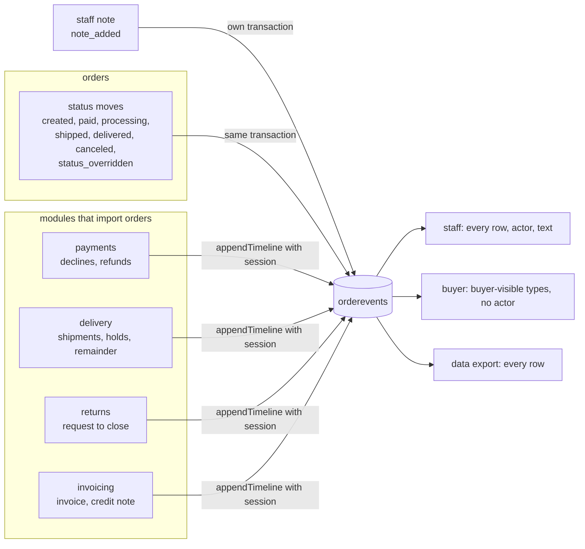

# Order status and timeline

Who may move an order's status, how, and the timeline that records every step.

## Who writes the status {#who-writes-the-status}

| Move                                       | Who asks                                                                         | Through                                                                                                                                                                                                                                        |
| ------------------------------------------ | -------------------------------------------------------------------------------- | ---------------------------------------------------------------------------------------------------------------------------------------------------------------------------------------------------------------------------------------------- |
| `pending` → `paid`                         | `system`                                                                         | `payments`' settlement, on confirm                                                                                                                                                                                                             |
| `paid` → `processing`                      | `system`                                                                         | `POST /orders/{id}/process`, `start:Shipment` — a first shipment or fulfil from `paid` makes it too — or `POST /orders/{id}/override-status`, `override:Order`                                                                                 |
| `processing` → `shipped`                   | `system`                                                                         | `POST /delivery/fulfillment-orders/{id}/shipments` — only the shipment that leaves **nothing** remaining                                                                                                                                       |
| `shipped` → `delivered`                    | `system`                                                                         | `POST /delivery/shipments/{id}/deliver` — only the last arrival, with nothing left to ship                                                                                                                                                     |
| `shipped` → `processing`                   | `system`                                                                         | `POST /delivery/shipments/{id}/mark-lost` — the `reopen` event, one of the two backward moves; `canOverrideTo` stays forward-only, so no override makes it. `order.status_changed` carries it                                                  |
| `delivered` → `processing`                 | `system`                                                                         | A return received with `remedy: replace` — the `reship` event, the second backward move; the replacement leaves through the ordinary shipping door, and its arrival keeps the first `withdrawUntil` and only ever pushes `conformityUntil` out |
| `processing` → `delivered`                 | `system`                                                                         | `POST /delivery/fulfillment-orders/{id}/fulfill` (digital), or a remainder cancel after every shipment arrived — `markFulfillmentComplete`, the one named double move                                                                          |
| `processing` → `canceled`                  | `system`                                                                         | `markUndeliverable`: a lost parcel's remainder was cancelled and refunded and nothing ever arrived — cause `lost`, `refund: false`, no clock. Outside the actor table, so the system cancels stay on `pending`                                 |
| `pending`/`paid`/`processing` → `canceled` | `customer` (own order, `pending`/`paid` only) or an operator (also `processing`) | `POST /orders/{id}/cancel` — **only while nothing has shipped**, conditional on `fulfillment.shipped` in the write's own filter                                                                                                                |

`delivery` never picks one of the shipping rows above. It writes the fulfilment summary and calls
`settleFulfillment(orderId, at, session, actor)`, which reads the order's own status and stored summary
and makes the move the summary makes due (`domain/fulfillment.ts`'s `settlementFor`), or none. A
lost parcel or a replacement calls `reopenForFulfillment`: `shipped` takes `reopen`, `delivered` takes
`reship`, `processing` is already there. The `mark*` steps beneath are not on the barrel. The summary
write never settles by itself: an admin override to `shipped` commits before its sync runs, and
settling from "units remain" would undo it.

### The fulfilment summary

`orders` cannot import `delivery` (the arrow points the other way), so the order carries a small
summary of where its goods stand, written **only** through `orderService.recordFulfillmentProgress`,
which `delivery` calls inside its own transaction:

| Field                         | Meaning                                         |
| ----------------------------- | ----------------------------------------------- |
| `fulfillment.shipped`         | at least one shipment exists                    |
| `fulfillment.remaining`       | units not shipped and not cancelled             |
| `fulfillment.onHold`          | of those, units in `on_hold` fulfillment orders |
| `fulfillment.awaitingStock`   | of those, units on `awaiting_stock`             |
| `fulfillment.undelivered`     | shipments not yet delivered                     |
| `fulfillment.lastDeliveredAt` | the latest `deliveredAt`                        |

It is internal: clients read the order's `fulfillmentStatus` and `actions`. The summary is recomputed
from the fulfillment orders **inside the same transaction** as the write that changed them, so a stale
read can never overwrite a newer one. The doors `delivery` writes through
(`services/fulfillment.ts`, `services/status.ts`) all take the act's session — the shipment, the
summary, the status move and the events commit together or not at all.

`fulfillmentStatus` is derived from the status and that summary. First match wins:

| #   | When                                                                           | Value                               |
| --- | ------------------------------------------------------------------------------ | ----------------------------------- |
| 1   | the status ignores the summary (`pending`, `shipped`, `delivered`, `canceled`) | its trait's value                   |
| 2   | something shipped, units remain                                                | `partially_fulfilled`               |
| 3   | nothing shipped, every remaining unit held                                     | `on_hold` (wins over `in_progress`) |
| 4   | otherwise (`paid`, `processing`)                                               | its trait's value                   |

The per-status half (rows 1 and 4) is the `fulfillment` trait in [the status traits](#status-traits).

**A list row is an `OrderListItem`.** `GET /orders` and `POST /orders/search` answer what the table
renders (number, the four statuses, total and currency, dates, `actions`): no email, address, line or
note. Those come from `GET /orders/{id}`, which is the audited read. See
[a list row is a list item](../reference/responses.md#a-list-row-is-a-list-item).

**Finding an order by the number the customer quotes.** `GET /orders`, `POST /orders/search` and the
CSV export take an exact, indexed `orderNumber` filter (`orders_orderNumber`, unique: a receipt number
names one order). The value is read the way customers type it (`parseOrderNumber`): spaces and a leading
`#` are dropped and the sequence is padded, so `#2026-41` finds `2026-000041`. Anything that is not
`{year}-{digits}` finds nothing, an empty page rather than an error, the same choice as payments'
`transferReference`. It narrows the caller's own scope like any other filter, so a buyer holding only
`read:Order` cannot reach another buyer's order by its number.

`GET /orders?fulfillmentStatus=` lists by that value. The filter is built from the same table
(`fulfillmentStatusFilter`) and ANDed into the caller's own scope, rather than storing a copy of the
answer: the filter and the value a row serializes with cannot disagree, and a unit test holds them to
each other.

The filter (`OrderFulfillmentFilter`) takes every carried value plus one aggregate no order ever
carries, `awaiting_shipment`: `paid` or `processing` (`isAwaitingGoods`), so goods still owed, none or
some already sent. It is the set behind the digest's unshipped row, the sales-orders badge and the
stats card `paidNotShipped`. It keys on `status`, never on refunds, so a canceled order whose money
was kept is out and a partly refunded one that still owes goods is in. Responses keep the six-value
`OrderFulfillmentStatus`.

| Ours                              | Shopify                                                        |
| --------------------------------- | -------------------------------------------------------------- |
| `awaiting_shipment` (filter-only) | `unfulfilled` (null or partial) inside `status=open`, and paid |
| `unfulfilled`                     | `unshipped`                                                    |
| `on_hold`, `partially_fulfilled`  | `on_hold`, `partial`                                           |
| `shipped`, `fulfilled`            | `fulfilled` (filter `shipped`)                                 |

The summary is also why `cancel` and `withdraw` read the order, not its status (and `withdrawBlocked`
carries the reason a withdrawal is refused, so a client disables the button instead of hiding it): a whole-order cancel
refuses once any shipment left (`actions.cancel` is `false`, and the write itself is conditional on
`fulfillment.shipped`), and `isBeforeDispatch` reads `fulfillment.shipped`, not `processing` — a
withdrawal after shipment 1 would otherwise refund goods the buyer already holds. What has not shipped
is cancelled one fulfillment order at a time, through [`returns`](./returns.md#cancelling-what-has-not-shipped).

### Status traits

Every question the module asks of a status alone reads one record,
`ORDER_STATUS_TRAITS` (`domain/status-traits.ts`), declared `satisfies Record<OrderStatus, ...>`.
A status added to the contract fails the build there instead of falling into a default category.

| Trait            | Read by                               | `pending` | `paid`    | `processing` | `shipped` | `delivered` | `canceled` |
| ---------------- | ------------------------------------- | --------- | --------- | ------------ | --------- | ----------- | ---------- |
| `stockCommitted` | `paymentSettled`                      | no        | yes       | yes          | yes       | yes         | no         |
| `beforeDispatch` | `isBeforeDispatch` (with the summary) | yes       | yes       | yes          | no        | no          | no         |
| `withdrawable`   | `canWithdraw`                         | yes       | yes       | yes          | yes       | yes         | no         |
| `fulfillment`    | `fulfillmentStatusOf`, its filter     | see below | see below | see below    | see below | see below   | see below  |

`fulfillment` is a value plus whether the summary may refine it: `unfulfilled` (`pending`,
`canceled`, and `paid` which follows the summary), `in_progress` (`processing`, follows the
summary), `shipped`, `fulfilled`. The edges between statuses are not traits; they live in the
[event table](../understand/tactical-ddd.md#_1-the-order-lifecycle).

### The admin override

A correction the ordinary table above cannot express — a mis-scanned parcel, a shipment recorded
against the wrong order — needs `override:Order`, a step-up permission granted to `admin` by
name. It needs a `reason` and writes a `status_overridden` row on the
[timeline](#the-timeline) (who, when, from → to, reason). It never lands on `paid` (that stays
`system`-only, absolute). Shipping from `paid` is no override: the ship act makes `paid → processing`
itself, and recording an arrival has no forced variant either.

- `POST /orders/{id}/override-status` with `{ to, reason }` moves the status
  alone, forward to `processing`/`shipped`/`delivered` only. No shipped email and no webhook: an override never lands on `paid`, the only status change
  a subscriber hears, and the shipments it cuts for `delivery` are silent too.

The billing correction announces `order.billing_corrected {orderId}` the same way, internal only:
[`invoicing`](./invoicing.md#correcting-the-buyer) cancels and reissues the invoice off it, and dedupes
on the outbox event id.

The status-only door announces `order.status_overridden {orderId, from, to, at}` through the outbox,
in its own transaction, and [`delivery`](./delivery.md#the-status-override) listens: forward to
`shipped` ships every remainder, forward to `delivered` delivers them too, all at `at` — the same
instant `withdrawUntil` was counted from. A forward move to `shipped` or `delivered` is **refused while any unit awaits stock**
(`ORDER_OVERRIDE_AWAITING_STOCK`): it would ship goods the stock ledger never counted out. A move to
`processing` ships nothing, so it is allowed.

`PUT /orders/:id` carries no `status` field at all — the override's own doors are the only way
to reach `processing`/`shipped`/`delivered` outside the ordinary sequence, override holder included.

A digital-only order has no shipment to have left, so an override into `shipped` is refused with the
same 409 as any other illegal target; `delivered` stays reachable.

An override into `shipped` or `delivered` also takes whatever is left of the order's hold off the
shelf (`inventory.shipForOrder`), in the same transaction as the status write — the same dispatch a
normal shipment triggers for its own units. An override into `processing` moves no stock. A hold
already `shipped` makes the second call silent.

## The timeline {#the-timeline}

What happened to an order, a page at a time, newest first: `GET /orders/{id}/timeline`. One append-only collection,
`orderevents`, owned by `orders` and typed as an `AppendOnlyLedger` (the stock-movement precedent).
It is its own collection because the alternatives fail: an array on the order collides with the
conditional status writes siblings make in their own transactions, the audit log expires on a
window (`NODE_AUDIT_RETENTION_DAYS`), and rebuilding from the siblings would need reads `orders` may not make.

**Two writers, one door.** `orders` writes its own moves inside the move's transaction (the
`markPaid`, `markProcessing`, `markShipped`, `markDelivered` and `markFulfillmentComplete` steps take
an `actor`). A module that depends on `orders` calls `orderService.appendTimeline(orderId, entry,
session)` in its own transaction, so a row commits with the fact it describes or not at all, and a
write that lost its race leaves no row. `orders` cannot listen to them: they import it.

**Paged as a log.** Staff notes make an order's history grow without limit (the only cap is the
note rate limit, per staff account), so the read takes `page`/`pageSize` and answers `{ items, meta }`,
newest first, with no `sort` (a log: [Sorting](../reference/sorting.md#lists-with-one-fixed-order)). The
buyer's audience is part of the query, not a filter on the page, so `meta.totalItems` and every page
count only rows that caller may read. Offset paging on a list that grows at its head can shift a row
onto the next page; the order page dedupes by row id when it loads older rows. The index
`{ orderId, at, _id }` serves it; `_id` closes the order.

**Types and audience.** `domain/timeline.ts` decides, per type, whether the buyer may read it
(Magento's `is_visible_on_front`, WooCommerce's `is_customer_note`); a private row is hidden whole,
never stripped field by field. The set of types is the contract's `OrderTimelineType` (a contract test
holds it equal to the variants' own `type` enums), so a type added there without an audience row
fails the test, and one added to a variant without it fails to compile. Each row carries its own `audience`
(`buyer` or `staff`) on the wire, so a staff screen marks which rows the buyer cannot see without
keeping a copy of this table.

The audience of every type is `domain/timeline.ts`, and the types are the contract's `OrderTimelineType`.
Two belong to a billing correction: `billing_corrected` (staff: who changed the buyer's invoice details)
and `invoice_corrected` (buyer: the replacement invoice and the credit note that cancelled the old one).

**What `data` holds, per type.** The wire carries one `oneOf` variant per kind of row, told apart by
`type` (a discriminator with a many-to-one `mapping`; the export's `OrderTimelineExportEntry` has
the same variants over `OrderTimelineExportEntryBase`). Each variant's `data` is closed and required,
and is written out in `OrderTimeline*` of `src/modules/orders/openapi.yaml`; `TimelineEntryInput` is
derived from it, so a writer that passes the wrong `data` for its `type` fails to compile.

Money is a `DecimalAmount`. A code a sibling module owns (a refund's reason, a dispute's status, a
hold's reason) is a plain string whose description names the owner's enum: `orders` cannot
`$ref` a module that depends on it. `text` exists only on `status_overridden` and `note_added`.

A row holds ids, codes and numbers in `data`. Never a sibling's free text: `returns`' `note` and
`declineMessage`, `delivery`'s hold note are reaped on their own clocks, and a copy here would
outlive the original. The free text `orders` owns is an override's reason and a staff note (`text`).

**GDPR.**

- Rows live as long as the order, and go with it on a hard delete.
- `text` has its own clock, `NODE_ORDER_EVENT_TEXT_RETENTION_DAYS`, counted from the row's own
  instant and swept by `npm run job reap:orders`. The order's clock starts only at erasure or
  inactivity, so a live customer's text would otherwise never go. The row stays.
- An erased account loses its name on every row it made (`actor` unset), staff or buyer.
- The buyer's data export (`orderTimeline` section of `POST /account/export`) carries every row of
  their own orders, staff text included: the export is their data, the screen is a view. An `actor`
  appears only when it is the exporting account itself; which staff member wrote a row stays in the
  audit log (CJEU Pankki S, C-579/21). Returns, holds and the purchase hold follow the same rule.
- The buyer's own screen never shows `actor`: who at the shop did something is the shop's business.
- A staff note's text also goes with the order's erasure (`scrubBatch` unsets every row's `text`).

### Staff notes

Staff have somewhere on the order to record a call or an agreement (Shopify's staff-only comment,
WooCommerce's and Magento's private order notes): `POST /orders/{id}/timeline/notes` with
`{ "text": "..." }` (1 to 2000 characters), and a note box above the timeline on the order page for
holders of `update:Order`.

| Rule        | What it does                                                                                                                                                                           |
| ----------- | -------------------------------------------------------------------------------------------------------------------------------------------------------------------------------------- |
| Answer      | `201` with the `note_added` entry and `Location: /orders/{id}/timeline/notes/{entryId}`, the URI of its `DELETE`. The entry's `id` is the timeline row's own id                        |
| Audience    | `staff`: the buyer's timeline never lists it. It is the buyer's data, so `POST /account/export` carries it, without its author                                                         |
| At rest     | `text` is AES-GCM under the PII key ring, bound to the order id (`orders:timeline-note:<orderId>`). `appendTimeline` encrypts, the presenter decrypts; `reencrypt` walks it too        |
| Withdrawing | `DELETE .../notes/{entryId}` unsets the text in one conditional write; the row stays, without text (GDPR Art. 16 and 17). A second call, a non-note row or another order's id is `404` |
| Audit       | `admin.order.note_added` and `admin.order.note_deleted`: the entry id and the text's LENGTH, never the text                                                                            |
| Budget      | `NODE_ORDER_NOTE_RATE_LIMIT_MAX` per account, after the permission check                                                                                                               |
| Text clock  | `NODE_ORDER_EVENT_TEXT_RETENTION_DAYS`, like every other `text`                                                                                                                        |

The form tells the writer that customers do not see a note on their order but receive it if they ask
for their data, and not to put phone numbers, addresses or health details in it.

Not built: `email_sent`. Mails are fire-and-forget (`enqueueEmail` never rejects), so a truthful row
would mean moving every mail call inside the sender's transaction, and it would still only say
"queued". A mailer-side log with the provider's delivery status is the honest shape, if it is ever wanted.

## Read next

- [orders](./orders.md) — the module's own page
