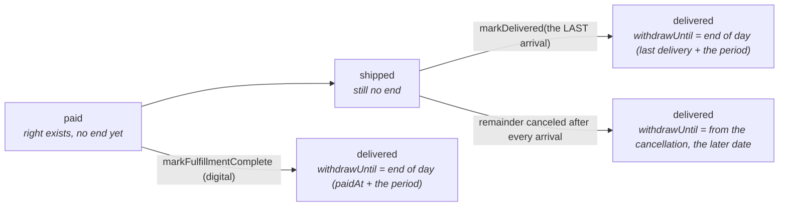
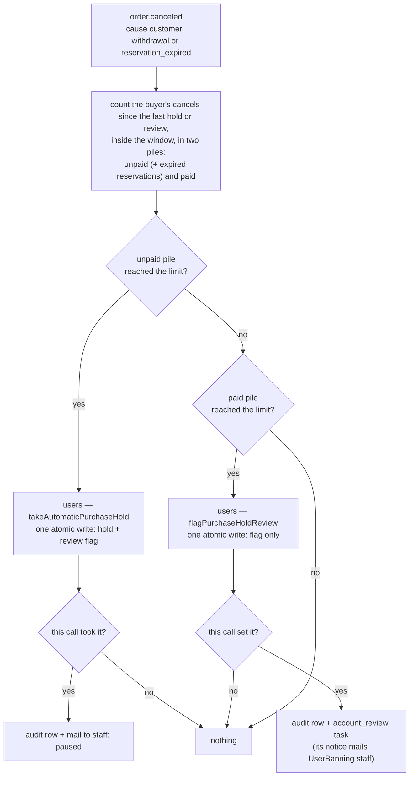

# Withdrawal window, purchase hold and shop identity

The three order rules that depend on time and on who the shop is: the withdrawal window, the purchase hold and the shop identity an order freezes.

## The withdrawal window {#the-withdrawal-window}

The EU right of withdrawal (Consumer Rights Directive Art. 9 and 11a) is decided here and made in
[`returns`](./returns.md#the-withdrawal-button). `orders` cannot import `returns`, `payments` or `delivery`, so what it
owns is the clock and the button:

- **`conformityUntil` is frozen beside it**, two calendar years from the arrival plus seven days of margin, to the end of that UTC day (the legal guarantee of conformity); `returns` judges a defect or a wrong item by it, see [the two deadlines](./returns.md#the-two-deadlines).
- **`withdrawUntil` is frozen, never recomputed** — the same "freeze the fact at the moment it
  happens" rule `shippingCost` and `currency` follow, so a config change cannot move a promise
  already made. Goods count from delivery (Art. 9(2)(b)); digital content from the conclusion of the
  contract (Art. 9(2)(c)), which is `paidAt` here. An order that arrives in several shipments has ONE
  window, from the last good (Art. 9(2)(b)(i), Commission Notice 2021/C 525/01 §5.1.2: "a single
  withdrawal period should apply from the day after delivery of the last item"): `delivery` reports the
  LAST arrival through `markDelivered(orderId, deliveredAt)`, and a remainder cancelled after every
  shipment arrived counts from the later of the two, since the order only became complete then.
  `orders` cannot read `delivery`'s own timestamps.
- **The window ends with the last hour of its last day.** The day of the event is not counted and
  the last day of the period is counted whole (CRD recital 41 → Regulation 1182/71 Art. 3(1),
  3(2)(b)), in UTC. A date in an email is the opposite case: staff type it on the shop's clock, so it
  is printed in `NODE_SHOP_TIMEZONE`; a promised day (`releaseDate` on a line, `agreedAt` and
  `expectedAt` in `delivery`) is likewise sent and answered as that shop day (the delivery mails, the order confirmation, the bank-transfer
  deadline with its zone named, the API-key expiry in UTC, named).
- **One silent grace day.** `withdrawUntil` is the last day the buyer is **told**; a withdrawal is
  accepted one UTC day past it (`withdrawalClosesAt`, the end of the next UTC day). The delivery
  mail, the timeline row and the withdrawal panel print that announced date only, as "until the end
  of 5 December", with no time and never the grace day, so nobody gets fewer days than their own
  count and nobody is shown a date later than the real close. The grace day is enforced in one place
  per door: the button (`withdrawalRefusalOf`), `POST /returns` and the remainder cancel
  (`returns`' `frozenDeadlinesOf`, `cancel-right`). It is UTC on purpose: no shop-calendar maths.
- **No weekend or holiday roll-over is computed.** Art. 3(4) moves a deadline that lands on one to
  the next working day; closing early would be illegal, offering more never is. So the period is
  long enough that the move cannot matter:

    |                                                                    | days |
    | ------------------------------------------------------------------ | ---- |
    | the legal period                                                   | 14   |
    | longest weekend + holiday run in any EU country (Denmark's Easter) | +5   |
    | the silent grace day (it also absorbs the UTC day counting)        | +1   |
    | needed                                                             | 20   |
    | minimum, a day to spare                                            | 21   |

    The default is 30, a common return window.

- **The guarantee carries its own margin.** `conformityUntil` is two calendar years from the
  arrival, to the end of the UTC day seven days later. It is a minimum that cannot be waived
  (Directive 2019/771 Art. 21), so extra time is never wrong; the same Art. 3(4) roll-over applies:

    |                                                          | days |
    | -------------------------------------------------------- | ---- |
    | the legal period                                         | 2 y  |
    | longest weekend + holiday run in any EU country (Easter) | +5   |
    | UTC day counting                                         | +1   |
    | a day to spare                                           | +1   |
    | margin carried                                           | 7    |

- **Before either has happened the window has no end** — the right exists from the moment the
  contract is concluded, so `withdrawUntil` is absent, not far in the future.
- **The button is server-driven.** `OrderActions.withdraw` is true for the order's own buyer (not an
  operator reading it) while the status is withdrawable and the window is open; `withdrawUntil`
  rides along once the clock has started. A client never counts days.
- An admin override into `delivered` starts the clock at the override, since no delivery timestamp
  exists for it. A digital-only order is the exception: its clock starts at `paidAt`, as it does
  through fulfilment (`withdrawalStartFor` owns that rule).

## The purchase hold {#the-purchase-hold}

A protective pause, not a punishment: a buyer whose UNPAID orders fall through `NODE_PURCHASE_HOLD_CANCEL_COUNT`
(3) times inside `NODE_PURCHASE_HOLD_WINDOW_DAYS` (7) has their NEXT checkout answered
`409 CART_PURCHASE_HOLD`, so a person looks before a bot or a loop does damage. Every cancel is still
processed normally; the rule acts after the third is accepted.

Cancelling a PAID order before dispatch is a statutory withdrawal (Directive 2011/83/EU Art. 9), a
right that needs no reason (BGH VIII ZR 146/15: only trickery or harassment is abuse), so paid cancels
never pause anyone. The same limit and window only FLAG the account for a person to look at. There
are two doors to the same act, the cancel button and a withdrawal through `POST /returns` before
dispatch, and both count.

| Count                | What it counts                                                                                                                                             | What happens                                                                                                                               |
| -------------------- | ---------------------------------------------------------------------------------------------------------------------------------------------------------- | ------------------------------------------------------------------------------------------------------------------------------------------ |
| **Pause** (and flag) | UNPAID cancels by the buyer, by either door (cause `customer` or `withdrawal`), plus orders whose reservation ran out unpaid (cause `reservation_expired`) | checkout answers `409`, for at most 7 days; staff are mailed ("paused")                                                                    |
| **Flag only**        | PAID cancels by the buyer, by either door                                                                                                                  | nothing is paused; an `account_review` task opens (`user.review_flagged`), and its notice reaches UserBanning staff by bell and mail, once |
| Never counts         | a cancel by staff, an erasure, a payment mismatch; returns after delivery                                                                                  |                                                                                                                                            |

Both counts read the order timeline (`canceled` rows: `by` and, for the system's causes, `cause`),
only the rows after the last hold was set or staff last acted on the account (set or lifted a hold),
and split orders by whether money ever reached them (`paidAt`).

An automatic hold ends by itself when the cancellations that caused it fall back under the limit
(`until` = the oldest counted cancel + the window, or a later one when more were counted), but NEVER
later than 7 days after it was placed (`AUTOMATIC_PURCHASE_HOLD_MAX_DAYS` in `orders/domain/purchase-hold.ts`,
not a setting: a raised window does not lengthen it). A machine's decision stays temporary, and a person
looks at the flag before it ends: staff can lift it, or place a manual hold, which has no maximum. The
account also carries a review flag (`purchaseHoldFlaggedAt`), set with an automatic hold or alone by
the paid count. The flag outlives the hold's end, so an unreviewed pause does not drop off the staff
list; it stays until a staff member acts: placing a hold or `POST /users/{id}/lift-purchase-hold` clears
it and restarts the count from that moment, so the same cancellations never trigger a second hold. The hold is stored on the user (`users` owns it, see
[users](./users.md#purchase-hold)); `orders` only owns the count. Staff are told by a work notice
(`order.purchase_hold_placed` → [shop-tasks](./shop-tasks.md#the-notices): the bell,
and one mail to each member who can ban), an audit row `system.user.purchase_hold_set`
(or `system.user.purchase_hold_flagged` for a flag alone), and the users-list filters
`purchaseHold=true` (held right now) and `purchaseHoldReview=true` (flagged, not yet reviewed). The buyer is told too, by a mail to the account's own
address sent from `users` ([what it says](./users.md#purchase-hold)).

What it never blocks: paying an order that already exists, cancelling your own unpaid orders, a
withdrawal or a return, delivery of paid orders, and the account's own data rights (access, export,
erasure). Because the legal right to withdraw is not the buyer's to lose, a pause is never triggered
by paid cancels, which are the withdrawals that carry money. An unpaid cancel is technically still a
withdrawal, so it stays a grey area (no money is involved, the pause is capped at 7 days and a person
reviews it, but have the terms text checked by a lawyer); the buyer is told how to contest it.

**Why legitimate interest, and the safeguards.** The processing basis is Art. 6(1)(f) with recital 47:
protecting the shop's stock and checkout from abuse. Whether the automatic pause is also an Art. 22
decision is a separate question, and an open one: it refuses a new contract, which the CJEU reads
broadly (C-634/21 SCHUFA, C-203/22 Dun & Bradstreet), but it is short, ends by itself, concerns one
shop and leaves every right untouched. The safeguards are applied as if it were: the buyer is mailed
when it is placed and the cart and profile show the reason and end date, a person can review and lift
it early through the contact page, every set and lift is audited, the data export carries it, the
mail names the right to object (Art. 21), the privacy notice says so (Art. 13(2)(f)), and a staff note
is written as if the buyer reads it. The written balancing test, the DPIA screening note and what is
kept after the hold ends are in [the purchase hold](../understand/data-retention.md#the-purchase-hold).

## Shop identity {#shop-identity}

The legal identity belongs to [account](./account.md#operator-identity) (`operatorIdentity()`, which
the withdrawal notice prints); the return address, the phone and who pays the return postage belong
to [shop](./shop.md). `orders` reads both. A partly-set return address counts as none.

### What the placed-order emails carry

The placed-order confirmation, which every order gets whatever the payment method, ends with the
withdrawal partial (`templates/partials/orders.withdrawal-notice.ejs`). A `bank_transfer` order also
gets the instructions mail, [`payments`'](./payments.md#bank-transfer), which does not carry it. The
text goes in the body,
not behind a link: a web page is not a durable medium (CJEU C-49/11). `withdrawalNotice()` in
`emails.ts` builds it from the official Annex I wording, and picks one of three cases:

| Case    | When                                 | What it says                                                      |
| ------- | ------------------------------------ | ----------------------------------------------------------------- |
| goods   | a withdrawable line ships            | Annex I(A), period from receipt, where goods go, who pays postage |
| digital | every withdrawable line is digital   | Annex I(A), period from the contract; no return paragraphs        |
| none    | every line is excluded under Art. 16 | only the Art. 6(1)(k) sentence: no instructions, no form          |

The "online" sentence is Annex I(A) note 3 as Directive 2023/2673 rewrote it, because the shop has a
withdrawal function (Art. 11a): it points at the order page and promises the acknowledgement on a
durable medium. The Italian is the Official Journal's text, copied, not translated.

Lines excluded under Art. 16 are named when others are not. The model form (Annex I(B)) has its "To"
row filled with the shop. The refund and return legs always say 14 days, the statutory figure, even
when the shop offers a longer withdrawal period.

### The two statutory 14-day figures {#the-statutory-14-days}

`domain/withdrawal.ts` is the one home of the numbers the law fixes, whatever withdrawal period the
shop offers. Neither is a setting: when the law changes, the line changes.

| Constant                    | Law                             | Counts                                             |
| --------------------------- | ------------------------------- | -------------------------------------------------- |
| `WITHDRAWAL_SEND_BACK_DAYS` | Directive 2011/83/EU Art. 14(1) | the buyer's days to send the goods back            |
| `WITHDRAWAL_REFUND_DAYS`    | Directive 2011/83/EU Art. 13(1) | the shop's days to refund, from the day it is told |

`withdrawalRefundDueBy(informedAt, timeZone)` is the refund deadline: the end of the **shop's** day
that is 14 days after the day the shop was told. The day itself does not count (Regulation 1182/71
Art. 3), and the shop's calendar is used because the refund is the shop's action (Art. 2(1)).
There is no weekend roll-over on purpose: Art. 3(4) only moves a deadline later, and paying
earlier is always lawful. `returns` and `payments` stamp the result on the refund record, see
[the refund deadline](./returns.md#the-refund-deadline).

## Read next

- [orders](./orders.md) — the module's own page
