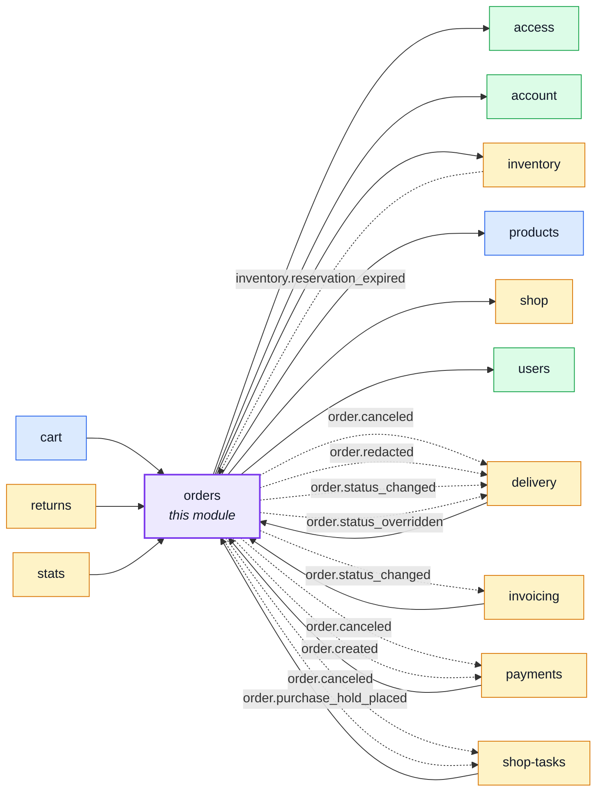
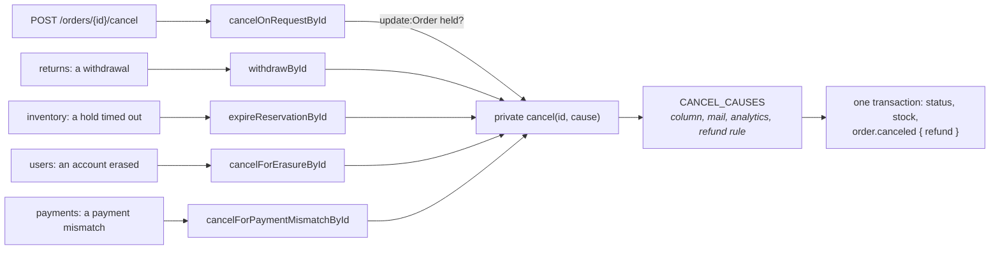
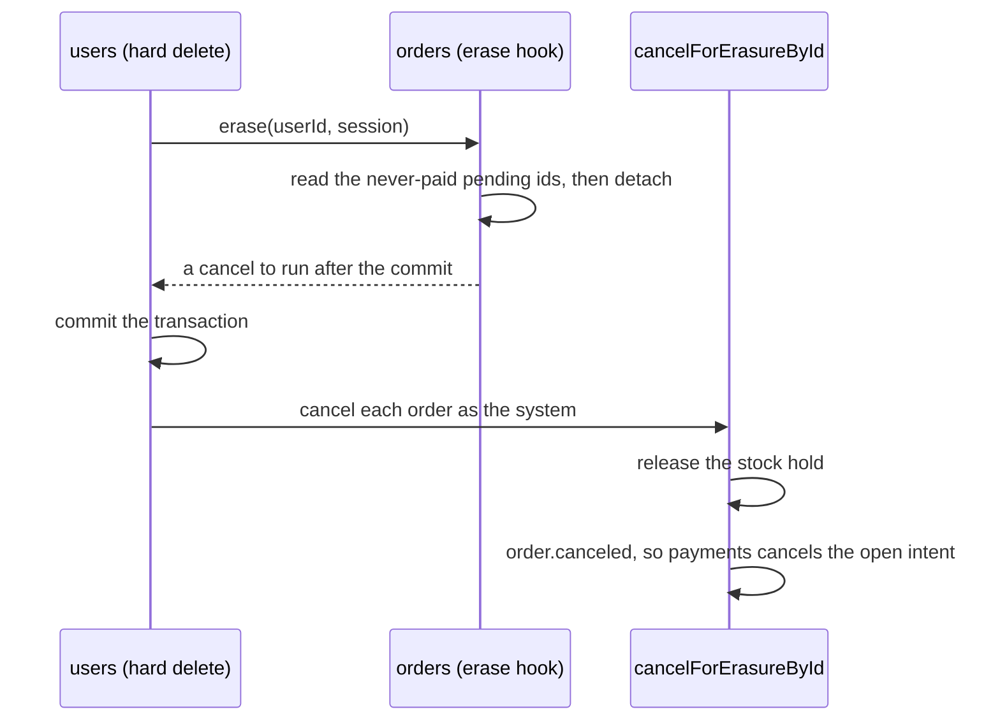
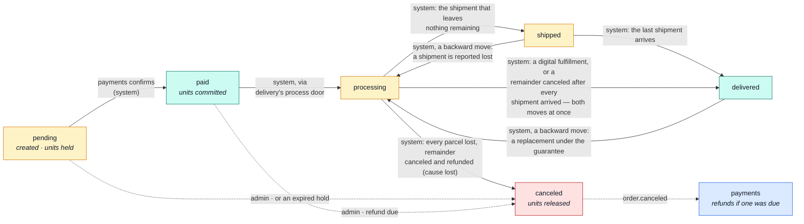
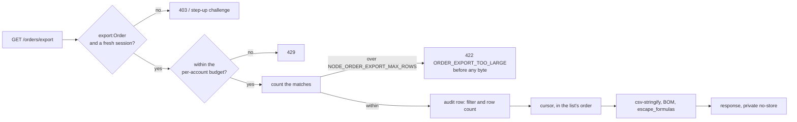
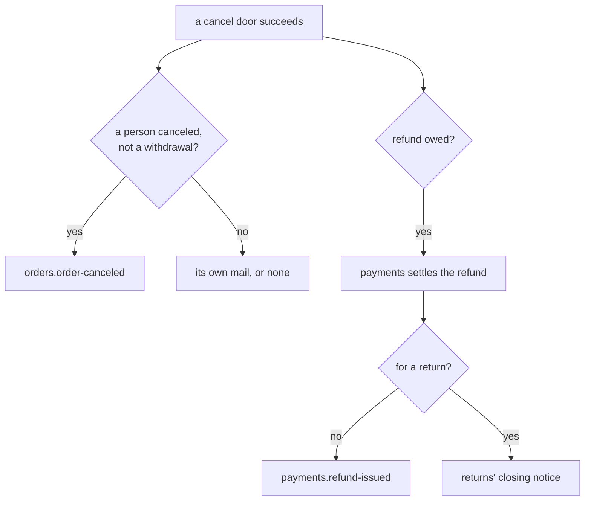

# orders

What a checkout produces: its status machine, its totals and its invoice link.

::: tip At a glance
**Owns** — placed orders: the line items frozen at purchase time, the status machine, and what cancelling restores.
**Depends on** — [`access`](./access.md) for the audit flag of a cancel on the caller's own order, [`inventory`](./inventory.md) for the units, [`products`](./products.md) for the shape it embeds, [`shop`](./shop.md) for the currency and seller, and [`users`](./users.md) for a buyer's locale and the erase hook.
**Breaks if you change** — the `status` enum. `delivery` (status change, cancel, override), `payments` (cancel) and `invoicing` (status change) react to transitions in it, and `webhooks` relays them.
:::

## Its neighbourhood

<!-- module-graph:orders:start -->

_Solid arrows are imports. Dotted arrows are domain events — the return path an import
graph cannot see._

<!-- module-graph:orders:end -->

## Who can do what

Every rule this module declares and who holds it, role by role. The rule is what a route guard asks for; the set is what a role lists.

<!-- permissions:start -->

| Rule             | Set             | `guest` | `unverified` | `customer` | `manager` | `warehouse` | `support` | `editor` | `moderator` | `admin` | `operator` | Credential | What it lets them do                                                                                                                  |
| ---------------- | --------------- | ------- | ------------ | ---------- | --------- | ----------- | --------- | -------- | ----------- | ------- | ---------- | ---------- | ------------------------------------------------------------------------------------------------------------------------------------- |
| `read:Order`     | `OrderOwn`      | —       | ✅ own       | ✅ own     | ✅ own    | ✅ own      | ✅ own    | ✅ own   | ✅ own      | ✅ own  | —          | —          | Read the caller's own orders.                                                                                                         |
| `display:Order`  | `OrderDisplay`  | —       | —            | —          | ✅        | ✅          | ✅        | —        | ✅          | ✅      | —          | ✅         | Read every order in the shop — the support desk and the warehouse, who help with or pack an order that is never their own.            |
| `create:Order`   | `OrderCreation` | —       | —            | —          | ✅        | —           | —         | —        | —           | ✅      | —          | ✅         | Raise an order on someone else's behalf. Checking out is not this key.                                                                |
| `update:Order`   | `OrderEditing`  | —       | —            | —          | ✅        | —           | —         | —        | ✅          | ✅      | —          | ✅         | Move an order along its status path.                                                                                                  |
| `delete:Order`   | `OrderRemoval`  | —       | —            | —          | ✅        | —           | —         | —        | —           | ✅      | —          | ✅         | Remove an order.                                                                                                                      |
| `override:Order` | `OrderOverride` | —       | —            | —          | —         | —           | —         | —        | —           | ✅ ⚡c  | —          | —          | Skip the normal lifecycle gate to force a delivery move, or correct a status by hand, with a recorded reason.                         |
| `export:Order`   | `OrderExport`   | —       | —            | —          | ✅ ⚡s    | —           | —         | —        | —           | ✅ ⚡s  | —          | —          | Take every order out of the shop as a CSV file, customer emails included. An API key cannot use it, since its step-up needs a person. |

✅ held · `own` only the caller’s own rows · ⚡c / ⚡s needs a freshly proved session (critical / sensitive) ·
Credential: ✅ when an API key can be minted with the rule. Generated from the rules and sets in
`src/modules/*/authorization.yaml` and the roles in `shared/rules/authorization-roles.yaml`, asked of the
evaluator — [Authorization](../understand/authorization.md) explains the model.

<!-- permissions:end -->

## The story

This is the module with the real invariants: what an order totals, which status transitions are
legal, and what cancelling gives back. If any module here ever grows a proper aggregate, it is
this one.

**An order embeds a snapshot of the catalogue row rather than referencing it.** `items` carries its
own `orderLineProductSchema` — the OpenAPI `OrderLineProduct` shape, not `Product` — populated at
purchase time from [`products`](./products.md)'s live row, so a later edit cannot rewrite the
history of an order placed last March. It is deliberately its OWN schema rather than a reuse of
the catalogue's: `onHand` and `reserved` describe the warehouse right now, and an order line has no
path to store either — the alternative is an invoice that quietly republishes live stock as if it
were history.

The snapshot's `title`/`description` are already RESOLVED, not the product's raw fallback-locale
column: `items[].locale` (required on `OrderItem`) freezes which language they were resolved into at
purchase time, so an order confirmation and its invoice read in the buyer's language rather than
whatever the storefront happened to be showing. Reading the order back later must reproduce exactly
that, never re-resolve against whoever is reading it now — see
[Internationalisation](../understand/i18n.md#tier-3-user-authored-content).

The snapshot also freezes what a preorder promised: `preorder: true` and the `releaseDate` the
buyer saw. Both are decided once at checkout and never re-derived: the date passing, or an admin moving
it, must not change what this order bought (CRD Art. 18 treats the date shown when ordering as the
agreed one), and a bank transfer may be paid a week after the order was placed.
[`delivery`](./delivery.md) groups the lines into fulfillment orders from this frozen pair, and the
hold takes the product's preorder allowance instead of a shelf unit.

The status enum is the module's public vocabulary:

| Status                  | What it means                                | Who moves it                                                                                                                                                             |
| ----------------------- | -------------------------------------------- | ------------------------------------------------------------------------------------------------------------------------------------------------------------------------ |
| `pending`               | created, unpaid, units held                  | checkout or an admin                                                                                                                                                     |
| `paid`                  | money taken, units committed                 | [`payments`](./payments.md) on confirm                                                                                                                                   |
| `processing`            | fulfilment started                           | [`delivery`](./delivery.md), reporting a recorded fulfillment-start fact (until that door exists, an admin correction)                                                   |
| `shipped` · `delivered` | fulfilment                                   | [`delivery`](./delivery.md): `shipped` once the LAST unit has left (an order shipped in parts stays `processing` until then), `delivered` once the last shipment arrived |
| `canceled`              | units released, refund issued if one was due | admin, or an expired hold. A product hidden, taken off sale or removed afterwards does not cancel it ([why](./products.md#hiding-taking-off-sale-removing))              |

An operator's cancel (a caller holding `update:Order`) asks for a fresh session first, since it
can refund or keep a paid order's money (`401 REAUTH_REQUIRED` on a stale one); the buyer's own
cancel is never prompted. Holding the key is the whole rule: there is no rank, so an operator
cancels a staff member's order, or their own, like anyone's.

### The cancel doors

Cancelling has one door per reason, over one private `cancel` and one table of causes
(`CANCEL_CAUSES` in `services/cancel.ts`). The reason is a value the caller states by choosing a
door, never inferred from which argument was left out. The table decides the lifecycle column the
move is read from, the mail, the analytics event name and whether the caller picks the refund.

| Door                           | Cause                 | Column     | Buyer is mailed        | Refund                                |
| ------------------------------ | --------------------- | ---------- | ---------------------- | ------------------------------------- |
| `cancelOnRequestById`          | `customer`            | customer   | the cancelled notice   | always                                |
| `cancelOnRequestById`          | `operator`            | admin      | the cancelled notice   | the operator's `refund`, default true |
| `withdrawById`                 | `withdrawal`          | withdrawal | `returns` acknowledges | always                                |
| `expireReservationById`        | `reservation_expired` | system     | the expiry notice      | whatever was paid                     |
| `cancelForErasureById`         | `erasure`             | system     | nobody                 | whatever was paid                     |
| `cancelForPaymentMismatchById` | `payment_mismatch`    | system     | nobody                 | whatever was paid                     |
| `markUndeliverable`            | `lost`                | system     | nobody                 | none: the remainder cancel refunded   |

The one door that serves two actors, `cancelOnRequestById`, resolves which inside the service: a
caller holding `update:Order` is the operator. The controller never makes that decision. A new
reason is a new row and a new door.

Any of these except `paid` (`system`-only, absolute) can also be reached by an admin override with
a reason — see [Who writes the status](#who-writes-the-status) below.

::: warning Two modules reach back, and both do it through events
[`inventory`](./inventory.md) cancels an order when its hold times out (`inventory.reservation_expired`), and
this module announces `order.canceled` with the `refund` it owes, so [`payments`](./payments.md)
can open the refund from the same outbox row. Neither is an import, which is what keeps a mutually-aware pair acyclic.
The `refund` flag is the cancel's policy, for `payments` alone: the public `order.canceled` webhook
carries only `{ orderId }`, since "owed" is not "paid back", and a subscriber hears `payment.refunded`
when money actually moved.
:::

Each account reads back only its own orders; writing and soft-deleting is admin-only, and an order can be soft-deleted (hidden) only once it is `canceled`. The
`userId: 1, deletedAt: 1` index is what makes both of those cheap at once.

One scheduled job via `docker/crontab`: `npm run job reap:orders`, nightly, replaces an order's
remaining PII (email, shipping name/phone/street, notes) with placeholders once
the order's claim window has closed (a never-paid order at once, a delivered one after `conformityUntil`, an undelivered paid one 540 days after `paidAt`; [the rule](../understand/data-retention.md#orders-after-the-account)) — amounts, line items and dates survive, only the person is gone. An account inactive past `NODE_INACTIVE_MINIMISE_DAYS` starts the same clock through this
module's `personalData.minimise` hook, keeping its `userId`; a live, active account's orders keep
their personal fields, since order history is part of the contract
([why](../understand/data-retention.md#orders-kept-while-the-account-lives)). Each scrub is announced:
the sweep works in batches of 500, and a batch scrubs its orders and writes one `order.redacted`
outbox row each (`data: { orderId }`) in the same transaction, so the
[webhook](./webhooks.md) exists exactly when the scrub does (GDPR Art. 19). It fires when the data
goes, not at the erasure, which only detaches `userId`. An admin can still hard-delete an order, but only one that is `canceled` and was never paid
(`services/remove.ts`'s `remove`): the cancel owns every end-of-order effect (stock, payment intent,
`order.canceled`), so an open order answers 409 `ORDER_NOT_CANCELED` until it is cancelled. This
reap is what protects the far more common case, the order nobody ever deletes. An order that was
never paid but was handed money after its cancel (a transfer or card payment that landed late, and
its refund) refuses it too, 409 `ORDER_HAS_MONEY_HISTORY`: `payments` stamps `moneyReceivedAt`
(`markMoneyReceived`) in the settlement's own transaction, and the delete filters on it, so a
payment landing mid-delete turns it into the 409. A paid order refuses
a hard delete instead (409 `ORDER_INVOICED`), once and for as long as `paidAt` is stamped:
`invoicing` freezes a legal document from that same transition, and it must survive the order it
was issued for. The refusal does not trust the document the caller read: the hard delete is one
`deleteOne` that filters on `status: canceled` and `paidAt: null`, so a settlement or a reopen
that commits in between turns it into the matching 409. Restoring a soft delete of an order that is
not hidden answers 409 `ORDER_NOT_DELETED`; `actions.restore` says when it would be accepted.

## When the account is erased

A hard delete of an account runs `orders`' `personalData.erase` hook inside the erasure
transaction. Two things happen to the account's orders, by whether the buyer ever paid:

| Order                                           | What erasure does                                                                      |
| ----------------------------------------------- | -------------------------------------------------------------------------------------- |
| Paid (`paidAt` set), in any status              | Detached (`userId` unset) and scheduled for scrubbing, nothing else: it is the invoice |
| Never paid (`paidAt` unset) and still `pending` | Detached, due for scrubbing at once, **and cancelled**                                 |

The cancel is the system's own (`cancelForErasureById`, the lifecycle column the reservation
sweep's expiry uses), so it releases the hold and, through `order.canceled`, cancels the payment
intent. It runs after the commit because it
moves stock and talks to a provider, neither of which a rolled-back erasure could undo. It sends
no mail: the address belongs to an account that no longer exists. A failed cancel is logged and
never undoes the erasure; the sweep still cancels it when the hold times out (up to 168 hours for
a bank transfer).

## Creating an order

Every order, whoever makes it, is written through exactly one function — `placeOrder`
(`services/place.ts`): freeze the lines against the catalogue, hold the stock, allocate the order
number, write the row. A `bank_transfer` order's reference, instructions and payment are
[`payments`'](./payments.md#bank-transfer): its `order.created` listener opens them. **The hold comes before the write, deliberately**: a refused hold then writes
nothing at all — no order to roll back and no order number burned on a sale that never happened.
Everything caller-specific — payment-method validation, the open-order cap (owned by `cart`), resolving a shipping
address or method, cart pre-flight and clearing — stays with the caller; `placeOrder` only takes
what it needs to hold and write. See [Checkout](./cart-checkout.md#the-sequence) for the storefront
path in full.

An order placed through checkout freezes the `termsVersion` in force at placement, as it freezes its
`currency`; a staff-placed order carries none. The label is evidence only together with the
operator's archive of each version's text (CRD Art. 6(9)). `GET /config` shows the version in force
now. See [Terms version](./account.md#terms-version).

A line the shelf only half covered carries what it owes, frozen like the rest of it: `backorderedQuantity`
(how many of `quantity` were owed), `promisedAt` (the product's restock date, else the day it was
placed plus 30 days; stored as that instant, answered as the shop day) and `promiseDated` (whether that was a date the product named). The confirmation
email prints each line's promise, `ships from {date}` for a preorder and `{n} to arrive by {date}` or
`within 30 days` for owed units (CRD Art. 8(7)(a)); `delivery` reads the same frozen fields to make a
fulfillment order of the owed part.

Two frozen addresses ride on the order, both snapshots like the lines (an order keeps where it went
and whom it was billed to, not what the address book says today):

| Field             | Present when                                                | Read by                                |
| ----------------- | ----------------------------------------------------------- | -------------------------------------- |
| `shippingAddress` | a line ships to an address (not digital-only, not a pickup) | the warehouse, the order page          |
| `billingAddress`  | every checkout order                                        | the invoice (Art. 226), the order page |

The split is Shopify's: a digital-only order is invoiced to someone but ships nowhere, so it freezes
no shipping address. Billing is "same as shipping" unless the buyer names another entry
([how checkout resolves it](./cart-checkout.md#the-sequence)); the admin's `POST /orders` runs no
checkout and carries neither. The retention scrub unsets both, with the notes.

Both addresses and the notes are stored encrypted (`pii.ts`, AES-256-GCM, the order `_id` in the
associated data) and decrypted in `applyOrderTransform`'s `after` hook, so no reader sees
ciphertext and `GET /orders` has no `notes` filter: an encrypted field cannot be searched. The
write door is `orderRepository.create`, which every writer goes through. `orders.email` stays
plaintext, because it is filtered and sorted on. Why an explicit codec, not mongoose getters:
`toJSON` would ship ciphertext, copying a foreign subdocument would double-encrypt, and a setter
runs on query filters, so an encrypted path in a filter silently matches nothing. The invoicing
issuers decrypt the order's address (`billingAddressOf`) and re-encrypt it under the invoice's own
id (`invoicing/pii.ts`); only the PDF render decrypts it again.

`POST /orders` is the OTHER caller — the admin path — and it is deliberately minimal, because it
exists for manual corrections, not as a second sales channel:

- it takes a buyer, an email and line items, and nothing else — no payment method, no address, no
  shipping method, and no frontend screen behind it;
- staff may sell a hidden or off-sale product by hand (the shopper's shelf rules are checkout's, not
  this door's); only a removed (soft-deleted) one is refused with `409 ORDER_PRODUCT_UNAVAILABLE`,
  every one named in `details.productIds`. The product is read through the caller's own scope, so a
  role without `display:Product` gets `404` for a hidden or removed product and an order never
  copies a product its caller may not read;
- it holds stock for the default reservation window like any other order, so an unpaid correction
  order is cancelled by the same reservation sweep as an abandoned checkout, and its buyer gets the
  same hold-expiry notice (`orders.order-hold-expired`): they were sent the confirmation, so the
  cancel is told too;
- carrying no address or shipping, it cannot be fulfilled through the warehouse's normal
  ship/deliver flow — moving it forward is the admin override's job (see below), not a parcel
  someone can actually hand over.

## The pipeline

The status enum above, drawn. Every solid edge is someone deciding; the dotted ones are this
module announcing and a sibling reacting.

Every one of these edges is still written by `orders` alone — `delivery`, `payments` and an admin
override all ASK for a move, never assign the field themselves. See
[Tactical DDD](../understand/tactical-ddd.md#who-writes-the-status) for the placement rule and
[Who writes the status](#who-writes-the-status) below for the permission rule and the override.

## Who writes the status {#who-writes-the-status}

Full detail: [Order status and timeline](./orders-status-and-timeline.md#who-writes-the-status).

### The fulfilment summary {#the-fulfilment-summary}

See [Order status and timeline](./orders-status-and-timeline.md#the-fulfilment-summary).

### Status traits {#status-traits}

See [Order status and timeline](./orders-status-and-timeline.md#status-traits).

### The admin override {#the-admin-override}

See [Order status and timeline](./orders-status-and-timeline.md#the-admin-override).

## The timeline {#the-timeline}

What happened to an order, a page at a time, newest first: `GET /orders/{id}/timeline`. One append-only collection,
`orderevents`, owned by `orders` and typed as an `AppendOnlyLedger` (the stock-movement precedent).
It is its own collection because the alternatives fail: an array on the order collides with the
conditional status writes siblings make in their own transactions, the audit log expires on a
window (`NODE_AUDIT_RETENTION_DAYS`), and rebuilding from the siblings would need reads `orders` may not make.

Full detail: [Order status and timeline](./orders-status-and-timeline.md#the-timeline).

### Staff notes {#staff-notes}

See [Order status and timeline](./orders-status-and-timeline.md#staff-notes).

## The CSV export

`GET /orders/export` answers the list's filters as one `text/csv` file, for reconciliation and the
accountant. A staff-only door, and a sharp one: the file holds every matching customer's email.

| Question              | Answer                                                                                                                                                                                                                                   |
| --------------------- | ---------------------------------------------------------------------------------------------------------------------------------------------------------------------------------------------------------------------------------------- |
| Who                   | `export:Order`: manager and admin, `stepUp: sensitive` (the same tier as exporting your own data). A support desk that can read every order cannot export them (Shopify's separate Export permission)                                    |
| API keys              | Cannot: the step-up needs a session, which a key never has (`requireFreshAuth` refuses without an `authContext`)                                                                                                                         |
| Synchronous, streamed | No file on disk, no reaper, no mailed link: a file that exists can be forgotten and a link forwarded (Art. 5(1)(e)). The account export is a job because it walks every module, not because exports must be                              |
| Route order           | Mounted before `/:id`, or `requireId` answers 404 for the word `export`                                                                                                                                                                  |
| Columns               | The list's, in file order: `createdAt`, `orderNumber`, `status`, `paymentStatus`, `fulfillmentStatus`, `returnStatus`, `email`, `lines`, `units`, `total`, `currency`, `paymentMethod`, `paidAt`. No address: both are encrypted at rest |
| Email                 | Kept: support and reconciliation need it, and the guards above are what make that acceptable                                                                                                                                             |
| Audit                 | `admin.orders.exported`, with the filter and the row count, never a row. An email filter is recorded only as "an email was given"                                                                                                        |
| Limits                | Own per-account budget (`NODE_ORDER_EXPORT_RATE_LIMIT_MAX`, default 10 a window) and a row cap (`NODE_ORDER_EXPORT_MAX_ROWS`, default 20000)                                                                                             |
| Headers               | `Cache-Control: private, no-store` (ASVS 14.3.2)                                                                                                                                                                                         |

**CSV injection.** `zod.email()` accepts `+cmd@example.com`, so the email column can start a
formula in a spreadsheet. The writer's `escape_formulas` prefixes any cell starting with `=`, `+`,
`-` (except a number), `@`, tab or carriage return with `'`. It does not cover `\0` or the
full-width `＝＋－＠` variants: that gap is known and not handled. See
[injection](../understand/defences/injection.md).

## Reads other modules compose

- `orderService.findManyByIds(ids)` answers each order's number and email, nothing more (no lines,
  no addresses). The staff payments list uses it to name its rows.
- `orderService.paidBuckets`, `productTotals`, `categoryTotals`, `productSeries`, `customerCounts`,
  `cancellationCohort` and `pipeline` are the grouped reads [`stats`](./stats.md) composes: each
  answers a few hundred rows at most, counts live orders only, and dates a sale by `paidAt`.
- `GET /orders` and `POST /orders/search` filter by `createdFrom`/`createdTo` and `paidFrom`/`paidTo`
  (inclusive instants; an unpaid order has no `paidAt`, so no paid bound matches it), by
  `paymentStatus` and `returnStatus`, and sort by `paidAt`. The two statuses are derived on read,
  so each filter value is mapped back to the stored fields behind it (`domain/projections.ts`); the
  integration suite checks every value both ways. `paidAt` is on the wire: the buyer's own fact.
  Scope stays the permission key: `read:Order` alone sees its own orders.
- `GET /orders` sorts by `payBy` (index `{status, payBy}`), which is how the Awaiting-transfer tab
  reads: `?paymentMethod=bank_transfer&status=pending&sort=payBy`.

## The invoice

`orderNumber` is Shopify's `#1001`, not a fiscal sequence: gaps are fine, and it names this
order alone. Its year is the shop calendar's (`NODE_SHOP_TIMEZONE`), the same cut the invoice series
uses, so order `2026-x` never gets invoice `2027-y`. The actual tax invoice — a frozen document, its own numbering series, credit notes on
refund — is [`invoicing`](./invoicing.md), a module this one has no import of and no wiring for:
`invoicing` depends on `orders`, never the reverse, and reaches its own `GET /orders/{id}/invoice`
and `GET /orders/{id}/credit-notes` by sharing this module's `/orders` basePath (the same pattern
[`addresses`](./addresses.md) uses on `/account`).

The only trace of that relationship here is `paidAt` (`model.ts`), stamped by `services/status.ts`'s
`markPaid` in the same write that moves an order to `paid` — the proxy `services/actions.ts`'s
`actions.invoice` flag and `services/remove.ts`'s hard-delete refusal both read, so neither has to ask
`invoicing` whether the freeze actually landed.

The placed-order email carries no invoice: nothing is invoiced yet at that point, whatever the
payment method — see [`invoicing`](./invoicing.md) for where the invoice comes from.

## The withdrawal window {#the-withdrawal-window}

The EU right of withdrawal (Consumer Rights Directive Art. 9 and 11a) is decided here and made in
[`returns`](./returns.md#the-withdrawal-button). `orders` cannot import `returns`, `payments` or `delivery`, so what it
owns is the clock and the button:

Full detail: [Withdrawal window, purchase hold and shop identity](./orders-withdrawal-and-hold.md#the-withdrawal-window).

## Correcting the shipping address

`PUT /orders/{id}/shipping-address` (`update:Order`) replaces where an order ships, for the case a held
`incorrect_address` fulfillment order creates: nothing else could change an address after checkout.
Shopify allows it on a partly fulfilled order too, and Solidus keeps the address a carton shipped to;
the buyer's own edit is a later, optional step.

- Allowed while the order has a shipping address and **units remain to send** (`canCorrectAddress`:
  held and awaiting-stock units count). A parcel already cut keeps the address it went to: each
  [shipment stores its own `destination`](./delivery.md#where-a-parcel-went). Otherwise
  `409 ORDER_ADDRESS_LOCKED`, and `OrderActions.correctAddress` says in advance, so no button is
  offered that the door refuses.
- The country must be on the shop's ship-to list, the one checkout refuses by: VAT is charged at the
  shop's own rates, so a redirect abroad would break what the order was charged.
  `422 ORDER_SHIP_TO_COUNTRY_NOT_SUPPORTED`.
- The new address is encrypted under the order's id like the one it replaces. The staff-only timeline
  row `address_corrected` and the audit row name **who**, never what it says.

## Cancel and refund mails

Every cancel and every refund leaves one written trace, and each has exactly one mail:

| What happened                                      | The mail                                                                                                                              | Template                                                 |
| -------------------------------------------------- | ------------------------------------------------------------------------------------------------------------------------------------- | -------------------------------------------------------- |
| The customer, or staff, cancelled                  | what the cancel did to their money: going back, no refund, or nothing charged                                                         | `orders.order-canceled`                                  |
| The reservation sweep cancelled (a hold timed out) | a hold's expiry notice (a card order or a staff-created one); a transfer's is `payments`' (`cause: reservation_expired` on the event) | `orders.order-hold-expired`, `payments.transfer-expired` |
| The customer withdrew before dispatch              | `returns`' withdrawal acknowledgement                                                                                                 | `returns.notice`                                         |
| The account was erased                             | none: the address belongs to an account that no longer exists                                                                         |                                                          |
| Money went back outside a return                   | the amount, and whether it was everything                                                                                             | `payments.refund-issued` (sent by `payments`)            |
| Money went back for a return                       | `returns`' closing notice                                                                                                             | `returns.notice`                                         |

The analytics event follows the same split: only a hold that timed out reports
`order_reservation_expired`. An erasure's cancel, which also has no request behind it, reports
`order_canceled` like any other, and so does a lost-parcel settlement (`markUndeliverable`, which
reports through `afterCancel` too, as the system actor with cause `lost`: the status move hands the
report back up through `delivery`, and `returns`, which owns the transaction, calls it once the
commit lands).

An anonymised order is never mailed: its email is a `.invalid` placeholder (`mailBuyer` skips it), so
any mail to it would only bounce.

The cancelled mail is sent from the `order.canceled` listener (`services/cancel-mail.ts`, the rule
is [Customer mail](../understand/outbox.md#customer-mail)), so it says what is being returned. The refunded
mail belongs to `payments`, which sends it from its own `payment.refunded` listener once the refund settles, so it only ever says what already went back. A paid
cancel therefore sends both, a few moments apart. A refund the provider refused sends nothing: no
money moved.

## The purchase hold {#the-purchase-hold}

A protective pause, not a punishment: a buyer whose UNPAID orders fall through `NODE_PURCHASE_HOLD_CANCEL_COUNT`
(3) times inside `NODE_PURCHASE_HOLD_WINDOW_DAYS` (7) has their NEXT checkout answered
`409 CART_PURCHASE_HOLD`, so a person looks before a bot or a loop does damage. Every cancel is still
processed normally; the rule acts after the third is accepted.

Full detail: [Withdrawal window, purchase hold and shop identity](./orders-withdrawal-and-hold.md#the-purchase-hold).

## Shop identity {#shop-identity}

The legal identity belongs to [account](./account.md#operator-identity) (`operatorIdentity()`, which
the withdrawal notice prints); the return address, the phone and who pays the return postage belong
to [shop](./shop.md). `orders` reads both. A partly-set return address counts as none.

Full detail: [Withdrawal window, purchase hold and shop identity](./orders-withdrawal-and-hold.md#shop-identity).

## Configuration

| Variable                                                             | Default | Meaning                                                                                                                                                                                        |
| -------------------------------------------------------------------- | ------- | ---------------------------------------------------------------------------------------------------------------------------------------------------------------------------------------------- |
| `NODE_WITHDRAWAL_PERIOD_DAYS`                                        | `30`    | Days a consumer has to withdraw. The legal 14 plus the margin in [the withdrawal window](#the-withdrawal-window) gives a floor of 21, so a smaller value is refused at read; the default is 30 |
| `NODE_ORDER_PII_DAYS_AFTER_GUARANTEE`                                | `0`     | Days after a delivered order's `conformityUntil` before `reap:orders` replaces its remaining personal data with placeholders (once the account is erased or minimised)                         |
| `NODE_ORDER_PII_DAYS_UNDELIVERED`                                    | `540`   | The same for a paid order that ended without delivery, counted from `paidAt`                                                                                                                   |
| `NODE_ORDER_EVENT_TEXT_RETENTION_DAYS`                               | `1095`  | Days after a timeline row's own instant before `reap:orders` unsets the free text staff wrote on it (an override's reason, a staff note). The row stays                                        |
| `NODE_ORDER_EXPORT_MAX_ROWS`                                         | `20000` | Most orders one `GET /orders/export` may carry. Over it: `422` `ORDER_EXPORT_TOO_LARGE`, before any byte of the file                                                                           |
| `NODE_ORDER_EXPORT_RATE_LIMIT_MAX`, `NODE_ORDER_NOTE_RATE_LIMIT_MAX` | —       | Per-account budgets: see [the rate-limit budgets](../understand/security.md#the-rate-limit-budgets)                                                                                            |
| `NODE_ADMIN_ORDER_MAX_LINES`                                         | `100`   | Most lines an admin-created order (`POST /orders`) may carry. Over it: `422` `ORDER_LINE_LIMIT_EXCEEDED`. The contract's own ceiling is 1000; a larger value has no effect                     |
| `NODE_ADMIN_ORDER_MAX_LINE_QUANTITY`                                 | `99999` | Largest quantity on one line of an admin-created order. Same refusal. The contract's ceiling is 999999                                                                                         |
| `NODE_PURCHASE_HOLD_CANCEL_COUNT`                                    | `3`     | How many of a buyer's unpaid cancels inside the window pause their checkout, and paid ones flag the account ([the purchase hold](#the-purchase-hold)). Minimum 2                               |
| `NODE_PURCHASE_HOLD_WINDOW_DAYS`                                     | `7`     | How long a cancel counts toward it                                                                                                                                                             |

The VAT RATES charged against an order line are a different thing with a different owner — see
[products](./products.md#configuration); this module only freezes onto the order the rate `products`
hands it at checkout. Every getter asks its slice (`config.ts`) per call, and the slice parses once per process, so a
correction takes effect on restart.

## Libraries

`csv-stringify` is this module's alone, used by the [CSV export](#the-csv-export). See
[Package Dependencies](../reference/package-dependencies.md) for where it sits among everything else.

| Library                  | Maintained                            | What it costs you                                                                                      |
| ------------------------ | ------------------------------------- | ------------------------------------------------------------------------------------------------------ |
| `csv-stringify` (chosen) | active, typed, MIT, zero dependencies | A Transform stream (so the file is never whole in memory) with `escape_formulas` built in              |
| a hand-rolled writer     | —                                     | quoting, delimiters and formula escaping are exactly the parsing `CLAUDE.md` rules out writing by hand |
| a spreadsheet library    | varies                                | binary formats, a larger tree and no stream: the file would be built in memory                         |

## Read next

- [Modules overview](./start.md) — the whole context map
- [`inventory`](./inventory.md) — where the units actually move
- [`payments`](./payments.md) — the money half of the same transition
- [Tactical DDD](../understand/tactical-ddd.md) — why this is the aggregate candidate
- [Events & Logging](../understand/events-and-logging.md) — `order.canceled` and `inventory.reservation_expired`
