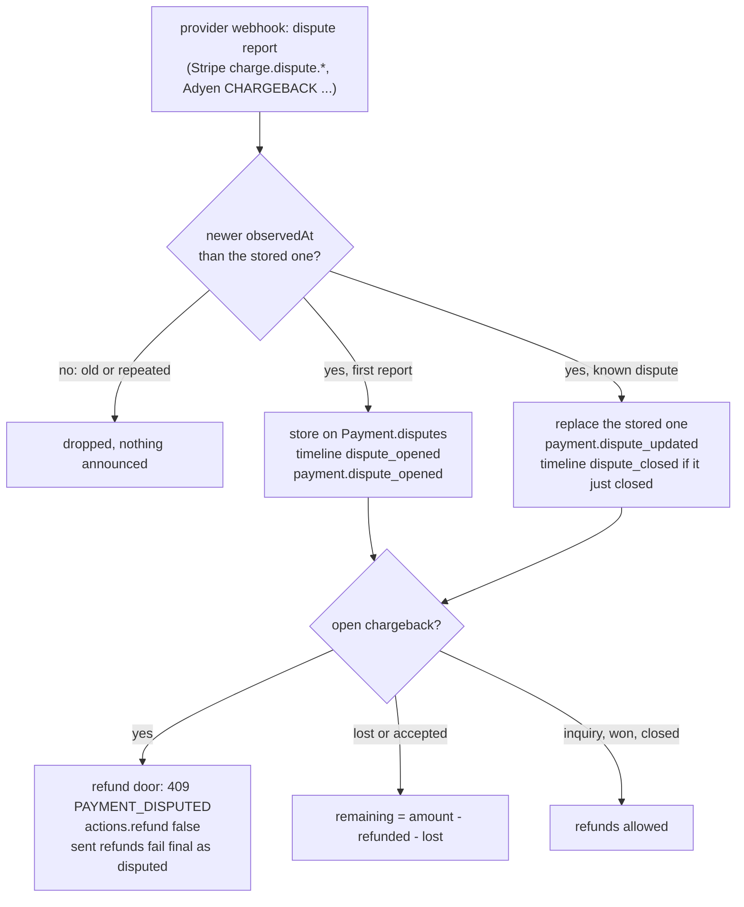
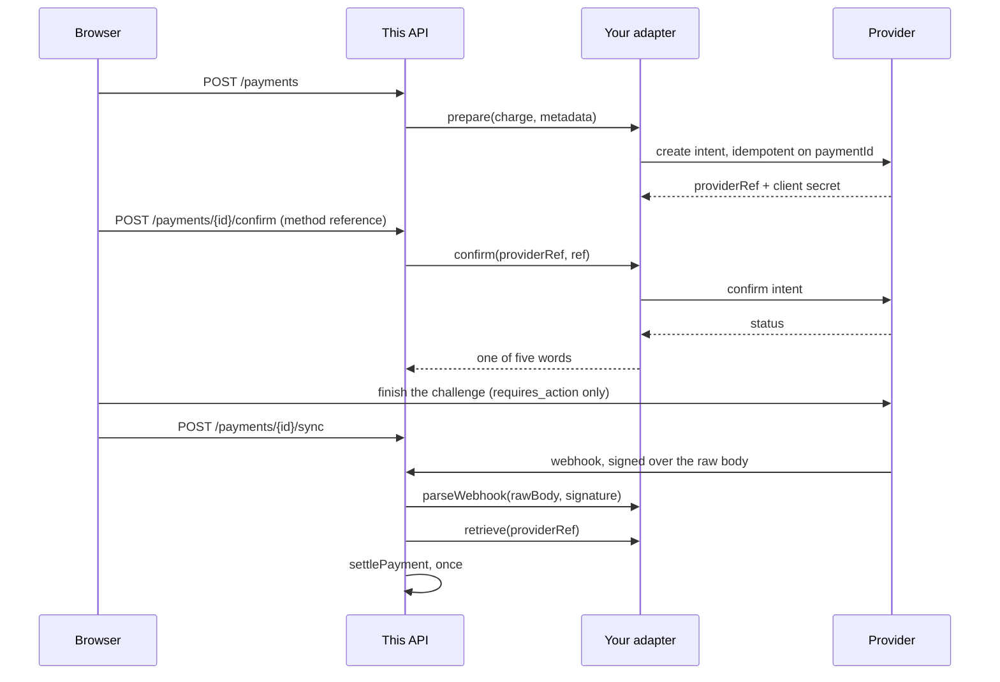

# Disputes and writing an adapter

What happens when a card payment is disputed, and how to write a new payment adapter behind the provider port.

## Disputes {#disputes}

A buyer can ask their bank to take a card payment back. The bank does it at once, and a window of
about 7 to 21 days opens for the shop to send evidence. The application shows the dispute, alerts
staff, and refuses to refund twice; the answer itself is given in the provider's own dashboard.

- **A chargeback is not a refund.** It raises no `payment.refunded`, so no credit note; it changes no
  order status and no `amountRefunded` (Saleor lowers `charged`, not `refunded`). In the EU a lost
  chargeback with no return is a non-payment, not a credit note (VAT Directive Art. 90); in Italy that
  holds outside insolvency (DPR 633/72 art. 26). Have an accountant confirm it for your deployment.
- **The report is the state.** Unlike a payment or a refund, a dispute is not re-read from the
  provider: Adyen has no endpoint to read one, so the signed notification is the only source. The port
  therefore carries `ProviderWebhookEvent.dispute` (`ProviderDisputeState`), and the application
  trusts it only after the signature has been verified.
- **Order is the provider's `observedAt`.** One write per report, conditional on it being newer than
  the stored one for the same `disputeRef`; a repeated or out-of-order delivery changes and announces
  nothing. There is no terminal state: a lost dispute can flip to `won` (a late win) and a closed one
  can reopen (a second chargeback).
- **Stored on the payment.** `Payment.disputes[]`, one per `disputeRef`, staff only on the wire. The
  payment's `displayStatus` does not change (Shopify keeps `displayFinancialStatus` separate); the
  staff list filters with `disputed=true`.

| Rule                        | What happens                                                                                                                                 |
| --------------------------- | -------------------------------------------------------------------------------------------------------------------------------------------- |
| Open chargeback             | the operator refund door answers 409 `PAYMENT_DISPUTED`; `actions.refund` is false                                                           |
| Open inquiry                | refunds stay allowed (a full refund ends one)                                                                                                |
| Lost or accepted chargeback | what is left to refund shrinks by its amount; a late win gives it back                                                                       |
| A refund sent meanwhile     | fails final as `disputed` without asking the provider; never retried; not settled by hand while the chargeback is open                       |
| Lost chargeback covers it   | a refund open at that time may be marked returned (the bank paid the buyer); that is the normal path, so a return still gets its credit note |
| Shop won                    | a refund refused as `disputed` can only be voided (`cancelRefund`)                                                                           |
| Unshipped goods             | nothing is held by itself; staff use the existing `high_risk` hold                                                                           |

**To-dos.** The proof the shop owes is the `dispute` to-do; once it is sent (`under_review`) that closes and a `dispute_awaiting_bank` to-do waits for the bank's decision, see [shop-tasks](./shop-tasks.md#the-shop-s-to-dos).

**Visibility.** The attention list gets `dispute_needs_response` for a dispute waiting on the shop,
with `since`, `dueBy` (the provider's evidence deadline) and `disputeId` (it has no `refundId`). When
the payment already had refunds succeed, the row carries `alreadyRefunded`: send that refund as
evidence (a refund-then-chargeback; Adyen defends it by itself). The order timeline gets two staff-only
rows, `dispute_opened` and `dispute_closed`.

**Events.** `payment.dispute_opened` on the first report and `payment.dispute_updated` on each newer
one (Shopify's two topics), both through the outbox and both public webhook events. The payload is
ids, closed codes and money: `{paymentId, orderId, disputeId, kind, status, reason, amount, currency,
fundsWithdrawn, evidenceDueBy?}`.

| Provider      | Its event                                                                                | Maps to                                              |
| ------------- | ---------------------------------------------------------------------------------------- | ---------------------------------------------------- |
| Stripe        | `charge.dispute.created`, `.updated`, `.closed`, `.funds_withdrawn`, `.funds_reinstated` | re-read `disputes.retrieve`, fill the report from it |
| Stripe status | `warning_needs_response`, `warning_under_review`, `warning_closed`                       | inquiry: `needs_response`, `under_review`, `closed`  |
| Stripe status | `needs_response`, `under_review`, `won`, `lost`                                          | chargeback with the same status                      |
| Stripe error  | `charge_disputed`, `refund_disputed_payment` on a refund                                 | `PaymentProviderError('disputed')`                   |
| Adyen         | `REQUEST_FOR_INFORMATION`, `NOTIFICATION_OF_CHARGEBACK`                                  | inquiry, `needs_response`                            |
| Adyen         | `CHARGEBACK`, `SECOND_CHARGEBACK`                                                        | chargeback, `needs_response` (reopens a closed one)  |
| Adyen         | `CHARGEBACK_REVERSED`                                                                    | chargeback, `won`                                    |

The fake provider's lever is `setFakeDispute(providerRef, state)` (`scenarios/support/doubles/payments/fake.ts`):
it returns the delivery; `signFakeDelivery` signs it, and `paymentService.receiveWebhook` (or the
real route) takes it from there. The demo profile's `POST /__test/payments/dispute` does it for an order.

## Writing a payment adapter {#writing-a-payment-adapter}

The boilerplate ships no PSP adapter. Production offers bank transfer and offline payments; card
payments exist the day a deployment adds one file and one `registerPaymentProvider` call. This
section is what that file has to get right. Everything said about Stripe is a claim about a third
party and can go stale: check [Stripe's docs](https://docs.stripe.com/payments/paymentintents/lifecycle)
before relying on it, and test against the provider's sandbox on the deployment that picks it.

### Status mapping

The port speaks five words (`ProviderPaymentStatus`). An adapter maps its provider's own states
onto them and nothing else is visible to the rest of the module.

| Port word         | Stripe `PaymentIntent` status                                                      | Note                                                                                |
| ----------------- | ---------------------------------------------------------------------------------- | ----------------------------------------------------------------------------------- |
| `open`            | `requires_confirmation`, or `requires_payment_method` with no `last_payment_error` | Nobody has attempted it yet. Settlement writes nothing, and the sweep re-asks later |
| `requires_action` | `requires_action`                                                                  | The browser has a challenge (3-D Secure) to answer                                  |
| `processing`      | `processing`                                                                       | Slow methods; extends the stock hold                                                |
| `succeeded`       | `succeeded`                                                                        | Report `amountReceived`, `currency`, `paymentId` and `cardLast4` too                |
| `declined`        | `requires_payment_method` with a `last_payment_error`                              | Stripe sends a refused attempt back to this state, so it is a decline               |
| none              | `canceled`                                                                         | No word exists for it today. Open: the vocabulary has not been extended             |

A decline is an answer, not an error: `confirm` returns `declined` and throws only on transport
failure. `succeeded` without `amountReceived` is treated as a mismatch, so convert minor units to
the decimal the payment stores. Amounts, refunds, disputes and the `amountMin`/`amountMax` filters travel as decimal strings; the webhook `amount` fields likewise.

### Declines are reported once

Stripe sends two events for one decline, and a payment can be declined more than once by
different attempts. The module reports each fact once, from the call whose write made it true
(`settlePayment` returns `transitioned`, and only then are the audit row and the analytics event written). Only a `confirm`
may decline an already-`declined` payment, because a confirm is a new attempt: card A refused,
then card B refused, are two failures. A webhook or a sync repeating the same decline reports
nothing. The port carries no attempt id, so do not try to dedupe inside the adapter: return the
status and let the settlement decide.

### Idempotency keys expire

A provider forgets a key after a window (Stripe: 24 hours), so a refund retried after it must find the
existing one instead of creating another: [a key the provider forgot](./payments-provider-port.md#a-key-the-provider-forgot).

### The webhook

`parseWebhook` receives the raw body, byte for byte. Verify the signature over those bytes first,
then translate the body, then return only the event id and the intent it names.
The delivery's own claim about the outcome is never used: the settlement calls `retrieve`, so a
late or reordered event is harmless. Throw `WebhookRejected` for anything that does not
authenticate or parse; the route answers 400.

The port checks your work: `receiveWebhook` (through `applyWebhookDelivery`) parses the event you return against the
contract's schema (`ReceivePaymentWebhookBody`) before any lookup, so an operator object such as
`{ "$ne": null }` where a `providerRef` string belongs is refused with the same 400, even from an
adapter that validated nothing. Do not rely on that: refuse a body you cannot make sense of
yourself, and keep the reason in the `WebhookRejected` message.

### Refund status, and the refund webhooks

`refund` answers `{refundRef, status}`: `pending` for a refund the provider accepted but has not
settled (Stripe `pending`, `requires_action`), `succeeded` otherwise. An immediate refusal still
throws. `retrieveRefund(refundRef)` returns the refund's own status: Stripe `canceled` maps to
`failed`, `requires_action` to `pending`, and `metadata.refund_record` comes back as `refundId`.

| Stripe event                                                           | Delivery                                       |
| ---------------------------------------------------------------------- | ---------------------------------------------- |
| `refund.created`, `refund.updated`, `refund.failed`, `charge.refunded` | `{id, providerRef: payment_intent, refundRef}` |

`parseWebhook(rawBody, headers)` receives every header: Stripe signs in `Stripe-Signature`, PayPal
in several. A charge under dispute (`charge_disputed`, `refund_disputed_payment`) is `disputed`.

| Stripe event                                                                             | Delivery                                                                |
| ---------------------------------------------------------------------------------------- | ----------------------------------------------------------------------- |
| `charge.dispute.created`, `.updated`, `.closed`, `.funds_withdrawn`, `.funds_reinstated` | `{id, providerRef: payment_intent, dispute}`, see [Disputes](#disputes) |

### Refund errors

An adapter maps the provider's refusal onto the closed `RefundFailureReason`:
[reading a refusal](./payments-provider-port.md#reading-a-refusal).

### The reconcile sweep calls the provider

[Lost webhooks](./payments-settlement.md#lost-webhooks) are caught by `sweep:payment-effects`, which calls `retrieve` for
each unsettled payment untouched for `NODE_PAYMENT_RECONCILE_MINUTES`, one at a time, up to 200 per
run. That is one provider read per stale payment per run: mind the provider's rate limit, and do not
answer a guess when it refuses.

### A Stripe server-confirm walkthrough

This repo confirms on the server, not through Checkout Sessions.

1. `prepare` creates a `PaymentIntent` with `metadata.paymentId`, using the payment id as the
   idempotency key, and returns its id and `client_secret`. Resuming a payment that already has
   an intent returns that same intent.
2. The browser mounts Stripe's Payment Element, calls `stripe.createConfirmationToken`, and posts
   the token id (`ctoken_…`) as the method reference to `POST /payments/{id}/confirm`. This needs
   Stripe.js in the storefront and its origins in the CSP; the storefront ships only a fake card
   picker today.
3. `confirm` calls `paymentIntents.confirm` with that token and maps the answer.
4. On `requires_action` the browser calls `stripe.handleNextAction` with the client secret, then
   `POST /payments/{id}/sync`, which `retrieve`s and settles.
5. Whatever the browser did, the signed webhook arrives and settles the same payment once.

### Port fit

| The port needs...             | Embedded form (Stripe Payment Element, Adyen, Braintree) | Redirect (Mollie, PayPal, Stripe Checkout)                                        |
| ----------------------------- | -------------------------------------------------------- | --------------------------------------------------------------------------------- |
| `prepare`: an id and a secret | Fits: intent id plus `clientSecret`                      | Partial: there is an id, but the customer needs a URL and the port has none       |
| `confirm`: a method reference | Fits: a token or nonce from the browser                  | Does not apply: the customer pays at the provider, so there is nothing to confirm |
| `retrieve` and the webhook    | Fits                                                     | Fits: thin event, then read the payment back                                      |
| `refund`, `cancel`            | Fits                                                     | Fits                                                                              |

The redirect gap is open. `PreparedPayment` carries only `clientSecret`, so a redirect provider
cannot tell the storefront where to send the customer, and closing it changes the contract. Until
it is decided, a redirect adapter has no honest place to put its URL.

## Read next

- [payments](./payments.md) — the module's own page
