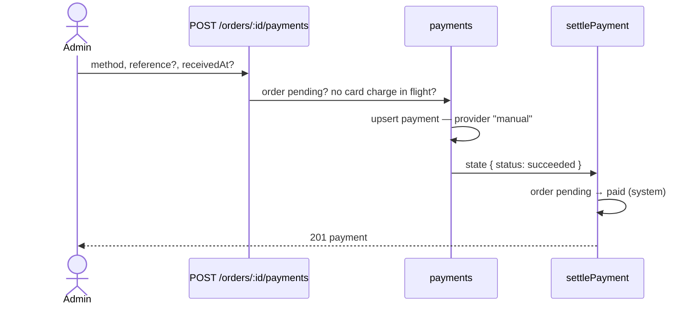
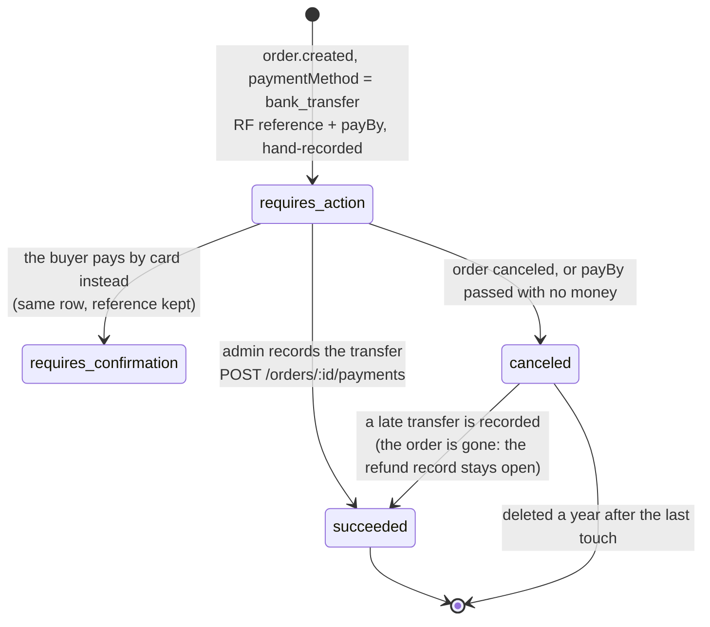
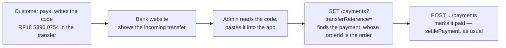

# Offline and bank-transfer payments

Money that reaches the shop without the provider: a payment an admin records, and the bank transfer a buyer makes themselves.

## Offline payments {#offline-payments}

Not every payment goes through the provider: an admin can record money that arrived some other
way — cash at the counter, a phone order paid by bank transfer — on a still-`pending` order.

**The admin records a payment; `settlePayment` moves the order.** Same code path as a card, so the
stock commits, `ORDER_STATUS_CHANGED` and `PAYMENT_SUCCEEDED` fire, and webhooks and emails follow
exactly as they would for a card. `manual` is not a provider port implementation — the port is
card-shaped, and a `manual` adapter would be three methods that throw — the offline path instead
writes the row directly and calls `settlePayment`.

The amount is always the order's own total; a partial or over-payment is out of scope, handled by
hand and off-system. Recording is refused with `PAYMENT_ORDER_NOT_PAYABLE` once the order is no
longer `pending` (including a second attempt at the same order), except a late transfer on a
canceled order, which is recorded and owed back, and with `PAYMENT_IN_FLIGHT` while
a card charge on the same order is still `requires_action` or `processing` — the provider could
still land that charge on its own, and recording money too would risk charging twice. A card
attempt that never got that far (`requires_confirmation`, `declined`) is simply overwritten: the row
becomes the offline one.

**Cash is a method of the by-hand record, and no deployment switch hides it.** `method` is
`bank_transfer`, `cash` or `other` (the contract's `OutsideMoneyMethod`, shared with a refund paid
outside). Who may record one is the role's `PaymentRecording` and `PaymentRefunding` sets, never an
`.env` knob, on purpose: the same tools are the only door for bank-transfer money and the rescue
for a failed card refund, so a switch that hid them would break shops that work.

**Only an operator can say a `manual` refund actually happened.** There is no provider to ask, so
money that left the system by hand can only be confirmed returned by a person. Every way a refund
opens on a hand-paid payment (a cancel, a late transfer on a cancelled order, an operator's
`refundPayment`, a received return, a buyer's withdrawal of the rest) only opens a `pending` record
and writes a `payment.refund_owed_by_hand` audit row naming the order, the record, the amount and
the reason; the actor is the caller, or the system when none is behind it. Nobody settles it on the
spot by default: goods arriving or a buyer withdrawing is not cash going back. The one exception is
an operator who says the money is already back (`paidOutside`, see
[Refunds](./payments-refunds.md#paid-outside)): that record is opened and settled in one step, and
no owed-by-hand row is written for it.

`settleRefundByHand` (`POST /payments/{id}/refunds/{refundId}/settle`, `create:Refund`, the same
fresh-session tier as recording a payment) is the only door that sets `settledByHand: true` (on the refund, never on the payment: one hand-settled refund says nothing about the next). It
names one record, so a payment carrying several open refunds (a cancelled remainder and two
returns) settles each separately, and a return stays `received` until its own money is confirmed
back. It answers the refund it settled (`GET /payments/{id}` has the totals and the actions). It audits `admin.payment.refund_settled_by_hand`; the `payment.refunded` event is the same as
for a provider refund. `PaymentActions.settleRefundByHand` lists the ids a caller may settle. A refund two
operators settle at once settles once; the loser answers 409 `PAYMENT_REFUND_NOT_OPEN`. A cancelled hand-paid order therefore shows
`succeeded` until an operator confirms it, not "refunded" for money nobody actually moved.

**The `actions` on every payment.** Each response that carries a payment, the answer to every
write included, carries `PaymentActions`. What each one means is in
[Refunds](./payments-refunds.md#payment-actions); `confirm`, `sync` and `intent` read the order for
`pay`, while `offline` and `refund` only ever return a `succeeded` payment, where `pay` is false
whatever the order says, so they read nothing.

## Bank transfer {#bank-transfer}

At checkout the customer may choose `bank_transfer` instead of `card` — `GET /payments/methods`
says whether this deployment offers it at all, which is only once `NODE_BANK_TRANSFER_BENEFICIARY`
and `_IBAN` are both set. This module owns the method outright: its settings, its reference, its
instructions and the two mails around them.

A transfer order is owed money from the moment it is placed, so it gets its **payment** then. The
payment carries everything the buyer and the operator need, and the order carries none of it.

- **`order.created` opens it.** A listener (`services/transfer.ts`) inserts the row if absent: a
  `requires_action` payment, `provider: manual` (no provider is behind it), for the order's total,
  with the RF reference and `payBy` copied from the order. A redelivered event finds the row and
  does nothing, and the instructions mail goes out only from the call that inserted it. A payment
  that already exists (a card paid first, an operator recorded the money) is left exactly as it is.
- **The instructions ride on the payment as `nextAction`**, a union keyed by `type` so a later
  redirect is one more member: `{ type: 'bank_transfer', beneficiary, iban, bic?, reference, payBy }`,
  present while the payment is `requires_action`. Beneficiary, IBAN and BIC are read live from
  the deployment's config, never frozen — a corrected typo shows on every transfer still open. The
  reference and `payBy` are the payment's own. A deployment that has stopped offering transfers
  shows no instructions.
- **The order carries the chosen method as a preference, not a lock.** The card form stays offered
  regardless: `createIntent` takes the same row over (`requires_confirmation`, method `card`,
  reference kept, instructions gone), and a card payment settles through the ordinary pipeline above.
  When a card pays a transfer order the order's `paymentMethod` becomes `card`, so the order page
  agrees with its payment; money recorded by hand leaves it alone.
- **The hold is longer, and the sweep needs no change to know it.** `cart`'s checkout hands
  `placeOrder` an explicit window, which `orders` passes to `inventory`'s `reserveForOrder` —
  `NODE_BANK_TRANSFER_HOLD_HOURS` (default 168, a week) instead of `NODE_RESERVATION_TTL_MINUTES` — and the same reservation sweep that
  releases a 15-minute card hold releases this one too, since it only ever reads each hold's own
  stored `expiresAt`. See [Inventory Reservations](./inventory-reservations.md#the-sweep).
- **A week-long hold is free to take, so an account is capped, for every method.**
  `cart` owns the cap: `NODE_MAX_OPEN_UNPAID_ORDERS_PER_ACCOUNT` (default 2) counts that account's own unpaid (`pending`)
  orders, a `processing` card included; a third checkout is refused with `CART_OPEN_ORDER_LIMIT_REACHED`,
  naming the open orders, before anything is written.
- **Nothing asks a provider about it.** The reconcile sweep skips hand-recorded rows, and the
  browser's `POST /payments/{id}/sync` answers the payment as it stands: only an operator recording
  the money moves it.
- **Three mails, one of them not this module's.** The order-placed confirmation is `orders`', with
  the withdrawal notice, for every method. This module sends the **instructions** when it opens the
  payment, and **"no transfer received"** when the order was cancelled because the hold ran out — by
  the call whose write moved the payment to `canceled`, so one cancel mails once. The buyer's own
  cancel is answered by `orders`' cancel mail alone. Any other hold's expiry stays `orders`'.
- **A cancelled transfer payment is kept a year**, not the thirty days of every other abandoned
  attempt (`TRANSFER_PAYMENT_RETENTION_DAYS`), so the reference still finds the order when a late
  transfer shows up. See [Matching a transfer back to its order](#matching-a-transfer-back-to-its-order).

## Matching a transfer back to its order {#matching-a-transfer-back-to-its-order}

The bank never tells this app anything — there is no statement feed, no webhook, no polling.
Instead the transfer payment gives the customer a clean code to write into the transfer, and an
admin reads it back off the bank's own website:

- **The reference is an ISO 11649 "RF" creditor reference** — the standard SEPA reference field,
  e.g. `RF13 2EY8 H44V JAVZ KX80 JRL`. Its mod-97 check digits (ISO 7064 MOD 97-10, the same scheme
  IBAN itself uses) mean a mistyped code is REJECTED rather than silently matching the wrong order.
  `domain/transfer-reference.ts`'s `buildReference` mints it from the order's own id encoded as
  base-36 — lossless over every bit of the id, so two different orders can never mint the same code
  the way a hash could, which is what makes the `transferReference` unique index a true invariant
  rather than a rarely-firing safety net. `parseReference` reads one back.
- **Minted once, when the payment opens, never recomputed.** It is deterministic in the order id,
  so a redelivered `order.created` could not mint a different one anyway. A `card` order never has
  one and is not reachable through this filter; an admin finds it by id through the normal order
  search instead. No raw-id fallback: a raw order id is not a reference and finds nothing.
- **No new settlement code.** The admin screen filters the payments list by the code, then the existing `POST
/orders/{id}/payments` — the same `pending → paid` move, stock commit, and events any
  other offline record already goes through.
- **A transfer that arrives after its order was cancelled is recorded, not refused.** The filter
  still finds the payment (its cancelled payment is kept), and `POST .../payments` takes the money onto
  that payment. The order cannot be paid any more, so the settlement owes the money straight back:
  the payment reads `succeeded`, its refund record stays open (a hand-paid refund is returned by
  the operator, off-system, and marked done), and the order stays cancelled with no stock touched.
- **A malformed and an unmatched reference answer the same empty list.** The filter reads the code
  in its canonical form first (spacing and case tolerated), and a code that is not a valid RF
  reference never reaches the database. Distinguishing the two would tell a guesser which half of
  a code they got right. The guard is the list's own `display:Payment`, and a staff read of the
  list is not an audited order read: the answer is a payment row, not the order.

## Read next

- [payments](./payments.md) — the module's own page
