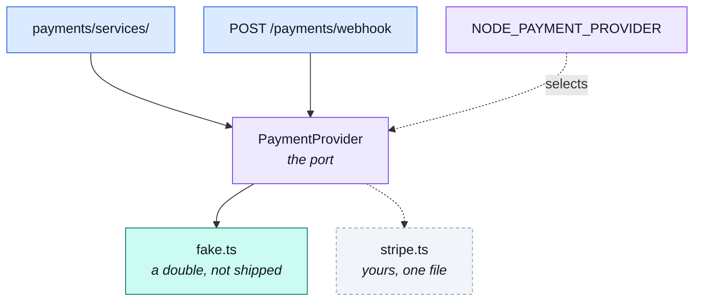

# The provider port

The seam a real payment service provider plugs into — and the reason nothing above it knows which
one is wired in.

::: tip At a glance
**Selected by** — `NODE_PAYMENT_PROVIDER`, read fresh per call. No default: unset means no card payments.
**Shipped with** — no implementation. `fake` is a [test double](../tools/test-doubles.md) outside `src/`, registered by the dev preload and by jest.
**Breaks if you change** — the `PaymentProvider` interface. It is the contract a real PSP has to satisfy.
:::

## The shape is not a choice

A port could have been written as _"here is a card, take the money"_. It is not, and the reason is
worth stating before anything else: **no real payment provider works that way, and the ones that
let you try put your whole deployment in the wrong compliance bracket.**

Three constraints come from outside this codebase and cannot be designed around.

**The card number must never reach this server.** A provider's own widget collects it inside an
iframe the provider owns, and hands the browser an opaque handle (`pm_…`). A server that receives
a real card number is in the heavyweight PCI DSS bracket — the full questionnaire, quarterly
external scans, an annual attestation — rather than the light one a tokenised integration gets.
That is why `confirm` takes a **method reference**, and why there is no `CardDetails` type anywhere
in this module.

**The answer is not always immediate.** A European card can come back needing a 3-D Secure
challenge answered in the browser, and some methods settle over days. `requires_action` and
`processing` exist because a payment in either state has to be representable — without them a
challenged payment has nowhere to live.

**The authoritative answer arrives separately.** It comes as a webhook, possibly after the customer
has closed the tab. The browser's report is a hint that makes the happy path feel synchronous; the
provider is the authority. The webhook is a THIN event: it names an intent, and the server then
asks the provider (`retrieve`) what became of it. A delivery's own body is never believed for the
outcome, because a provider does not promise delivery order (Stripe says so) and a stale
`succeeded` arriving after a `declined` must not un-decline anything. The cost is one provider
call per accepted event.

## What the port is

[`payments`](./payments.md)' service talks to **one interface and nothing else**, and which
implementation answers is a deployment decision rather than a code path.

| Member                                                                 | Contract                                                                                                                                                                                                                                                                                                                                                                                                                                             |
| ---------------------------------------------------------------------- | ---------------------------------------------------------------------------------------------------------------------------------------------------------------------------------------------------------------------------------------------------------------------------------------------------------------------------------------------------------------------------------------------------------------------------------------------------- |
| `name`                                                                 | Persisted on every payment document, so a row says who handled it.                                                                                                                                                                                                                                                                                                                                                                                   |
| `prepare(charge, metadata, existingProviderRef?)`                      | Opens an intent for an amount this application already froze. Returns `providerRef` (persisted) and `clientSecret` (handed to the browser, never stored). **Idempotent on `metadata.paymentId`** — the double-click case must not open a second intent.                                                                                                                                                                                              |
| `confirm(providerRef, methodRef)`                                      | Attaches the browser's tokenised method and asks for the money. Returns one of five states; **a decline is an answer, not an error** — only transport failures throw.                                                                                                                                                                                                                                                                                |
| `retrieve(providerRef)`                                                | Reads the authoritative state back. The reconciliation path, and what a finished challenge settles against.                                                                                                                                                                                                                                                                                                                                          |
| `refund(providerRef, charge, { idempotencyKey, refundId, createdAt })` | Idempotent on the key (`refund:{paymentId}:{refundId}`, one per refund record) — a real PSP refunds once per key, so a retry cannot return the money twice. Beyond the provider's key window the adapter stays idempotent itself, see [a key the provider forgot](#a-key-the-provider-forgot). Answers `{refundRef, status}`: `pending` for a refund accepted but not settled. Refusals are classified, see [reading a refusal](#reading-a-refusal). |
| `retrieveRefund(refundRef)`                                            | A refund's own status: `pending`, `succeeded` or `failed` (+ the closed `failureReason`, + our record id as `refundId` from `metadata.refund_record`). Stripe `canceled` maps to `failed`, `requires_action` to `pending`. The sweep re-reads any record holding a refund id with it, and a webhook naming a refund is settled from it: see [the provider's refund status](./payments.md#when-the-bank-sends-a-refund-back).                         |
| `cancel(providerRef, { reason })`                                      | Closes an intent that has not succeeded yet — an abandoned card flow, or money recorded another way instead. **Idempotent**: an already-cancelled intent answers success. Throws `PaymentInFlightError` when the intent already succeeded or is still mid-flight — there is money to refund instead, not an intent left to cancel.                                                                                                                   |
| `parseWebhook(rawBody, headers)`                                       | Verifies the delivery and translates the provider's own event shape into this module's. Takes the **unparsed** body — a signature covers exact bytes. Parses after the signature and before any lookup, against the contract's schema.                                                                                                                                                                                                               |

::: warning A typo'd env value fails loudly
`resolvePaymentProvider` throws when the environment names a provider this process does not carry.
Falling back to "no provider" would turn a deployment's typo into a checkout that quietly refuses
cards. Only an UNSET variable means no provider.
:::

::: tip No provider is a valid deployment
Unset, `GET /payments/methods` lists no `card`, `POST /payments` answers 409
`PAYMENT_CARD_NOT_AVAILABLE`, `POST /payments/webhook` answers 404, and checkout refuses `card` (and
a request that names no method, which defaults to it) with `CART_PAYMENT_METHOD_NOT_AVAILABLE`.
With a bank transfer configured, checkout still works.
:::

## The raw body is load-bearing

`parseWebhook` verifies an HMAC over the bytes the provider transmitted. `JSON.stringify` of a
parsed body is **not** those bytes — key order, number formatting and whitespace all move.

`app/security.ts` keeps the buffer for the webhook path alone, through the JSON parser's `verify`
hook, and lists the paths in `RAW_BODY_PATHS`. Changing that ordering makes every signature fail to
verify, with no error anywhere to say why; the controller notices an absent buffer and says so.

## The fake, and why it is honest

It imposes the same shape a real provider does — asynchronous states included — so the demo and
every e2e walk the challenge and webhook paths without an account anywhere.

| Method reference                   | First answer      | Settles to  |
| ---------------------------------- | ----------------- | ----------- |
| `pm_card_visa` (and anything else) | `succeeded`       | `succeeded` |
| `pm_card_declined`                 | `declined`        | `declined`  |
| `pm_card_authentication_required`  | `requires_action` | `succeeded` |
| `pm_card_processing`               | `processing`      | `succeeded` |

Anything unrecognised succeeds, with its last four digits taken from the reference's own tail — a
visitor poking at a demo should reach the happy path, and each interesting case stays one
documented value away.

`retrieve` answers `processing` for a reference it does not know. That is deliberate: `processing`
is the only status that settles nothing in either direction, and an intent the stub has forgotten
(a restart, a second worker) must move no money.

`cancel` refuses once a reference has settled to `succeeded` — the only rest state a `confirm` on
this stub ever writes down, since it settles eagerly rather than staying `processing` at rest. A
second `cancel` of an already-cancelled reference is success, not a repeat refusal, matching a real
provider's own idempotent behaviour there.

::: tip Every call is logged, and that is the point
A real PSP leaves a trail you can go and read — a dashboard, a webhook log, a statement. This one
leaves nothing, so "charged, succeeded" and "never reached the provider at all" look identical from
the outside. The log line is the fake's substitute for that trail. It carries the last four digits
and never more, the same rule the payment document follows.
:::

## Adding a real adapter (Stripe as the example)

Nothing here ships a PSP adapter; Stripe is the worked example.

1. Write `stripe.ts` in `providers/`, implementing `PaymentProvider`. Its `parseWebhook` calls the <!-- doc-paths:ignore -->
   vendor's own verifier (`stripe.webhooks.constructEvent`) and maps any `payment_intent.*` event
   onto `{ id, providerRef }`: the state is then read back through `retrieve`.
2. Call `registerPaymentProvider(stripeProvider)` (from `providers/registry.ts`) where the module loads;
   it is registered under its own `name`.
3. Set `NODE_PAYMENT_PROVIDER`, and `NODE_PAYMENT_WEBHOOK_SECRET` to the vendor's webhook signing secret.
   Your adapter reads its own secret key, and refuses its vendor's test key outside development
   (Stripe's is `sk_test_`).
4. Point the vendor's dashboard at `POST /payments/webhook`, which needs a public HTTPS endpoint.

The frontend swaps its method widget for the vendor's, which is the point of the exercise — the app
stops touching card data. The service and the contract's shape stay as they are; settlement stays too, with one added input: the adapter reports `amountReceived`, `currency` and `paymentId` with every `succeeded`, converted from its minor units, and echoes the `metadata.paymentId` it was given at `prepare`. A success that disagrees with the frozen payment is refused, see [the final write](./payments.md#the-pre-check-and-the-final-write).

## Reading a refusal

`refund` rejects with a `PaymentProviderError` carrying a closed `RefundFailureReason`. The class
decides what the application does next, so an adapter throws a definite code only when the provider
answered about THIS refund.

| The provider said                                                                  | Throw                                                         | Then                                                 |
| ---------------------------------------------------------------------------------- | ------------------------------------------------------------- | ---------------------------------------------------- |
| A 4xx on the create, or a refund object `failed`/`canceled`, naming a card problem | `declined`, `expired_or_canceled_card`, `lost_or_stolen_card` | final: never retried, the shop pays back another way |
| A refund `failed` because the shop's balance is short                              | `insufficient_funds`                                          | retried with a growing delay; money did not move     |
| Stripe's own `failure_reason: unknown` (a definite answer)                         | `declined` (not `unknown`, which means unclear here)          | final                                                |
| A network error, a timeout, a 5xx, a 429, Adyen `transient-error`                  | `provider_unavailable`                                        | retried; never offered for hand settlement           |
| Anything else                                                                      | `unknown`, or throw any other error                           | retried; never offered for hand settlement           |

The two retried-and-unclear codes are never offered for hand settlement because the refund may have
gone through: the sweep resends under the same key, and a timeout then gets the real answer.

## A key the provider forgot

A provider remembers an idempotency key for a limited time (Stripe: a day from its FIRST use; reuse
does not extend it). After that, resending a refund under the same key creates a second one, which
for a partial refund pays the buyer twice. So the adapter must not rely on the key alone:

- stamp `refundId` on the provider's refund (Stripe: `metadata.refund_record`);
- when `createdAt` is more than a day old, list the payment's refunds first and adopt the one
  carrying `refundId`; create a new one only if there is none.

The fake behaves this way: it replays an answer (a definite refusal too) for a day, forgets the key
after, and adopts by `refundId` for an old record. Its levers (`scenarios/support/doubles/payments/fake.ts`):
`setFakeRefundFailure`, `setFakeRefundTimeout` (the refund runs, the answer is lost) and
`ageFakeRefundKeys`.

## Retiring a provider

1. Unset `NODE_PAYMENT_PROVIDER` to stop new checkouts. Payments already made keep working: they
   dispatch on their own `provider` name.
2. Keep the adapter registered and keyed until its payments are settled and the refund and chargeback
   window has passed.
3. Delete the webhook endpoint in the vendor's dashboard.

Removing the adapter earlier is allowed, not guarded. Each open refund on it then fails once as
`provider_removed`, which is final and can be marked returned by hand once the money went back
another way. The reconcile sweep skips payments whose provider is not registered.

## Related pages

- [`payments`](./payments.md) — the module this belongs to
- [Layers](../theory/layers.md) — what a port is, and why it sits where it does
- [Security](../tools/security.md) — what is never stored or logged
- [The Flow Runner](../tools/flow-runner.md) — where the magic method references are used
