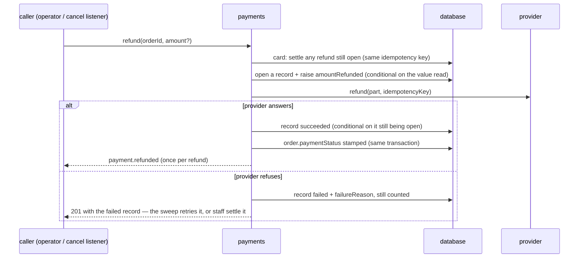
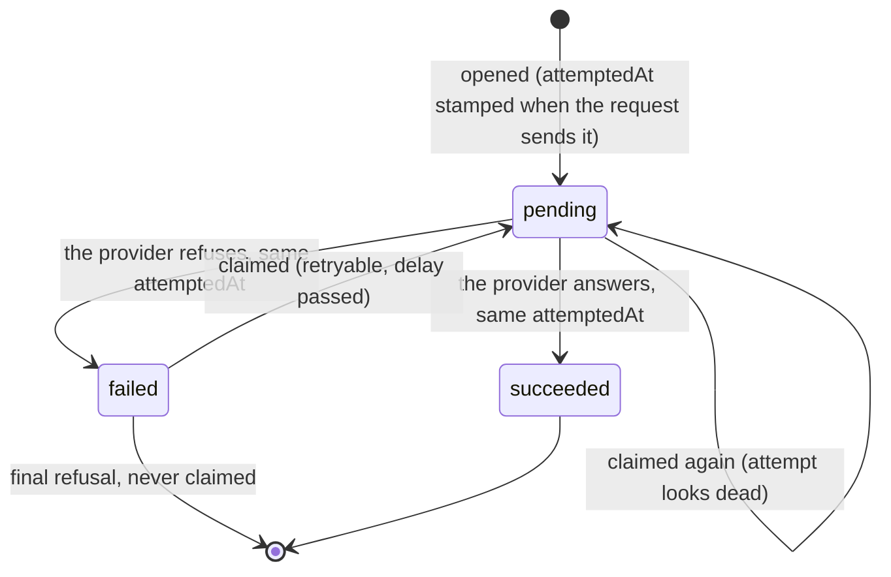
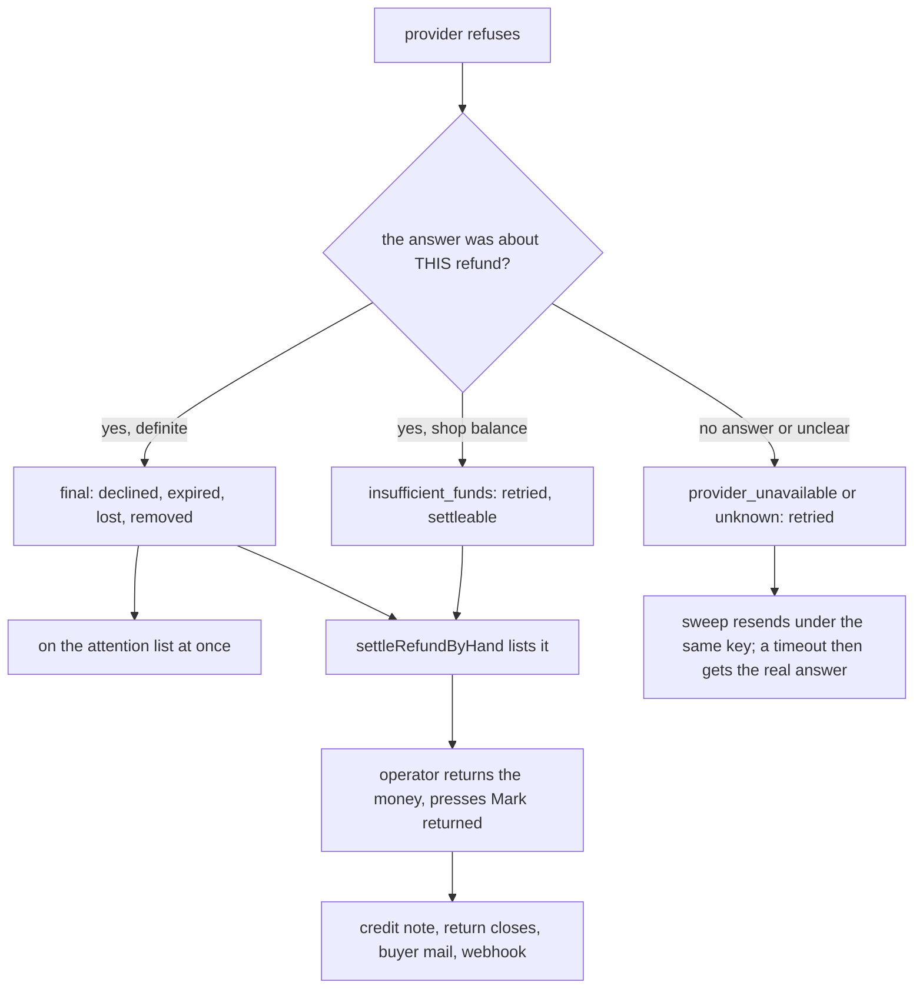
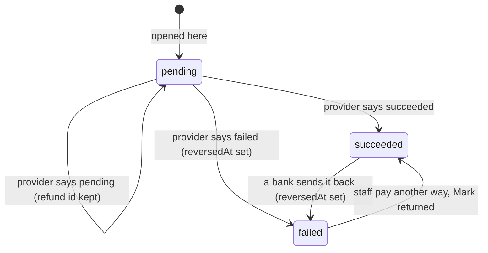
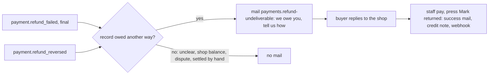
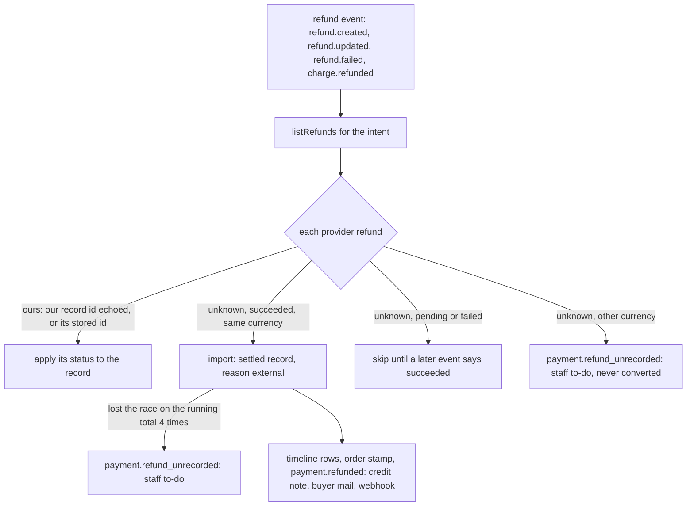

# Refunds and refund failures

Money going back to the buyer: the record, the send, and every way it can fail or be made outside the app.

## Refunds {#refunds}

Money going back to the buyer: the record, the send, and every way it can fail or be made outside the app.

### Refund records

A refund is a row on the payment (`refunds[]`), one per attempt — Stripe's `Refund` shape — and
`amountRefunded` is the running total, counting a refund from the moment it is opened.

- **A refusal is an answer, not an error.** The record exists and counts against what is left, so
  `POST /payments/{id}/refunds` answers **201** with the `failed` record (never a 5xx: a 500 would
  invite a second click that opens a second partial refund). The three entry points differ:

    | Entry point                   | Answers                                       | Where staff follow the refund                                        |
    | ----------------------------- | --------------------------------------------- | -------------------------------------------------------------------- |
    | `POST /payments/{id}/refunds` | 201 and the record (`failed` if refused)      | the record itself, `actions.settleRefundByHand`, the attention list  |
    | `POST /orders/{id}/cancel`    | 200; the refund runs after the answer         | the payment's `displayStatus` (`refund_pending`), the attention list |
    | `POST /returns/{id}/receive`  | 200; `received` = still owed, `closed` = back | the order's payment, the attention list                              |

- **Opened before asked.** The write that appends the record also raises `amountRefunded`, and it is
  conditional on `amountRefunded` still being what the caller read — so two racing partial refunds
  cannot return more than was paid. A miss re-reads and re-checks.
- **Exact sums.** Amounts are summed in integer minor units (`toMinorUnits`/`toDecimalString` from
  `@domain-primitives/money`), never by adding decimals. They rest as `Decimal128`
  ([Money at rest](../understand/tactical-ddd.md#at-rest-decimal128)); a refund with more places than
  the currency's minor unit is refused (`fitsCurrency`).
- **One key per record.** `refund:{paymentId}:{refundId}` — a retry of a refund is safe at the
  provider, and two different partial refunds are never mistaken for one.
- **The order's status commits with the settlement.** `order.paymentStatus` (`partially_refunded`
  or `refunded`) is stamped in the settlement's own transaction. No later refund exists to repair a
  missed stamp after the last one, so a failing stamp settles nothing and the sweep retries.
- **A refusal stays open.** The record is `failed`, with a closed `failureReason` (staff only; see
  [the staff Payments page](./payments.md#the-staff-payments-page)), and keeps its share of `amountRefunded`, so nothing is opened beside it. What happens next
  is [the claim](#sending-a-refund-the-claim-the-fence-the-delay) below. A later cancel, return or
  operator call sends only records it opened itself (or found never attempted), so one stuck refund
  never blocks the next: the request opens its own record and the sweep keeps retrying the old one.
- **The default is everything left.** `POST /payments/{id}/refunds` with no body returns
  all that is still refundable; with an `amount` it returns that part. An `amount` over what is
  left, nothing left included, is a 422 (`PAYMENT_REFUND_EXCEEDS_REMAINING`); with no `amount`,
  nothing left is a 409 (`PAYMENT_NOT_REFUNDABLE`).
- **A refund can pay for a return.** `openReturnRefund` (called by [`returns`](./returns.md) inside its own
  transaction when goods are received) opens a refund with `reason: return` and the return's `returnId`, clamped to what the
  payment has left. The record commits with the return; `sendOpenedRefund` asks the provider after. `payment.refunded` carries the `returnId`, so `returns` closes the return when
  the refund lands — including later, when the sweep completes one the provider first refused.
- **No sale, no document.** A late payment or an amount mismatch has no invoice, so its refund gets no
  credit note ([`invoicing`](./invoicing.md#issuing-a-document)).
- **A late payment is named.** Money that lands after the order could no longer be paid (its hold
  expired or it was cancelled) is refunded with `reason: late_payment`, not `cancellation`, so staff
  can tell a lost sale from a cancellation. The buyer is mailed it like any refund outside a return.
- **A refund can pay for a cancelled remainder.** The same door takes `reason: cancellation` for the
  unshipped part of an order that shipped in part ([`returns`](./returns.md#cancelling-what-has-not-shipped)).
  The `returnId` names the cancellation, which is closed at birth, so nothing waits on it; and because
  no return-closing notice follows, the buyer is told by the refund's own mail, like any cancel's.
- **A credit note per refund.** `payment.refunded` carries `refundId`, this refund's `amount` and
  `full`; `invoicing` issues from it ([`invoicing`](./invoicing.md)). A return's refund also
  records the goods it pays back (`lines`: product and quantity, plus the `shipping` inside the
  amount, Shopify's `refund_line_items`) and announces them as `goods`, so the credit note
  credits each line at its own VAT rate. Neither field is published on the wire.

### Sending a refund: the claim, the fence, the delay {#sending-a-refund-the-claim-the-fence-the-delay}

Two callers can reach the same open record (the request that opened it, the sweep every few
minutes). Three rules keep them from sending it twice or overwriting each other:

| Rule      | What it does                                                                                                                                                                                                                                                                                  |
| --------- | --------------------------------------------------------------------------------------------------------------------------------------------------------------------------------------------------------------------------------------------------------------------------------------------- |
| The claim | One conditional write moves a sendable record to `pending` and stamps `attemptedAt`. Sendable is: `failed` and not final and past its delay, or `pending` with an attempt old enough to be taken for dead. A record opened in a caller's transaction carries no stamp and is claimed at once. |
| The fence | The provider's answer settles, and its refusal fails, only a `pending` record that still carries the SAME `attemptedAt`. A slow old attempt that comes back after a newer claim finds nothing to write.                                                                                       |
| The delay | After a refusal the record waits `NODE_PAYMENT_REFUND_RETRY_MINUTES`, doubling with each refusal and capped at a day (`nextAttemptAt`). A definite refusal has no next attempt at all.                                                                                                        |

A refusal is **final** when the provider (or the lack of one) gave a definite answer about this
refund: `declined`, `expired_or_canceled_card`, `lost_or_stolen_card`, `provider_removed`. Asking
again will not change it, so the sweep never does; the shop pays back another way. `insufficient_funds`
(the shop's own provider balance is short), `provider_unavailable` and `unknown` are retried.
The domain sets are `FINAL_REFUND_FAILURES` and `MONEY_DID_NOT_MOVE_FAILURES`
(`payments/domain/lifecycle.ts`).

**A provider the deployment no longer carries.** A payment keeps the name of the provider that took
it. If that adapter is gone from this process, nothing can be asked: the refund fails once as
`provider_removed` (final), and the reconcile sweep skips such payments instead of stopping on
them. See [Retiring a provider](./payments-provider-port.md#retiring-a-provider).

**The provider's key expires.** A provider remembers an idempotency key for a day from its first
use (Stripe). Past that a reused key makes a NEW refund, so the adapter must adopt the refund the
record already made ([the port](./payments-provider-port.md#a-key-the-provider-forgot)). The age
is measured from the record's `createdAt`, never from the last attempt.

### When a card refund cannot go back {#when-a-card-refund-cannot-go-back}

A refused card refund is the shop's to settle: the money has to reach the buyer another way, and an
operator then presses **Mark returned** (`POST /payments/{id}/refunds/{refundId}/settle`). That is
only offered when the refusal PROVES the money did not move.

| The refusal                                                   | Money moved? | Retried?           | Hand settle                                                                                       | Attention kind                      |
| ------------------------------------------------------------- | ------------ | ------------------ | ------------------------------------------------------------------------------------------------- | ----------------------------------- |
| `declined`, `expired_or_canceled_card`, `lost_or_stolen_card` | no           | never (final)      | yes                                                                                               | `refused_refund`, at once           |
| `provider_removed` (the adapter is no longer installed)       | no           | never (final)      | yes                                                                                               | `refused_refund`, at once           |
| `disputed` (the buyer's bank took the money back)             | no (already) | never (final)      | once no dispute is open (also void), see [Disputes](./payments-disputes-and-adapters.md#disputes) | `refused_refund`, at once           |
| `insufficient_funds` (the shop's provider balance is short)   | no           | yes, growing delay | yes                                                                                               | `stale_refund`, after the threshold |
| `provider_unavailable`, `unknown`                             | maybe        | yes, growing delay | no: 409 `PAYMENT_REFUND_IN_FLIGHT`                                                                | `stale_refund`, after the threshold |
| a `pending` record (an attempt is running)                    | maybe        | claimed when stale | no: 409 `PAYMENT_REFUND_IN_FLIGHT`                                                                | `stale_refund`                      |

An unclear failure that never resolves (the provider gone dark) stays open with the growing delay
and shows on the attention list after `NODE_PAYMENT_ATTENTION_MINUTES`. There is no override: a
provider gone for good is a technician's edit of the record. Staff check the provider's dashboard or
support first. Rule of thumb for adapter authors: [reading a refusal](./payments-provider-port.md#reading-a-refusal).

### When the provider reports a refund's own status {#when-the-bank-sends-a-refund-back}

A refund is an object of its own at the provider, with a status that can change after the first
answer. The port reports it: `refund` answers `{refundRef, status}`, and `retrieveRefund` reads it back.

| What happens                                        | Record                                             | Announced                                  |
| --------------------------------------------------- | -------------------------------------------------- | ------------------------------------------ |
| the provider answers `pending`                      | stays `pending`, holds the provider's refund id    | nothing yet: no credit note, no buyer mail |
| the sweep (or a webhook) re-reads it: `succeeded`   | settles                                            | `payment.refunded`                         |
| a re-read says `failed` on an open record           | `failed` + reason + `reversedAt`, never resent     | `payment.refund_failed` with `final: true` |
| a webhook says `failed` on a settled record         | `failed` + reason + `reversedAt`, `settledAt` gone | `payment.refund_reversed`                  |
| the same report again, or a success after a failure | unchanged: `reversedAt` is set once                | nothing                                    |

- **Never resent.** A record holding a provider refund id is re-read by the sweep, never sent again:
  a resend inside the key window replays the old success. A record with `reversedAt` is skipped.
- **Owed, not undone.** The order is re-stamped (`partially_refunded` while another refund stands,
  otherwise cleared so it reads `paid`), the timeline gains `refund_reversed`, and the payment reads
  `refund_pending`. The credit note and a closed return stay: the sale was reduced, and a bounced
  payout is a payable, not a tax event (an accountant should confirm before a real shop relies on it).
- **Settled by hand.** Staff agree a method with the buyer, pay, and press Mark returned. That
  fires `payment.refunded` again for the same `refundId`: the credit note (unique per refund) and the
  return ignore it, the outbound webhook goes out again.
- **A report that beats the answer.** A webhook can arrive before `refund()` returns. The provider
  echoes our record id, so the delivery finds the open record, fails it for good, and the late
  success answer then settles nothing (the settle refuses a record with `reversedAt`).
- **Needs a person.** `reversed_refund` is on `GET /payments/attention` at once, with `since` = when
  it bounced. It is only for a refund that HAD settled (`reversedAfterSettling` on the record); the
  provider refusing an open one shows as `refused_refund`, with `reversedAt` as the once-guard.
  A refund that settled and came back cannot be cancelled (it has its credit note): only paid by hand.
  `payment.refund_reversed` also opens a `refund_reversed` to-do for `PaymentRefunding`, closed when
  the refund is marked returned (see [shop-tasks](./shop-tasks.md#the-shop-s-to-dos)).

### Telling the buyer their refund cannot reach the card {#telling-the-buyer}

EU law (Consumer Rights Directive Art. 13(1), Codice del Consumo Art. 56) returns the money by the
means the buyer paid with, unless they expressly agree otherwise, and at no cost to them. So when a
refund cannot reach the card the shop asks; it never picks a method for them.

- **One template, two triggers.** `payments.refund-undeliverable` is sent on a refusal that ended the
  retrying and on a reversal. The listener reads the record, so a refund already paid by hand mails
  nobody, and a transient refusal that later turns final mails once (the event fires only on a NEW
  refusal).
- **Never mailed:** `provider_unavailable` and `unknown` (the refund may have gone through),
  `insufficient_funds` (the shop's own balance), `disputed` (the bank already returned it).
- **No reason in the mail, nor on the buyer's page.** `Refund.owedAnotherWay` is the buyer-visible
  half: true on an open refund that is owed another way. The order page says so instead of "retried
  automatically". `failureReason` stays staff-only.
- **No bank details are stored.** The buyer replies by email and the IBAN stays in the shop's mailbox
  and bank, under the shop's own retention (GDPR Art. 5(1)(c): the app keeps nothing for a rare
  event). The mail shows `NODE_SUPPORT_EMAIL` as text.

### Refunds made outside the app {#refunds-made-outside-the-app}

Staff can refund from the provider's own dashboard. The application finds those refunds and records
them, so the credit note (a VAT duty), the buyer's mail and the order's state follow, and
`remainingOf` stops offering money that already left.

- **Matched by our id, not a flag.** The adapter echoes `metadata.refund_record` as `refundId`, so a
  refund of ours whose answer was lost (a timeout that ran) is settled from the provider, never
  imported a second time.
- **One write, once.** The import appends the record, raises the running total and carries the
  provider's refund id in one conditional write: a redelivery imports nothing. It sets
  `createdAt` and `settledAt` to the provider's own date.
- **Always recorded.** The money moved, so the import never refuses, even when the total then passes
  what was paid. An open refund of ours that no longer fits (`exceedsRemaining`: what the provider
  holds, plus this one, is more than was paid) is held **unsent**: the provider would refuse it. It
  shows as `refund_exceeds_remaining` with `exceedsBy`, and staff cancel it or mark it returned.
  Nothing closes by itself.
- **The order is not cancelled.** An outside refund moves `paymentStatus`; the order keeps its status.
- **A refund the import cannot record tells staff.** Two cases, one event, `payment.refund_unrecorded`
  (through the outbox, in a transaction of its own): the import lost its race on the running total on
  every attempt (the first and three re-reads), or the refund is in another currency than the payment
  (never converted). `shop-tasks` opens a `refund_unrecorded` to-do for `PaymentRefunding`, closed by
  staff; the open one is touched, not doubled, when it comes again. The webhook still answers 204:
  a provider retry cannot fix either cause.
- **A return that asks for more than is left tells staff.** `openReturnRefund` clamps a return's
  refund to what the payment has left. When it opens less than the return asked, or nothing, it
  writes `payment.return_refund_short` (outbox, in the return's own transaction: asked, opened,
  currency) and `shop-tasks` opens a `return_refund_short` to-do for the return. A receipt that
  opened nothing leaves the return `received`. See
  [A return the payment could not pay in full](./shop-tasks-todos.md).
- **Re-sync refunds.** `POST /payments/{id}/refunds/sync` (`syncRefunds`) runs the same idempotent
  walk on demand: a refund already recorded is carried, never imported twice, so a second call imports
  nothing twice. It needs `create:Refund`, so it asks the same fresh session as every refund button;
  `display:Payment` alone is refused, because it writes money records. It answers the payment with its
  `actions`, where `syncRefunds` says whether the button is offered (a card payment that succeeded,
  for a holder of `create:Refund`). A refund it cannot record (another currency) stays unrecorded and is
  announced again on each run: staff record it themselves and close the to-do, and a later re-sync or
  refund on that payment reminds them again, because the books still lack it.

### Cancelling a refund {#cancelling-a-refund}

Staff void a refund the shop must never pay (a duplicate opened by mistake, or one the provider's
dashboard already covered) with `POST /payments/{id}/refunds/{refundId}/cancel`, body `{ note }`.
The note is required: the audit row says why, as for the status override. `create:Refund` at the
route, so the same fresh-session tier as creating one. It answers 200 with the `Refund`
(`status: failed`, `failureReason: canceled`).

It is a local void. Nothing reaches the provider, and none of `payment.refunded`, a credit note or a
buyer mail happens: no money moved. What it does write, in one transaction:

| Write                | Detail                                                                                                        |
| -------------------- | ------------------------------------------------------------------------------------------------------------- |
| the record           | `failed` with `failureReason: canceled`; one conditional write that also takes its share off `amountRefunded` |
| the order's timeline | `refund_canceled`, staff only: ids and amount, never the note                                                 |
| the audit row        | `admin.payment.refund_canceled`, with the note                                                                |
| the domain event     | `payment.refund_canceled`, through the outbox; internal, no webhook carries it                                |

Which refunds may be voided is the hand-settle rule (`mayBeCanceled`), because both rest on the fact
that the money provably did not move. `PaymentActions.cancelRefund` lists exactly those ids.

| The refund                                                                                                                       | Cancel                             |
| -------------------------------------------------------------------------------------------------------------------------------- | ---------------------------------- |
| a hand-paid payment's `pending` one                                                                                              | yes                                |
| a card refund refused as `declined`, `insufficient_funds`, `expired_or_canceled_card`, `lost_or_stolen_card`, `provider_removed` | yes                                |
| a card refund refused as `disputed`, once no dispute is open                                                                     | yes                                |
| `succeeded` (the money moved), or already canceled                                                                               | no: 409 `PAYMENT_REFUND_NOT_OPEN`  |
| a card refund `pending` (an attempt runs) or failed as `provider_unavailable` / `unknown`                                        | no: 409 `PAYMENT_REFUND_IN_FLIGHT` |

A canceled record is closed for good: the refund sweep never claims it (`canceled` is not
retryable), `isOpenRefund` is false for it, so it is on no attention list and does not make the
payment read `refund_pending`, and it can be neither settled by hand nor canceled again. A claim by
the sweep between the read and the write makes the conditional write miss: the check runs again
against the record as it now stands. The order's `paymentStatus` stamp is recomputed by a cancel
when the payment holds a settled refund, because an open record blocks `refunded`: cancelling the
last one, after the rest came back from the dashboard, moves the order to `refunded`. A cancel with
no settled refund leaves the stamp as it is.

Every other refund dispatches to the provider named on the payment's own `provider` field — never
the deployment's currently configured one — so a refund of an older payment still reaches the
provider that actually took the money even after a deployment switches to another. The provider is
asked AFTER the record opens: a rejection leaves the payment `succeeded` and the record `failed`, so the
refund sweep (above) can actually retry it, instead of a failed attempt being recorded as a
successful one.

Requires `create:Payment`, the same fresh-session tier as a refund (`create:Refund`) — an
admin's own word that money arrived is exactly as consequential as one that it left.

The webhook is not on this diagram because it does not add an edge the diagram doesn't already
have — it reaches the exact same `settlePayment` a sync does, with `succeeded` or `declined` as the
only two states it ever reports.

## Read next

- [payments](./payments.md) — the module's own page
