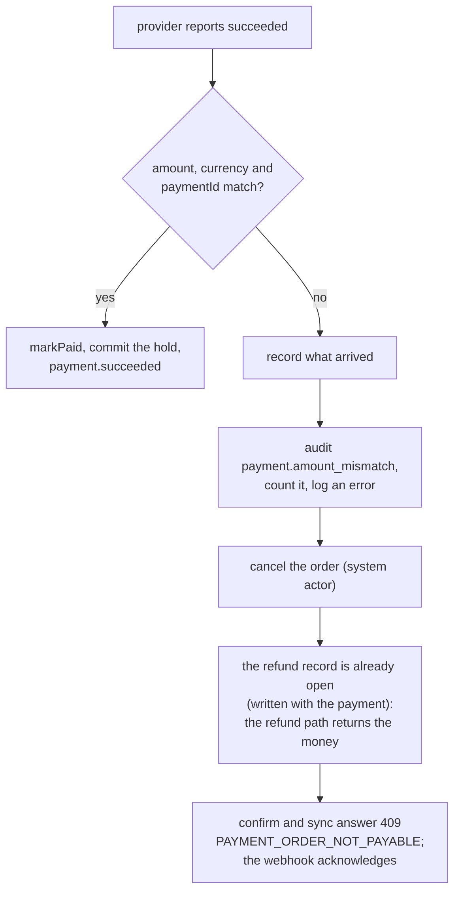
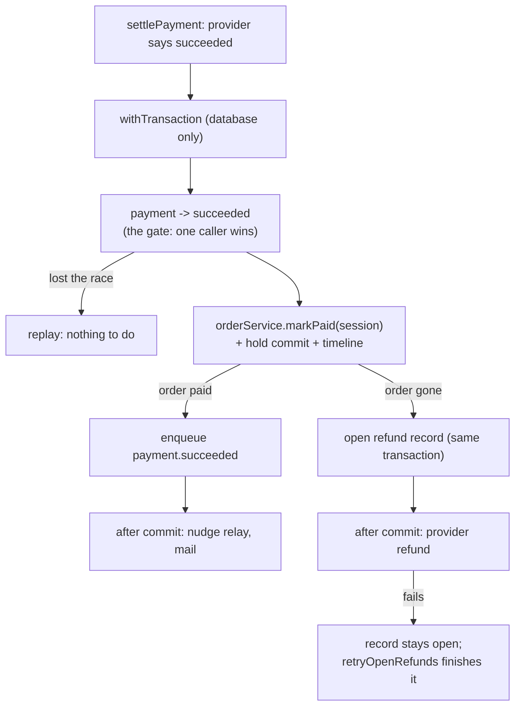
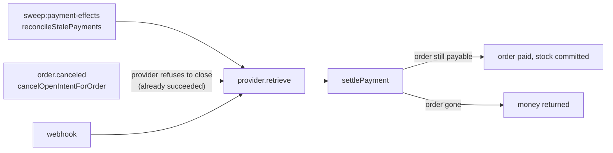
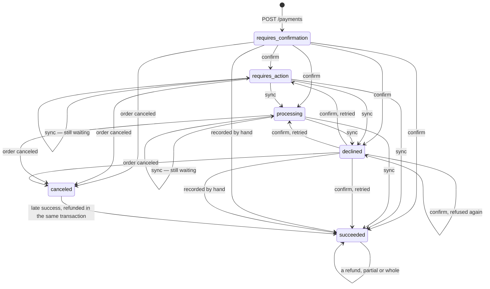

# How a payment settles

How a provider's answer becomes a paid order: the pre-check, the one settlement transaction, the sweep for lost webhooks and the status rules.

## The answer is not always immediate {#the-answer-is-not-always-immediate}

Two statuses sit between submitted and settled, and a lifecycle without them loses every European
card payment the bank decides to challenge:

| Status            | What it means                                                                                                                                                   |
| ----------------- | --------------------------------------------------------------------------------------------------------------------------------------------------------------- |
| `requires_action` | The buyer has something to do: the bank wants a 3-D Secure challenge answered in the browser, or a bank transfer is waiting to be sent (`nextAction` says how). |
| `processing`      | The provider has the payment but has not settled it. Some methods take days.                                                                                    |

Both answer **200**, not an error: the browser has a next step, and a 4xx would tell it to stop.
`POST /payments/{id}/sync` re-reads the provider and settles, which is what makes the happy path
feel synchronous.

**`processing` also extends the order's stock hold**, to `NODE_BANK_TRANSFER_HOLD_HOURS` from that
moment — a SEPA debit or a bank redirect can take days, and the ordinary 15-minute window
would let [`inventory`](./inventory-reservations.md)'s reservation sweep cancel an order whose
money is still on its way. `requires_action` gets no such grace: it means the browser has a
challenge to answer, not the provider a payment to finish.

**`POST /payments/webhook/{provider}` is what makes the server look**, and the browser never is. It arrives whether or not
the customer kept the tab open, and it is the one route in the module mounted above the auth wall:
its caller is a machine with no account, authenticating by signing the raw body — a stronger proof
of origin than any cookie this API could ask it for. The delivery is a thin event: the server
re-reads the payment's state from the provider and settles that, never the body's own claim.
A provider retries for days, so a redelivery re-reads the provider and settles again; every write in
the settlement is conditional (the payment's own `succeeded` write is the gate), so a repeat settles
once and nothing keeps a ledger of event ids.

A payment's payer is the order's own `userId`, copied as it stands. `payments` does not import
[`users`](./users.md): an account's erasure reaches it through the `personalData.erase` hook it
registers, not through an import, so no account lookup stands between an intent and the order it pays.

`unique: true` on `orderId` is the guard against a double charge: one payment per order is a
database fact, not a check somebody has to remember.

Delete this module and cancelling an order still releases its stock but returns no money — the
cancel lifecycle itself (`statusesLeadingTo`, `orders/domain/lifecycle.ts`) has no idea this module exists.

## The pre-check, and the final write {#the-pre-check-and-the-final-write}

Two different questions, asked at two different moments, both owned by `orders`:

- **The pre-check** — `orders.isPayable(order.status)` — gates every door that could open a new
  payment: `POST /payments`, `POST /orders/{id}/payments`, and `getForOrder`'s
  `PaymentActions.pay`. `pending` only; a `paid` order answers `false` even though `system` may
  still write a `paid → paid` echo underneath it (the payment webhook's own retries) — that echo is
  not a fresh offer to pay. This module never compares a status literal to decide whether to open a
  door; it always asks `orders`, so it cannot drift off the rule the lifecycle owns. The card
  confirm asks one more thing of `orders`, `isPayableNow` (awaiting payment AND its hold not
  released), because it is the only door where the buyer can still be refused before money moves;
  [why the others do not](./inventory-reservations.md#money-can-land-on-a-released-hold-take-the-units-again).
- **The final write** — `markPaid` (`orders/friends/payments.ts`) — is what actually moves the order once money has
  settled (`settlePayment` calls it; see "Status transitions" below and
  `docs/understand/tactical-ddd.md` §1 "Who writes the status"). It is `orders`' own conditional write,
  independent of the pre-check: a race that slips past the pre-check still cannot double-move the
  order, because `markPaid` only writes from `pending`.

**The final write and the payment's own `succeeded` write are one transaction.** A customer may
cancel at any moment, and a cancel racing the settlement serialises on the order document: either
the cancel lands first and `markPaid` finds the order gone (the money is put straight back, see
[One settlement transaction](#one-settlement-transaction)), or the settlement lands first and the
cancel's refund sees a `succeeded` payment. What makes sure only one of them refunds is
`addRefund`'s condition on `amountRefunded` (a second refund of the same money finds nothing left
to ask back), not a status write.

**Before the final write, the money is compared with what was asked.** A provider's `succeeded`
carries `amountReceived`, `currency` and `paymentId`, and `settlePayment` checks all three against
the payment frozen at the intent, compared in minor units (the provider's `amountReceived` is decimal text, so `"50"` and `"50.00"` agree). One that differs, or is missing, is not accepted
(PayPal IPN, WooCommerce "on hold" and Magento "Suspected Fraud" all make the same comparison). The
payment is written `succeeded` with what ARRIVED, and then:

No stock is committed, no `payment.succeeded` is announced, no invoice is issued. The 409 is not a
decline, so it spends no decline budget. A crash after the payment write leaves the order
`pending`; the reservation expiry then cancels it and the same refund path returns the money. A
hand-recorded payment (`manual`) is exempt: its amount is the order's own, with no provider
reporting a different one. The audit action stays out of `security.*`, whose whole prefix the
incident view takes: this is a reconciliation, not an attack signal.

## One settlement transaction {#one-settlement-transaction}

A success settles in ONE Mongo transaction with an explicit session. `markPaid` takes the session and
commits the order's hold itself (paid means stock committed, as cancelled means stock released).

- **Database only.** The driver re-runs the callback on a transient error, so no provider call, mail
  or cache write happens inside it.
- **No marker.** A crash before the commit leaves nothing; after it, the outbox row is durable and the
  relay publishes it. Nothing redelivers a settlement that already answered its caller, and nothing
  has to.
- **A lost order owes a refund record, not a marker.** The record is opened in the same transaction
  as the `succeeded` write, so money is never durable without its way back. The provider is asked
  after the commit; `npm run job sweep:payment-effects` (`retryOpenRefunds`) finishes a refund that
  failed.
- **A hold expiring on a paid order is no longer possible.** The commit lands with the `paid` move,
  so the reservation sweep (which only releases `held` holds) never sees a paid order's hold.

## Lost webhooks {#lost-webhooks}

A provider's webhook is the authority on a payment, and a webhook can be lost: a deploy at the wrong
moment, a retry window that ran out, a browser closed before the sync. Two nets sit under it, and
both end in the one settlement the webhook, the confirm and the sync already share
(`settlement.ts#settleFromProvider`), so none can drift from the others.

- **The sweep.** Every unsettled payment holding a provider intent, untouched for
  `NODE_PAYMENT_RECONCILE_MINUTES` (default 15), is asked about. An intent nobody attempted comes
  back `open` and changes nothing: no hold is stretched, no decline is invented. A payment the webhook already
  settled is not asked at all, and every write inside the settlement is conditional, so the sweep
  racing a late webhook settles once.
- **The cancel path.** Cancelling an order closes its open intent at the provider. A provider that
  answers "already succeeded" has taken money in the last minutes before the cancel, which no sweep
  window can be short enough to catch. The cancel path reconciles that payment on the spot: the order
  is gone, so the money goes straight back. A provider still mid-flight is left to the sweep.

Neither net adds a marker or a field: the payment's own status and `updatedAt` are the whole state.

## Status transitions {#status-transitions}

`requires_confirmation` is entered once, by `POST /payments`, and never again — nothing a
provider reports is ever that value. From there, every non-terminal status can settle to any other
non-terminal status. Three sets in `domain/lifecycle.ts` say which write may run from where:

| Set                                   | Statuses                                                             | Gates                                                                        |
| ------------------------------------- | -------------------------------------------------------------------- | ---------------------------------------------------------------------------- |
| `CONFIRMABLE_PAYMENT_STATUSES`        | `requires_confirmation`, `declined`                                  | `POST /payments/{id}/confirm` (a decline is retryable with another method)   |
| `SETTLEABLE_PAYMENT_STATUSES`         | `requires_confirmation`, `requires_action`, `processing`, `declined` | every write except the success write: in-flight, decline, the order's cancel |
| `SUCCESS_SETTLEABLE_PAYMENT_STATUSES` | the settleable ones plus `canceled`                                  | the success write, the amount-mismatch write and the provider re-read's gate |

`succeeded` is terminal, and stays `succeeded` however much is refunded: refund state is read from
the refund records and `amountRefunded` ([Refund records](./payments-refunds.md#refund-records)), the way Stripe's
PaymentIntent and Shopify's transactions do, and the order already carries `paymentStatus`.

`canceled` is written by the `order.canceled` listener (`cancelOpenIntentForOrder`), only after
the provider confirmed the intent closed, and only from a still-open status: a success racing it
wins. A report that arrives later (`processing`, `declined`) moves nothing and announces nothing.
Money that arrives on it is real: the success write runs from `canceled`, finds the order gone and
opens the refund for the whole amount in the same transaction.

**Each fact is reported once, by the call whose write made it true.** `settlePayment` says whether
its own write moved the payment (`transitioned`); only then do the `payment.confirmed` / `payment.failed`
audit row and the `payment_succeeded` / `payment_declined` analytics event fire. So a poll of a
payment that already succeeded, or a webhook for a decline the confirm already recorded (Stripe sends
two events for one decline), reports nothing. Only a confirm may decline an already-`declined`
payment, because a confirm is itself a new attempt: card A refused, then card B refused, are two
`payment.failed` rows. A confirm that loses the race to the webhook answers the payment as the
winner left it, not the copy it read first.

`POST /orders/{id}/payments` (below) is a fourth way to reach `succeeded`, alongside
confirm, sync and the webhook — it calls the exact same `settlePayment`, so nothing about this
diagram's terminal states or their guards changes for it.

## Read next

- [payments](./payments.md) — the module's own page
