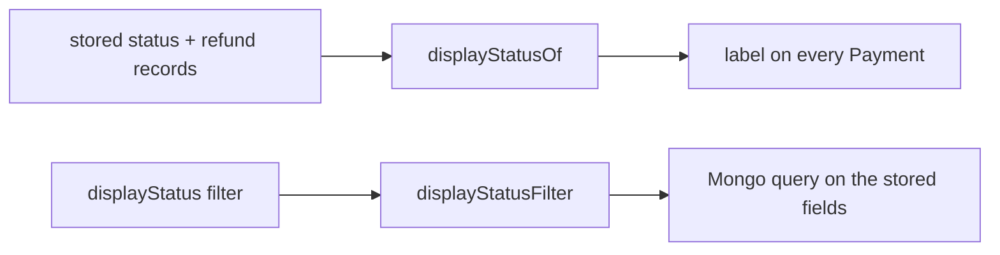

# The staff Payments page, mails and retention

What staff see and are sent about a payment, the order timeline entries it writes, and how long its data is kept.

## The staff Payments page {#the-staff-payments-page}

Four reads behind one admin page, all `display:Payment` (support, manager, moderator, admin) and never
shared-cached. A payer reads their own payment through `GET /orders/{id}/payments` or, by its own id (the
`Location` of `POST /payments`), `GET /payments/{id}`; a stranger's is the same 404 as a missing one.

| Read                                     | Answers                                                                                                                                                                 |
| ---------------------------------------- | ----------------------------------------------------------------------------------------------------------------------------------------------------------------------- |
| `GET /payments`, `POST /payments/search` | one page of payments, newest first; each row carries its order's `orderNumber` and `email`, composed from `orders` in one batch (`findManyByIds`)                       |
| `GET /payments/refunds`                  | one row per refund across every payment (`$unwind`); refunds stay embedded, because opening one is a single conditional write that also raises `amountRefunded`         |
| `GET /payments/attention`                | problems still recorded on a document, oldest first; a fixed problem clears its marker and disappears                                                                   |
| Awaiting transfer                        | `GET /payments?method=bank_transfer&displayStatus=incomplete&sort=payBy`: soonest deadline first (`nextAction.payBy`); a payment with no deadline sorts as the earliest |

`displayStatus` is derived, never stored (Shopify's `displayFinancialStatus`). An open refund wins
over the status. `amountRefunded` counts a requested refund as done, so it is compared with
`amount` only once no refund is open (then equal means every unit went back). The filter is the label's inverse, and the integration suite checks
every label both ways.

| Label                | Stored                                                                   |
| -------------------- | ------------------------------------------------------------------------ |
| `incomplete`         | `requires_confirmation`, `requires_action`                               |
| `pending`            | `processing`                                                             |
| `succeeded`          | `succeeded`, no settled refund and none open (a canceled one is neither) |
| `refund_pending`     | any refund record `pending` or `failed`, a canceled one excepted         |
| `partially_refunded` | `succeeded`, at least one settled refund, none open                      |
| `refunded`           | `succeeded`, a settled refund, none open, `amountRefunded` = `amount`    |
| `failed`             | `declined`                                                               |
| `canceled`           | `canceled`                                                               |

**What staff see that a payer does not.** `providerRef`, each refund's `providerRefundRef` and a
failed refund's `failureReason`, and a refund's `paidOutside.reference`. The reason is a closed code (`declined`, `insufficient_funds`,
`expired_or_canceled_card`, `lost_or_stolen_card`, `provider_unavailable`, `unknown`, and `canceled`, which is not a refusal but a void by staff), Stripe's
`failure_reason` shape. A provider adapter throws `PaymentProviderError(code, message)`; anything
else is `unknown`. The provider's own wording goes to the log and is never stored. The fake
provider's `setFakeRefundFailure` simulates each code.

`paymentService.methodMix` groups the payments that took money (`succeeded`) by
method, provider and currency, for [`stats`](./stats.md).

**Needs attention** lists seven kinds (`PaymentAttentionKind`): a dispute the shop has to answer
(`dispute_needs_response`, [Disputes](./payments-disputes-and-adapters.md#disputes)), a payment
refunded past what was paid with nothing open to blame (`over_refunded`: it names the payment, not a
refund, and never clears, see [paid outside](./payments-refunds.md#paid-outside)), and five that are an open refund record: a provider
refund open longer than `NODE_PAYMENT_ATTENTION_MINUTES` (`stale_refund`), a refund the provider refused
for good (`refused_refund`), a settled refund the bank took back (`reversed_refund`), a dashboard refund
that took the room an open one counted on (`refund_exceeds_remaining`), and a refund owed by hand on a
`manual` payment (`manual_refund_owed`; nothing but the operator finishes it, so it shows at any age). Any row backed by a refund that pays a withdrawal or
a return also carries `refundDueBy` and `refundDueRule` (`withdrawal` or `faulty`), the legal deadline
and why it is that date, stamped on the record when it opened (`dueBy`, `dueRule`; Consumer Rights Directive Art. 13, [how it is set](./returns.md#the-refund-deadline)), so the
page can show the days left; a refund the law sets no deadline for shows its age only. The listener
for `order.canceled` stamps it from `informedAt` for a withdrawal or a buyer's own cancel. A refund is never owed without a record: a cancel
or a refund opens it before anything is asked of a provider. An amount mismatch is not a stored state (an
audit row `payment.amount_mismatch`, a counter, a log), so the page links to the audit log instead.
Each source is capped at 100 rows.

## The two mails {#the-two-mails}

Payments sends the buyer's money mails itself, from listeners on its own events, so every path
that settles money is covered: the webhook, the browser confirm, an offline record and the
recovery sweep.

| Event               | Template                    | Skipped when                                                    |
| ------------------- | --------------------------- | --------------------------------------------------------------- |
| `payment.succeeded` | `payments.payment-received` | never                                                           |
| `payment.refunded`  | `payments.refund-issued`    | a return's refund (`returns` closes it), or one that moved none |

The refund mail reads the refund record, not the event, and says "that is everything" from the
refunds settled up to that one rather than the payment's current status. A mail that fails is
logged and never undoes money that landed. The bank transfer's two mails are this module's too —
see [Bank transfer](./payments-offline.md#bank-transfer).

## The order timeline {#the-order-timeline}

Payments feeds the order's [timeline](./orders.md#the-timeline) through `orderService.appendTimeline`,
in the transaction of the fact each row describes, so a write that lost its race leaves no row.

| Row                | Written when                                                          |
| ------------------ | --------------------------------------------------------------------- |
| `paid`             | the payment settles (`orders` writes it; payments names how)          |
| `payment_declined` | the provider declines an attempt                                      |
| `refund_issued`    | a refund record is opened, before the provider is asked               |
| `refund_settled`   | the record settles                                                    |
| `refund_failed`    | the provider refuses (staff only)                                     |
| `refund_reversed`  | the provider takes a settled refund back (staff only)                 |
| `refund_canceled`  | staff void the record (staff only; the note is only in the audit row) |
| `dispute_opened`   | the provider first reports a dispute (staff only)                     |
| `dispute_closed`   | a dispute first reads won, lost, accepted or closed (staff only)      |

What each row carries is its variant in `OrderTimeline*` of `src/modules/orders/openapi.yaml`.

The provider's wording is never copied: it can carry anything, and only the closed code is stored.
The `actor` is the operator who asked or recorded the money; an automatic refund has none.

## Retention {#retention}

Two questions came up here, and both have a real answer worth writing down rather than leaving
implicit in the code.

**Is anything on a payment personal data (PII) that must eventually be scrubbed, the way
[`orders`](./orders.md) scrubs a shipping name and address?** No. `cardLast4` is four digits out
of a card number — not a PAN, and not enough to identify anyone or charge anything on its own,
the same reasoning that lets it appear on any receipt or bank statement. `amount`, `currency` and
`provider` were never personal data either. The only personal link on a payment is `userId`, and
that is already removed the moment an account is erased (`detachUserId`, immediate — no delay, no
timer). So once a payment settles, there is nothing left for a retention job to do.

**Does a settled payment ever get deleted?** No — same as `orders`, a `succeeded`
payment (refunded or not) is an invoice, kept indefinitely for tax and commercial-law reasons. It is
never a candidate for `reap:payments`, `reap:orders`, or any other timer in this codebase.

**What about a payment that never settles at all** — a declined card nobody retried, a 3-D Secure
challenge nobody answered? That row was never a transaction: no money moved, so there is no
invoice to keep. `npm run job reap:payments` deletes it once it has sat untouched (`updatedAt`) for
`NODE_PAYMENT_ABANDONED_RETENTION_DAYS` (default 30 days) — an abandoned checkout, not a financial
record. Retrying resets the clock, the same way editing a cart resets `carts`' own TTL.

| Payment state                                                                 | Kept forever? | Mechanism                                      |
| ----------------------------------------------------------------------------- | :-----------: | ---------------------------------------------- |
| `succeeded`                                                                   |      Yes      | Never touched by any timer — it is the invoice |
| `requires_*`, `processing`, `declined`, `canceled`, untouched past the window |      No       | `npm run job reap:payments` deletes the row    |

`npm run job reap:payments` runs nightly from `docker/crontab`, alongside the rest of this repo's
scheduled jobs — see [Scheduled jobs](../reference/ops.md#scheduled-jobs) for the full mechanism
and the module-removal convention that goes with owning one.

This is a genuinely different shape from `orders`' retention: `orders` keeps every row forever and
scrubs PII in place; `payments` keeps a settled row forever and deletes an unsettled one outright.
Neither scrubs a settled payment, because there is nothing on it left to scrub.

## Read next

- [payments](./payments.md) — the module's own page
