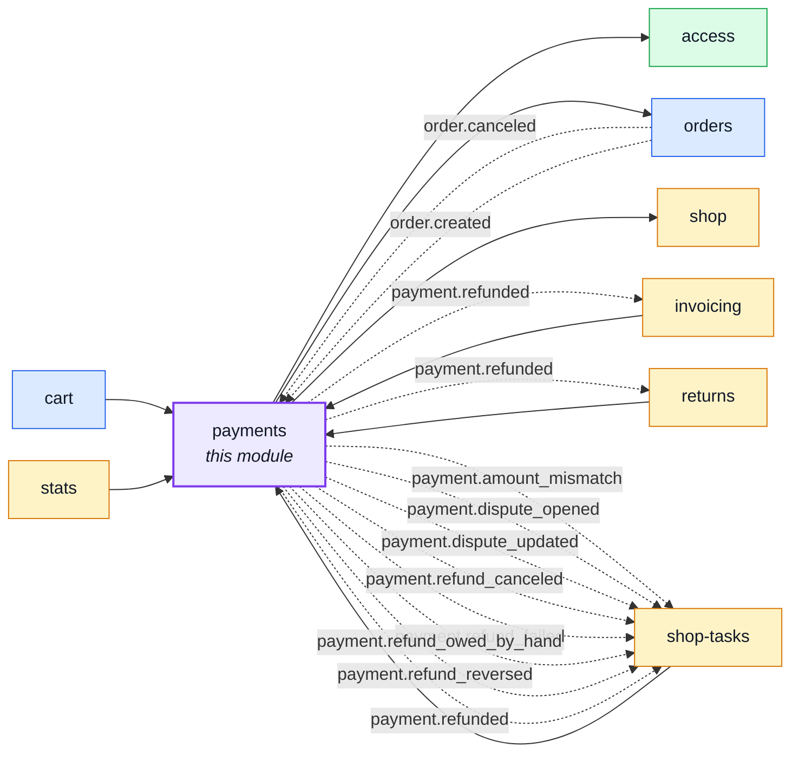
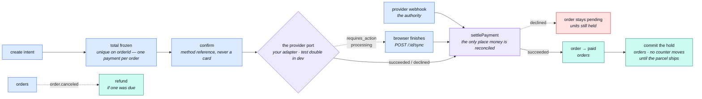

# payments

An order's money, behind a provider port.

::: tip At a glance
**Owns** — an order's money, behind a provider port. The intent freezes a total; the confirm moves the order to `paid`.
**Depends on** — [`orders`](./orders.md), [`access`](./access.md) (the audit flag of a money step on the caller's own order) and [`shop`](./shop.md) (the zone of a transfer's pay-by deadline).
**Breaks if you change** — the confirm path. It is the single moment held units become a sale.
:::

## Its neighbourhood

<!-- module-graph:payments:start -->

_Solid arrows are imports. Dotted arrows are domain events — the return path an import
graph cannot see._

<!-- module-graph:payments:end -->

## Who can do what

Every rule this module declares and who holds it, role by role. The rule is what a route guard asks for; the set is what a role lists.

<!-- permissions:start -->

| Rule              | Set                | `guest` | `unverified` | `customer` | `manager` | `warehouse` | `support` | `editor` | `moderator` | `admin` | `operator` | Credential | What it lets them do                                                                                                                                                  |
| ----------------- | ------------------ | ------- | ------------ | ---------- | --------- | ----------- | --------- | -------- | ----------- | ------- | ---------- | ---------- | --------------------------------------------------------------------------------------------------------------------------------------------------------------------- |
| `read:Payment`    | `PaymentOwn`       | —       | ✅ own       | ✅ own     | ✅ own    | ✅ own      | ✅ own    | ✅ own   | ✅ own      | ✅ own  | —          | —          | Read the caller's own payments.                                                                                                                                       |
| `display:Payment` | `PaymentDisplay`   | —       | —            | —          | ✅        | —           | ✅        | —        | ✅          | ✅      | —          | ✅         | Read every payment in the shop — the support desk helping with an order that is never their own, and the shop manager seeing the money behind the orders they handle. |
| `create:Payment`  | `PaymentRecording` | —       | —            | —          | —         | —           | —         | —        | ✅ ⚡c      | ✅ ⚡c  | —          | —          | Record a payment that arrived outside the provider — cash, a transfer, by hand.                                                                                       |
| `create:Refund`   | `PaymentRefunding` | —       | —            | —          | —         | —           | —         | —        | ✅ ⚡c      | ✅ ⚡c  | —          | —          | Return money to the payer — refund a payment, whole or in part.                                                                                                       |

✅ held · `own` only the caller’s own rows · ⚡c / ⚡s needs a freshly proved session (critical / sensitive) ·
Credential: ✅ when an API key can be minted with the rule. Generated from the rules and sets in
`src/modules/*/authorization.yaml` and the roles in `shared/rules/authorization-roles.yaml`, asked of the
evaluator — [Authorization](../understand/authorization.md) explains the model.

<!-- permissions:end -->

## The story

A payment is _about_ an order: the intent freezes its total, the confirm moves its status to
`paid`. The arrow never comes back — [`orders`](./orders.md) announces `order.canceled` with the
`refund` it owes, and this module answers by opening the refund. The event is an outbox row written
with the cancel, so the promise survives a crash; the refund RECORD is the promise from then on.

The payment also remembers every cancel event id it handled (`handledCancelEvents`, never on the
wire), even one that had nothing to refund. A redelivery of a handled event refunds nothing, so
staff voiding that refund is final: the event cannot pay it again. An open record is finished by
the refund sweep, not by a redelivery.

This module's `order.canceled` listener also closes a card intent nobody ever finished, so an
abandoned one cannot resolve at the provider days later with no local row left to catch the charge
it makes. Best-effort and first: a payment already `succeeded` is the refund's to give back, never
the intent close's.

**A refund that cannot be sent yet is a record, never a marker on the order.** The listener opens
the record before the provider is asked. If the database fails before that, the listener rejects
and the relay delivers the event again. After it, a provider refusal is logged and the event is
answered: the refund sweep (`retryOpenRefunds`) finishes the open record with the same idempotency
key, for as long as it takes. A hand-paid order opens its record too and waits for an operator:
it shows on the needs-attention list as `manual_refund_owed`, and `settleRefundByHand` (the
operator confirming the money went back) is what settles it. Opening that record announces
`payment.refund_owed_by_hand` in the same transaction, and [tasks](./tasks.md#system-tasks) opens a
`manual_refund_owed` task from it; a refusal that ends the retrying (`payment.refund_failed` with
`final: true`), an amount mismatch and a dispute open theirs the same way.

**`settlePayment` is the one place where the money and the goods agree.** It moves the order to
`paid` in the same transaction, and `markPaid` commits the order's held units there rather than
announcing and hoping: that instant is the only moment a hold becomes a paid claim (the units leave
the shelf later, at shipment).

It is reached three ways — the confirm, the sync, and the provider's webhook — and there is exactly
one of it because two would drift, and drifted copies would settle one order twice. Every write inside it
is conditional on the payment still being settleable, and the two terminal statuses are deliberately
outside that set: that absence is what makes a provider retrying a delivery for three days find
nothing left to move.

::: tip The provider is a port, and the implementation is fake on purpose
Nothing above `providers/` knows which processor is wired in. The fake is what lets the whole
checkout-to-paid path run in tests and in the demo profile without a sandbox account — including
the 3-D Secure challenge and the webhook, which it imposes exactly as a real provider would.
Swapping in a real processor is one file behind an interface that already exists.
:::

::: warning The card never reaches this server
`POST /payments/{id}/confirm` takes an opaque method reference the browser's provider widget
produced, never a card number. That is what keeps the deployment in the light PCI DSS bracket
rather than the heavy one, and it is why the request schema refuses a value shaped like a PAN.
:::

## The answer is not always immediate {#the-answer-is-not-always-immediate}

Two statuses sit between submitted and settled, and a lifecycle without them loses every European
card payment the bank decides to challenge:

Full detail: [How a payment settles](./payments-settlement.md#the-answer-is-not-always-immediate).

## The pre-check, and the final write {#the-pre-check-and-the-final-write}

Two different questions, asked at two different moments, both owned by `orders`:

Full detail: [How a payment settles](./payments-settlement.md#the-pre-check-and-the-final-write).

## One settlement transaction {#one-settlement-transaction}

A success settles in ONE Mongo transaction with an explicit session. `markPaid` takes the session and
commits the order's hold itself (paid means stock committed, as cancelled means stock released).

Full detail: [How a payment settles](./payments-settlement.md#one-settlement-transaction).

## Lost webhooks {#lost-webhooks}

A provider's webhook is the authority on a payment, and a webhook can be lost: a deploy at the wrong
moment, a retry window that ran out, a browser closed before the sync. Two nets sit under it, and
both end in the one settlement the webhook, the confirm and the sync already share
(`settlement.ts#settleFromProvider`), so none can drift from the others.

Full detail: [How a payment settles](./payments-settlement.md#lost-webhooks).

## Status transitions {#status-transitions}

`requires_confirmation` is entered once, by `POST /payments`, and never again — nothing a
provider reports is ever that value. From there, every non-terminal status can settle to any other
non-terminal status. Three sets in `domain/lifecycle.ts` say which write may run from where:

Full detail: [How a payment settles](./payments-settlement.md#status-transitions).

## Offline payments {#offline-payments}

Not every payment goes through the provider: an admin can record money that arrived some other
way — cash at the counter, a phone order paid by bank transfer — on a still-`pending` order.

Full detail: [Offline and bank-transfer payments](./payments-offline.md#offline-payments).

## Refunds {#refunds}

Money going back to the buyer: the record, the send, and every way it can fail or be made outside the app.

Full detail: [Refunds and refund failures](./payments-refunds.md#refunds).

### Refund records {#refund-records}

See [Refunds and refund failures](./payments-refunds.md#refund-records).

### Sending a refund: the claim, the fence, the delay {#sending-a-refund-the-claim-the-fence-the-delay}

See [Refunds and refund failures](./payments-refunds.md#sending-a-refund-the-claim-the-fence-the-delay).

### When a card refund cannot go back {#when-a-card-refund-cannot-go-back}

See [Refunds and refund failures](./payments-refunds.md#when-a-card-refund-cannot-go-back).

### When the provider reports a refund's own status {#when-the-bank-sends-a-refund-back}

See [Refunds and refund failures](./payments-refunds.md#when-the-bank-sends-a-refund-back).

### Telling the buyer their refund cannot reach the card {#telling-the-buyer}

See [Refunds and refund failures](./payments-refunds.md#telling-the-buyer).

### Refunds made outside the app {#refunds-made-outside-the-app}

See [Refunds and refund failures](./payments-refunds.md#refunds-made-outside-the-app).

### Cancelling a refund {#cancelling-a-refund}

See [Refunds and refund failures](./payments-refunds.md#cancelling-a-refund).

## Disputes {#disputes}

A buyer can ask their bank to take a card payment back. The bank does it at once, and a window of
about 7 to 21 days opens for the shop to send evidence. The application shows the dispute, alerts
staff, and refuses to refund twice; the answer itself is given in the provider's own dashboard.

Full detail: [Disputes and writing an adapter](./payments-disputes-and-adapters.md#disputes).

## Bank transfer {#bank-transfer}

At checkout the customer may choose `bank_transfer` instead of `card` — `GET /payments/methods`
says whether this deployment offers it at all, which is only once `NODE_BANK_TRANSFER_BENEFICIARY`
and `_IBAN` are both set. This module owns the method outright: its settings, its reference, its
instructions and the two mails around them.

Full detail: [Offline and bank-transfer payments](./payments-offline.md#bank-transfer).

## Matching a transfer back to its order {#matching-a-transfer-back-to-its-order}

The bank never tells this app anything — there is no statement feed, no webhook, no polling.
Instead the transfer payment gives the customer a clean code to write into the transfer, and an
admin reads it back off the bank's own website:

Full detail: [Offline and bank-transfer payments](./payments-offline.md#matching-a-transfer-back-to-its-order).

## Libraries

`ibantools` is this module's alone — see [Package Dependencies](../reference/package-dependencies.md)
for where it sits among everything else this repo depends on. Used once, at boot: it is what
the `paymentsConfig` boot check runs `NODE_BANK_TRANSFER_IBAN`/`_BIC` through before the deployment is allowed to
advertise `bank_transfer` at all.

| Library                      | Maintained    | What it costs you                                                              |
| ---------------------------- | ------------- | ------------------------------------------------------------------------------ |
| `ibantools` (chosen)         | active, typed | IBAN + BIC validation and formatting for every SEPA country, zero dependencies |
| a hand-rolled mod-97 check   | —             | exactly the kind of validation `CLAUDE.md` rules out writing by hand           |
| trusting the value unchecked | —             | a mistyped IBAN in `.env` sends every customer's money to the wrong account    |

The RF reference above is ALSO a hand-rolled mod-97 check, and is not a contradiction of the row
just above: `ibantools` validates IBAN and BIC only, has no ISO 11649 support at all, and no
maintained package on npm covers this narrow a spec — the "only then write it ourselves" branch of
`CLAUDE.md`'s own dependency rule, not the one the IBAN row warns against skipping.

## The pipeline

Three entry points, one settlement. What differs between them is only how the provider was asked.

## The staff Payments page {#the-staff-payments-page}

Four reads behind one admin page, all `display:Payment` (support, manager, moderator, admin) and never
shared-cached. A payer reads their own payment through `GET /orders/{id}/payments` or, by its own id (the
`Location` of `POST /payments`), `GET /payments/{id}`; a stranger's is the same 404 as a missing one.

Full detail: [The staff Payments page, mails and retention](./payments-staff-and-retention.md#the-staff-payments-page).

## The two mails {#the-two-mails}

Payments sends the buyer's money mails itself, from listeners on its own events, so every path
that settles money is covered: the webhook, the browser confirm, an offline record and the
recovery sweep.

Full detail: [The staff Payments page, mails and retention](./payments-staff-and-retention.md#the-two-mails).

## The order timeline {#the-order-timeline}

Payments feeds the order's [timeline](./orders.md#the-timeline) through `orderService.appendTimeline`,
in the transaction of the fact each row describes, so a write that lost its race leaves no row.

Full detail: [The staff Payments page, mails and retention](./payments-staff-and-retention.md#the-order-timeline).

## Configuration

| Variable                                | Default  | Meaning                                                                                                                                                                                                                                                                                                                   |
| --------------------------------------- | -------- | ------------------------------------------------------------------------------------------------------------------------------------------------------------------------------------------------------------------------------------------------------------------------------------------------------------------------- |
| `NODE_PAYMENT_PROVIDER`                 | —        | Which registered implementation answers. Unset: no card payments (`card` is not listed). A name this process does not carry throws at boot rather than silently taking no payments                                                                                                                                        |
| `NODE_PAYMENT_WEBHOOK_SECRET`           | —        | What `POST /payments/webhook/{provider}` verifies deliveries against. With a live provider this is THEIR signing secret, and it is the only thing between an attacker and marking any order paid. A comma-separated list is a ring for rotating it: the first entry signs, any entry verifies, every entry 16+ characters |
| `NODE_DEFAULT_CURRENCY`                 | see shop | Owned by [`shop`](./shop.md#configuration). Stamped on every payment document at creation.                                                                                                                                                                                                                                |
| `NODE_PAYMENT_ABANDONED_RETENTION_DAYS` | `30`     | Days an attempt that never settled may sit untouched before `npm run job reap:payments` deletes it. See Retention below.                                                                                                                                                                                                  |
| `NODE_BANK_TRANSFER_BENEFICIARY`        | —        | The account name a transfer is made out to. `bank_transfer` is offered only once this and `_IBAN` are both set                                                                                                                                                                                                            |
| `NODE_BANK_TRANSFER_IBAN`               | —        | The account IBAN. Validated with `ibantools` at boot — a malformed value refuses to boot rather than silently advertising a dead account                                                                                                                                                                                  |
| `NODE_BANK_TRANSFER_BIC`                | —        | The account's BIC/SWIFT, optional even once transfer is offered. Validated at boot when set                                                                                                                                                                                                                               |
| `NODE_BANK_TRANSFER_HOLD_HOURS`         | `168`    | How long checkout holds stock for a `bank_transfer` order — a week, not `NODE_RESERVATION_TTL_MINUTES`'s fifteen minutes                                                                                                                                                                                                  |
| `NODE_PAYMENT_REFUND_RETRY_MINUTES`     | `1`      | How long an open refund sits untouched before `sweep:payment-effects` retries it. See [One settlement transaction](#one-settlement-transaction)                                                                                                                                                                           |
| `NODE_PAYMENT_ATTENTION_MINUTES`        | `60`     | How long a refund may stay open before `GET /payments/attention` lists it. The retry window is a minute, so this is how long a person would wait. See [the staff Payments page](#the-staff-payments-page)                                                                                                                 |
| `NODE_PAYMENT_RECONCILE_MINUTES`        | `15`     | How long an unsettled payment sits untouched before `sweep:payment-effects` asks the provider what became of it. See [Lost webhooks](#lost-webhooks)                                                                                                                                                                      |

The currency is stamped rather than looked up, so changing it affects new payments and leaves
existing ones reading in the currency they were actually taken in. There is no conversion
anywhere in this module: a deployment that needs several currencies needs a price per currency
on the product, not a rate here.

One more, not an environment variable — a code constant in `providers/webhook-signature.ts`,
called out here because an operator debugging a webhook has no other reason to open the file:

| Constant            | Value | Meaning                                                                                     |
| ------------------- | ----- | ------------------------------------------------------------------------------------------- |
| `TOLERANCE_SECONDS` | 300   | How far a delivery's `t=` may drift from the server's clock before it is rejected as stale. |

## Retention {#retention}

Two questions came up here, and both have a real answer worth writing down rather than leaving
implicit in the code.

Full detail: [The staff Payments page, mails and retention](./payments-staff-and-retention.md#retention).

## Writing a payment adapter {#writing-a-payment-adapter}

The boilerplate ships no PSP adapter. Production offers bank transfer and offline payments; card
payments exist the day a deployment adds one file and one `registerPaymentProvider` call. This
section is what that file has to get right. Everything said about Stripe is a claim about a third
party and can go stale: check [Stripe's docs](https://docs.stripe.com/payments/paymentintents/lifecycle)
before relying on it, and test against the provider's sandbox on the deployment that picks it.

Full detail: [Disputes and writing an adapter](./payments-disputes-and-adapters.md#writing-a-payment-adapter).

## Read next

- [Disputes and writing an adapter](./payments-disputes-and-adapters.md) — a deeper page of this module
- [Offline and bank-transfer payments](./payments-offline.md) — a deeper page of this module
- [Refunds and refund failures](./payments-refunds.md) — a deeper page of this module
- [How a payment settles](./payments-settlement.md) — a deeper page of this module
- [The staff Payments page, mails and retention](./payments-staff-and-retention.md) — a deeper page of this module
- [The provider port](./payments-provider-port.md) — the interface and the fake behind it
- [`orders`](./orders.md) — what a payment is about
- [Layers](../understand/layers.md) — what a port is and where it sits
- [Security](../understand/security.md) — what is never stored here, and this module's own rate-limit budgets
