# payments

::: tip At a glance
**Owns** — an order's money, behind a provider port. The intent freezes a total; the confirm moves the order to `paid`.
**Depends on** — [`orders`](./orders.md).
**Breaks if you change** — the confirm path. It is the single moment held units become a sale.
:::

## Its neighbourhood

<!-- module-graph:payments:start -->

_Solid arrows are imports. Dotted arrows are domain events — the return path an import
graph cannot see._

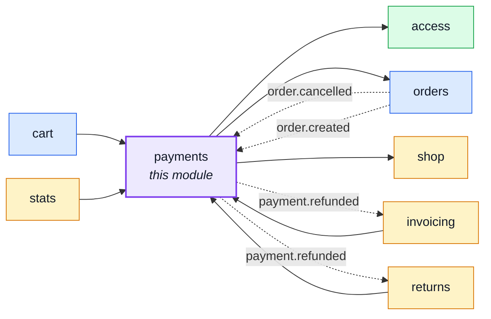

<!-- module-graph:payments:end -->

## The story

A payment is _about_ an order: the intent freezes its total, the confirm moves its status to
`paid`. The arrow never comes back — [`orders`](./orders.md) announces `order.cancelled` with the
`refund` it owes, and this module answers by opening the refund. The event is an outbox row written
with the cancel, so the promise survives a crash; the refund RECORD is the promise from then on.

This module's `order.cancelled` listener also closes a card intent nobody ever finished, so an
abandoned one cannot resolve at the provider days later with no local row left to catch the charge
it makes. Best-effort and first: a payment already `succeeded` is the refund's to give back, never
the intent close's.

**A refund that cannot be sent yet is a record, never a marker on the order.** The listener opens
the record before the provider is asked. If the database fails before that, the listener rejects
and the relay delivers the event again. After it, a provider refusal is logged and the event is
answered: the refund sweep (`retryOpenRefunds`) finishes the open record with the same idempotency
key, for as long as it takes. A hand-paid order opens its record too and waits for an operator:
it shows on the needs-attention list as `manual_refund_owed`, and the operator's own refund
settles it by hand.

**`settlePayment` is the one place where the money and the goods agree.** It moves the order to
`paid` in the same transaction, and `markPaid` commits the order's held units there rather than
announcing and hoping: that instant is the only moment a hold becomes a paid claim (the units leave
the shelf later, at shipment).

It is reached three ways — the confirm, the sync, and the provider's webhook — and there is exactly
one of it because two would drift, and drifted copies would settle one order twice. Every write inside it
is conditional on the payment still being settleable, and the two terminal statuses are deliberately
outside that set: that absence is what makes a provider retrying a delivery for three days find
nothing left to move.

::: tip The provider is a port, and the implementation is fake on purpose
Nothing above `providers/` knows which processor is wired in. The fake is what lets the whole
checkout-to-paid path run in tests and in the demo profile without a sandbox account — including
the 3-D Secure challenge and the webhook, which it imposes exactly as a real provider would.
Swapping in a real processor is one file behind an interface that already exists.
:::

::: warning The card never reaches this server
`POST /payments/{id}/confirm` takes an opaque method reference the browser's provider widget
produced, never a card number. That is what keeps the deployment in the light PCI DSS bracket
rather than the heavy one, and it is why the request schema refuses a value shaped like a PAN.
:::

## The answer is not always immediate

Two statuses sit between submitted and settled, and a lifecycle without them loses every European
card payment the bank decides to challenge:

| Status            | What it means                                                                                                                                                   |
| ----------------- | --------------------------------------------------------------------------------------------------------------------------------------------------------------- |
| `requires_action` | The buyer has something to do: the bank wants a 3-D Secure challenge answered in the browser, or a bank transfer is waiting to be sent (`nextAction` says how). |
| `processing`      | The provider has the payment but has not settled it. Some methods take days.                                                                                    |

Both answer **200**, not an error: the browser has a next step, and a 4xx would tell it to stop.
`POST /payments/{id}/sync` re-reads the provider and settles, which is what makes the happy path
feel synchronous.

**`processing` also extends the order's stock hold**, to `NODE_BANK_TRANSFER_HOLD_HOURS` from that
moment — a SEPA debit or a bank redirect can take days, and the ordinary 15-minute window
would let [`inventory`](./inventory-reservations.md)'s reservation sweep cancel an order whose
money is still on its way. `requires_action` gets no such grace: it means the browser has a
challenge to answer, not the provider a payment to finish.

**`POST /payments/webhook` is what makes the server look**, and the browser never is. It arrives whether or not
the customer kept the tab open, and it is the one route in the module mounted above the auth wall:
its caller is a machine with no account, authenticating by signing the raw body — a stronger proof
of origin than any cookie this API could ask it for. The delivery is a thin event: the server
re-reads the payment's state from the provider and settles that, never the body's own claim.
A provider retries for days, so a redelivery re-reads the provider and settles again; every write in
the settlement is conditional (the payment's own `succeeded` write is the gate), so a repeat settles
once and nothing keeps a ledger of event ids.

A payment's payer is the order's own `userId`, copied as it stands. `payments` does not import
[`users`](./users.md): an account's erasure reaches it through the `personalData.erase` hook it
registers, not through an import, so no account lookup stands between an intent and the order it pays.

`unique: true` on `orderId` is the guard against a double charge: one payment per order is a
database fact, not a check somebody has to remember.

Delete this module and cancelling an order still releases its stock but returns no money — the
cancel lifecycle itself (`statusesLeadingTo`, `orders/domain/lifecycle.ts`) has no idea this module exists.

## The pre-check, and the final write

Two different questions, asked at two different moments, both owned by `orders`:

- **The pre-check** — `orders.isPayable(order.status)` — gates every door that could open a new
  payment: `POST /payments/intent`, `POST /payments/order/{orderId}/offline`, and `getForOrder`'s
  `PaymentActions.pay`. `pending` only; a `paid` order answers `false` even though `system` may
  still write a `paid → paid` echo underneath it (the payment webhook's own retries) — that echo is
  not a fresh offer to pay. This module never compares a status literal to decide whether to open a
  door; it always asks `orders`, so it cannot drift off the rule the lifecycle owns.
- **The final write** — `orderService.markPaid` — is what actually moves the order once money has
  settled (`settlePayment` calls it; see "Status transitions" below and
  `docs/theory/tactical-ddd.md` §1 "Who writes the status"). It is `orders`' own conditional write,
  independent of the pre-check: a race that slips past the pre-check still cannot double-move the
  order, because `markPaid` only writes from `pending`.

**The final write and the payment's own `succeeded` write are one transaction.** A customer may
cancel at any moment, and a cancel racing the settlement serialises on the order document: either
the cancel lands first and `markPaid` finds the order gone (the money is put straight back, see
[One settlement transaction](#one-settlement-transaction)), or the settlement lands first and the
cancel's refund sees a `succeeded` payment. What makes sure only one of them refunds is
`addRefund`'s condition on `amountRefunded` (a second refund of the same money finds nothing left
to ask back), not a status write.

**Before the final write, the money is compared with what was asked.** A provider's `succeeded`
carries `amountReceived`, `currency` and `paymentId`, and `settlePayment` checks all three against
the payment frozen at the intent, in minor units. One that differs, or is missing, is not accepted
(PayPal IPN, WooCommerce "on hold" and Magento "Suspected Fraud" all make the same comparison). The
payment is written `succeeded` with what ARRIVED, and then:

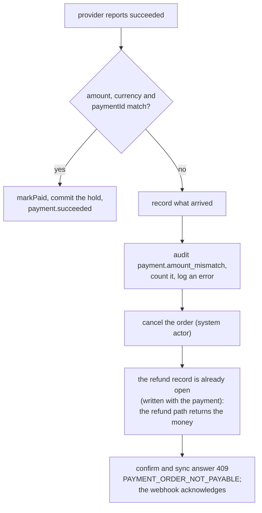

No stock is committed, no `payment.succeeded` is announced, no invoice is issued. The 409 is not a
decline, so it spends no decline budget. A crash after the payment write leaves the order
`pending`; the reservation expiry then cancels it and the same refund path returns the money. A
hand-recorded payment (`manual`) is exempt: its amount is the order's own, with no provider
reporting a different one. The audit action stays out of `security.*`, whose whole prefix the
incident view takes: this is a reconciliation, not an attack signal.

## One settlement transaction

A success settles in ONE Mongo transaction with an explicit session. `markPaid` takes the session and
commits the order's hold itself (paid means stock committed, as cancelled means stock released).

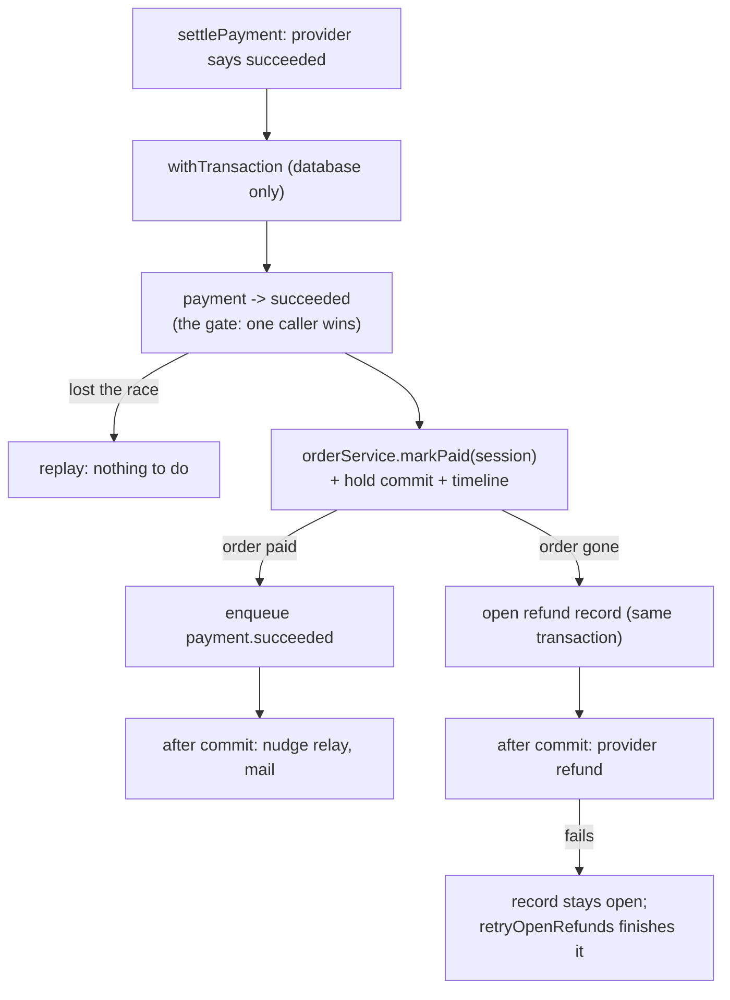

- **Database only.** The driver re-runs the callback on a transient error, so no provider call, mail
  or cache write happens inside it.
- **No marker.** A crash before the commit leaves nothing; after it, the outbox row is durable and the
  relay publishes it. Nothing redelivers a settlement that already answered its caller, and nothing
  has to.
- **A lost order owes a refund record, not a marker.** The record is opened in the same transaction
  as the `succeeded` write, so money is never durable without its way back. The provider is asked
  after the commit; `npm run sweep:payment-effects` (`retryOpenRefunds`) finishes a refund that
  failed.
- **A hold expiring on a paid order is no longer possible.** The commit lands with the `paid` move,
  so the reservation sweep (which only releases `held` holds) never sees a paid order's hold.

## Lost webhooks

A provider's webhook is the authority on a payment, and a webhook can be lost: a deploy at the wrong
moment, a retry window that ran out, a browser closed before the sync. Two nets sit under it, and
both end in the one settlement the webhook, the confirm and the sync already share
(`settlement.ts#settleFromProvider`), so none can drift from the others.

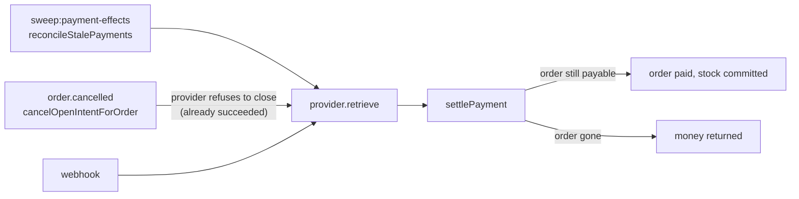

- **The sweep.** Every unsettled payment holding a provider intent, untouched for
  `NODE_PAYMENT_RECONCILE_MINUTES` (default 15), is asked about. An intent nobody attempted comes
  back `open` and changes nothing: no hold is stretched, no decline is invented. A payment the webhook already
  settled is not asked at all, and every write inside the settlement is conditional, so the sweep
  racing a late webhook settles once.
- **The cancel path.** Cancelling an order closes its open intent at the provider. A provider that
  answers "already succeeded" has taken money in the last minutes before the cancel, which no sweep
  window can be short enough to catch. The cancel path reconciles that payment on the spot: the order
  is gone, so the money goes straight back. A provider still mid-flight is left to the sweep.

Neither net adds a marker or a field: the payment's own status and `updatedAt` are the whole state.

## Status transitions

`requires_confirmation` is entered once, by `POST /payments/intent`, and never again — nothing a
provider reports is ever that value. From there, every non-terminal status can settle to any other
non-terminal status. Three sets in `domain/lifecycle.ts` say which write may run from where:

| Set                                   | Statuses                                                             | Gates                                                                        |
| ------------------------------------- | -------------------------------------------------------------------- | ---------------------------------------------------------------------------- |
| `CONFIRMABLE_PAYMENT_STATUSES`        | `requires_confirmation`, `declined`                                  | `POST /payments/{id}/confirm` (a decline is retryable with another method)   |
| `SETTLEABLE_PAYMENT_STATUSES`         | `requires_confirmation`, `requires_action`, `processing`, `declined` | every write except the success write: in-flight, decline, the order's cancel |
| `SUCCESS_SETTLEABLE_PAYMENT_STATUSES` | the settleable ones plus `cancelled`                                 | the success write, the amount-mismatch write and the provider re-read's gate |

`succeeded` is terminal, and stays `succeeded` however much is refunded: refund state is read from
the refund records and `amountRefunded` ([Refund records](#refund-records)), the way Stripe's
PaymentIntent and Shopify's transactions do, and the order already carries `paymentStatus`.

`cancelled` is written by the `order.cancelled` listener (`cancelOpenIntentForOrder`), only after
the provider confirmed the intent closed, and only from a still-open status: a success racing it
wins. A report that arrives later (`processing`, `declined`) moves nothing and announces nothing.
Money that arrives on it is real: the success write runs from `cancelled`, finds the order gone and
opens the refund for the whole amount in the same transaction.

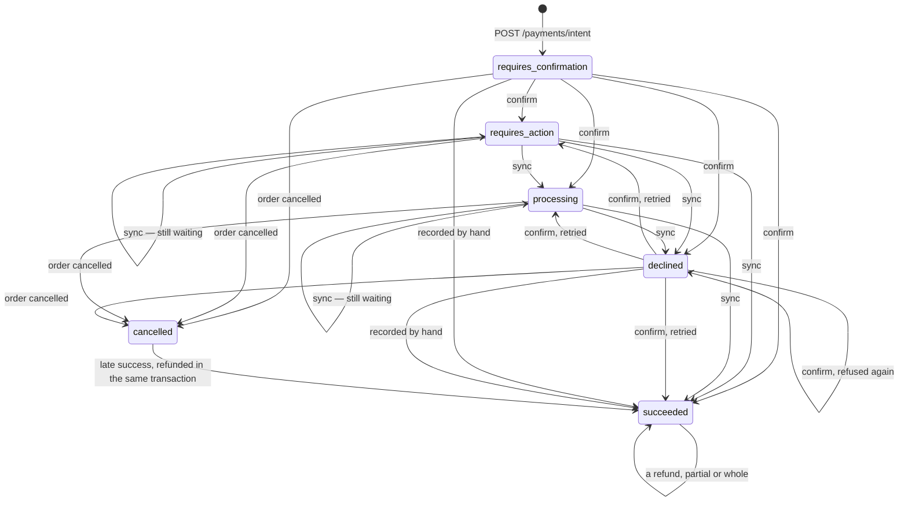

**Each fact is reported once, by the call whose write made it true.** `settlePayment` says whether
its own write moved the payment (`transitioned`); only then do the `payment.confirmed` / `payment.failed`
audit row and the `payment_succeeded` / `payment_declined` analytics event fire. So a poll of a
payment that already succeeded, or a webhook for a decline the confirm already recorded (Stripe sends
two events for one decline), reports nothing. Only a confirm may decline an already-`declined`
payment, because a confirm is itself a new attempt: card A refused, then card B refused, are two
`payment.failed` rows. A confirm that loses the race to the webhook answers the payment as the
winner left it, not the copy it read first.

`POST /payments/order/{orderId}/offline` (below) is a fourth way to reach `succeeded`, alongside
confirm, sync and the webhook — it calls the exact same `settlePayment`, so nothing about this
diagram's terminal states or their guards changes for it.

## Offline payments

Not every payment goes through the provider: an admin can record money that arrived some other
way — cash at the counter, a phone order paid by bank transfer — on a still-`pending` order.

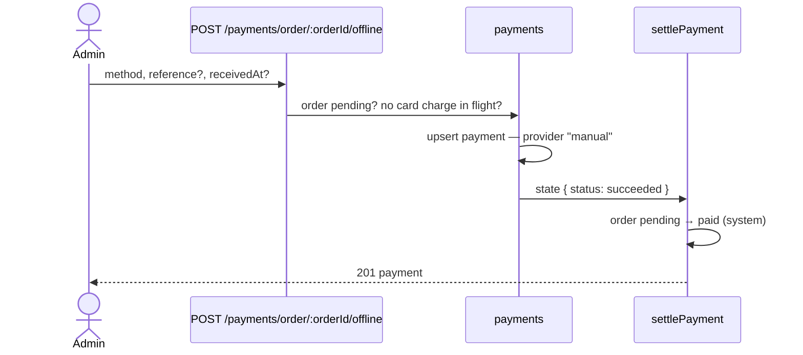

**The admin records a payment; `settlePayment` moves the order.** Same code path as a card, so the
stock commits, `ORDER_STATUS_CHANGED` and `PAYMENT_SUCCEEDED` fire, and webhooks and emails follow
exactly as they would for a card. `manual` is not a provider port implementation — the port is
card-shaped, and a `manual` adapter would be three methods that throw — the offline path instead
writes the row directly and calls `settlePayment`.

The amount is always the order's own total; a partial or over-payment is out of scope, handled by
hand and off-system. Recording is refused with `PAYMENT_ORDER_NOT_PAYABLE` once the order is no
longer `pending` (including a second attempt at the same order), and with `PAYMENT_IN_FLIGHT` while
a card charge on the same order is still `requires_action` or `processing` — the provider could
still land that charge on its own, and recording money too would risk charging twice. A card
attempt that never got that far (`requires_confirmation`, `declined`) is simply overwritten: the row
becomes the offline one.

**Only an operator can say a `manual` refund actually happened.** There is no provider to ask, so
money that left the system by hand can only be confirmed returned by a person: the automatic
listener (a customer's own cancel) leaves the payment `succeeded` and writes an unattended
`payment.refund_owed_by_hand` audit row instead of guessing; `refundByOrder` — already admin-only,
with the same fresh-session tier as recording one — is the only door that may set
`refundedByHand: true`. A cancelled hand-paid order therefore shows `succeeded` until an
operator confirms it, not "refunded" for money nobody actually moved.

### Refund records

A refund is a row on the payment (`refunds[]`), one per attempt — Stripe's `Refund` shape — and
`amountRefunded` is the running total, counting a refund from the moment it is opened.

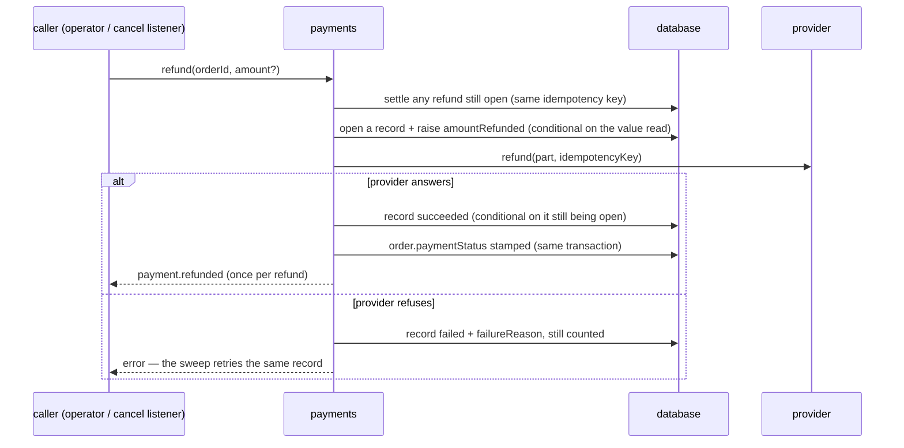

- **Opened before asked.** The write that appends the record also raises `amountRefunded`, and it is
  conditional on `amountRefunded` still being what the caller read — so two racing partial refunds
  cannot return more than was paid. A miss re-reads and re-checks.
- **Exact sums.** Amounts are summed in integer minor units (`toMinorUnits`/`toDecimalAmount` from
  `@domain-primitives/money`), never by adding decimals. They rest as `Decimal128`
  ([Money at rest](../theory/tactical-ddd.md#at-rest-decimal128)); a refund with more places than
  the currency's minor unit is refused (`fitsCurrency`).
- **One key per record.** `refund:{paymentId}:{refundId}` — a retry of a refund is safe at the
  provider, and two different partial refunds are never mistaken for one.
- **The order's status commits with the settlement.** `order.paymentStatus` (`partially_refunded`
  or `refunded`) is stamped in the settlement's own transaction. No later refund exists to repair a
  missed stamp after the last one, so a failing stamp settles nothing and the sweep retries.
- **A refusal stays open.** The record is `failed`, with a closed `failureReason` (staff only; see
  [the staff Payments page](#the-staff-payments-page)), and keeps its share of `amountRefunded`, so nothing is opened beside it. `retryOpenRefunds` (run by
  `npm run sweep:payment-effects`) and the next cancel or operator call both finish it.
- **The default is everything left.** `POST /payments/order/{orderId}/refund` with no body returns
  all that is still refundable; with an `amount` it returns that part. An `amount` over what is
  left, nothing left included, is a 422 (`PAYMENT_REFUND_EXCEEDS_REMAINING`); with no `amount`,
  nothing left is a 409 (`PAYMENT_NOT_REFUNDABLE`).
- **A refund can pay for a return.** `refundForReturn` (called by [`returns`](./returns.md) when goods
  are received) opens a refund with `reason: return` and the return's `returnId`, clamped to what the
  payment has left. `payment.refunded` carries the `returnId`, so `returns` closes the return when
  the refund lands — including later, when the sweep completes one the provider first refused.
- **A refund can pay for a cancelled remainder.** The same door takes `reason: cancellation` for the
  unshipped part of an order that shipped in part ([`returns`](./returns.md#cancelling-what-has-not-shipped)).
  The `returnId` names the cancellation, which is closed at birth, so nothing waits on it; and because
  no return-closing notice follows, the buyer is told by the refund's own mail, like any cancel's.
- **A credit note per refund.** `payment.refunded` carries `refundId`, this refund's `amount` and
  `full`; `invoicing` issues from it ([`invoicing`](./invoicing.md)). A return's refund also
  records the goods it pays back (`lines`: product and quantity, plus the `shipping` inside the
  amount, Shopify's `refund_line_items`) and announces them as `goods`, so the credit note
  credits each line at its own VAT rate. Neither field is published on the wire.

Every other refund dispatches to the provider named on the payment's own `provider` field — never
the deployment's currently configured one — so a refund of an older payment still reaches the
provider that actually took the money even after a deployment switches to another. The provider is
asked AFTER the record opens: a rejection leaves the payment `succeeded` and the record `failed`, so the
refund sweep (above) can actually retry it, instead of a failed attempt being recorded as a
successful one.

Requires `create:Payment`, the same fresh-session tier as a refund (`create:Refund`) — an
admin's own word that money arrived is exactly as consequential as one that it left.

The webhook is not on this diagram because it does not add an edge the diagram doesn't already
have — it reaches the exact same `settlePayment` a sync does, with `succeeded` or `declined` as the
only two states it ever reports.

## Bank transfer

At checkout the customer may choose `bank_transfer` instead of `card` — `GET /payments/methods`
says whether this deployment offers it at all, which is only once `NODE_BANK_TRANSFER_BENEFICIARY`
and `_IBAN` are both set. This module owns the method outright: its settings, its reference, its
instructions and the two mails around them.

A transfer order is owed money from the moment it is placed, so it gets its **payment** then. The
payment carries everything the buyer and the operator need, and the order carries none of it.

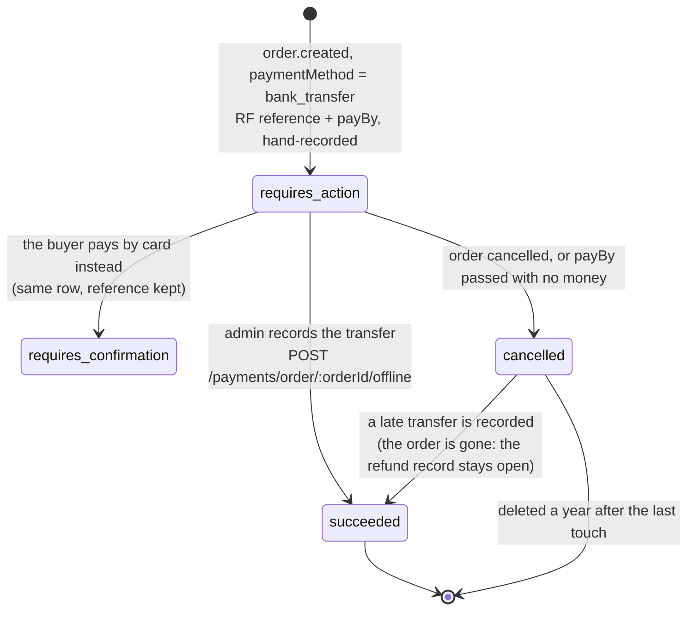

- **`order.created` opens it.** A listener (`services/transfer.ts`) inserts the row if absent: a
  `requires_action` payment, `provider: manual` (no provider is behind it), for the order's total,
  with the RF reference and `payBy` copied from the order. A redelivered event finds the row and
  does nothing, and the instructions mail goes out only from the call that inserted it. A payment
  that already exists (a card paid first, an operator recorded the money) is left exactly as it is.
- **The instructions ride on the payment as `nextAction`**, a union keyed by `type` so a later
  redirect is one more member: `{ type: 'bank_transfer', beneficiary, iban, bic?, reference, payBy }`,
  present while the payment is `requires_action`. Beneficiary, IBAN and BIC are read live from
  the deployment's config, never frozen — a corrected typo shows on every transfer still open. The
  reference and `payBy` are the payment's own. A deployment that has stopped offering transfers
  shows no instructions.
- **The order carries the chosen method as a preference, not a lock.** The card form stays offered
  regardless: `createIntent` takes the same row over (`requires_confirmation`, method `card`,
  reference kept, instructions gone), and a card payment settles through the ordinary pipeline above.
  When a card pays a transfer order the order's `paymentMethod` becomes `card`, so the order page
  agrees with its payment; money recorded by hand leaves it alone.
- **The hold is longer, and the sweep needs no change to know it.** `cart`'s checkout hands
  `inventoryService.reserveForOrder` an explicit window — `NODE_BANK_TRANSFER_HOLD_HOURS` (default
  168, a week) instead of `NODE_RESERVATION_TTL_MINUTES` — and the same reservation sweep that
  releases a 15-minute card hold releases this one too, since it only ever reads each hold's own
  stored `expiresAt`. See [Inventory Reservations](./inventory-reservations.md#the-sweep).
- **A week-long hold is free to take, so an account is capped, for every method.**
  `cart` owns the cap: `NODE_MAX_OPEN_UNPAID_ORDERS_PER_ACCOUNT` (default 2) counts that account's own unpaid (`pending`)
  orders, a `processing` card included; a third checkout is refused with `CART_OPEN_ORDER_LIMIT`,
  naming the open orders, before anything is written.
- **Nothing asks a provider about it.** The reconcile sweep skips hand-recorded rows, and the
  browser's `POST /payments/{id}/sync` answers the payment as it stands: only an operator recording
  the money moves it.
- **Three mails, one of them not this module's.** The order-placed confirmation is `orders`', with
  the withdrawal notice, for every method. This module sends the **instructions** when it opens the
  payment, and **"no transfer received"** when the order was cancelled because the hold ran out — by
  the call whose write moved the payment to `cancelled`, so one cancel mails once. The buyer's own
  cancel is answered by `orders`' cancel mail alone. A card hold's expiry stays `orders`'.
- **A cancelled transfer payment is kept a year**, not the thirty days of every other abandoned
  attempt (`TRANSFER_PAYMENT_RETENTION_DAYS`), so the reference still finds the order when a late
  transfer shows up. See [Matching a transfer back to its order](#matching-a-transfer-back-to-its-order).

## Matching a transfer back to its order

The bank never tells this app anything — there is no statement feed, no webhook, no polling.
Instead the transfer payment gives the customer a clean code to write into the transfer, and an
admin reads it back off the bank's own website:

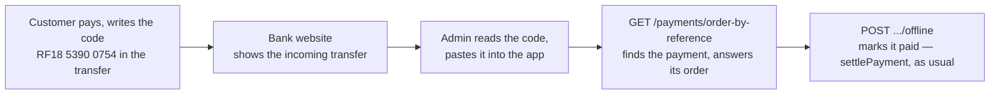

- **The reference is an ISO 11649 "RF" creditor reference** — the standard SEPA reference field,
  e.g. `RF13 2EY8 H44V JAVZ KX80 JRL`. Its mod-97 check digits (ISO 7064 MOD 97-10, the same scheme
  IBAN itself uses) mean a mistyped code is REJECTED rather than silently matching the wrong order.
  `domain/transfer-reference.ts`'s `buildReference` mints it from the order's own id encoded as
  base-36 — lossless over every bit of the id, so two different orders can never mint the same code
  the way a hash could, which is what makes the `transferReference` unique index a true invariant
  rather than a rarely-firing safety net. `parseReference` reads one back.
- **Minted once, when the payment opens, never recomputed.** It is deterministic in the order id,
  so a redelivered `order.created` could not mint a different one anyway. A `card` order never has
  one and is not reachable through this lookup; an admin finds it by id through the normal order
  search instead. No raw-id fallback: a raw order id is not a reference and answers 404.
- **No new settlement code.** The admin screen calls the lookup, then the existing `POST
/payments/order/{orderId}/offline` — the same `pending → paid` move, stock commit, and events any
  other offline record already goes through.
- **A transfer that arrives after its order was cancelled is recorded, not refused.** The lookup
  still finds the order (its cancelled payment is kept), and `POST .../offline` takes the money onto
  that payment. The order cannot be paid any more, so the settlement owes the money straight back:
  the payment reads `succeeded`, its refund record stays open (a hand-paid refund is returned by
  the operator, off-system, and marked done), and the order stays cancelled with no stock touched.
- **A malformed and an unmatched reference answer the same 404.** Distinguishing them would tell a
  guesser which half of a code they got right.

## Libraries

`ibantools` is this module's alone — see [Package Dependencies](../tools/package-dependencies.md)
for where it sits among everything else this repo depends on. Used once, at boot: it is what
the `paymentsConfig` boot check runs `NODE_BANK_TRANSFER_IBAN`/`_BIC` through before the deployment is allowed to
advertise `bank_transfer` at all.

| Library                      | Maintained    | What it costs you                                                              |
| ---------------------------- | ------------- | ------------------------------------------------------------------------------ |
| `ibantools` (chosen)         | active, typed | IBAN + BIC validation and formatting for every SEPA country, zero dependencies |
| a hand-rolled mod-97 check   | —             | exactly the kind of validation `CLAUDE.md` rules out writing by hand           |
| trusting the value unchecked | —             | a mistyped IBAN in `.env` sends every customer's money to the wrong account    |

The RF reference above is ALSO a hand-rolled mod-97 check, and is not a contradiction of the row
just above: `ibantools` validates IBAN and BIC only, has no ISO 11649 support at all, and no
maintained package on npm covers this narrow a spec — the "only then write it ourselves" branch of
`CLAUDE.md`'s own dependency rule, not the one the IBAN row warns against skipping.

## The pipeline

Three entry points, one settlement. What differs between them is only how the provider was asked.

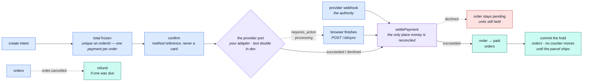

## The staff Payments page

Four reads behind one admin page, all `display:Payment` (support, manager, admin) and never
shared-cached. A payer reads their own payment through `GET /payments/order/{orderId}` only.

| Read                                     | Answers                                                                                                                                                                 |
| ---------------------------------------- | ----------------------------------------------------------------------------------------------------------------------------------------------------------------------- |
| `GET /payments`, `POST /payments/search` | one page of payments, newest first; each row carries its order's `orderNumber` and `email`, composed from `orders` in one batch (`findManyByIds`)                       |
| `GET /payments/refunds`                  | one row per refund across every payment (`$unwind`); refunds stay embedded, because opening one is a single conditional write that also raises `amountRefunded`         |
| `GET /payments/attention`                | problems still recorded on a document, oldest first; a fixed problem clears its marker and disappears                                                                   |
| Awaiting transfer                        | `GET /payments?method=bank_transfer&displayStatus=incomplete&sort=payBy`: soonest deadline first (`nextAction.payBy`); a payment with no deadline sorts as the earliest |

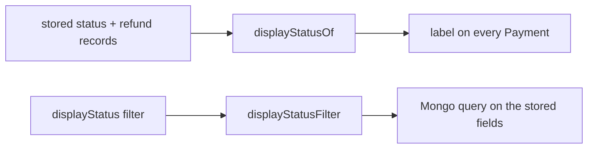

`displayStatus` is derived, never stored (Shopify's `displayFinancialStatus`). An open refund wins
over the status. `amountRefunded` counts a requested refund as done, so it is compared with
`amount` only once no refund is open (then equal means every unit went back). The filter is the label's inverse, and the integration suite checks
every label both ways.

| Label                | Stored                                                                |
| -------------------- | --------------------------------------------------------------------- |
| `incomplete`         | `requires_confirmation`, `requires_action`                            |
| `pending`            | `processing`                                                          |
| `succeeded`          | `succeeded`, no refund record                                         |
| `refund_pending`     | any refund record `pending` or `failed`                               |
| `partially_refunded` | `succeeded`, at least one settled refund, none open                   |
| `refunded`           | `succeeded`, a settled refund, none open, `amountRefunded` = `amount` |
| `failed`             | `declined`                                                            |
| `cancelled`          | `cancelled`                                                           |

**What staff see that a payer does not.** `providerRef`, each refund's `providerRefundRef` and a
failed refund's `failureReason`. The reason is a closed code (`declined`, `insufficient_funds`,
`expired_or_canceled_card`, `lost_or_stolen_card`, `provider_unavailable`, `unknown`), Stripe's
`failure_reason` shape. A provider adapter throws `PaymentProviderError(code, message)`; anything
else is `unknown`. The provider's own wording goes to the log and is never stored. The fake
provider's `setFakeRefundFailure` simulates each code.

`paymentService.methodMix` groups the payments that took money (`succeeded`) by
method, provider and currency, for [`stats`](./stats.md).

**Needs attention** lists two sources, both an open refund record: a provider refund open longer
than `NODE_PAYMENT_ATTENTION_MINUTES`, and a refund owed by hand on a `manual` payment (nothing but
the operator finishes it, so it shows at any age). A refund is never owed without a record: a cancel
or a refund opens it before anything is asked of a provider. An amount mismatch is not a stored state (an
audit row `payment.amount_mismatch`, a counter, a log), so the page links to the audit log instead.
Each source is capped at 100 rows.

## The two mails

Payments sends the buyer's money mails itself, from listeners on its own events, so every path
that settles money is covered: the webhook, the browser confirm, an offline record and the
recovery sweep.

| Event               | Template                    | Skipped when                                                    |
| ------------------- | --------------------------- | --------------------------------------------------------------- |
| `payment.succeeded` | `payments.payment-received` | never                                                           |
| `payment.refunded`  | `payments.refund-issued`    | a return's refund (`returns` closes it), or one that moved none |

The refund mail reads the refund record, not the event, and says "that is everything" from the
refunds settled up to that one rather than the payment's current status. A mail that fails is
logged and never undoes money that landed. The bank transfer's two mails are this module's too —
see [Bank transfer](#bank-transfer).

## The order timeline

Payments feeds the order's [timeline](./orders.md#the-timeline) through `orderService.appendTimeline`,
in the transaction of the fact each row describes, so a write that lost its race leaves no row.

| Row                | Written when                                                 | Carries                                    |
| ------------------ | ------------------------------------------------------------ | ------------------------------------------ |
| `paid`             | the payment settles (`orders` writes it; payments names how) | `method`: `card`, or what staff recorded   |
| `payment_declined` | the provider declines an attempt                             | `paymentId`                                |
| `refund_issued`    | a refund record is opened, before the provider is asked      | `refundId`, `amount`, `currency`, `reason` |
| `refund_settled`   | the record settles                                           | the same                                   |
| `refund_failed`    | the provider refuses (staff only)                            | the same, and the closed `failureReason`   |

The provider's wording is never copied: it can carry anything, and only the closed code is stored.
The `actor` is the operator who asked or recorded the money; an automatic refund has none.

## Configuration

| Variable                                | Default | Meaning                                                                                                                                                                                                                                                                                                        |
| --------------------------------------- | ------- | -------------------------------------------------------------------------------------------------------------------------------------------------------------------------------------------------------------------------------------------------------------------------------------------------------------- |
| `NODE_PAYMENT_PROVIDER`                 | —       | Which registered implementation answers. Unset: no card payments (`card` is not listed). A name this process does not carry throws at boot rather than silently taking no payments                                                                                                                             |
| `NODE_PAYMENT_WEBHOOK_SECRET`           | —       | What `POST /payments/webhook` verifies deliveries against. With a live provider this is THEIR signing secret, and it is the only thing between an attacker and marking any order paid. A comma-separated list is a ring for rotating it: the first entry signs, any entry verifies, every entry 16+ characters |
| `NODE_DEFAULT_CURRENCY`                 | `EUR`   | ISO-4217. Stamped on every payment document at creation; also what `products`, `cart` and `orders` (frozen at checkout) read for their own `currency` field — one shop, one currency                                                                                                                           |
| `NODE_PAYMENT_ABANDONED_RETENTION_DAYS` | `30`    | Days an attempt that never settled may sit untouched before `npm run reap:payments` deletes it. See Retention below.                                                                                                                                                                                           |
| `NODE_BANK_TRANSFER_BENEFICIARY`        | —       | The account name a transfer is made out to. `bank_transfer` is offered only once this and `_IBAN` are both set                                                                                                                                                                                                 |
| `NODE_BANK_TRANSFER_IBAN`               | —       | The account IBAN. Validated with `ibantools` at boot — a malformed value refuses to boot rather than silently advertising a dead account                                                                                                                                                                       |
| `NODE_BANK_TRANSFER_BIC`                | —       | The account's BIC/SWIFT, optional even once transfer is offered. Validated at boot when set                                                                                                                                                                                                                    |
| `NODE_BANK_TRANSFER_HOLD_HOURS`         | `168`   | How long checkout holds stock for a `bank_transfer` order — a week, not `NODE_RESERVATION_TTL_MINUTES`'s fifteen minutes                                                                                                                                                                                       |
| `NODE_PAYMENT_REFUND_RETRY_MINUTES`     | `1`     | How long an open refund sits untouched before `sweep:payment-effects` retries it. See [One settlement transaction](#one-settlement-transaction)                                                                                                                                                                |
| `NODE_PAYMENT_ATTENTION_MINUTES`        | `60`    | How long a refund may stay open before `GET /payments/attention` lists it. The retry window is a minute, so this is how long a person would wait. See [the staff Payments page](#the-staff-payments-page)                                                                                                      |
| `NODE_PAYMENT_RECONCILE_MINUTES`        | `15`    | How long an unsettled payment sits untouched before `sweep:payment-effects` asks the provider what became of it. See [Lost webhooks](#lost-webhooks)                                                                                                                                                           |

The currency is stamped rather than looked up, so changing it affects new payments and leaves
existing ones reading in the currency they were actually taken in. There is no conversion
anywhere in this module: a deployment that needs several currencies needs a price per currency
on the product, not a rate here.

One more, not an environment variable — a code constant in `providers/webhook-signature.ts`,
called out here because an operator debugging a webhook has no other reason to open the file:

| Constant            | Value | Meaning                                                                                     |
| ------------------- | ----- | ------------------------------------------------------------------------------------------- |
| `TOLERANCE_SECONDS` | 300   | How far a delivery's `t=` may drift from the server's clock before it is rejected as stale. |

## Retention

Two questions came up here, and both have a real answer worth writing down rather than leaving
implicit in the code.

**Is anything on a payment personal data (PII) that must eventually be scrubbed, the way
[`orders`](./orders.md) scrubs a shipping name and address?** No. `cardLast4` is four digits out
of a card number — not a PAN, and not enough to identify anyone or charge anything on its own,
the same reasoning that lets it appear on any receipt or bank statement. `amount`, `currency` and
`provider` were never personal data either. The only personal link on a payment is `userId`, and
that is already removed the moment an account is erased (`detachUserId`, immediate — no delay, no
timer). So once a payment settles, there is nothing left for a retention job to do.

**Does a settled payment ever get deleted?** No — same as `orders`, a `succeeded`
payment (refunded or not) is an invoice, kept indefinitely for tax and commercial-law reasons. It is
never a candidate for `reap:payments`, `reap:orders`, or any other timer in this codebase.

**What about a payment that never settles at all** — a declined card nobody retried, a 3-D Secure
challenge nobody answered? That row was never a transaction: no money moved, so there is no
invoice to keep. `npm run reap:payments` deletes it once it has sat untouched (`updatedAt`) for
`NODE_PAYMENT_ABANDONED_RETENTION_DAYS` (default 30 days) — an abandoned checkout, not a financial
record. Retrying resets the clock, the same way editing a cart resets `carts`' own TTL.

| Payment state                                                                  | Kept forever? | Mechanism                                      |
| ------------------------------------------------------------------------------ | :-----------: | ---------------------------------------------- |
| `succeeded`                                                                    |      Yes      | Never touched by any timer — it is the invoice |
| `requires_*`, `processing`, `declined`, `cancelled`, untouched past the window |      No       | `npm run reap:payments` deletes the row        |

`npm run reap:payments` runs nightly from `docker/crontab`, alongside the rest of this repo's
scheduled jobs — see [Scheduled jobs](../reference/ops.md#scheduled-jobs) for the full mechanism
and the module-removal convention that goes with owning one.

This is a genuinely different shape from `orders`' retention: `orders` keeps every row forever and
scrubs PII in place; `payments` keeps a settled row forever and deletes an unsettled one outright.
Neither scrubs a settled payment, because there is nothing on it left to scrub.

## Writing a payment adapter

The boilerplate ships no PSP adapter. Production offers bank transfer and offline payments; card
payments exist the day a deployment adds one file and one `registerPaymentProvider` call. This
section is what that file has to get right. Everything said about Stripe is a claim about a third
party and can go stale: check [Stripe's docs](https://docs.stripe.com/payments/paymentintents/lifecycle)
before relying on it, and test against the provider's sandbox on the deployment that picks it.

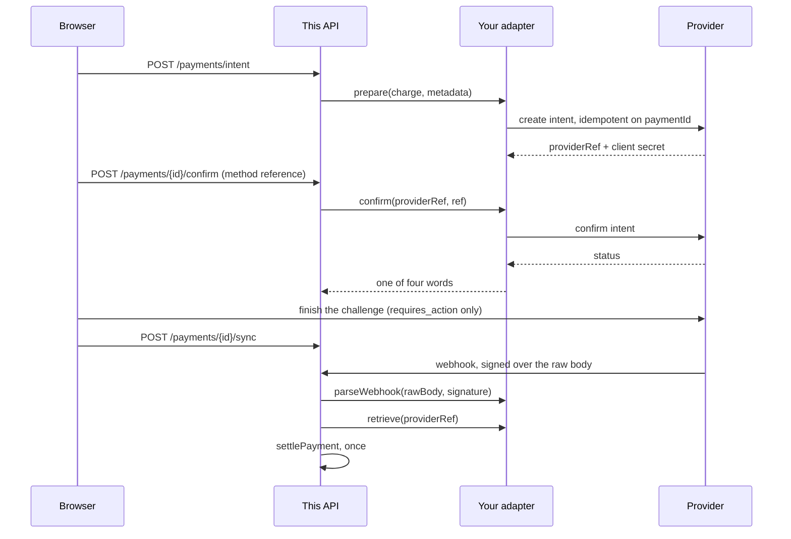

### Status mapping

The port speaks five words (`ProviderPaymentStatus`). An adapter maps its provider's own states
onto them and nothing else is visible to the rest of the module.

| Port word         | Stripe `PaymentIntent` status                                                      | Note                                                                                |
| ----------------- | ---------------------------------------------------------------------------------- | ----------------------------------------------------------------------------------- |
| `open`            | `requires_confirmation`, or `requires_payment_method` with no `last_payment_error` | Nobody has attempted it yet. Settlement writes nothing, and the sweep re-asks later |
| `requires_action` | `requires_action`                                                                  | The browser has a challenge (3-D Secure) to answer                                  |
| `processing`      | `processing`                                                                       | Slow methods; extends the stock hold                                                |
| `succeeded`       | `succeeded`                                                                        | Report `amountReceived`, `currency`, `paymentId` and `cardLast4` too                |
| `declined`        | `requires_payment_method` with a `last_payment_error`                              | Stripe sends a refused attempt back to this state, so it is a decline               |
| none              | `canceled`                                                                         | No word exists for it today. Open: the vocabulary has not been extended             |

A decline is an answer, not an error: `confirm` returns `declined` and throws only on transport
failure. `succeeded` without `amountReceived` is treated as a mismatch, so convert minor units to
the decimal the payment stores.

### Declines are reported once

Stripe sends two events for one decline, and a payment can be declined more than once by
different attempts. The module reports each fact once, from the call whose write made it true
(`settlePayment` returns `transitioned`, and only then are the audit row and the analytics event written). Only a `confirm`
may decline an already-`declined` payment, because a confirm is a new attempt: card A refused,
then card B refused, are two failures. A webhook or a sync repeating the same decline reports
nothing. The port carries no attempt id, so do not try to dedupe inside the adapter: return the
status and let the settlement decide.

### Idempotency keys expire

`refund` receives a stable `idempotencyKey`. Stripe forgets a key after 24 hours
([idempotent requests](https://docs.stripe.com/api/idempotent_requests)), so a refund retried by
the effects sweep after that window, with the same key, is a NEW refund and returns the money
twice. Before retrying an old refund, list the intent's existing refunds at the provider and
return the matching one instead of creating another. Stamp your own reference on each refund's
metadata so the match is exact.

### The webhook

`parseWebhook` receives the raw body, byte for byte. Verify the signature over those bytes first,
then translate the body, then return only the event id and the intent it names.
The delivery's own claim about the outcome is never used: the settlement calls `retrieve`, so a
late or reordered event is harmless. Throw `WebhookRejected` for anything that does not
authenticate or parse; the route answers 400.

The port checks your work: `applyWebhookDelivery` parses the event you return against the
contract's schema (`ReceivePaymentWebhookBody`) before any lookup, so an operator object such as
`{ "$ne": null }` where a `providerRef` string belongs is refused with the same 400, even from an
adapter that validated nothing. Do not rely on that: refuse a body you cannot make sense of
yourself, and keep the reason in the `WebhookRejected` message.

### Refund errors

Map the provider's refusal onto the closed `RefundFailureReason` and throw
`PaymentProviderError(code, message)` (`providers/errors.ts`). Anything else an adapter throws is
stored as `unknown`. The message is the provider's own wording and goes to the log, never the wire.

### The reconcile sweep calls the provider

[Lost webhooks](#lost-webhooks) are caught by `sweep:payment-effects`, which calls `retrieve` for
each unsettled payment untouched for `NODE_PAYMENT_RECONCILE_MINUTES`, one at a time, up to 200 per
run. That is one provider read per stale payment per run: mind the provider's rate limit, and do not
answer a guess when it refuses.

### A Stripe server-confirm walkthrough

This repo confirms on the server, not through Checkout Sessions.

1. `prepare` creates a `PaymentIntent` with `metadata.paymentId`, using the payment id as the
   idempotency key, and returns its id and `client_secret`. Resuming a payment that already has
   an intent returns that same intent.
2. The browser mounts Stripe's Payment Element, calls `stripe.createConfirmationToken`, and posts
   the token id (`ctoken_…`) as the method reference to `POST /payments/{id}/confirm`. This needs
   Stripe.js in the storefront and its origins in the CSP; the storefront ships only a fake card
   picker today.
3. `confirm` calls `paymentIntents.confirm` with that token and maps the answer.
4. On `requires_action` the browser calls `stripe.handleNextAction` with the client secret, then
   `POST /payments/{id}/sync`, which `retrieve`s and settles.
5. Whatever the browser did, the signed webhook arrives and settles the same payment once.

### Port fit

| The port needs...             | Embedded form (Stripe Payment Element, Adyen, Braintree) | Redirect (Mollie, PayPal, Stripe Checkout)                                        |
| ----------------------------- | -------------------------------------------------------- | --------------------------------------------------------------------------------- |
| `prepare`: an id and a secret | Fits: intent id plus `clientSecret`                      | Partial: there is an id, but the customer needs a URL and the port has none       |
| `confirm`: a method reference | Fits: a token or nonce from the browser                  | Does not apply: the customer pays at the provider, so there is nothing to confirm |
| `retrieve` and the webhook    | Fits                                                     | Fits: thin event, then read the payment back                                      |
| `refund`, `cancel`            | Fits                                                     | Fits                                                                              |

The redirect gap is open. `PreparedPayment` carries only `clientSecret`, so a redirect provider
cannot tell the storefront where to send the customer, and closing it changes the contract. Until
it is decided, a redirect adapter has no honest place to put its URL.

## Who can do what

Every rule this module declares and who holds it, role by role. The rule is what a route guard asks for; the set is what a role lists.

<!-- permissions:start -->

| Rule              | Set                | `guest` | `unverified` | `customer` | `manager` | `warehouse` | `support` | `editor` | `moderator` | `admin` | `operator` | Credential | What it lets them do                                                                                                                                                  |
| ----------------- | ------------------ | ------- | ------------ | ---------- | --------- | ----------- | --------- | -------- | ----------- | ------- | ---------- | ---------- | --------------------------------------------------------------------------------------------------------------------------------------------------------------------- |
| `read:Payment`    | `PaymentOwn`       | —       | ✅ own       | ✅ own     | ✅ own    | ✅ own      | ✅ own    | ✅ own   | ✅ own      | ✅ own  | —          | —          | Read the caller's own payments.                                                                                                                                       |
| `display:Payment` | `PaymentDisplay`   | —       | —            | —          | ✅        | —           | ✅        | —        | ✅          | ✅      | —          | ✅         | Read every payment in the shop — the support desk helping with an order that is never their own, and the shop manager seeing the money behind the orders they handle. |
| `create:Payment`  | `PaymentRecording` | —       | —            | —          | —         | —           | —         | —        | ✅ ⚡c      | ✅ ⚡c  | —          | —          | Record a payment that arrived outside the provider — cash, a transfer, by hand.                                                                                       |
| `create:Refund`   | `PaymentRefunding` | —       | —            | —          | —         | —           | —         | —        | ✅ ⚡c      | ✅ ⚡c  | —          | —          | Return money to the payer — refund a payment, whole or in part.                                                                                                       |

✅ held · `own` only the caller’s own rows · ⚡c / ⚡s needs a freshly proved session (critical / sensitive) ·
Credential: ✅ when an API key can be minted with the rule. Generated from the rules and sets in
`src/modules/*/authorization.yaml` and the roles in `shared/authorization-roles.yaml`, asked of the
evaluator — [Authorization](../theory/authorization.md) explains the model.

<!-- permissions:end -->

## Related pages

- [The provider port](./payments-provider-port.md) — the interface and the fake behind it
- [`orders`](./orders.md) — what a payment is about
- [Layers](../theory/layers.md) — what a port is and where it sits
- [Security](../tools/security.md) — what is never stored here, and this module's own rate-limit budgets
