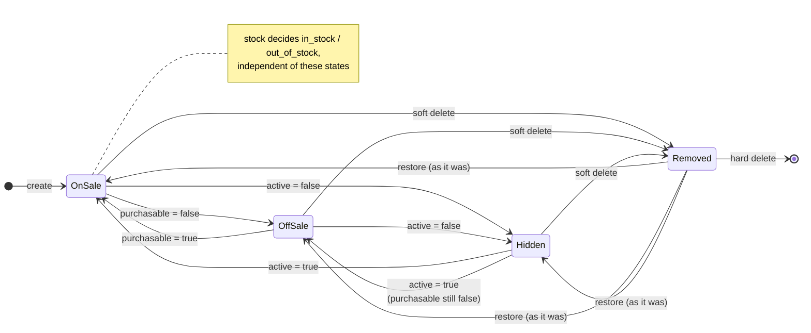
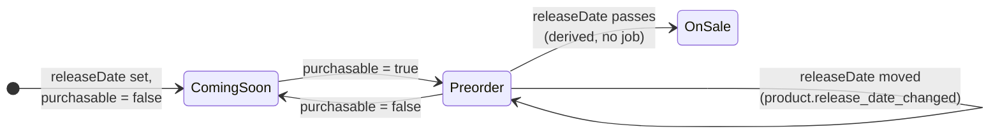

# Product states and backorder

The states a product lives in, what each one allows a buyer to do, and how backorder fits in.

## Product states {#product-states}

Three independent questions, three fields. Stock is the third axis and is unchanged.

| Field          | Question                       | `false` / set means                        |
| -------------- | ------------------------------ | ------------------------------------------ |
| `active`       | Can a shopper see it?          | hidden: 404 for shoppers, visible to staff |
| `purchasable`  | Can it be bought, stock aside? | listed, "Not available right now"          |
| `releaseDate`  | When does it ship from?        | a future date makes it a preorder          |
| `availability` | Is there stock?                | `out_of_stock`: its own read, not a field  |
| `deletedAt`    | Was it removed?                | gone; carts and wishlists drop it          |

`purchasable` is ignored while `active` is `false`: hidden wins. `active` means visibility and
nothing else, the same meaning it has on users and languages.



What each state does to the rest of the shop:

| State    | Catalogue (shopper) | Cart / wishlist line       | New add | Checkout      | Admin order   | Placed orders |
| -------- | ------------------- | -------------------------- | ------- | ------------- | ------------- | ------------- |
| On sale  | listed              | `in_stock` / stock values  | ok      | stock decides | stock decides | untouched     |
| Off sale | listed, flagged     | `unavailable`              | ok      | refused       | ok            | untouched     |
| Hidden   | 404                 | `removed`, kept            | 404     | refused       | ok (staff)    | untouched     |
| Removed  | 404                 | pulled (`product.deleted`) | 404     | n/a           | refused (409) | untouched     |

Who sees a hidden product is settled by `display:Product` (`manager`, `warehouse`, `editor`,
`admin`); an off-sale product is public, so `GET /products?purchasable=` is open to everyone. The
line values and their precedence live in [cart](./cart.md#line-availability).

### Preorder

A preorder is a product sold before it is released. It is derived, never stored:

```
preorder = active && purchasable && releaseDate > now
```

The day the date passes the product stops being one, with no job to run (BigCommerce and
WooCommerce auto-revert the same way). `releaseDate` is "ships from", a plain day (`YYYY-MM-DD`) on the shop's calendar at most
one year ahead (Google's `availability_date` rule); a day in the past is accepted and means
"released". `null` clears it; a `PUT` that omits it clears it too.

**A promise date is a day, not an instant.** Staff type a day; the server stores the UTC instant of
that day's midnight in the shop's zone (`NODE_SHOP_TIMEZONE`, published as `GET /shop` `timeZone`)
and answers with the same day, so no client does zone maths and a screen, a mail and a day-grouping
agree. There is no launch hour. The same holds for `restockDate`. The one-year limit and "a past
day means released" are checked on the stored instant. Unchanged: withdrawal deadlines count UTC
days, and an invoice prints in the zone frozen when it was issued.



| Piece                    | Owner       | What it does                                                           |
| ------------------------ | ----------- | ---------------------------------------------------------------------- |
| `releaseDate`            | `products`  | the catalogue fact; a future date makes `availability` read `preorder` |
| allowance and allocation | `inventory` | `backorderLimit` caps how many can be ordered; receipts allocate them  |
| the "ships from" promise | `delivery`  | one fulfillment order per release day, on hold until stock arrives     |

A preorder sells against the **allowance**, not the shelf: what is left of `backorderLimit` after
the units already claimed. Its `availability` reads `preorder` while any is left, and `out_of_stock`
the day the allowance is full, or until staff set one (a new product's allowance is 0). The two
numbers are `inventory`'s own, on its stock level; the product holds no copy of them.

Moving the date announces `product.release_date_changed` through the outbox, in the edit's own
transaction and only when the stored instant actually changed (the payload carries the two instants). `delivery` listens: buyers who already paid
were promised the old date, and consumer law decides what they must be told (see
[delivery](./delivery.md#preorders-and-a-moved-date)). The edit form can [preview the
count](./delivery.md#previewing-a-move-before-it-is-saved) first.

### Industry mapping

Not stored; how these states translate if a feed or JSON-LD is ever emitted.

| Ours               | schema.org `availability` | Google feed           |
| ------------------ | ------------------------- | --------------------- |
| on sale, stock > 0 | `InStock`                 | `in_stock`            |
| on sale, stock 0   | `OutOfStock`              | `out_of_stock`        |
| off sale           | `OutOfStock`              | `out_of_stock`        |
| hidden / removed   | (not emitted)             | removed from the feed |

## Backorder {#backorder}

A released product the shop keeps selling while it is out of stock. Two fields, and a derived `availability`:

| Field            | Meaning                                                                       |
| ---------------- | ----------------------------------------------------------------------------- |
| `allowBackorder` | the switch, off by default                                                    |
| `restockDate`    | optional, at most a year ahead; without it the shop promises "within 30 days" |

**A passed restock date reads `out_of_stock`**, until staff set a new date or clear it. A missed date is
evidence the shop lacks a basis to promise another one. Moving the date later tells the buyers who
were promised it, by the same rule as a moved release date; a buyer promised the 30-day default is
left alone, whatever the catalogue does.

Nothing announces that a product is orderable again: [`stock-alerts`](./stock-alerts.md) runs a
five-minute `sweep:stock-alerts` job that asks `inventory` which waiting products are no longer
`out_of_stock` and answers their requests. A product edit that changes what a shopper may order
announces `product.terms_changed`, which `inventory` listens to so its availability entry is read
fresh.

## Read next

- [products](./products.md) — the module's own page
