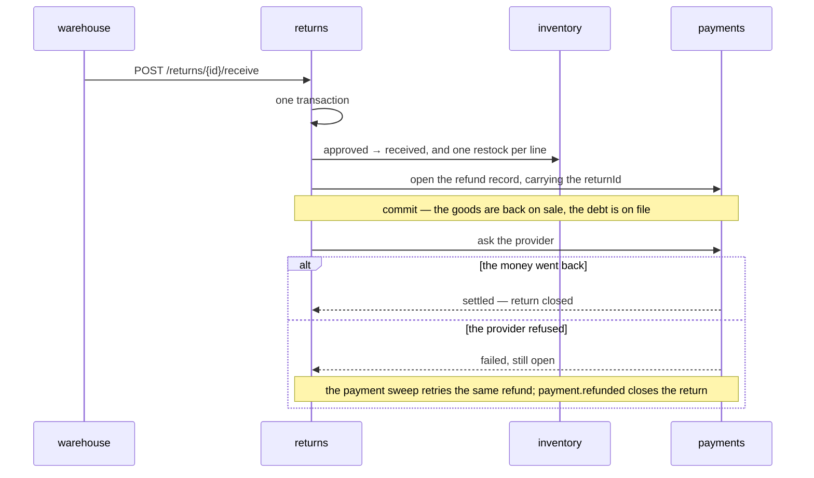
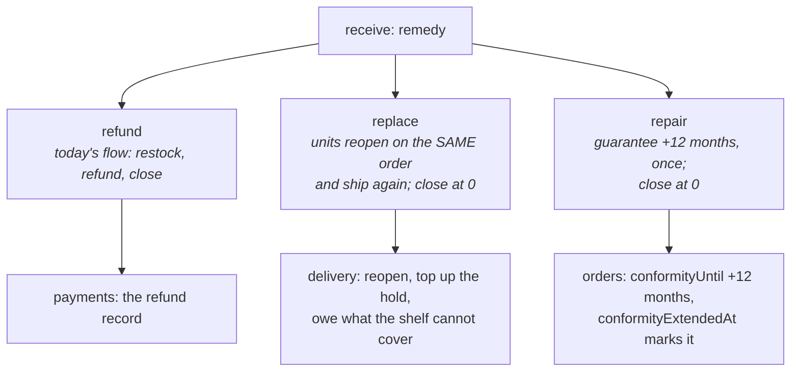
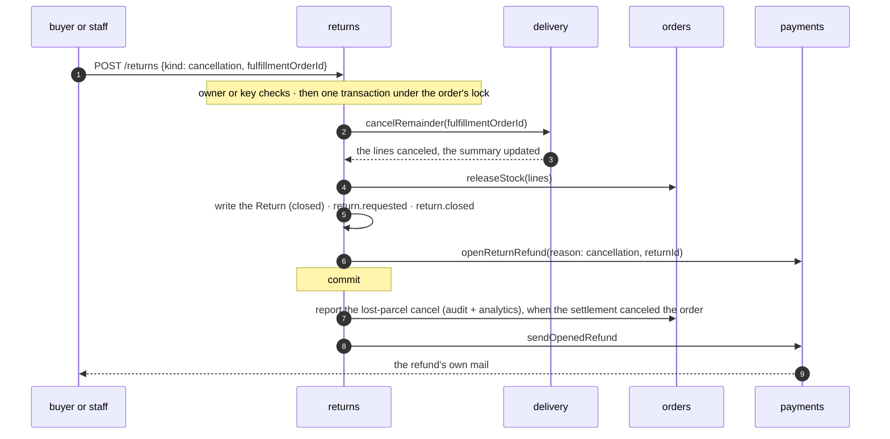

# Remedies for a return

What a return gives the buyer back, the remedy ladder, and cancelling what has not shipped.

## What the customer gets back {#what-the-customer-gets-back}

Receiving is where the two clocks meet, and they are kept apart on purpose:

- **A refused refund does not change the answer.** `POST /returns/{id}/receive` answers 200 either
  way: `received` means the money is still owed (its refund record is on the payment, where the
  sweep and the attention list follow it) or short and waiting on staff's **Close** (the payment had
  nothing left to give, so no record exists and a to-do asks staff to check), `closed` means it went
  back.
- **Received is a fact about a parcel; closed is a fact about money.** The status move and the
  restock and the refund RECORD are ONE transaction, so units are never on the shelf behind a return
  that reads `approved`, and a received return owes its debt on file whenever the payment can give
  it. Money cannot roll back, so only the provider call is outside it: the record carries this
  return's id, so a refund the provider refused (or one never sent) is retried by the payment sweep
  and closes the return when it lands. A return with no record because the payment had nothing left
  (or no succeeded payment) is `received` for a reason a person is told about:
  `payment.return_refund_short` opens a to-do, and staff **Close** the return by hand once they have
  checked. That to-do clears only on that hand close, never on an automatic one.
- **Paid outside.** Staff who may refund (`create:Refund`, on top of `receive:Return`) can say the
  buyer was already paid back in cash or by transfer: `paidOutside` on the receipt. The refund
  record is then born settled by hand in the receipt's transaction, the provider is never asked, the
  credit note and the buyer's mail follow, and the return closes in the same step. Only a `refund`
  remedy takes it (422 `RETURN_REMEDY_INVALID`), a caller without `create:Refund` gets 403, and a
  return whose refund the proof of sending already opened refuses it (409
  `RETURN_REFUND_OPENED_ON_PROOF`). The amount is still capped at what the payment has left, so an
  earlier goodwill refund makes the record smaller than the return, the return closes anyway, and the
  short-refund to-do stays open: **Close** answers 409 `RETURN_NOT_CLOSABLE` on a closed return, so
  staff close the to-do themselves once they have checked. See [Refunds](./payments-refunds.md#paid-outside).
- **Restock happens on `received`, not on refund** — two facts, two moments. No reservation is
  claimed: the order's hold was `committed` at payment and stays that way.
- **Staff choose how many units go back on sale.** `POST /returns/{id}/receive` takes
  `lines: [{ productId, restock }]`, `0 <= restock <= the line's quantity`. A product not listed goes
  back in full and absent `lines` restocks everything (the Solidus and Shopify default). Only the
  restocked units reach `restockReturnedLines` and, in the same transaction, the backorder
  allocation, so a broken unit is never handed to a paying backorder buyer. A line at 0 writes no
  ledger row. The count is recorded on each line as `restocked`, and the audit row of
  `admin.return.received` names every line's count. An unknown or repeated product, or a count over
  the line, is a 422 `RETURN_RESTOCK_INVALID` on `lines.<i>.restock`, checked before anything is
  written. The refund never reads it. For a hard-deleted product nothing moves, count or no count.
  A parcel lost on its way back is received with 0 on every line: this shop's policy is to bear
  that risk and refund on proof of sending (the EU leaves the final risk to national law), so the
  money is owed and nothing goes on the shelf. `restocked` is staff's bookkeeping; the buyer's page
  does not show it.
- **The amount** is the returned lines at the price the order froze, plus refundable delivery, less
  an optional handling deduction (Art. 14(2)) staff enter at receipt. It is fixed then and shown as
  `refundAmount`. `src/modules/returns/domain/refund-amount.ts` is pure integer arithmetic.
- **Delivery is refunded by whichever cancel or return takes the _last unit_ of the order** — every
  unit then cancelled or back, counted against ORDERED quantity — and never twice (see
  [below](#the-delivery-across-several-cancels-and-returns)). For a return that closes the order it is capped at the cheapest standard delivery the shop offers, so a paid
  express upgrade stays with the shop (Art. 13(2)); on a €150 express order, where standard would
  have been free, the refundable delivery is zero. `pickup` is collection, not delivery, and does
  not count. Goods that were faulty or not what was ordered are the seller's own doing: the whole
  delivery goes back. What an earlier cancel or return already refunded of the delivery is taken off
  first, so the cap is on what is still owed.
- **The refund is clamped to what the payment has left**, so a goodwill refund made earlier can
  never make a return over-refund. The credit note follows the refund
  ([`invoicing`](./invoicing.md)).
- **Return postage** follows `NODE_RETURN_POSTAGE_PAYER`. It changes what the customer is told, not the
  refund: with `consumer` the customer posts at their own cost (Art. 14(1), told beforehand), with
  `shop` the shop covers it.

## The remedy ladder {#the-remedy-ladder}

A faulty or wrong item (`defective`, `wrong_item`) is the legal guarantee, and the law gives the
buyer a ladder (Directive 2019/771 Art. 13): first a **repair or a replacement**, the buyer's
choice; then a price reduction or the money back. The buyer states a wish when they open the
return (`preferredRemedy`, 422 `RETURN_REMEDY_INVALID` for any other reason); staff choose the
`remedy` at receipt (`refund` by default). A withdrawal and a goodwill return always refund.

- **Money and units.** `replace` and `repair` move no money and write no credit note. They close the
  return in the receipt's transaction and **stop holding its quantities**: the buyer has a unit
  again, so it stays returnable under the guarantee, and it never takes the delivery refund
  (`holdsReturnedGoods`, `accountsOf`).
- **`replace`** is the same product, same order ([delivery](./delivery.md#replacement-after-a-return)).
  Restock is still per line (a defect is usually 0, a wrong item usually all).
- **`repair`** extends `conformityUntil` by 12 months (Directive 2024/1799), once per order; the
  unit is posted back by staff.
- **No deduction.** A guarantee remedy is free of charge (2019/771 Art. 14(1)), so a
  `handlingDeduction` on a `defective` or `wrong_item` return is a 422 `RETURN_DEDUCTION_INVALID`.
- **Staff may differ from the wish** (Art. 13(3): impossible or disproportionate). Nothing is
  refused; the audit row of `admin.return.received` carries both `remedy` and `preferredRemedy`.
- **Records.** `Return.remedy`, the order timeline's `return_closed` row, and the `return.closed`
  webhook carry the remedy. Two mails: `return-replaced` and `return-repaired`; the request and
  approval mails for a defect or a wrong item tell the buyer they choose, and that a repair extends
  the guarantee by 12 months.
- **Price reduction** (Art. 15) needs no door: the Refund button, with the guide entry
  [A faulty item](../use-the-shop/when-something-goes-wrong-returns.md#faulty-item).

## Cancelling what has not shipped {#cancelling-what-has-not-shipped}

Once any shipment left, an order can no longer be cancelled whole. What remains is cancelled **one
fulfillment order at a time**, as a Return of `kind: cancellation`, **closed when made**: its `lines`
are the remainder, and the refund of them follows the commit. The legal basis is CRD recital 40
(withdraw before delivery) and Commission Notice 2021/C 525/01 §5.5.1 (partial withdrawal); the
Shopify rule for the staff side: a partly shipped order cannot be cancelled, you refund the unshipped
items, under the Refund permission.

| Case                     | The door                                                           | Result                                                                                                   |
| ------------------------ | ------------------------------------------------------------------ | -------------------------------------------------------------------------------------------------------- |
| nothing shipped anywhere | the order's own cancel (as always)                                 | order `canceled`, full refund including delivery; every fulfillment order cancelled                      |
| something shipped        | `POST /returns` `{kind: cancellation, fulfillmentOrderId, reason}` | the remainder's lines cancelled; refund of those lines (+ delivery on the last unit); units back on sale |
| everything shipped       | a return, as always                                                | —                                                                                                        |

Why here and not in `delivery`: a remainder cancel moves **money, stock and the shipping rule**, and
only this module already reaches all four. In **one transaction**, under the order's lock row, it
asks `delivery` to mark the lines (`cancelRemainder`, which also recomputes the order's summary and
moves its status when that completes it), gives the units back (`orders.releaseStock`, which drives the hold) and
writes the Return and opens its refund record (`openReturnRefund`, `reason: cancellation`, the
Return's id). After the commit, when the settlement cancelled the order (every parcel lost), `returns` runs the
cancel report `orders` handed back: the audit row and the analytics event. Then the provider call
(`sendOpenedRefund`); a refund the provider refuses stays open for the payment
sweep, and the Return stays closed.

**Who may.** The buyer, as part of their withdrawal (`reason: withdrawal`; never on goods Art. 16
excludes, and inside the window). **Staff** (out of stock for good) need
the **refund key**, `create:Refund` — `stepUp: critical`, so the route asks for a fresh session —
held by moderator and admin; the manager and the warehouse do not hold it. Holding the key is the
whole rule, as on every door that sends money out: a refund of one's own order is allowed and its
audit rows are flagged `ownOrder` ([your own money](../understand/authorization.md#your-own-money)).
The refund's **request** is audited the moment its record opens (`admin.payment.refund_requested`),
before the provider is asked, so a provider refusal that the sweep later finishes still leaves the
decision on file; an approval or a receipt of one's own return carries the flag too. No new key and
no new verb: it is one more thing the refund permission already means.

`reason: withdrawal` by staff is **recording** the buyer's withdrawal, so it carries the day and the
channel the buyer stated it (`requestedAt`, `statedVia`) and is judged on that day, with the buyer's
own window and Art. 16 limits. A staff member who IS the buyer is answered as the buyer, and is
never prompted for a fresh session.

| Caller                                   | `withdrawal`                                                        | Any other reason                    |
| ---------------------------------------- | ------------------------------------------------------------------- | ----------------------------------- |
| the order's buyer (staff or not)         | allowed, no step-up                                                 | `RETURN_CANCELLATION_INVALID` (422) |
| staff with the refund key, not the buyer | with `requestedAt` and `statedVia`, after a fresh session; else 422 | allowed, after a fresh session      |
| anyone else                              | 403 (the key is asked first)                                        | 403                                 |

The route asks for the fresh session BEFORE the idempotency ledger: the ledger stores any JSON
answer, so a 401 challenge placed behind it would be replayed to the same key after the staff member
re-authenticated. The order is read as the caller may read it: a stranger's order is a 404.

Refused: `RETURN_CANCELLATION_INVALID` (422) — no `fulfillmentOrderId`, `lines` sent, a return that
names one, or a reason that does not fit the caller (above); `RETURN_STATEMENT_INVALID` (422) — the
stated date or channel is missing, misplaced, in the future or before the order; `RETURN_NOTHING_TO_CANCEL` (409) —
nothing is left on that fulfillment order, or nothing has shipped and no other fulfillment order has
units (that one is the whole order: cancel the order instead).

**Before anything ships**, a fulfillment order may be cancelled alone as long as another stays live.
Made-to-order goods have a group of their own (`delivery`'s [grouping rule](./delivery.md#the-grouping-rule)),
which the buyer may cancel while the order is `paid` and not once it is `processing`.

### The delivery across several cancels and returns

CRD Art. 13(1) refunds "all payments … including … the costs of delivery"; Art. 13(2) lets the premium
over the cheapest standard delivery be kept; the CJEU (C-511/08 _Heinrich Heine_) forbids charging the
outbound delivery to a consumer who withdraws. The Notice is silent on partial withdrawal, so the rule
is the one that never refunds twice and never splits it:

| Detail       | Rule                                                                                                                                 |
| ------------ | ------------------------------------------------------------------------------------------------------------------------------------ |
| "last unit"  | every ordered unit is cancelled, back (a return `received` or `closed`), or in the act being settled                                 |
| Which amount | closed by a **cancel** → all the delivery still owed; closed by a **return** → that return's reason rule (cheapest standard vs full) |
| Two at once  | decided under the per-order lock (`ReturnOrderLock`): exactly one is last. A receipt takes the lock too                              |
| Never twice  | each cancel and return stores the delivery inside its refund; the next is quoted on what is still owed                               |

## Read next

- [returns](./returns.md) — the module's own page
