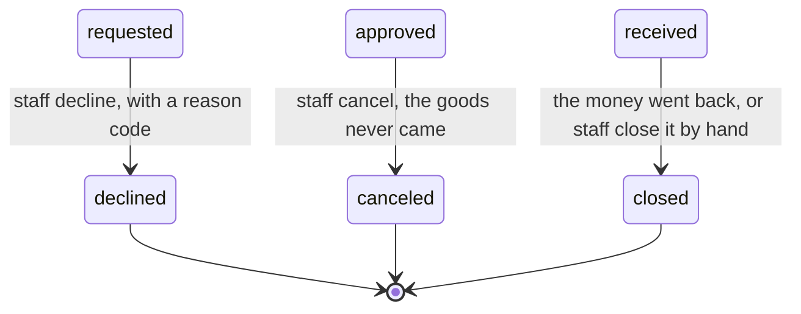

# Declining, closing and cancelling a return

How a return ends other than by refund: declined, closed by hand or cancelled, the events it raises and the statuses beside the order's own.

`declined` and `canceled` are final; `closed` follows the goods and the refund. The full lifecycle is on [the returns page](./returns.md#the-lifecycle).

## Declining a request {#declining-a-request}

`POST /returns/{id}/decline` takes a **code** and, when the code is `other`, a **message** (Shopify's
`declineReason` plus `declineNote`; Solidus' `RefundReason` is a code list too).

| Code                  | Means                                                            |
| --------------------- | ---------------------------------------------------------------- |
| `return_period_ended` | past the window                                                  |
| `not_returnable`      | exempt from returns (an Art. 16 exception) or sold as final sale |
| `no_defect_found`     | a guarantee claim where the goods conform                        |
| `other`               | none of these: the message says why, and is required             |

The buyer's mail and page show one sentence per code in **their** language, plus the message when
there is one (staff's own words stay in staff's language). The code survives the reaper because it is
not free text; only `declineMessage` is unset by `reap:returns`. The data export carries both. The
response is `Return.declineReason` (the code) and `Return.declineMessage`; no webhook announces a
decline. A decline is a complaint the shop does not settle, so ADR Directive 2013/11 Art. 13(3) asks
the shop to point the buyer to an ADR body: the mail carries none yet, which is the shop's to add.

## Closing a return by hand {#closing-a-return-by-hand}

`POST /returns/{id}/close`, body `{ note }` (optional), moves a `received` return to `closed` when its
money will not follow the usual way: the refund was canceled
([payments](./payments.md#cancelling-a-refund)), or the customer was paid outside the shop. It is
Shopify's `returnClose`.

| What it does                                                                        | What it does not                                             |
| ----------------------------------------------------------------------------------- | ------------------------------------------------------------ |
| `received → closed` in one conditional write                                        | move money, or stock (the restock happened on receipt)       |
| order timeline `return_closed`, audit `admin.return.closed` (the note is only here) | announce `return.closed`: that mail says the money went back |
| refresh the order's `returnStatus`                                                  | issue a credit note                                          |

`receive:Return` guards it, the key that receives the goods, with the same fresh-session tier. Any
other status answers 409 `RETURN_NOT_CLOSABLE`: a `requested` return is declined, not closed, and
an `approved` one whose goods never come is [canceled](#canceling-a-return).
`Return.actions.close` says whether it would be accepted.

## Canceling a return {#canceling-a-return}

`POST /returns/{id}/cancel`, body `{ note }` (optional), moves an `approved` return whose goods will
never arrive to `canceled`. It is Shopify's `returnCancel` and Solidus' return-authorization cancel.
A withdrawal, born `approved`, can be canceled too.

`canceled` is not `completed`: the return did not happen. So it holds no units (the same lines can be
returned again, by a new return) and counts as no goods back (the order's `returnStatus` leaves
`in_progress`, and the return takes no part in the delivery-refund rule).

| What it does                                                           | What it does not                          |
| ---------------------------------------------------------------------- | ----------------------------------------- |
| `approved → canceled` in one conditional write                         | move money or stock                       |
| order timeline `return_canceled`, audit `admin.return.canceled` (note) | publish an event or webhook, or send mail |
| refresh the order's `returnStatus`                                     | issue a credit note                       |

No event and no mail is a choice: a decline is not published either, and nothing the customer must
act on changed. `update:Return` guards it, with no fresh session since nothing moves; a repeat
answers 409 `RETURN_NOT_CANCELABLE`. There is no cancel from `requested` (decline covers it, with its
reason code) and no buyer-side cancel.

Two things it is **not** for:

- A parcel lost on its way back. This shop's policy is to bear that risk and refund on proof of
  sending (the EU leaves the final risk to national law), so the refund may be owed: receive it with
  a restock count of 0 ([receive](./returns-remedies.md#what-the-customer-gets-back)), or record the proof first
  ([proof of sending](./returns-withdrawal.md#proof-of-sending)).
- A withdrawal still inside the buyer's 14 days to send the goods (CRD Art. 14(1)). The guide says
  to wait; the server does not block it. Goods that turn up after a cancel are a new, staff-opened
  return with the original `requestedAt`.

## The events {#the-events}

`return.requested`, `return.received` and `return.closed` are public webhooks, so each rides the
[transactional outbox](../understand/outbox.md): the row is written in the transaction of the move it
announces, keyed on the **order** (`aggregateId`), so one order's events reach `webhooks` in the
order they were written.

| Event              | Written with                                             | Where                 |
| ------------------ | -------------------------------------------------------- | --------------------- |
| `return.requested` | the return row, under the order's lock                   | `services/create.ts`  |
| `return.received`  | the `approved → received` claim and the restock          | `services/receive.ts` |
| `return.closed`    | the `received → closed` claim (only the caller that won) | `services/close.ts`   |

A return that is lost to a race writes nothing, and a failed event write takes the move down with
it. The audit row and the order's `returnStatus` stay after the commit, best effort. The
customer's mail is sent from a listener on these events ([Customer mail](../understand/outbox.md#customer-mail)):
`return.requested` acknowledges, `return.decided` (internal) answers staff's decision, `return.closed`
says the money went back.

## Lines {#lines}

A return names what comes back: `lines` of `productId` and `quantity`, checked against what has
**shipped** (`delivery`'s fulfillment orders, per product) less what earlier non-declined returns
already took (`domain/quantities.ts`, pure). Goods that never left cannot come back; an order that
shipped in part offers only what did. No `lines`
means everything still left — the shape of a withdrawal. The title and the gross unit price are
frozen onto the line, so a refund of it reads the same later whatever the catalogue does.

Two returns opened at the same instant for the same units cannot both pass the quantity check.
Mongo transactions are snapshot isolation, so each would read "nothing returned yet" and both
would commit. Opening a return therefore first writes the order's lock row (`ReturnOrderLock`, one
per order, `$inc` in the same transaction); a second opening conflicts on that write, is re-run
after the first commits, and then sees its return. The audit row and the order's return
status follow the commit, so a lost race announces nothing.

The lock is a row of its own because `returns` must not write `orders`' document, and a counter of
returned quantities would be a second copy of the truth.

## The statuses beside the order's own {#the-statuses-beside-the-order-s-own}

`orders` cannot import `payments` or `returns`, so it cannot derive the money or the return on read.
Both are **stamped by their owner through `orders`' own service door** (`markPaymentStatus`,
`markReturnStatus`), the way `delivery` reports a shipment. `fulfillmentStatus` reads the summary
`delivery` reports, so it is derived on read.

| Field               | Values                                                                                      | Stamped by                                                                                   |
| ------------------- | ------------------------------------------------------------------------------------------- | -------------------------------------------------------------------------------------------- |
| `paymentStatus`     | `unpaid` · `paid` · `partially_refunded` · `refunded`                                       | `payments` (the refund states); `paid`/`unpaid` from `paidAt`                                |
| `fulfillmentStatus` | `unfulfilled` · `in_progress` · `on_hold` · `partially_fulfilled` · `shipped` · `fulfilled` | derived from `status` and `delivery`'s summary ([table](./orders.md#the-fulfilment-summary)) |
| `returnStatus`      | `none` · `requested` · `in_progress` · `partially_returned` · `returned`                    | `returns`, after every move (`services/projection.ts`)                                       |

`returnStatus` measures what came back against what the order held **less what a remainder cancel took**:
a cancelled unit never shipped, so it can never return, and without that a cancel would keep the order
from ever reading `returned` (and `withdraw` from ever turning off). A cancellation never counts as
goods coming back.

`returnStatus` is a report of a fact already decided, so a failed stamp is logged and never undoes the
move; the next move stamps again. `paymentStatus` is not: `payments` stamps it inside the refund's
settlement transaction, because no later refund exists to repair it after the last one.

## Read next

- [returns](./returns.md) — the module's own page
