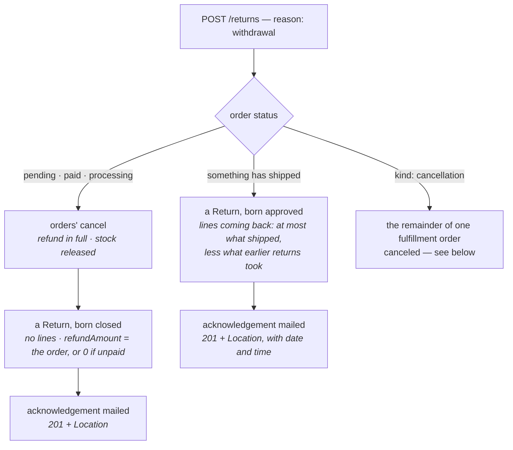

# The withdrawal button and its deadlines

The EU withdrawal right as the module implements it: the button, who may open a return, the two deadlines and the goods that have no right.

## The withdrawal button {#the-withdrawal-button}

The button is **server-driven**: `OrderActions.withdraw` says whether it is offered,
`OrderActions.withdrawBlocked` says why not (`all_excluded`, `window_closed` or `nothing_left`, the
first that applies, from `withdrawalRefusalOf` in `orders/domain/withdrawal.ts` — the same function
the door asks, so the two cannot disagree) and `OrderActions.withdrawUntil` says until when (the last day the buyer is told; a withdrawal is accepted one UTC day past it, [the grace day](./orders.md#the-withdrawal-window)). A
client shows the button **disabled with the reason**, never hidden. `OrderActions`' own description states the doctrine — a
client must not re-implement the lifecycle, because "a second copy in a separately deployed client is
how the two come to disagree". The frontend never counts the days. The clock itself is
[`orders`'](./orders.md#the-withdrawal-window).

The call always answers one thing: **201 and a `Return`** (the Stripe and GitHub rule: one resource
per endpoint). Where the goods are decides what that record is:

**Before dispatch** reads `fulfillment.shipped`, not the order's status: an order that shipped in part
is still `processing`, and refunding it whole would refund goods the buyer already holds. A withdrawal
that loses a race against a shipment is opened again as what the order now is — a return, not a cancel:
the refund waits for the goods.

- **Before dispatch the Return is a record, not a flow.** The order is still in the shop's hands, so
  `orders`' cancel already does everything — refund in full, release the stock hold. The Return
  written beside it is **closed at birth** (`reason: withdrawal`, `decidedAt` and `closedAt` now, no
  `lines` because no goods are expected, `refundAmount` the whole order — zero when nothing was
  paid). It exists so every withdrawal has its own dated record (Art. 11a(3) asks the trader to
  acknowledge the date, time and content), and so `GET /returns?orderId=` answers "what happened to
  my withdrawal" the same way whatever the order's state. The client reloads the order from
  `Return.orderId`.
- **One transaction.** The cancel (status, stock, `order.canceled` row) and the record (the Return,
  `return.requested`, `return.closed`) commit together under the order's lock row, as a remainder
  cancel does: a crash leaves both or neither, never a canceled order with no dated proof. A cancel
  refused by a shipment that landed first writes nothing.
- **The money does not move through the Return.** The cancel's own refund runs as for any cancel
  (the `refund` on `order.canceled`, finished by the refund sweep if the provider refuses), so its `payment.refunded`
  carries no `returnId`, and `returns` does not close anything on it: the Return was closed already.
  The credit note follows that event as usual.
- **Events:** the order's own `order.canceled` first, then `return.requested` and `return.closed`
  back to back (both written in the transaction that writes the return). A subscriber to `return.closed` therefore also hears about withdrawals that never
  had goods.
- **One mail from this module:** the acknowledgement, with no postage line and no address (nothing
  is posted). `return-closed` is for a return whose goods came back, so it is never sent here. Any
  notice about the money is the refund's, which belongs to `payments`, not to this module.
- An order's `returnStatus` stays `none`: a Return with no lines holds no goods, and
  `projectReturnStatus` ignores it.
- **The buyer does it, or staff record it for them** with the day and channel the buyer stated it: see [Staff open a return for the buyer](#staff-open-a-return-for-the-buyer).
- **The acknowledgement** carries the order, the exact date and time (UTC, spelled out), and who
  pays the postage — Art. 14(1) permits the consumer to bear it only if told beforehand, so the
  same `NODE_RETURN_POSTAGE_PAYER` value drives the copy and is frozen on the return.

## Staff open a return for the buyer {#staff-open-a-return-for-the-buyer}

A buyer who phones, writes or walks in cannot always click the button. Staff holding `update:Return`
use the same door, `POST /returns` (Solidus has one endpoint for both; Shopify's `returnCreate`
takes `requestedAt` for the same reason). The order is the buyer's or, for such a caller, anyone's;
anyone else still gets a 404.

| Staff open                       | Born                                   | Deadline                                       | Art. 16 goods            | Recorded                                      |
| -------------------------------- | -------------------------------------- | ---------------------------------------------- | ------------------------ | --------------------------------------------- |
| `defective` `wrong_item` `other` | `approved`, `decidedAt` now            | waived; judged on `requestedAt` for the record | taken (`other` only)     | `openedBy: staff`, `policyExceptions`         |
| `withdrawal`                     | `approved` (or closed before dispatch) | the legal window, judged on `requestedAt`      | refused as for the buyer | `openedBy: staff`, `statedVia`, `requestedAt` |

- **Opening it is the decision.** One transaction writes `return.requested` and `return.decided`
  (approved), so the buyer gets one mail, with the return address and the day they asked.
  A wrong decline is fixed the same way: open a new return for the same lines. `declined` and
  `canceled` are final, so a decision stays a record and is never rewritten.
- **`requestedAt`** is when the buyer asked, never in the future and never before the order. Staff may
  backdate it; the audit names the staff member. Every return carries it (the server stamps now for
  the buyer), and the deadline is judged on it, so a request made inside the window and entered late
  records no exception.
- **`policyExceptions`** is frozen at creation, like Solidus' `acceptance_status_errors`:
  `window_closed` when the reason's deadline had passed on `requestedAt`, `excluded_goods` when a
  goodwill return takes made-to-order goods. A defect or a wrong item never records the second: the
  guarantee reaches those goods. The `Return` shows it, so the next staff member sees it was an exception.
- **A withdrawal is not theirs to waive.** It keeps its legal window and its Art. 16 exclusion, judged
  on `requestedAt` (CRD Art. 11(2): timing counts from when it was SENT). `requestedAt` and
  `statedVia` (`phone`, `email`, `letter`, `other`) are required; the buyer's own withdrawal is
  stamped now and `online`, and the buyer sending either is a 422 `RETURN_STATEMENT_INVALID`.
- **Keys.** Shipped goods: `update:Return`. Before dispatch the order is cancelled and refunded, which
  needs `create:Refund` (the money) and `update:Order` (the cancel, run on the operator's scope with
  the staff member on the timeline). A remainder cancel needs `create:Refund`.
- **Fresh session.** Any request carrying `statedVia` asks for one, whoever sends it: the record is a
  legal act and, before dispatch, a refund. Written as "the body carries it", not "the caller is
  staff", so it fails closed.
- **The mail** tells the buyer the day they stated it, the channel and the day the shop wrote it
  down: their dated proof (Art. 11(4)). `return.requested` carries `requestedAt` and `statedVia`.
- **Not built:** a dedicated key for the waiver. `update:Return` already decides every request.

## The two deadlines {#the-two-deadlines}

An order freezes two deadlines the moment it is delivered, and a request is judged by the one that
belongs to its reason:

| Reason                    | Deadline                                                                                              | Art. 16 exclusion |
| ------------------------- | ----------------------------------------------------------------------------------------------------- | ----------------- |
| `withdrawal`, `other`     | `withdrawUntil` plus one silent day: the shop's period (`NODE_WITHDRAWAL_PERIOD_DAYS`, 30 by default) | applies           |
| `defective`, `wrong_item` | `conformityUntil`: two years from delivery, plus seven days of margin                                 | does not apply    |

The second row is the legal guarantee of conformity (Directive 2019/771 Art. 10(1), Art. 21: not
waivable). Art. 16 CRD only takes the right of **withdrawal** away, so a made-to-order item that
arrives broken is still the shop's to put right. A reason past its deadline is a 409
`RETURN_WINDOW_CLOSED`, worded for the guarantee when the reason was a defect or a wrong item.
`reasonsOpenAt` (`domain/reasons.ts`) is the one rule; the door and [the options
read](./returns.md#the-options-read) both ask it.

## The refund deadline {#the-refund-deadline}

Every refund `returns` opens, and the refund of a withdrawal before dispatch (`payments` opens that
one from `order.canceled`), is stamped with its legal deadline when the record opens: `dueBy`, and
`dueRule` for why. The stamp is stored, not recomputed, so a later change of time zone or setting
never moves a date a buyer was already owed.

| Case                                          | `dueBy`                                                 | `dueRule`    | Stamped by                                                  |
| --------------------------------------------- | ------------------------------------------------------- | ------------ | ----------------------------------------------------------- |
| withdrawal return, goods or proof in time     | end of the shop's day, 14 days after the shop was told  | `withdrawal` | `returns`, on the proof, else on receipt                    |
| withdrawal return, goods or proof after that  | the moment they arrived: pay now                        | `withdrawal` | `returns`, same                                             |
| remainder cancel (withdrawal)                 | as the first row; staff back-dating is honoured         | `withdrawal` | `returns`                                                   |
| withdrawal before dispatch, paid buyer cancel | as the first row, from `informedAt` on `order.canceled` | `withdrawal` | `payments`                                                  |
| defective or wrong item                       | the moment the goods or the proof came, the earlier     | `faulty`     | `returns`, on receipt, or on the proof with `refundOnProof` |
| goodwill (`other`), the shop's own cancel     | none                                                    | none         | none                                                        |

The table is `refundDueByOf` (`domain/refund-due.ts`); `services/refund-due.ts` adds the one thing a
domain file cannot reach, the shop's calendar. The shop may wait for the goods, whichever comes
first, but waiting never moves the last date (Directive 2011/83/EU Art. 13(3); guidance 2021/C
525/01 §5.5.3). Nothing refunds by itself: the system computes, shows and reminds.

### Proof of sending {#proof-of-sending}

`POST /returns/{id}/proof-of-sending` (`services/proof.ts`) is staff recording the carrier's document
for the parcel the buyer sent back: the date on it (`proofOfSendingAt`), the carrier and the
reference. It needs `receive:Return`, the key that receives the goods, and an `approved` return; it
is recorded **once** (a second call is a 409 `RETURN_PROOF_ALREADY_RECORDED`) and leaves the return
`approved`. The return's `actions.recordProof` says whether it is offered.

| Reason                                         | What the proof does                                                                                                                                                  |
| ---------------------------------------------- | -------------------------------------------------------------------------------------------------------------------------------------------------------------------- |
| withdrawal                                     | opens the refund now, quoted with no handling deduction, so money can go back before the parcel arrives (Art. 13(3): goods or proof, the earlier)                    |
| defective or wrong item                        | records the proof only: the remedy (refund, repair, replace) is decided at receipt; a refund picked then is due the earlier of goods and proof                       |
| defective or wrong item, `refundOnProof: true` | opens the refund now, as a withdrawal's does: staff accept the buyer's termination (Directive 2019/771 Art. 13(4), 16(3)(b)); the refund is due the day on the proof |

A `sentAt` in the future is a 422 `RETURN_PROOF_DATE_INVALID`. Staff **cannot cancel** a return whose
proof opened its refund: that is a 409 `RETURN_REFUND_OPEN`, because the refund is owed and a canceled
return would no longer add up (the check rides in the cancel's own conditional write, and names both
the withdrawal and the `refundOnProof` case). The return's `actions.cancel` is false from then on, so
no client offers the button. A proof on a faulty item that did not choose `refundOnProof` opens
nothing, so that return can still be canceled.

**Refund on proof** is staff's choice, made when they record the proof, for a defective or wrong item
only (any other reason with it is a 422 `RETURN_REFUND_ON_PROOF_INVALID`). It is not automatic: a
faulty item may be repaired or replaced first (Art. 13(2)-(3)), and only the buyer's termination
makes the refund due on proof, so staff choose it with the claim in front of them. The flag is
stored as `refundOnProof` on the return, shown on the `Return` response (so a client can lock the
remedy at receipt) and written on the proof's audit row. Once the refund opened on proof, receipt
refuses a repair or a replacement with a 409 `RETURN_REFUND_OPENED_ON_PROOF`.

A return whose refund opened on proof counts as **settled** for the order's accounts, though its
parcel may not have arrived: its units and the delivery it quoted are already accounted for, so the
next return or cancel on the order sees them and the delivery is refunded exactly once, by whichever
takes the last unit ([the accounts](./returns-remedies.md#the-delivery-across-several-cancels-and-returns)).

After a proof on a withdrawal, **receiving the goods** restocks as usual and opens no second refund.
It also refuses a handling deduction above 0 with a 409 `RETURN_REFUND_OPENED_ON_PROOF`: the shop can
no longer withhold the refund, so what the buyer damaged is claimed from them separately. If that
refund already settled, the receipt closes the return in the same step; if it is still owed, the
return stays `received` and the `PAYMENT_REFUNDED` listener closes it when it settles. A parcel lost
after a proof is received with 0 on every line and follows the same path. A proof that asked for
money while the payment had nothing left opened no record and raised a `return_refund_short` to-do
then: the goods arriving leave the return `received`, for staff to close by hand once they have checked. The order's timeline gets a
`proof_of_sending_recorded` row (the return's id only: the carrier and reference stay on the return).

## Goods with no right of withdrawal {#goods-with-no-right-of-withdrawal}

Art. 16(c)–(d) of the Consumer Rights Directive takes the right away from some goods — those made
to the customer's specifications or clearly personalised, and those liable to deteriorate or expire
rapidly. A product carries `noWithdrawal: true` (an admin sets it in the
product form); the flag is **frozen onto each order line at checkout**, like every other line field,
so changing the product later cannot rewrite what a customer was sold.

- A withdrawal that names no lines leaves excluded lines out of what comes back.
- A `withdrawal` or `other` return that names an excluded line is refused (422,
  `RETURN_LINES_INVALID`); a `defective` or `wrong_item` one is not ([the two deadlines](#the-two-deadlines)).
- A withdrawal **before dispatch** takes the eligible goods; only an order made wholly of excluded
  goods is refused (422, `all_excluded` on the button). The ordinary cancel is the shop's own policy
  and is unaffected.
    - While the order is `pending` or `paid` the shop has not started, so the whole order is cancelled,
      the excluded line included (the buyer re-orders what they still want).
    - Once it is `processing` the excluded line is the shop's work: only the other shipment groups are
      cancelled (a `kind: cancellation` return each) and the made-to-order group stays, with the order.
    - An edge the flag cannot see: when the eligible groups are already cancelled, the button still
      shows (the order's lines are frozen) and a second withdrawal answers `RETURN_NOTHING_TO_CANCEL`.
- `OrderActions.withdraw` is `false` on an order made only of excluded goods (`withdrawBlocked:
all_excluded`).
- Excluded units never come back, so they never keep the order from reading `returned` — and a
  return that leaves them behind is never a "full" return, so delivery is not refunded with it.

**Sealed hygiene goods** (Art. 16(e)) keep the right until the customer opens them after delivery.
The flag cannot see that, so it is not the switch for them: staff handle an opened return outside
the flow.

**Digital content** (Art. 16(m): the right is lost once delivery starts, with the consumer's express
consent) is not modelled: there is no consent step at checkout, and `noWithdrawal` is **not** the
switch for it. Until one is built, the full withdrawal period is the lawful default (Art. 14(4)(b)).

- Accepting the terms, or a pre-ticked box, is not express consent (Commission guidance on Directive
  2011/83/EU), so a clause in the shop's own terms-and-conditions text does not replace the step.
- The step belongs with digital downloads: a marker on the product, the consent, a stamp for when
  supply began, and the Art. 8(7)(b) confirmation.

## Read next

- [returns](./returns.md) — the module's own page
