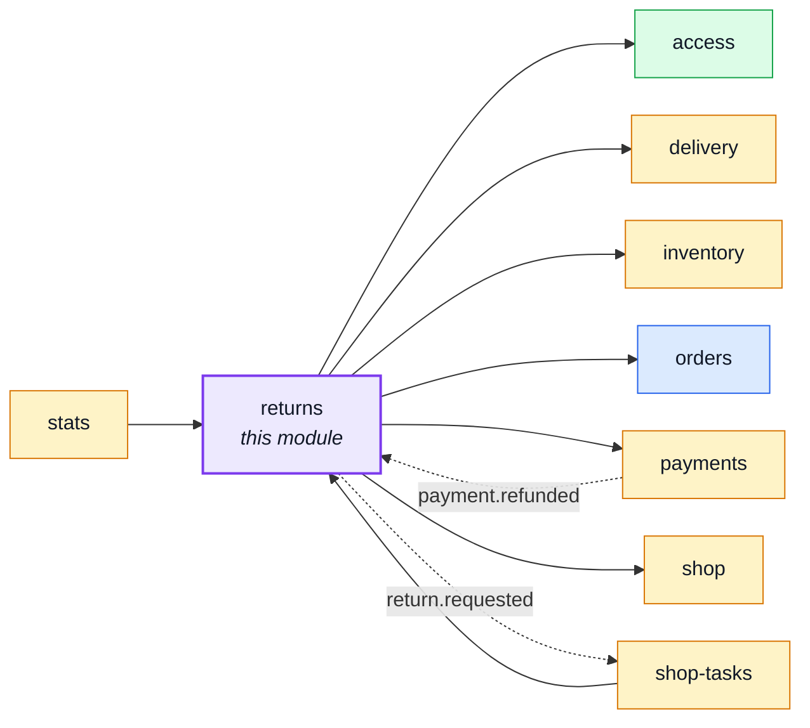
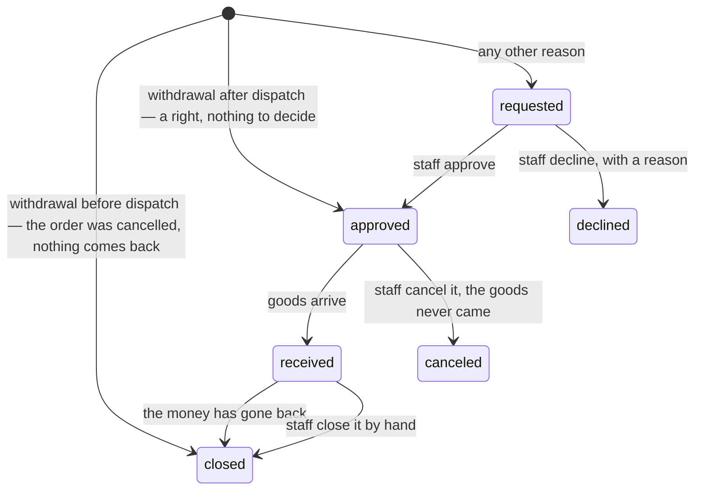
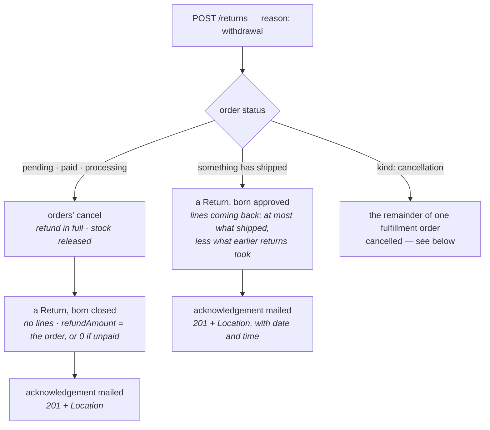
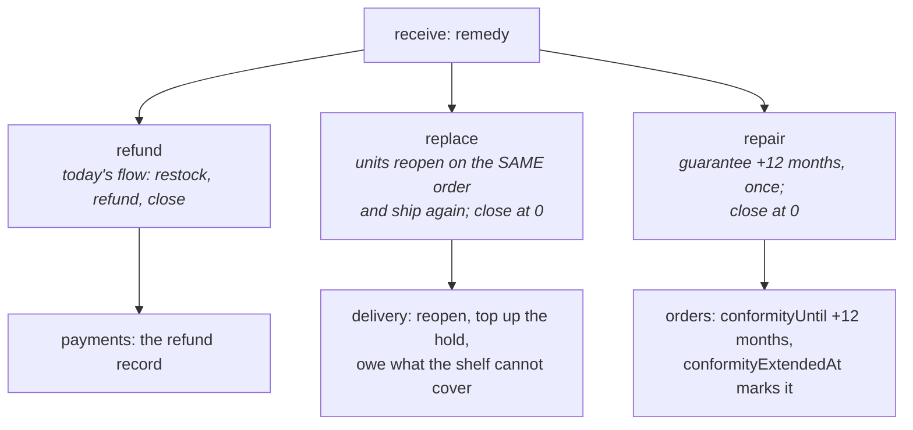
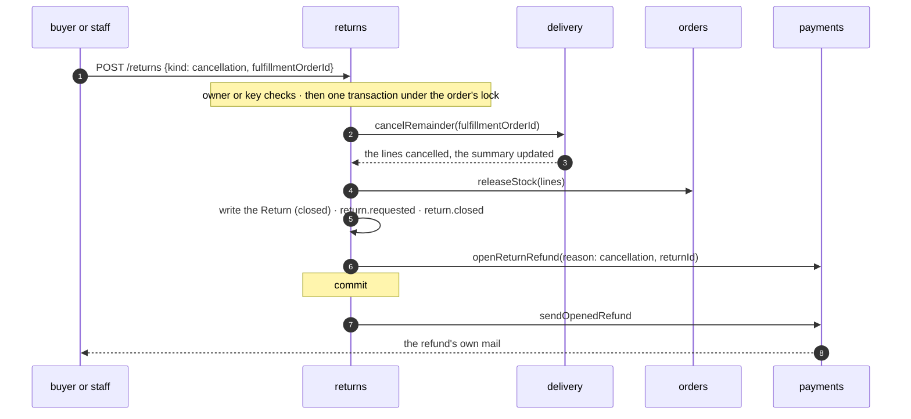

# returns

::: tip At a glance
**Owns** — the `Return` collection, outright: the request to send goods back — or the record that an
unshipped remainder was cancelled — its lines, and where it stands. A withdrawal is one of these.
**Depends on** — [`orders`](./orders.md) (the order a return is about, its owner, and the cancel a
withdrawal before dispatch becomes), [`inventory`](./inventory.md) (received goods back on sale),
[`payments`](./payments.md) (the refund, and `payment.refunded` closing the return) and
[`delivery`](./delivery.md) (what has shipped, what remains of each fulfillment order, and the
delivery a withdrawal refunds), [`access`](./access.md) (the audit flag of an approve or receive on
the caller's own order) and [`shop`](./shop.md) (where goods come back to, who pays the postage).
**Breaks if you change** — `orders`' `OrderActions.withdraw`/`withdrawUntil` (the button reads them)
and `orders`' `withdrawById`; `payments`' `openReturnRefund`, `sendOpenedRefund` and the `returnId` on a refund.
:::

## Its neighbourhood

<!-- module-graph:returns:start -->

_Solid arrows are imports. Dotted arrows are domain events — the return path an import
graph cannot see._



<!-- module-graph:returns:end -->

## The story

Since 19 June 2026 an online shop in the EU must offer a "withdraw from contract here" button for
the whole withdrawal period, with a confirmation step and an acknowledgement on a durable medium
(Consumer Rights Directive Art. 11a, added by Directive 2023/2673). This module is that button.

The button is not a feature of its own. In Shopify, Medusa and commercetools it
is **a Return whose `reason` is `withdrawal`** — the same object a faulty-goods return uses, with a
legal deadline and an acknowledgement attached. So there is no separate endpoint: the button is
`POST /returns`.

Three objects, each owned once:

| Object                 | Owns                                                                        | Lives in                                   |
| ---------------------- | --------------------------------------------------------------------------- | ------------------------------------------ |
| **Return**             | the _request_: lines, reason, state                                         | this module                                |
| **Refund**             | the _money_: one record per attempt, on the payment                         | [`payments`](./payments.md#refund-records) |
| **Status projections** | `paymentStatus`, `fulfillmentStatus`, `returnStatus` beside the order's own | [`orders`](./orders.md)                    |

## The lifecycle



Every move is one conditional write from the statuses that may precede it
(`src/modules/returns/domain/lifecycle.ts`), so two staff members deciding the same request race in
the database and exactly one wins — the loser is told it was already decided (409). The one move
that is not conditional is the first: a withdrawal before dispatch is written `closed` at birth.

`declined` and `canceled` are final. A wrong decline is not undone: staff open a new return for the
same lines ([Declined by mistake](../demo-ecommerce/support.md#declined-by-mistake)), which is how
Shopify and Solidus fix it, so a decision stays a record and is never rewritten.

## Declining a request {#declining-a-request}

`POST /returns/{id}/decline` takes a **code** and, when the code is `other`, a **message** (Shopify's
`declineReason` plus `declineNote`; Solidus' `RefundReason` is a code list too).

| Code                  | Means                                                            |
| --------------------- | ---------------------------------------------------------------- |
| `return_period_ended` | past the window                                                  |
| `not_returnable`      | exempt from returns (an Art. 16 exception) or sold as final sale |
| `no_defect_found`     | a guarantee claim where the goods conform                        |
| `other`               | none of these: the message says why, and is required             |

The buyer's mail and page show one sentence per code in **their** language, plus the message when
there is one (staff's own words stay in staff's language). The code survives the reaper because it is
not free text; only `declineMessage` is unset by `reap:returns`. The data export carries both. The
response is `Return.declineReason` (the code) and `Return.declineMessage`; no webhook announces a
decline. A decline is a complaint the shop does not settle, so ADR Directive 2013/11 Art. 13(3) asks
the shop to point the buyer to an ADR body: the mail carries none yet, which is the shop's to add.

## Closing a return by hand {#closing-a-return-by-hand}

`POST /returns/{id}/close`, body `{ note }` (optional), moves a `received` return to `closed` when its
money will not follow the usual way: the refund was canceled
([payments](./payments.md#cancelling-a-refund)), or the customer was paid outside the shop. It is
Shopify's `returnClose`.

| What it does                                                                        | What it does not                                             |
| ----------------------------------------------------------------------------------- | ------------------------------------------------------------ |
| `received → closed` in one conditional write                                        | move money, or stock (the restock happened on receipt)       |
| order timeline `return_closed`, audit `admin.return.closed` (the note is only here) | announce `return.closed`: that mail says the money went back |
| refresh the order's `returnStatus`                                                  | issue a credit note                                          |

`receive:Return` guards it, the key that receives the goods, with the same fresh-session tier. Any
other status answers 409 `RETURN_NOT_CLOSABLE`: a `requested` return is declined, not closed, and
an `approved` one whose goods never come is [canceled](#canceling-a-return).
`Return.actions.close` says whether it would be accepted.

## Canceling a return {#canceling-a-return}

`POST /returns/{id}/cancel`, body `{ note }` (optional), moves an `approved` return whose goods will
never arrive to `canceled`. It is Shopify's `returnCancel` and Solidus' return-authorization cancel.
A withdrawal, born `approved`, can be canceled too.

`canceled` is not `completed`: the return did not happen. So it holds no units (the same lines can be
returned again, by a new return) and counts as no goods back (the order's `returnStatus` leaves
`in_progress`, and the return takes no part in the delivery-refund rule).

| What it does                                                           | What it does not                          |
| ---------------------------------------------------------------------- | ----------------------------------------- |
| `approved → canceled` in one conditional write                         | move money or stock                       |
| order timeline `return_canceled`, audit `admin.return.canceled` (note) | publish an event or webhook, or send mail |
| refresh the order's `returnStatus`                                     | issue a credit note                       |

No event and no mail is a choice: a decline is not published either, and nothing the customer must
act on changed. `update:Return` guards it, with no fresh session since nothing moves; a repeat
answers 409 `RETURN_NOT_CANCELABLE`. There is no cancel from `requested` (decline covers it, with its
reason code) and no buyer-side cancel.

Two things it is **not** for:

- A parcel lost on its way back. The shop bears that risk, so the refund may be owed: receive it with
  a restock count of 0 ([receive](#what-the-customer-gets-back)).
- A withdrawal still inside the buyer's 14 days to send the goods (CRD Art. 14(1)). The guide says
  to wait; the server does not block it. Goods that turn up after a cancel are a new, staff-opened
  return with the original `requestedAt`.

## The events

`return.requested`, `return.received` and `return.closed` are public webhooks, so each rides the
[transactional outbox](../tools/outbox.md): the row is written in the transaction of the move it
announces, keyed on the **order** (`aggregateId`), so one order's events reach `webhooks` in the
order they were written.

| Event              | Written with                                             | Where                 |
| ------------------ | -------------------------------------------------------- | --------------------- |
| `return.requested` | the return row, under the order's lock                   | `services/create.ts`  |
| `return.received`  | the `approved → received` claim and the restock          | `services/receive.ts` |
| `return.closed`    | the `received → closed` claim (only the caller that won) | `services/close.ts`   |

A return that is lost to a race writes nothing, and a failed event write takes the move down with
it. The audit row and the order's `returnStatus` stay after the commit, best effort. The
customer's mail is sent from a listener on these events ([Customer mail](../tools/outbox.md#customer-mail)):
`return.requested` acknowledges, `return.decided` (internal) answers staff's decision, `return.closed`
says the money went back.

## The withdrawal button

The button is **server-driven**: `OrderActions.withdraw` says whether it is offered,
`OrderActions.withdrawBlocked` says why not (`all_excluded`, `window_closed` or `nothing_left`, the
first that applies, from `withdrawalRefusalOf` in `orders/domain/withdrawal.ts` — the same function
the door asks, so the two cannot disagree) and `OrderActions.withdrawUntil` says until when (the last day the buyer is told; a withdrawal is accepted one UTC day past it, [the grace day](./orders.md#the-withdrawal-window)). A
client shows the button **disabled with the reason**, never hidden. `OrderActions`' own description states the doctrine — a
client must not re-implement the lifecycle, because "a second copy in a separately deployed client is
how the two come to disagree". The frontend never counts the days. The clock itself is
[`orders`'](./orders.md#the-withdrawal-window).

The call always answers one thing: **201 and a `Return`** (the Stripe and GitHub rule: one resource
per endpoint). Where the goods are decides what that record is:



**Before dispatch** reads `fulfillment.shipped`, not the order's status: an order that shipped in part
is still `processing`, and refunding it whole would refund goods the buyer already holds. A withdrawal
that loses a race against a shipment is opened again as what the order now is — a return, never a full
refund.

- **Before dispatch the Return is a record, not a flow.** The order is still in the shop's hands, so
  `orders`' cancel already does everything — refund in full, release the stock hold. The Return
  written beside it is **closed at birth** (`reason: withdrawal`, `decidedAt` and `closedAt` now, no
  `lines` because no goods are expected, `refundAmount` the whole order — zero when nothing was
  paid). It exists so every withdrawal has its own dated record (Art. 11a(3) asks the trader to
  acknowledge the date, time and content), and so `GET /returns?orderId=` answers "what happened to
  my withdrawal" the same way whatever the order's state. The client reloads the order from
  `Return.orderId`.
- **The money does not move through the Return.** The cancel's own refund runs as for any cancel
  (the `refund` on `order.cancelled`, finished by the refund sweep if the provider refuses), so its `payment.refunded`
  carries no `returnId`, and `returns` does not close anything on it: the Return was closed already.
  The credit note follows that event as usual.
- **Events:** the order's own `order.cancelled` first, then `return.requested` and `return.closed`
  back to back (both written in the transaction that writes the return). A subscriber to `return.closed` therefore also hears about withdrawals that never
  had goods.
- **One mail from this module:** the acknowledgement, with no postage line and no address (nothing
  is posted). `return-closed` is for a return whose goods came back, so it is never sent here. Any
  notice about the money is the refund's, which belongs to `payments`, not to this module.
- An order's `returnStatus` stays `none`: a Return with no lines holds no goods, and
  `projectReturnStatus` ignores it.
- **The buyer does it, or staff record it for them** with the day and channel the buyer stated it: see [Staff open a return for the buyer](#staff-open-a-return-for-the-buyer).
- **The acknowledgement** carries the order, the exact date and time (UTC, spelled out), and who
  pays the postage — Art. 14(1) permits the consumer to bear it only if told beforehand, so the
  same `NODE_RETURN_POSTAGE_PAYER` value drives the copy and is frozen on the return.

## Staff open a return for the buyer {#staff-open-a-return-for-the-buyer}

A buyer who phones, writes or walks in cannot always click the button. Staff holding `update:Return`
use the same door, `POST /returns` (Solidus has one endpoint for both; Shopify's `returnCreate`
takes `requestedAt` for the same reason). The order is the buyer's or, for such a caller, anyone's;
anyone else still gets a 404.

| Staff open                       | Born                                   | Deadline                                       | Art. 16 goods            | Recorded                                      |
| -------------------------------- | -------------------------------------- | ---------------------------------------------- | ------------------------ | --------------------------------------------- |
| `defective` `wrong_item` `other` | `approved`, `decidedAt` now            | waived; judged on `requestedAt` for the record | taken (`other` only)     | `openedBy: staff`, `policyExceptions`         |
| `withdrawal`                     | `approved` (or closed before dispatch) | the legal window, judged on `requestedAt`      | refused as for the buyer | `openedBy: staff`, `statedVia`, `requestedAt` |

- **Opening it is the decision.** One transaction writes `return.requested` and `return.decided`
  (approved), so the buyer gets one mail, with the return address and the day they asked.
  A wrong decline is fixed the same way: open a new return for the same lines. `declined` and
  `canceled` are final, so a decision stays a record and is never rewritten.
- **`requestedAt`** is when the buyer asked, never in the future and never before the order. Staff may
  backdate it; the audit names the staff member. Every return carries it (the server stamps now for
  the buyer), and the deadline is judged on it, so a request made inside the window and entered late
  records no exception.
- **`policyExceptions`** is frozen at creation, like Solidus' `acceptance_status_errors`:
  `window_closed` when the reason's deadline had passed on `requestedAt`, `excluded_goods` when a
  goodwill return takes made-to-order goods. A defect or a wrong item never records the second: the
  guarantee reaches those goods. The `Return` shows it, so the next staff member sees it was an exception.
- **A withdrawal is not theirs to waive.** It keeps its legal window and its Art. 16 exclusion, judged
  on `requestedAt` (CRD Art. 11(2): timing counts from when it was SENT). `requestedAt` and
  `statedVia` (`phone`, `email`, `letter`, `other`) are required; the buyer's own withdrawal is
  stamped now and `online`, and the buyer sending either is a 422 `RETURN_STATEMENT_INVALID`.
- **Keys.** Shipped goods: `update:Return`. Before dispatch the order is cancelled and refunded, which
  needs `create:Refund` (the money) and `update:Order` (the cancel, run on the operator's scope with
  the staff member on the timeline). A remainder cancel needs `create:Refund`.
- **Fresh session.** Any request carrying `statedVia` asks for one, whoever sends it: the record is a
  legal act and, before dispatch, a refund. Written as "the body carries it", not "the caller is
  staff", so it fails closed.
- **The mail** tells the buyer the day they stated it, the channel and the day the shop wrote it
  down: their dated proof (Art. 11(4)). `return.requested` carries `requestedAt` and `statedVia`.
- **Not built:** a dedicated key for the waiver. `update:Return` already decides every request.

## Lines

A return names what comes back: `lines` of `productId` and `quantity`, checked against what has
**shipped** (`delivery`'s fulfillment orders, per product) less what earlier non-declined returns
already took (`domain/quantities.ts`, pure). Goods that never left cannot come back; an order that
shipped in part offers only what did. No `lines`
means everything still left — the shape of a withdrawal. The title and the gross unit price are
frozen onto the line, so a refund of it reads the same later whatever the catalogue does.

Two returns opened at the same instant for the same units cannot both pass the quantity check.
Mongo transactions are snapshot isolation, so each would read "nothing returned yet" and both
would commit. Opening a return therefore first writes the order's lock row (`ReturnOrderLock`, one
per order, `$inc` in the same transaction); a second opening conflicts on that write, is re-run
after the first commits, and then sees its return. The audit row and the order's return
status follow the commit, so a lost race announces nothing.

The lock is a row of its own because `returns` must not write `orders`' document, and a counter of
returned quantities would be a second copy of the truth.

## The two deadlines

An order freezes two deadlines the moment it is delivered, and a request is judged by the one that
belongs to its reason:

| Reason                    | Deadline                                                                                              | Art. 16 exclusion |
| ------------------------- | ----------------------------------------------------------------------------------------------------- | ----------------- |
| `withdrawal`, `other`     | `withdrawUntil` plus one silent day: the shop's period (`NODE_WITHDRAWAL_PERIOD_DAYS`, 30 by default) | applies           |
| `defective`, `wrong_item` | `conformityUntil`: two years from delivery, plus seven days of margin                                 | does not apply    |

The second row is the legal guarantee of conformity (Directive 2019/771 Art. 10(1), Art. 21: not
waivable). Art. 16 CRD only takes the right of **withdrawal** away, so a made-to-order item that
arrives broken is still the shop's to put right. A reason past its deadline is a 409
`RETURN_WINDOW_CLOSED`, worded for the guarantee when the reason was a defect or a wrong item.
`reasonsOpenAt` (`domain/reasons.ts`) is the one rule; the door and [the options
read](#the-options-read) both ask it.

## Goods with no right of withdrawal

Art. 16(c)–(d) of the Consumer Rights Directive takes the right away from some goods — those made
to the customer's specifications or clearly personalised, and those liable to deteriorate or expire
rapidly. A product carries `noWithdrawal: true` (an admin sets it in the
product form); the flag is **frozen onto each order line at checkout**, like every other line field,
so changing the product later cannot rewrite what a customer was sold.

- A withdrawal that names no lines leaves excluded lines out of what comes back.
- A `withdrawal` or `other` return that names an excluded line is refused (422,
  `RETURN_LINES_INVALID`); a `defective` or `wrong_item` one is not ([the two deadlines](#the-two-deadlines)).
- A withdrawal **before dispatch** takes the eligible goods; only an order made wholly of excluded
  goods is refused (422, `all_excluded` on the button). The ordinary cancel is the shop's own policy
  and is unaffected.
    - While the order is `pending` or `paid` the shop has not started, so the whole order is cancelled,
      the excluded line included (the buyer re-orders what they still want).
    - Once it is `processing` the excluded line is the shop's work: only the other shipment groups are
      cancelled (a `kind: cancellation` return each) and the made-to-order group stays, with the order.
    - An edge the flag cannot see: when the eligible groups are already cancelled, the button still
      shows (the order's lines are frozen) and a second withdrawal answers `RETURN_NOTHING_TO_CANCEL`.
- `OrderActions.withdraw` is `false` on an order made only of excluded goods (`withdrawBlocked:
all_excluded`).
- Excluded units never come back, so they never keep the order from reading `returned` — and a
  return that leaves them behind is never a "full" return, so delivery is not refunded with it.

**Sealed hygiene goods** (Art. 16(e)) keep the right until the customer opens them after delivery.
The flag cannot see that, so it is not the switch for them: staff handle an opened return outside
the flow.

**Digital content** (Art. 16(m): the right is lost once delivery starts, with the consumer's express
consent) is not modelled: there is no consent step at checkout, and `noWithdrawal` is **not** the
switch for it. Until one is built, the full withdrawal period is the lawful default (Art. 14(4)(b)).

- Accepting the terms, or a pre-ticked box, is not express consent (Commission guidance on Directive
  2011/83/EU), so a clause in the shop's own terms-and-conditions text does not replace the step.
- The step belongs with digital downloads: a marker on the product, the consent, a stamp for when
  supply began, and the Art. 8(7)(b) confirmation.

## The statuses beside the order's own

`orders` cannot import `payments` or `returns`, so it cannot derive the money or the return on read.
Both are **stamped by their owner through `orders`' own service door** (`markPaymentStatus`,
`markReturnStatus`), the way `delivery` reports a shipment. `fulfillmentStatus` reads the summary
`delivery` reports, so it is derived on read.

| Field               | Values                                                                                      | Stamped by                                                                                   |
| ------------------- | ------------------------------------------------------------------------------------------- | -------------------------------------------------------------------------------------------- |
| `paymentStatus`     | `unpaid` · `paid` · `partially_refunded` · `refunded`                                       | `payments` (the refund states); `paid`/`unpaid` from `paidAt`                                |
| `fulfillmentStatus` | `unfulfilled` · `in_progress` · `on_hold` · `partially_fulfilled` · `shipped` · `fulfilled` | derived from `status` and `delivery`'s summary ([table](./orders.md#the-fulfilment-summary)) |
| `returnStatus`      | `none` · `requested` · `in_progress` · `partially_returned` · `returned`                    | `returns`, after every move (`services/projection.ts`)                                       |

`returnStatus` measures what came back against what the order held **less what a remainder cancel took**:
a cancelled unit never shipped, so it can never return, and without that a cancel would keep the order
from ever reading `returned` (and `withdraw` from ever turning off). A cancellation never counts as
goods coming back.

`returnStatus` is a report of a fact already decided, so a failed stamp is logged and never undoes the
move; the next move stamps again. `paymentStatus` is not: `payments` stamps it inside the refund's
settlement transaction, because no later refund exists to repair it after the last one.

## What the customer gets back

Receiving is where the two clocks meet, and they are kept apart on purpose:

```mermaid
sequenceDiagram
    participant W as warehouse
    participant R as returns
    participant I as inventory
    participant P as payments
    W->>R: POST /returns/{id}/receive
    R->>R: one transaction
    R->>I: approved → received, and one restock per line
    R->>P: open the refund record, carrying the returnId
    Note over R,P: commit — the goods are back on sale, the debt is on file
    R->>P: ask the provider
    alt the money went back
        P-->>R: settled — return closed
    else the provider refused
        P-->>R: failed, still open
        Note over P,R: the payment sweep retries the same refund; payment.refunded closes the return
    end
```

- **A refused refund does not change the answer.** `POST /returns/{id}/receive` answers 200 either
  way: `received` means the money is still owed (its refund record is already on the payment, where
  the sweep and the attention list follow it), `closed` means it went back.
- **Received is a fact about a parcel; closed is a fact about money.** The status move and the
  restock and the refund RECORD are ONE transaction, so units are never on the shelf behind a return
  that reads `approved`, and a received return always has its debt on file. Money cannot roll back,
  so only the provider call is outside it: the record carries this return's id, so a refund the
  provider refused (or one never sent) is retried by the payment sweep and closes the return when
  it lands. A return is never stuck
  `received` for a reason nobody is retrying.
- **Restock happens on `received`, not on refund** — two facts, two moments. No reservation is
  claimed: the order's hold was `committed` at payment and stays that way.
- **Staff choose how many units go back on sale.** `POST /returns/{id}/receive` takes
  `lines: [{ productId, restock }]`, `0 <= restock <= the line's quantity`. A product not listed goes
  back in full and absent `lines` restocks everything (the Solidus and Shopify default). Only the
  restocked units reach `restockReturnedLines` and, in the same transaction, the backorder
  allocation, so a broken unit is never handed to a paying backorder buyer. A line at 0 writes no
  ledger row. The count is recorded on each line as `restocked`, and the audit row of
  `admin.return.received` names every line's count. An unknown or repeated product, or a count over
  the line, is a 422 `RETURN_RESTOCK_INVALID` on `lines.<i>.restock`, checked before anything is
  written. The refund never reads it. For a hard-deleted product nothing moves, count or no count.
  A parcel lost on its way back is received with 0 on every line: the shop bears that risk, so the
  money is owed and nothing goes on the shelf. `restocked` is staff's bookkeeping; the buyer's page
  does not show it.
- **The amount** is the returned lines at the price the order froze, plus refundable delivery, less
  an optional handling deduction (Art. 14(2)) staff enter at receipt. It is fixed then and shown as
  `refundAmount`. `src/modules/returns/domain/refund-amount.ts` is pure integer arithmetic.
- **Delivery is refunded by whichever cancel or return takes the _last unit_ of the order** — every
  unit then cancelled or back, counted against ORDERED quantity — and never twice (see
  [below](#the-delivery-across-several-cancels-and-returns)). For a return that closes the order it is capped at the cheapest standard delivery the shop offers, so a paid
  express upgrade stays with the shop (Art. 13(2)); on a €150 express order, where standard would
  have been free, the refundable delivery is zero. `pickup` is collection, not delivery, and does
  not count. Goods that were faulty or not what was ordered are the seller's own doing: the whole
  delivery goes back. What an earlier cancel or return already refunded of the delivery is taken off
  first, so the cap is on what is still owed.
- **The refund is clamped to what the payment has left**, so a goodwill refund made earlier can
  never make a return over-refund. The credit note follows the refund
  ([`invoicing`](./invoicing.md)).
- **Return postage** follows `NODE_RETURN_POSTAGE_PAYER`. It changes what the customer is told, not the
  refund: with `consumer` the customer posts at their own cost (Art. 14(1), told beforehand), with
  `shop` the shop covers it.

## The remedy ladder {#the-remedy-ladder}

A faulty or wrong item (`defective`, `wrong_item`) is the legal guarantee, and the law gives the
buyer a ladder (Directive 2019/771 Art. 13): first a **repair or a replacement**, the buyer's
choice; then a price reduction or the money back. The buyer states a wish when they open the
return (`preferredRemedy`, 422 `RETURN_REMEDY_INVALID` for any other reason); staff choose the
`remedy` at receipt (`refund` by default). A withdrawal and a goodwill return always refund.



- **Money and units.** `replace` and `repair` move no money and write no credit note. They close the
  return in the receipt's transaction and **stop holding its quantities**: the buyer has a unit
  again, so it stays returnable under the guarantee, and it never takes the delivery refund
  (`holdsReturnedGoods`, `accountsOf`).
- **`replace`** is the same product, same order ([delivery](./delivery.md#replacement-after-a-return)).
  Restock is still per line (a defect is usually 0, a wrong item usually all).
- **`repair`** extends `conformityUntil` by 12 months (Directive 2024/1799), once per order; the
  unit is posted back by staff.
- **No deduction.** A guarantee remedy is free of charge (2019/771 Art. 14(1)), so a
  `handlingDeduction` on a `defective` or `wrong_item` return is a 422 `RETURN_DEDUCTION_INVALID`.
- **Staff may differ from the wish** (Art. 13(3): impossible or disproportionate). Nothing is
  refused; the audit row of `admin.return.received` carries both `remedy` and `preferredRemedy`.
- **Records.** `Return.remedy`, the order timeline's `return_closed` row, and the `return.closed`
  webhook carry the remedy. Two mails: `return-replaced` and `return-repaired`; the request and
  approval mails for a defect or a wrong item tell the buyer they choose, and that a repair extends
  the guarantee by 12 months.
- **Price reduction** (Art. 15) needs no door: the Refund button, with the guide entry
  [A faulty item](../demo-ecommerce/when-something-goes-wrong.md#faulty-item).

## Reads for the stats

`returnService.returnedBuckets`, `returnedByProduct` and `returnedSeries` count units whose goods
were received (`received`, `closed`), dated by `receivedAt` in the shop's zone (index
`{status, receivedAt}`). A return asked for but not received counts nothing. [`stats`](./stats.md)
composes them into "units reversed" and the return rate.

## Cancelling what has not shipped

Once any shipment left, an order can no longer be cancelled whole. What remains is cancelled **one
fulfillment order at a time**, as a Return of `kind: cancellation`, **closed when made**: its `lines`
are the remainder, and the refund of them follows the commit. The legal basis is CRD recital 40
(withdraw before delivery) and Commission Notice 2021/C 525/01 §5.5.1 (partial withdrawal); the
Shopify rule for the staff side: a partly shipped order cannot be cancelled, you refund the unshipped
items, under the Refund permission.

| Case                     | The door                                                           | Result                                                                                                   |
| ------------------------ | ------------------------------------------------------------------ | -------------------------------------------------------------------------------------------------------- |
| nothing shipped anywhere | the order's own cancel (as always)                                 | order `cancelled`, full refund including delivery; every fulfillment order cancelled                     |
| something shipped        | `POST /returns` `{kind: cancellation, fulfillmentOrderId, reason}` | the remainder's lines cancelled; refund of those lines (+ delivery on the last unit); units back on sale |
| everything shipped       | a return, as always                                                | —                                                                                                        |

Why here and not in `delivery`: a remainder cancel moves **money, stock and the shipping rule**, and
only this module already reaches all four. In **one transaction**, under the order's lock row, it
asks `delivery` to mark the lines (`cancelRemainder`, which also recomputes the order's summary and
moves its status when that completes it), gives the units back (`orders.releaseStock`, which drives the hold) and
writes the Return and opens its refund record (`openReturnRefund`, `reason: cancellation`, the
Return's id). Only the provider call follows the commit (`sendOpenedRefund`); a refund the provider refuses stays open for the payment
sweep, and the Return stays closed.



**Who may.** The buyer, as part of their withdrawal (`reason: withdrawal`; never on goods Art. 16
excludes, and inside the window). **Staff** (out of stock for good) need
the **refund key**, `create:Refund` — `stepUp: critical`, so the route asks for a fresh session —
held by moderator and admin; the manager and the warehouse do not hold it. Holding the key is the
whole rule, as on every door that sends money out: a refund of one's own order is allowed and its
audit rows are flagged `ownOrder` ([your own money](../theory/authorization.md#your-own-money)).
The refund's **request** is audited the moment its record opens (`admin.payment.refund_requested`),
before the provider is asked, so a provider refusal that the sweep later finishes still leaves the
decision on file; an approval or a receipt of one's own return carries the flag too. No new key and
no new verb: it is one more thing the refund permission already means.

`reason: withdrawal` by staff is **recording** the buyer's withdrawal, so it carries the day and the
channel the buyer stated it (`requestedAt`, `statedVia`) and is judged on that day, with the buyer's
own window and Art. 16 limits. A staff member who IS the buyer is answered as the buyer, and is
never prompted for a fresh session.

| Caller                                   | `withdrawal`                                                        | Any other reason                    |
| ---------------------------------------- | ------------------------------------------------------------------- | ----------------------------------- |
| the order's buyer (staff or not)         | allowed, no step-up                                                 | `RETURN_CANCELLATION_INVALID` (422) |
| staff with the refund key, not the buyer | with `requestedAt` and `statedVia`, after a fresh session; else 422 | allowed, after a fresh session      |
| anyone else                              | 403 (the key is asked first)                                        | 403                                 |

The route asks for the fresh session BEFORE the idempotency ledger: the ledger stores any JSON
answer, so a 401 challenge placed behind it would be replayed to the same key after the staff member
re-authenticated. The order is read as the caller may read it: a stranger's order is a 404.

Refused: `RETURN_CANCELLATION_INVALID` (422) — no `fulfillmentOrderId`, `lines` sent, a return that
names one, or a reason that does not fit the caller (above); `RETURN_STATEMENT_INVALID` (422) — the
stated date or channel is missing, misplaced, in the future or before the order; `RETURN_NOTHING_TO_CANCEL` (409) —
nothing is left on that fulfillment order, or nothing has shipped and no other fulfillment order has
units (that one is the whole order: cancel the order instead).

**Before anything ships**, a fulfillment order may be cancelled alone as long as another stays live.
Made-to-order goods have a group of their own (`delivery`'s [grouping rule](./delivery.md#the-grouping-rule)),
which the buyer may cancel while the order is `paid` and not once it is `processing`.

### The delivery across several cancels and returns

CRD Art. 13(1) refunds "all payments … including … the costs of delivery"; Art. 13(2) lets the premium
over the cheapest standard delivery be kept; the CJEU (C-511/08 _Heinrich Heine_) forbids charging the
outbound delivery to a consumer who withdraws. The Notice is silent on partial withdrawal, so the rule
is the one that never refunds twice and never splits it:

| Detail       | Rule                                                                                                                                 |
| ------------ | ------------------------------------------------------------------------------------------------------------------------------------ |
| "last unit"  | every ordered unit is cancelled, back (a return `received` or `closed`), or in the act being settled                                 |
| Which amount | closed by a **cancel** → all the delivery still owed; closed by a **return** → that return's reason rule (cheapest standard vs full) |
| Two at once  | decided under the per-order lock (`ReturnOrderLock`): exactly one is last. A receipt takes the lock too                              |
| Never twice  | each cancel and return stores the delivery inside its refund; the next is quoted on what is still owed                               |

## The order timeline

A return writes `return_requested`, `return_approved` (a withdrawal is opened already approved, so
both at once), `return_declined`, `return_received` and `return_closed` on the order's
[timeline](./orders.md#the-timeline), each in the transaction of the move it narrates. A row holds
the return's id, the reason code and, for received and closed, the refund amount. A receipt and the
close it leads to name the staff member who received the goods; a return the payment sweep closes
later names no one. The customer's
`note` and staff's `declineMessage` are never copied (nor is the note of a hand close: it stays in the audit row): `reap:returns` owns their clock. A withdrawal
before dispatch and a cancelled remainder write no return rows, since the order's `cancelled` and
delivery's `remainder_cancelled` already say it.

## The options read

`GET /returns/options?orderId=` is the server's answer to "what can I still return, and what can I
still cancel?", so the frontend shows and never counts: `reasons` is what THIS caller can still name
([the two deadlines](#the-two-deadlines)): the buyer's open ones (none past every deadline), and
for staff holding `update:Return` every reason, with `exceptions` naming the non-withdrawal ones
already past their deadline (a preview of what opening them waives); `returnable` is the quantity per product that
has **shipped** and is not already coming back, empty while `reasons` is, with each line's
`withdrawable` flag (false for Art. 16 goods, which only a defect or a wrong item may name, and
which staff may take for a goodwill return); `cancellable` lists each fulfillment order with a
remainder and the exact refund cancelling it would owe (the delivery included when it takes the last
unit), each with `cancel`: whether THIS caller may cancel it. The buyer may inside the window and
unless the remainder holds excluded goods and the shop has started on the order; anyone else when
they hold the refund key. It is the
door's own rule (`cancelRefusalOf`), so a button is never offered that the door then refuses. The
owner reads their own order's, staff holding `read:Return` any. The cancel recomputes
under the lock, so what was quoted is what is refunded unless something moved in between.

## GDPR

`personalData` is a required manifest field. A return is keyed by `orderId` and **never** by
`userId`, so `collect` walks `findOwnOrders`'s ids exactly like
[`invoicing`](./invoicing.md) does (`personalData.collect`, no `erase`), and no `erase` is needed: `orders`' `detachUserId` already
breaks the link on the order. That is the Art. 17(3)(b)/(e) retention exemption `invoicing`
applies — a return is the same kind of legal record. `POST /account/export` carries a `returns`
section, staff's decline code and `declineMessage` included: a staff assessment of the customer is the customer's
data under Art. 15.

The free text is the exception to "kept": `npm run job reap:returns` unsets `note` and `declineMessage`
once a return has not changed for `NODE_RETURN_TEXT_RETENTION_DAYS`; status, lines, amounts and
dates stay. No early wipe on account erasure. The reasoning:
[Data Retention: free text on returns](../theory/data-retention.md#free-text-on-returns).

## Permissions

There is no `returns.self.*` key: a customer opening or reading their own return needs only to be
signed in, the way an order's own cancel works, and "own" is the ORDER's owner.

| Key              | Held by                                       | Does                                                                                                             |
| ---------------- | --------------------------------------------- | ---------------------------------------------------------------------------------------------------------------- |
| `read:Return`    | manager, warehouse, support, moderator, admin | reads every return                                                                                               |
| `update:Return`  | manager, support, moderator, admin            | approves or declines a request                                                                                   |
| `receive:Return` | manager, warehouse, admin                     | records the goods arriving (`stepUp: critical`)                                                                  |
| `create:Refund`  | moderator, admin                              | cancels an unshipped remainder, as a refund (`stepUp: critical`) — see [above](#cancelling-what-has-not-shipped) |

`receive` is narrower than `update` the way `start:Shipment` is narrower than
`update:Order`: the warehouse holds the parcel and may say it arrived, without being handed the
decision of whether the return was owed.

## Configuration

| Variable                          | Default | Meaning                                                                                   |
| --------------------------------- | ------- | ----------------------------------------------------------------------------------------- |
| `NODE_RETURNS_RATE_LIMIT_MAX`     | `20`    | Returns opened per window, per account                                                    |
| `NODE_RETURN_TEXT_RETENTION_DAYS` | `1095`  | Days without a change before `reap:returns` unsets a return's `note` and `declineMessage` |

The return address (`NODE_RETURN_ADDRESS_*`) and who pays postage (`NODE_RETURN_POSTAGE_PAYER`) are
[`shop`'s](./shop.md#configuration). The postage payer is frozen on each return when it opens.

## Who can do what

Every rule this module declares and who holds it, role by role. The rule is what a route guard asks for; the set is what a role lists.

<!-- permissions:start -->

| Rule             | Set                | `guest` | `unverified` | `customer` | `manager` | `warehouse` | `support` | `editor` | `moderator` | `admin` | `operator` | Credential | What it lets them do                                                                                                                                                                |
| ---------------- | ------------------ | ------- | ------------ | ---------- | --------- | ----------- | --------- | -------- | ----------- | ------- | ---------- | ---------- | ----------------------------------------------------------------------------------------------------------------------------------------------------------------------------------- |
| `read:Return`    | `ReturnDisplay`    | —       | —            | —          | ✅        | ✅          | ✅        | —        | ✅          | ✅      | —          | ✅         | Read every return in the shop — the queue staff work through.                                                                                                                       |
| `update:Return`  | `ReturnManagement` | —       | —            | —          | ✅        | —           | ✅        | —        | ✅          | ✅      | —          | ✅         | Decide a return request — approve it, or decline it with a reason — cancel an approved return whose goods never came, and open a return or record a withdrawal on a buyer's behalf. |
| `receive:Return` | `ReturnReceiving`  | —       | —            | —          | ✅ ⚡c    | ✅ ⚡c      | —         | —        | —           | ✅ ⚡c  | —          | —          | Record that the returned goods arrived — puts the units back on sale and returns the customer's money.                                                                              |

✅ held · `own` only the caller’s own rows · ⚡c / ⚡s needs a freshly proved session (critical / sensitive) ·
Credential: ✅ when an API key can be minted with the rule. Generated from the rules and sets in
`src/modules/*/authorization.yaml` and the roles in `shared/authorization-roles.yaml`, asked of the
evaluator — [Authorization](../theory/authorization.md) explains the model.

<!-- permissions:end -->

## Related pages

- [`orders`](./orders.md) — the withdrawal clock and the cancel a pre-dispatch withdrawal becomes
- [`delivery`](./delivery.md) — what has shipped, and the remainder a cancel marks
- [`payments`](./payments.md#refund-records) — the money side
- [`invoicing`](./invoicing.md) — the credit note a refund issues
