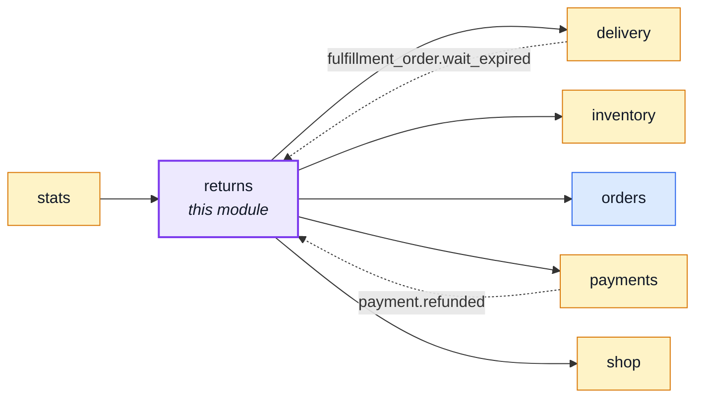
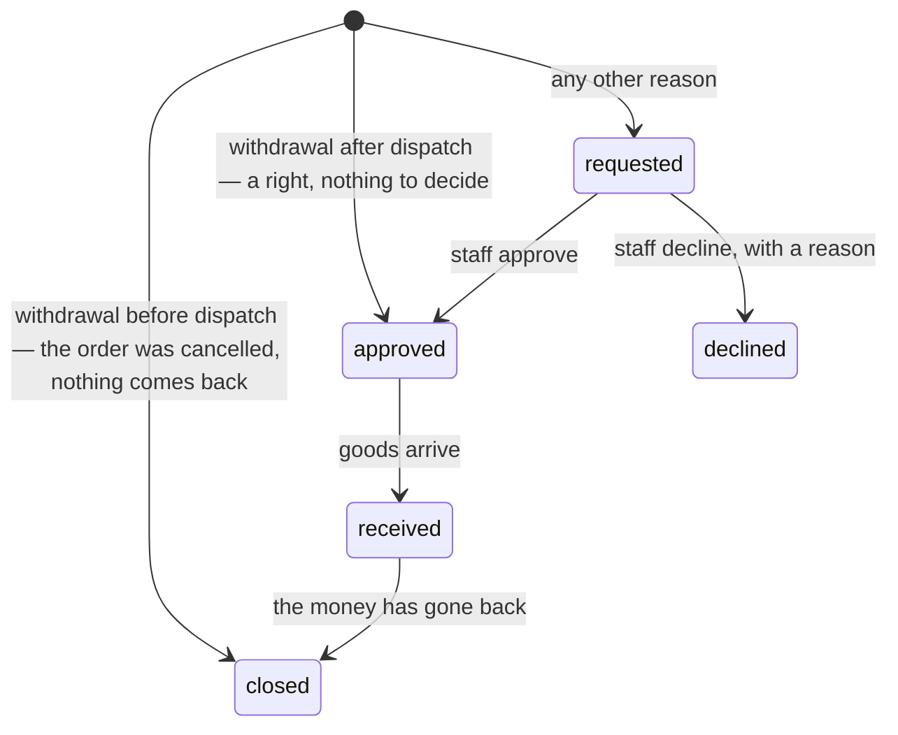
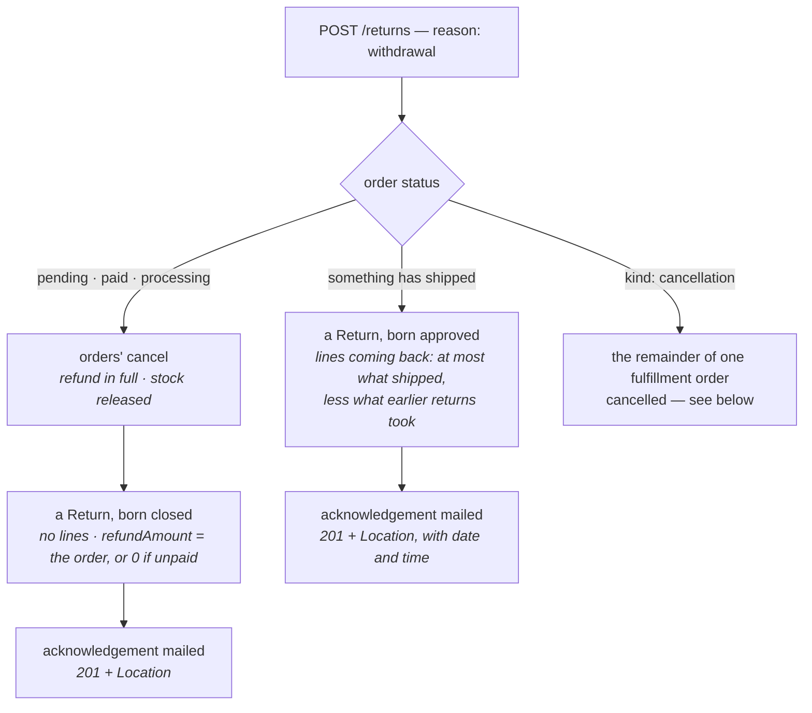
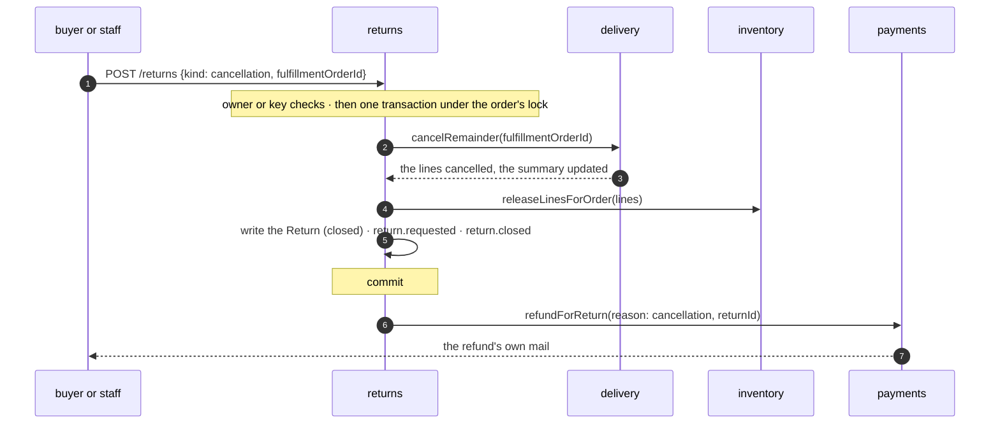

# returns

::: tip At a glance
**Owns** — the `Return` collection, outright: the request to send goods back — or the record that an
unshipped remainder was cancelled — its lines, and where it stands. A withdrawal is one of these.
**Depends on** — [`orders`](./orders.md) (the order a return is about, its owner, and the cancel a
withdrawal before dispatch becomes), [`inventory`](./inventory.md) (received goods back on sale),
[`payments`](./payments.md) (the refund, and `payment.refunded` closing the return) and
[`delivery`](./delivery.md) (what has shipped, what remains of each fulfillment order, and the
delivery a withdrawal refunds).
**Breaks if you change** — `orders`' `OrderActions.withdraw`/`withdrawUntil` (the button reads them)
and `cancelById`'s `withdrawal` option; `payments`' `refundForReturn` and the `returnId` on a refund.
:::

## Its neighbourhood

<!-- module-graph:returns:start -->

_Solid arrows are imports. Dotted arrows are domain events — the return path an import
graph cannot see._



<!-- module-graph:returns:end -->

## The story

Since 19 June 2026 an online shop in the EU must offer a "withdraw from contract here" button for
the whole withdrawal period, with a confirmation step and an acknowledgement on a durable medium
(Consumer Rights Directive Art. 11a, added by Directive 2023/2673). This module is that button.

The button is not a feature of its own. In Shopify, Medusa and commercetools it
is **a Return whose `reason` is `withdrawal`** — the same object a faulty-goods return uses, with a
legal deadline and an acknowledgement attached. So there is no separate endpoint: the button is
`POST /returns`.

Three objects, each owned once:

| Object                 | Owns                                                                        | Lives in                                   |
| ---------------------- | --------------------------------------------------------------------------- | ------------------------------------------ |
| **Return**             | the _request_: lines, reason, state                                         | this module                                |
| **Refund**             | the _money_: one record per attempt, on the payment                         | [`payments`](./payments.md#refund-records) |
| **Status projections** | `paymentStatus`, `fulfillmentStatus`, `returnStatus` beside the order's own | [`orders`](./orders.md)                    |

## The lifecycle



Every move is one conditional write from the statuses that may precede it
(`src/modules/returns/domain/lifecycle.ts`), so two staff members deciding the same request race in
the database and exactly one wins — the loser is told it was already decided (409). The one move
that is not conditional is the first: a withdrawal before dispatch is written `closed` at birth.

## The events

`return.requested`, `return.received` and `return.closed` are public webhooks, so each rides the
[transactional outbox](../tools/outbox.md): the row is written in the transaction of the move it
announces, keyed on the **order** (`aggregateId`), so one order's events reach `webhooks` in the
order they were written.

| Event              | Written with                                             | Where                 |
| ------------------ | -------------------------------------------------------- | --------------------- |
| `return.requested` | the return row, under the order's lock                   | `services/create.ts`  |
| `return.received`  | the `approved → received` claim and the restock          | `services/receive.ts` |
| `return.closed`    | the `received → closed` claim (only the caller that won) | `services/close.ts`   |

A return that is lost to a race writes nothing, and a failed event write takes the move down with
it. The mail, the audit row and the order's `returnStatus` stay after the commit, best effort.

## The withdrawal button

The button is **server-driven**: `OrderActions.withdraw` says whether to show it and
`OrderActions.withdrawUntil` says until when. `OrderActions`' own description states the doctrine — a
client must not re-implement the lifecycle, because "a second copy in a separately deployed client is
how the two come to disagree". The frontend never counts the days. The clock itself is
[`orders`'](./orders.md#the-withdrawal-window).

The call always answers one thing: **201 and a `Return`** (the Stripe and GitHub rule: one resource
per endpoint). Where the goods are decides what that record is:



**Before dispatch** reads `fulfillment.shipped`, not the order's status: an order that shipped in part
is still `processing`, and refunding it whole would refund goods the buyer already holds. A withdrawal
that loses a race against a shipment is opened again as what the order now is — a return, never a full
refund.

- **Before dispatch the Return is a record, not a flow.** The order is still in the shop's hands, so
  `orders`' cancel already does everything — refund in full, release the stock hold. The Return
  written beside it is **closed at birth** (`reason: withdrawal`, `decidedAt` and `closedAt` now, no
  `lines` because no goods are expected, `refundAmount` the whole order — zero when nothing was
  paid). It exists so every withdrawal has its own dated record (Art. 11a(3) asks the trader to
  acknowledge the date, time and content), and so `GET /returns?orderId=` answers "what happened to
  my withdrawal" the same way whatever the order's state. The client reloads the order from
  `Return.orderId`.
- **The money does not move through the Return.** The cancel's own refund runs as for any cancel
  (`ORDER_REFUND_OWED`, retried by the order's pending-effect sweep), so its `payment.refunded`
  carries no `returnId`, and `returns` does not close anything on it: the Return was closed already.
  The credit note follows that event as usual.
- **Events:** the order's own `order.cancelled` first, then `return.requested` and `return.closed`
  back to back (both written in the transaction that writes the return). A subscriber to `return.closed` therefore also hears about withdrawals that never
  had goods.
- **One mail from this module:** the acknowledgement, with no postage line and no address (nothing
  is posted). `return-closed` is for a return whose goods came back, so it is never sent here. Any
  notice about the money is the refund's, which belongs to `payments`, not to this module.
- An order's `returnStatus` stays `none`: a Return with no lines holds no goods, and
  `projectReturnStatus` ignores it.
- **Only the buyer may do it**, an operator included: the right is the consumer's.
- **The acknowledgement** carries the order, the exact date and time (UTC, spelled out), and who
  pays the postage — Art. 14(1) permits the consumer to bear it only if told beforehand, so the
  same `NODE_RETURN_POSTAGE_PAYER` value drives the copy and is frozen on the return.

## Lines

A return names what comes back: `lines` of `productId` and `quantity`, checked against what has
**shipped** (`delivery`'s fulfillment orders, per product) less what earlier non-declined returns
already took (`domain/quantities.ts`, pure). Goods that never left cannot come back; an order that
shipped in part offers only what did. No `lines`
means everything still left — the shape of a withdrawal. The title and the gross unit price are
frozen onto the line, so a refund of it reads the same later whatever the catalogue does.

Two returns opened at the same instant for the same units cannot both pass the quantity check.
Mongo transactions are snapshot isolation, so each would read "nothing returned yet" and both
would commit. Opening a return therefore first writes the order's lock row (`ReturnOrderLock`, one
per order, `$inc` in the same transaction); a second opening conflicts on that write, is re-run
after the first commits, and then sees its return. The mail, the audit row and the order's return
status follow the commit, so a lost race announces nothing.

The lock is a row of its own because `returns` must not write `orders`' document, and a counter of
returned quantities would be a second copy of the truth.

## Goods with no right of withdrawal

Art. 16(c)–(d) of the Consumer Rights Directive takes the right away from some goods — those made
to the customer's specifications or clearly personalised, and those liable to deteriorate or expire
rapidly. A product carries `noWithdrawal: true` (an admin sets it in the
product form); the flag is **frozen onto each order line at checkout**, like every other line field,
so changing the product later cannot rewrite what a customer was sold.

- A withdrawal that names no lines leaves excluded lines out of what comes back.
- A return that names an excluded line is refused (422, `RETURN_LINES_INVALID`).
- A withdrawal **before dispatch** takes the whole order, so one excluded line keeps it out (422); the
  ordinary cancel is the shop's own policy and is unaffected.
- `OrderActions.withdraw` is `false` on an order made only of excluded goods.
- Excluded units never come back, so they never keep the order from reading `returned` — and a
  return that leaves them behind is never a "full" return, so delivery is not refunded with it.

**Sealed hygiene goods** (Art. 16(e)) keep the right until the customer opens them after delivery.
The flag cannot see that, so it is not the switch for them: staff handle an opened return outside
the flow.

**Digital content** (Art. 16(m): the right is lost once delivery starts, with the consumer's express
consent) is not modelled: there is no consent step at checkout, and `noWithdrawal` is **not** the
switch for it. Until one is built, the full withdrawal period is the lawful default (Art. 14(4)(b)).

- Accepting the terms, or a pre-ticked box, is not express consent (Commission guidance on Directive
  2011/83/EU), so a clause in the shop's own terms-and-conditions text does not replace the step.
- The step belongs with digital downloads: a marker on the product, the consent, a stamp for when
  supply began, and the Art. 8(7)(b) confirmation.

## The statuses beside the order's own

`orders` cannot import `payments` or `returns`, so it cannot derive the money or the return on read.
Both are **stamped by their owner through `orders`' own service door** (`markPaymentStatus`,
`markReturnStatus`), the way `delivery` reports a shipment. `fulfillmentStatus` reads the summary
`delivery` reports, so it is derived on read.

| Field               | Values                                                                                      | Stamped by                                                                                   |
| ------------------- | ------------------------------------------------------------------------------------------- | -------------------------------------------------------------------------------------------- |
| `paymentStatus`     | `unpaid` · `paid` · `partially_refunded` · `refunded`                                       | `payments` (the refund states); `paid`/`unpaid` from `paidAt`                                |
| `fulfillmentStatus` | `unfulfilled` · `in_progress` · `on_hold` · `partially_fulfilled` · `shipped` · `fulfilled` | derived from `status` and `delivery`'s summary ([table](./orders.md#the-fulfilment-summary)) |
| `returnStatus`      | `none` · `requested` · `in_progress` · `partially_returned` · `returned`                    | `returns`, after every move (`services/projection.ts`)                                       |

`returnStatus` measures what came back against what the order held **less what a remainder cancel took**:
a cancelled unit never shipped, so it can never return, and without that a cancel would keep the order
from ever reading `returned` (and `withdraw` from ever turning off). A cancellation never counts as
goods coming back.

`returnStatus` is a report of a fact already decided, so a failed stamp is logged and never undoes the
move; the next move stamps again. `paymentStatus` is not: `payments` stamps it inside the refund's
settlement transaction, because no later refund exists to repair it after the last one.

## What the customer gets back

Receiving is where the two clocks meet, and they are kept apart on purpose:

```mermaid
sequenceDiagram
    participant W as warehouse
    participant R as returns
    participant I as inventory
    participant P as payments
    W->>R: POST /returns/{id}/receive
    R->>R: one transaction
    R->>I: approved → received, and one restock per line
    Note over R,I: commit — the goods are back on sale
    R->>P: open a refund carrying the returnId, then ask the provider
    alt the money went back
        P-->>R: settled — return closed
    else the provider refused
        P-->>R: failed, still open
        Note over P,R: the payment sweep retries the same refund; payment.refunded closes the return
    end
```

- **Received is a fact about a parcel; closed is a fact about money.** The status move and the
  restock are ONE transaction, so units are never on the shelf behind a return that reads `approved`
  nor missing from it behind one that reads `received`. Money cannot roll back, so it is not in it:
  the refund is opened on the payment first and carries this return's id, so a refund the provider
  refused is retried by the payment sweep and closes the return when it lands. A return is never stuck
  `received` for a reason nobody is retrying.
- **Restock happens on `received`, not on refund** — two facts, two moments. No reservation is
  claimed: the order's hold was `committed` at payment and stays that way.
- **The amount** is the returned lines at the price the order froze, plus refundable delivery, less
  an optional handling deduction (Art. 14(2)) staff enter at receipt. It is fixed then and shown as
  `refundAmount`. `src/modules/returns/domain/refund-amount.ts` is pure integer arithmetic.
- **Delivery is refunded by whichever cancel or return takes the _last unit_ of the order** — every
  unit then cancelled or back, counted against ORDERED quantity — and never twice (see
  [below](#the-delivery-across-several-cancels-and-returns)). For a return that closes the order it is capped at the cheapest standard delivery the shop offers, so a paid
  express upgrade stays with the shop (Art. 13(2)); on a €150 express order, where standard would
  have been free, the refundable delivery is zero. `pickup` is collection, not delivery, and does
  not count. Goods that were faulty or not what was ordered are the seller's own doing: the whole
  delivery goes back. What an earlier cancel or return already refunded of the delivery is taken off
  first, so the cap is on what is still owed.
- **The refund is clamped to what the payment has left**, so a goodwill refund made earlier can
  never make a return over-refund. The credit note follows the refund
  ([`invoicing`](./invoicing.md)).
- **Return postage** follows `NODE_RETURN_POSTAGE_PAYER`. It changes what the customer is told, not the
  refund: with `consumer` the customer posts at their own cost (Art. 14(1), told beforehand), with
  `shop` the shop covers it.

## Reads for the stats

`returnService.returnedBuckets`, `returnedByProduct` and `returnedSeries` count units whose goods
were received (`received`, `closed`), dated by `receivedAt` in the shop's zone (index
`{status, receivedAt}`). A return asked for but not received counts nothing. [`stats`](./stats.md)
composes them into "units reversed" and the return rate.

## Cancelling what has not shipped

Once any shipment left, an order can no longer be cancelled whole. What remains is cancelled **one
fulfillment order at a time**, as a Return of `kind: cancellation`, **closed when made**: its `lines`
are the remainder, and the refund of them follows the commit. The legal basis is CRD recital 40
(withdraw before delivery) and Commission Notice 2021/C 525/01 §5.5.1 (partial withdrawal); the
Shopify rule for the staff side: a partly shipped order cannot be cancelled, you refund the unshipped
items, under the Refund permission.

| Case                     | The door                                                           | Result                                                                                                   |
| ------------------------ | ------------------------------------------------------------------ | -------------------------------------------------------------------------------------------------------- |
| nothing shipped anywhere | the order's own cancel (as always)                                 | order `cancelled`, full refund including delivery; every fulfillment order cancelled                     |
| something shipped        | `POST /returns` `{kind: cancellation, fulfillmentOrderId, reason}` | the remainder's lines cancelled; refund of those lines (+ delivery on the last unit); units back on sale |
| everything shipped       | a return, as always                                                | —                                                                                                        |

Why here and not in `delivery`: a remainder cancel moves **money, stock and the shipping rule**, and
only this module already reaches all four. In **one transaction**, under the order's lock row, it
asks `delivery` to mark the lines (`cancelRemainder`, which also recomputes the order's summary and
moves its status when that completes it), gives the units back (`inventory.releaseLinesForOrder`) and
writes the Return. The refund follows, as on receipt, through `refundForReturn` with
`reason: cancellation` and the Return's id; a refund the provider refuses stays open for the payment
sweep, and the Return stays closed.



**Who may.** The buyer, as part of their withdrawal (`reason: withdrawal`; never on goods Art. 16
excludes, and inside the window). **Staff** (out of stock for good, a sweep that got no answer) need
the **refund key**, `payments.any.update` — `stepUp: critical`, so the route asks for a fresh session —
held by moderator and admin; the manager and the warehouse do not hold it. Holding the key is the
whole rule, as on every door that sends money out: a refund of one's own order is allowed and its
audit row is flagged `ownOrder` ([your own money](../theory/authorization.md#your-own-money)). No
new key and no new verb: it is one more thing the refund permission already means.

Refused: `RETURN_CANCELLATION_INVALID` (422) — no `fulfillmentOrderId`, `lines` sent, or a return that
names one; `RETURN_NOTHING_TO_CANCEL` (409) — nothing has shipped (cancel the order instead), or
nothing is left on that fulfillment order.

### A wait nobody answered

A preorder's buyer who was asked to keep waiting and never answered has, by law, cancelled (FTC 16 CFR
435.2 (b)(1)(iii); [delivery](./delivery.md#the-daily-sweep) runs the question and the clock). The
daily sweep announces `fulfillment_order.wait_expired`, and this module acts, because only it reaches
money and stock together. It first re-checks that the wait really is expired (a "keep waiting" that
came in since wins) and then:

| The order                                                | What is cancelled                                                   |
| -------------------------------------------------------- | ------------------------------------------------------------------- |
| something already shipped                                | that fulfillment order's remainder, as a `no_answer` return, system |
| nothing shipped, this is the only fulfillment order left | the whole order, refunded in full (`orders`' `cancelUnanswered`)    |
| nothing shipped, another fulfillment order is alive      | nothing yet: the goods on the shelf are the buyer's and ship first  |

The first row is the same transaction and the same refund as a buyer's own remainder cancel, with the
system as the actor and `reason: no_answer` on the Return. The reason is the shop's own: a request
naming it is refused. The announcement is repeated daily until a cancel lands, so every row above is
idempotent, and the third row simply tries again tomorrow.

### The delivery across several cancels and returns

CRD Art. 13(1) refunds "all payments … including … the costs of delivery"; Art. 13(2) lets the premium
over the cheapest standard delivery be kept; the CJEU (C-511/08 _Heinrich Heine_) forbids charging the
outbound delivery to a consumer who withdraws. The Notice is silent on partial withdrawal, so the rule
is the one that never refunds twice and never splits it:

| Detail       | Rule                                                                                                                                 |
| ------------ | ------------------------------------------------------------------------------------------------------------------------------------ |
| "last unit"  | every ordered unit is cancelled, back (a return `received` or `closed`), or in the act being settled                                 |
| Which amount | closed by a **cancel** → all the delivery still owed; closed by a **return** → that return's reason rule (cheapest standard vs full) |
| Two at once  | decided under the per-order lock (`ReturnOrderLock`): exactly one is last. A receipt takes the lock too                              |
| Never twice  | each cancel and return stores the delivery inside its refund; the next is quoted on what is still owed                               |

## The order timeline

A return writes `return_requested`, `return_approved` (a withdrawal is opened already approved, so
both at once), `return_declined`, `return_received` and `return_closed` on the order's
[timeline](./orders.md#the-timeline), each in the transaction of the move it narrates. A row holds
the return's id, the reason code and, for received and closed, the refund amount. The customer's
`note` and staff's `declineReason` are never copied: `reap:returns` owns their clock. A withdrawal
before dispatch and a cancelled remainder write no return rows, since the order's `cancelled` and
delivery's `remainder_cancelled` already say it.

## The options read

`GET /returns/options?orderId=` is the server's answer to "what can I still return, and what can I
still cancel?", so the frontend shows and never counts: `returnable` is the quantity per product that
has **shipped** and is not already coming back; `cancellable` lists each fulfillment order with a
remainder and the exact refund cancelling it would owe (the delivery included when it takes the last
unit). The owner reads their own order's, staff holding `returns.any.read` any. The cancel recomputes
under the lock, so what was quoted is what is refunded unless something moved in between.

## GDPR

`personalData` is a required manifest field. A return is keyed by `orderId` and **never** by
`userId`, so `collect` walks `findOwnOrders`'s ids exactly like
[`invoicing`](./invoicing.md) does (`personalData.collect`, no `erase`), and no `erase` is needed: `orders`' `detachUserId` already
breaks the link on the order. That is the Art. 17(3)(b)/(e) retention exemption `invoicing`
applies — a return is the same kind of legal record. `POST /account/export` carries a `returns`
section, staff's `declineReason` included: a staff assessment of the customer is the customer's
data under Art. 15.

The free text is the exception to "kept": `npm run reap:returns` unsets `note` and `declineReason`
once a return has not changed for `NODE_RETURN_TEXT_RETENTION_DAYS`; status, lines, amounts and
dates stay. No early wipe on account erasure. The reasoning:
[Data Retention: free text on returns](../theory/data-retention.md#free-text-on-returns).

## Permissions

There is no `returns.self.*` key: a customer opening or reading their own return needs only to be
signed in, the way an order's own cancel works, and "own" is the ORDER's owner.

| Key                   | Held by                                       | Does                                                                                                             |
| --------------------- | --------------------------------------------- | ---------------------------------------------------------------------------------------------------------------- |
| `returns.any.read`    | manager, warehouse, support, moderator, admin | reads every return                                                                                               |
| `returns.any.update`  | manager, support, moderator, admin            | approves or declines a request                                                                                   |
| `returns.any.receive` | manager, warehouse, admin                     | records the goods arriving (`stepUp: critical`)                                                                  |
| `payments.any.update` | moderator, admin                              | cancels an unshipped remainder, as a refund (`stepUp: critical`) — see [above](#cancelling-what-has-not-shipped) |

`receive` is narrower than `update` the way `delivery.any.start` is narrower than
`orders.any.update`: the warehouse holds the parcel and may say it arrived, without being handed the
decision of whether the return was owed.

## Configuration

| Variable                          | Default | Meaning                                                                                  |
| --------------------------------- | ------- | ---------------------------------------------------------------------------------------- |
| `NODE_RETURNS_RATE_LIMIT_MAX`     | `20`    | Returns opened per window, per account                                                   |
| `NODE_RETURN_TEXT_RETENTION_DAYS` | `1095`  | Days without a change before `reap:returns` unsets a return's `note` and `declineReason` |

The return address (`NODE_RETURN_ADDRESS_*`) and who pays postage (`NODE_RETURN_POSTAGE_PAYER`) are
[`orders`'s](./orders.md#shop-identity). The postage payer is frozen on each return when it opens.

## Related pages

- [`orders`](./orders.md) — the withdrawal clock and the cancel a pre-dispatch withdrawal becomes
- [`delivery`](./delivery.md) — what has shipped, and the remainder a cancel marks
- [`payments`](./payments.md#refund-records) — the money side
- [`invoicing`](./invoicing.md) — the credit note a refund issues
