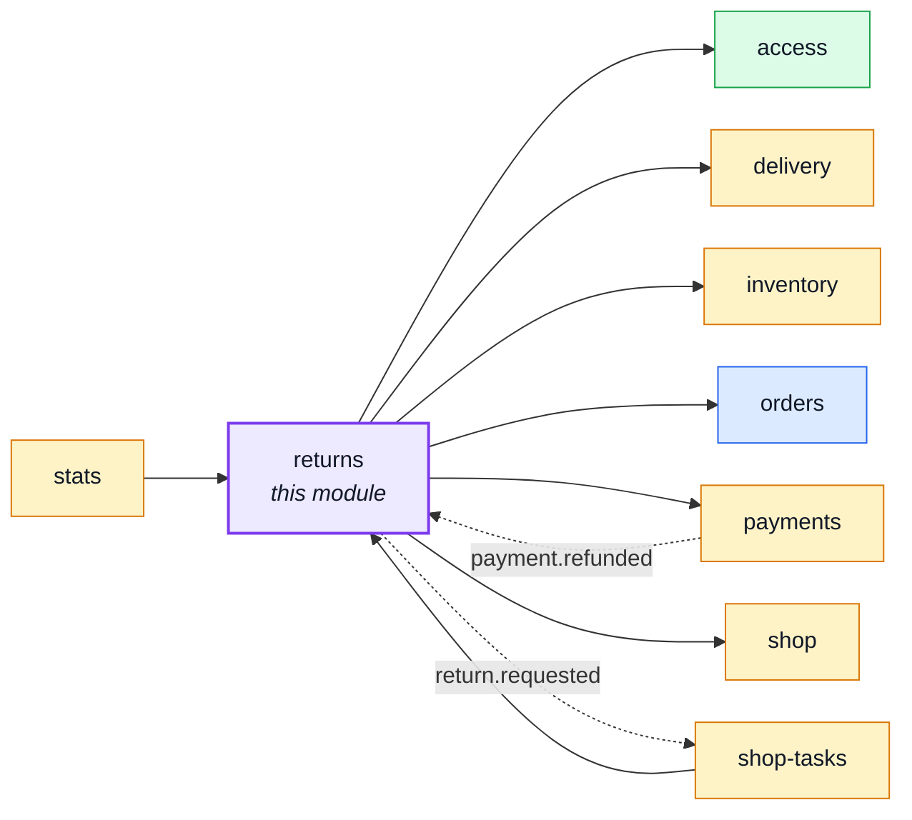
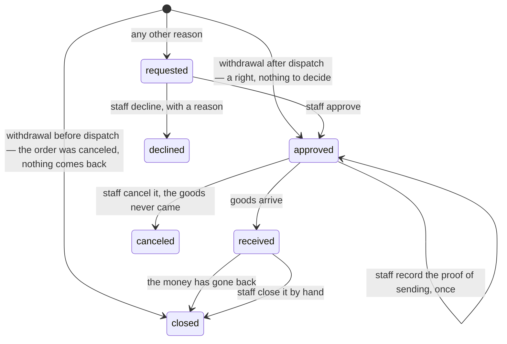

# returns

Sending goods back, including the EU withdrawal button.

::: tip At a glance
**Owns** — the `Return` collection, outright: the request to send goods back — or the record that an
unshipped remainder was cancelled — its lines, and where it stands. A withdrawal is one of these.
**Depends on** — [`orders`](./orders.md) (the order a return is about, its owner, and the cancel a
withdrawal before dispatch becomes), [`inventory`](./inventory.md) (received goods back on sale),
[`payments`](./payments.md) (the refund, and `payment.refunded` closing the return) and
[`delivery`](./delivery.md) (what has shipped, what remains of each fulfillment order, and the
delivery a withdrawal refunds), [`access`](./access.md) (the audit flag of an approve or receive on
the caller's own order) and [`shop`](./shop.md) (where goods come back to, who pays the postage).
**Breaks if you change** — `orders`' `OrderActions.withdraw`/`withdrawUntil` (the button reads them)
and `orders`' `withdrawById`; `payments`' `openReturnRefund`, `sendOpenedRefund` and the `returnId` on a refund.
:::

## Its neighbourhood

<!-- module-graph:returns:start -->

_Solid arrows are imports. Dotted arrows are domain events — the return path an import
graph cannot see._

<!-- module-graph:returns:end -->

## Who can do what

Every rule this module declares and who holds it, role by role. The rule is what a route guard asks for; the set is what a role lists.

<!-- permissions:start -->

| Rule             | Set                | `guest` | `unverified` | `customer` | `manager` | `warehouse` | `support` | `editor` | `moderator` | `admin` | `operator` | Credential | What it lets them do                                                                                                                                                                   |
| ---------------- | ------------------ | ------- | ------------ | ---------- | --------- | ----------- | --------- | -------- | ----------- | ------- | ---------- | ---------- | -------------------------------------------------------------------------------------------------------------------------------------------------------------------------------------- |
| `read:Return`    | `ReturnDisplay`    | —       | —            | —          | ✅        | ✅          | ✅        | —        | ✅          | ✅      | —          | ✅         | Read every return in the shop — the queue staff work through.                                                                                                                          |
| `update:Return`  | `ReturnManagement` | —       | —            | —          | ✅        | —           | ✅        | —        | ✅          | ✅      | —          | ✅         | Decide a return request — approve it, or decline it with a reason — cancel an approved return whose goods never came, and open a return or record a withdrawal on a buyer's behalf.    |
| `receive:Return` | `ReturnReceiving`  | —       | —            | —          | ✅ ⚡c    | ✅ ⚡c      | —         | —        | —           | ✅ ⚡c  | —          | —          | Record that the returned goods arrived — puts the units back on sale and returns the customer's money — or the buyer's proof of sending, which on a withdrawal opens the refund first. |

✅ held · `own` only the caller’s own rows · ⚡c / ⚡s needs a freshly proved session (critical / sensitive) ·
Credential: ✅ when an API key can be minted with the rule. Generated from the rules and sets in
`src/modules/*/authorization.yaml` and the roles in `shared/rules/authorization-roles.yaml`, asked of the
evaluator — [Authorization](../understand/authorization.md) explains the model.

<!-- permissions:end -->

## The story

Since 19 June 2026 an online shop in the EU must offer a "withdraw from contract here" button for
the whole withdrawal period, with a confirmation step and an acknowledgement on a durable medium
(Consumer Rights Directive Art. 11a, added by Directive 2023/2673). This module is that button.

The button is not a feature of its own. In Shopify, Medusa and commercetools it
is **a Return whose `reason` is `withdrawal`** — the same object a faulty-goods return uses, with a
legal deadline and an acknowledgement attached. So there is no separate endpoint: the button is
`POST /returns`.

Three objects, each owned once:

| Object                 | Owns                                                                        | Lives in                                   |
| ---------------------- | --------------------------------------------------------------------------- | ------------------------------------------ |
| **Return**             | the _request_: lines, reason, state                                         | this module                                |
| **Refund**             | the _money_: one record per attempt, on the payment                         | [`payments`](./payments.md#refund-records) |
| **Status projections** | `paymentStatus`, `fulfillmentStatus`, `returnStatus` beside the order's own | [`orders`](./orders.md)                    |

## The list row {#the-list-row}

`GET /returns` answers a `ReturnListItem`: id, order, status, reason, kind, dates and `actions`. The
customer's note, staff's decline message and the lines are `GET /returns/{id}`, the audited read; a
customer's own list is the same shape. See
[a list row is a list item](../reference/responses.md#a-list-row-is-a-list-item).

## The lifecycle

Every move is one conditional write from the statuses that may precede it. The moves are one table
(`src/modules/returns/domain/lifecycle.ts`): `approve` and `decline` from `requested`, `receive` and
`cancel` from `approved`, `close` from `received`. The writes and the `actions` flags both ask it, and
a flag is the caller's permission key AND the table's answer for the return's status (and `cancel` is
also false once a proof of sending opened the refund). The proof of
sending is a stamp inside the receive window, not a move. The birth status is per door, not a move
either.

Two staff members deciding the same request race in the database and exactly one wins — the loser is told it was already decided (409). The one move
that is not conditional is the first: a withdrawal before dispatch is written `closed` at birth.

`declined` and `canceled` are final. A wrong decline is not undone: staff open a new return for the
same lines ([Declined by mistake](../use-the-shop/support.md#declined-by-mistake)), which is how
Shopify and Solidus fix it, so a decision stays a record and is never rewritten.

## Declining a request {#declining-a-request}

`POST /returns/{id}/decline` takes a **code** and, when the code is `other`, a **message** (Shopify's
`declineReason` plus `declineNote`; Solidus' `RefundReason` is a code list too).

Full detail: [Declining, closing and cancelling a return](./returns-statuses-and-cancellation.md#declining-a-request).

## Closing a return by hand {#closing-a-return-by-hand}

`POST /returns/{id}/close`, body `{ note }` (optional), moves a `received` return to `closed` when its
money will not follow the usual way: the refund was canceled
([payments](./payments.md#cancelling-a-refund)), or the customer was paid outside the shop. It is
Shopify's `returnClose`.

Full detail: [Declining, closing and cancelling a return](./returns-statuses-and-cancellation.md#closing-a-return-by-hand).

## Canceling a return {#canceling-a-return}

`POST /returns/{id}/cancel`, body `{ note }` (optional), moves an `approved` return whose goods will
never arrive to `canceled`. It is Shopify's `returnCancel` and Solidus' return-authorization cancel.
A withdrawal, born `approved`, can be canceled too.

Full detail: [Declining, closing and cancelling a return](./returns-statuses-and-cancellation.md#canceling-a-return).

## The events {#the-events}

`return.requested`, `return.received` and `return.closed` are public webhooks, so each rides the
[transactional outbox](../understand/outbox.md): the row is written in the transaction of the move it
announces, keyed on the **order** (`aggregateId`), so one order's events reach `webhooks` in the
order they were written.

Full detail: [Declining, closing and cancelling a return](./returns-statuses-and-cancellation.md#the-events).

## The withdrawal button {#the-withdrawal-button}

The button is **server-driven**: `OrderActions.withdraw` says whether it is offered,
`OrderActions.withdrawBlocked` says why not (`all_excluded`, `window_closed` or `nothing_left`, the
first that applies, from `withdrawalRefusalOf` in `orders/domain/withdrawal.ts` — the same function
the door asks, so the two cannot disagree) and `OrderActions.withdrawUntil` says until when (the last day the buyer is told; a withdrawal is accepted one UTC day past it, [the grace day](./orders.md#the-withdrawal-window)). A
client shows the button **disabled with the reason**, never hidden. `OrderActions`' own description states the doctrine — a
client must not re-implement the lifecycle, because "a second copy in a separately deployed client is
how the two come to disagree". The frontend never counts the days. The clock itself is
[`orders`'](./orders.md#the-withdrawal-window).

Full detail: [The withdrawal button and its deadlines](./returns-withdrawal.md#the-withdrawal-button).

## Staff open a return for the buyer {#staff-open-a-return-for-the-buyer}

A buyer who phones, writes or walks in cannot always click the button. Staff holding `update:Return`
use the same door, `POST /returns` (Solidus has one endpoint for both; Shopify's `returnCreate`
takes `requestedAt` for the same reason). The order is the buyer's or, for such a caller, anyone's;
anyone else still gets a 404.

Full detail: [The withdrawal button and its deadlines](./returns-withdrawal.md#staff-open-a-return-for-the-buyer).

## Lines {#lines}

A return names what comes back: `lines` of `productId` and `quantity`, checked against what has
**shipped** (`delivery`'s fulfillment orders, per product) less what earlier non-declined returns
already took (`domain/quantities.ts`, pure). Goods that never left cannot come back; an order that
shipped in part offers only what did. No `lines`
means everything still left — the shape of a withdrawal. The title and the gross unit price are
frozen onto the line, so a refund of it reads the same later whatever the catalogue does.

Full detail: [Declining, closing and cancelling a return](./returns-statuses-and-cancellation.md#lines).

## The two deadlines {#the-two-deadlines}

An order freezes two deadlines the moment it is delivered, and a request is judged by the one that
belongs to its reason:

Full detail: [The withdrawal button and its deadlines](./returns-withdrawal.md#the-two-deadlines).

## The refund deadline {#the-refund-deadline}

Every refund `returns` opens, and the refund of a withdrawal before dispatch (`payments` opens that
one from `order.canceled`), is stamped with its legal deadline when the record opens: `dueBy`, and
`dueRule` for why. The stamp is stored, not recomputed, so a later change of time zone or setting
never moves a date a buyer was already owed.

Full detail: [The withdrawal button and its deadlines](./returns-withdrawal.md#the-refund-deadline).

### Proof of sending {#proof-of-sending}

See [The withdrawal button and its deadlines](./returns-withdrawal.md#proof-of-sending).

## Goods with no right of withdrawal {#goods-with-no-right-of-withdrawal}

Art. 16(c)–(d) of the Consumer Rights Directive takes the right away from some goods — those made
to the customer's specifications or clearly personalised, and those liable to deteriorate or expire
rapidly. A product carries `noWithdrawal: true` (an admin sets it in the
product form); the flag is **frozen onto each order line at checkout**, like every other line field,
so changing the product later cannot rewrite what a customer was sold.

Full detail: [The withdrawal button and its deadlines](./returns-withdrawal.md#goods-with-no-right-of-withdrawal).

## The statuses beside the order's own {#the-statuses-beside-the-order-s-own}

`orders` cannot import `payments` or `returns`, so it cannot derive the money or the return on read.
Both are **stamped by their owner through `orders`' own service door** (`markPaymentStatus`,
`markReturnStatus`), the way `delivery` reports a shipment. `fulfillmentStatus` reads the summary
`delivery` reports, so it is derived on read.

Full detail: [Declining, closing and cancelling a return](./returns-statuses-and-cancellation.md#the-statuses-beside-the-order-s-own).

## What the customer gets back {#what-the-customer-gets-back}

Receiving is where the two clocks meet, and they are kept apart on purpose:

Full detail: [Remedies for a return](./returns-remedies.md#what-the-customer-gets-back).

## The remedy ladder {#the-remedy-ladder}

A faulty or wrong item (`defective`, `wrong_item`) is the legal guarantee, and the law gives the
buyer a ladder (Directive 2019/771 Art. 13): first a **repair or a replacement**, the buyer's
choice; then a price reduction or the money back. The buyer states a wish when they open the
return (`preferredRemedy`, 422 `RETURN_REMEDY_INVALID` for any other reason); staff choose the
`remedy` at receipt (`refund` by default). A withdrawal and a goodwill return always refund.

Full detail: [Remedies for a return](./returns-remedies.md#the-remedy-ladder).

## Reads for the stats

`returnService.returnedBuckets`, `returnedByProduct` and `returnedSeries` count units whose goods
were received (`received`, `closed`), dated by `receivedAt` in the shop's zone (index
`{status, receivedAt}`). A return asked for but not received counts nothing. [`stats`](./stats.md)
composes them into "units reversed" and the return rate.

## Cancelling what has not shipped {#cancelling-what-has-not-shipped}

Once any shipment left, an order can no longer be cancelled whole. What remains is cancelled **one
fulfillment order at a time**, as a Return of `kind: cancellation`, **closed when made**: its `lines`
are the remainder, and the refund of them follows the commit. The legal basis is CRD recital 40
(withdraw before delivery) and Commission Notice 2021/C 525/01 §5.5.1 (partial withdrawal); the
Shopify rule for the staff side: a partly shipped order cannot be cancelled, you refund the unshipped
items, under the Refund permission.

Full detail: [Remedies for a return](./returns-remedies.md#cancelling-what-has-not-shipped).

### The delivery across several cancels and returns {#the-delivery-across-several-cancels-and-returns}

See [Remedies for a return](./returns-remedies.md#the-delivery-across-several-cancels-and-returns).

## The order timeline

A return writes `return_requested`, `return_approved` (a withdrawal is opened already approved, so
both at once), `return_declined`, `return_received` and `return_closed`, and `proof_of_sending_recorded` when staff record a proof, on the order's
[timeline](./orders.md#the-timeline), each in the transaction of the move it narrates. A row holds
the return's id, the reason code and, for received and closed, the refund amount. A receipt and the
close it leads to name the staff member who received the goods; a return the payment sweep closes
later names no one. The customer's
`note` and staff's `declineMessage` are never copied (nor is the note of a hand close: it stays in the audit row): `reap:returns` owns their clock. A withdrawal
before dispatch and a cancelled remainder write no return rows, since the order's `canceled` and
delivery's `remainder_canceled` already say it.

## The options read

`GET /returns/options?orderId=` is the server's answer to "what can I still return, and what can I
still cancel?", so the frontend shows and never counts: `reasons` is what THIS caller can still name
([the two deadlines](#the-two-deadlines)): the buyer's open ones (none past every deadline), and
for staff holding `update:Return` every reason, with `exceptions` naming the non-withdrawal ones
already past their deadline (a preview of what opening them waives); `returnable` is the quantity per product that
has **shipped** and is not already coming back, empty while `reasons` is, with each line's
`withdrawable` flag (false for Art. 16 goods, which only a defect or a wrong item may name, and
which staff may take for a goodwill return); `cancelable` lists each fulfillment order with a
remainder and the exact refund cancelling it would owe (the delivery included when it takes the last
unit), each with `cancel`: whether THIS caller may cancel it. The buyer may inside the window and
unless the remainder holds excluded goods and the shop has started on the order; anyone else when
they hold the refund key. It is the
door's own rule (`cancelRefusalOf`), so a button is never offered that the door then refuses. The
owner reads their own order's, staff holding `read:Return` any. The cancel recomputes
under the lock, so what was quoted is what is refunded unless something moved in between.

## GDPR

`personalData` is a required manifest field. A return is keyed by `orderId` and **never** by
`userId`, so `collect` walks `findOwnOrders`'s ids exactly like
[`invoicing`](./invoicing.md) does (`personalData.collect`, no `erase`), and no `erase` is needed: `orders`' `detachUserId` already
breaks the link on the order. That is the Art. 17(3)(b)/(e) retention exemption `invoicing`
applies — a return is the same kind of legal record. `POST /account/export` carries a `returns`
section, staff's decline code and `declineMessage` included: a staff assessment of the customer is the customer's
data under Art. 15.

The free text is the exception to "kept": `npm run job reap:returns` unsets `note` and `declineMessage`
once a return has not changed for `NODE_RETURN_TEXT_RETENTION_DAYS`; status, lines, amounts and
dates stay. No early wipe on account erasure. The reasoning:
[Data Retention: free text on returns](../understand/data-retention.md#free-text-on-returns).

## Permissions

There is no `returns.self.*` key: a customer opening or reading their own return needs only to be
signed in, the way an order's own cancel works, and "own" is the ORDER's owner.

| Key              | Held by                                       | Does                                                                                                             |
| ---------------- | --------------------------------------------- | ---------------------------------------------------------------------------------------------------------------- |
| `read:Return`    | manager, warehouse, support, moderator, admin | reads every return                                                                                               |
| `update:Return`  | manager, support, moderator, admin            | approves or declines a request                                                                                   |
| `receive:Return` | manager, warehouse, admin                     | records the goods arriving, or the proof of sending (`stepUp: critical`)                                         |
| `create:Refund`  | moderator, admin                              | cancels an unshipped remainder, as a refund (`stepUp: critical`) — see [above](#cancelling-what-has-not-shipped) |

`receive` is narrower than `update` the way `start:Shipment` is narrower than
`update:Order`: the warehouse holds the parcel and may say it arrived, without being handed the
decision of whether the return was owed.

## Configuration

| Variable                          | Default | Meaning                                                                                            |
| --------------------------------- | ------- | -------------------------------------------------------------------------------------------------- |
| `NODE_RETURNS_RATE_LIMIT_MAX`     | —       | Per-account budget: see [the rate-limit budgets](../understand/security.md#the-rate-limit-budgets) |
| `NODE_RETURN_TEXT_RETENTION_DAYS` | `1095`  | Days without a change before `reap:returns` unsets a return's `note` and `declineMessage`          |

The return address (`NODE_RETURN_ADDRESS_*`) and who pays postage (`NODE_RETURN_POSTAGE_PAYER`) are
[`shop`'s](./shop.md#configuration). The postage payer is frozen on each return when it opens.

## Read next

- [`orders`](./orders.md) — the withdrawal clock and the cancel a pre-dispatch withdrawal becomes
- [`delivery`](./delivery.md) — what has shipped, and the remainder a cancel marks
- [`payments`](./payments.md#refund-records) — the money side
- [`invoicing`](./invoicing.md) — the credit note a refund issues
