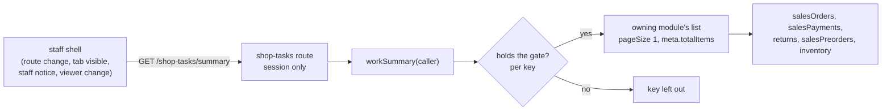
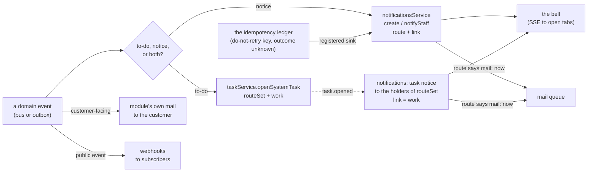

# Shop-tasks notices, digest and badge

The messages the buyer and the staff receive from the shop's to-dos: notices, the staff digest and the nav badge.

## The notices {#the-notices}

Each notice code is its own dictionary key: `shop-tasks.<name>` for a buyer's message,
`shop-tasks.staff.<name>` for a staff work notice. The variants are appended to the `Notification`
union by `openapi.notifications.yaml` and to the stream's `NotificationPayload` by
`asyncapi.notifications.yaml`.

| Code                                                         | Audience | Written on                           | Told                               | Mail                  |
| ------------------------------------------------------------ | -------- | ------------------------------------ | ---------------------------------- | --------------------- |
| `shop-tasks.cart-line-removed`                               | buyer    | `cart.lines_removed`                 | whose carts held the product       | —                     |
| `shop-tasks.wishlist-item-removed`                           | buyer    | `wishlist.items_removed`             | whose wishlists held the product   | —                     |
| `shop-tasks.cart-merge-refused`                              | buyer    | `cart.merge_refused`                 | the signed-in user                 | —                     |
| `shop-tasks.fulfillment-delayed`                             | buyer    | `fulfillment_order.delayed`          | the buyer, if the account exists   | —                     |
| `shop-tasks.fulfillment-held`                                | buyer    | `fulfillment_order.hold_noticed`     | the buyer, if the account exists   | —                     |
| `shop-tasks.shipment-lost`                                   | buyer    | `shipment.lost`                      | the buyer, if the account exists   | —                     |
| `shop-tasks.stock-alert`                                     | buyer    | `stock_alert.sent`                   | who asked                          | —                     |
| `shop-tasks.staff.purchase-hold-placed`                      | staff    | `order.purchase_hold_placed`         | `UserBanning`                      | now                   |
| `shop-tasks.staff.return-requested`                          | staff    | `return.requested` (not withdrawals) | `ReturnManagement`                 | —                     |
| `shop-tasks.staff.outcome-unknown`                           | staff    | the idempotency ledger (no event)    | the route's own set, see below     | now                   |
| the eleven summary rows, see [the digest](#the-staff-digest) | staff    | the digest jobs                      | the set that does the counted work | digest, where overdue |

The `fulfillment-delayed` and `shipment-lost` params name their dates (`agreedAt`, `expectedAt`) as plain shop days (`YYYY-MM-DD`), converted from the event's instants when the row is written, so the inbox prints the same day as the mail.

A notice that points at an order names it. `fulfillment-delayed`, `fulfillment-held`, `shipment-lost` and
`staff.return-requested` carry a required `orderNumber` (`2026-000041`, printed as `#2026-000041`), copied
from their event, which got it where the order was already in hand. The row does no orders read, and two
notices for two orders never read as the same link. A later notice that names an order does the same.

`shop-tasks.staff.outcome-unknown` is the one notice that is not written on an event. When a
do-not-retry write (a refund, a ship, a stock receipt or adjustment) has a key whose first attempt
never reported back, the ledger in `infrastructure` calls a sink this module installs in its
`onRegistered`, and the notice is written in-process (never through the outbox, so the mail does not
wait for the relay). It is told to the holders of the route's own permission set: `PaymentRefunding`
for a refund, `DeliveryManagement` for a ship, `InventoryManagement` for stock. Its params name the
subject (`subjectName`: the order's number printed as `#…`, or the product's name; `subjectId`: the
order's or the product's id, the screen it opens) because two such notices must not read the same.
Unlike the other order notices this one does read: no event carries the order number, so the sink asks
`payments` or `delivery` for the order of the payment or fulfillment order and `orders` for its number.
One notice per stuck key. See [Do-not-retry operations](../understand/idempotency.md#do-not-retry-operations).

`fulfillment_order.delayed` is both a to-do and a message. One module has one handler per event, so
a single handler runs the to-do first (idempotent by `eventId`) and then the notice: a redelivery
after a failed notice re-runs a no-op open and writes the notice once.

## The staff digest {#the-staff-digest}

Two jobs keep the staff's summary rows true: `sweep:staff-digest` (daily, 06:30 UTC) and
`sweep:staff-weekly` (Mondays, 06:30 UTC; the late-preorder row). Each row is a count read from the
module that owns it; a count of zero removes the row, one that fell is updated quietly, one that
appeared or grew is unread again, pushed and, where the route says `digest`, mailed once per person
per run.

| Summary row                                 | Counts                                               | Run    | Set told              | Mail   |
| ------------------------------------------- | ---------------------------------------------------- | ------ | --------------------- | ------ |
| `shop-tasks.staff.transfers-due`            | bank transfers due soon                              | daily  | `PaymentRecording`    | bell   |
| `shop-tasks.staff.unshipped`                | paid orders with goods still to ship                 | daily  | `DeliveryStart`       | digest |
| `shop-tasks.staff.returns-undecided`        | return requests still undecided                      | daily  | `ReturnManagement`    | digest |
| `shop-tasks.staff.returns-awaiting-goods`   | approved returns overdue for their goods             | daily  | `ReturnReceiving`     | digest |
| `shop-tasks.staff.returns-proof-goods-late` | approved returns with a proof of sending, goods late | daily  | `ReturnReceiving`     | digest |
| `shop-tasks.staff.delivery-holds-open`      | held orders open too long                            | daily  | `DeliveryManagement`  | digest |
| `shop-tasks.staff.awaiting-tracking`        | shipped parcels with no tracking code                | daily  | `DeliveryManagement`  | bell   |
| `shop-tasks.staff.undelivered`              | parcels shipped and never marked arrived             | daily  | `DeliveryManagement`  | digest |
| `shop-tasks.staff.stale-refunds`            | refunds open past the attention threshold            | daily  | `PaymentRefunding`    | digest |
| `shop-tasks.staff.low-stock`                | products low on stock                                | daily  | `InventoryManagement` | bell   |
| `shop-tasks.staff.preorders-late`           | preorders past their date                            | weekly | `OrderEditing`        | digest |

`returns-awaiting-goods` counts only what needs action: an approved return, a withdrawal or a
faulty or wrong item, with neither goods nor proof of sending after `WITHDRAWAL_SEND_BACK_DAYS` (14)
plus `NODE_STAFF_RETURN_TRANSIT_DAYS` days. The clock starts the day the buyer stated the withdrawal,
or the day staff approved the faulty item. The text tells staff to ask the buyer once for proof of
posting and to keep the refund on hold; one proof recorded takes the return out of the count. The
returns list shows the ones still inside their days. Its link opens the list on
`proofOfSending=false`.

`returns-proof-goods-late` is the other half: an approved return, a withdrawal or a faulty or wrong
item, whose proof of sending is on file and whose goods are still not back `NODE_STAFF_RETURN_TRANSIT_DAYS`
days after the date on the proof. The wording is neutral on money on purpose: a withdrawal's proof
(or a faulty item's, with `refundOnProof`) already opened a refund, any other faulty item's may be
due, and the row only says the goods are late: follow up with the carrier and check the refund. Its
link opens the list on `proofOfSending=true`. A goodwill return (`other`) has no deadline in law, so
it never shows in either row, and one with a proof on file goes silent. The old row counts only returns
with no proof, so no return is counted twice.

Each row carries `params.work`: the filtered list path, from the `staffPages:` block of
`shared/rules/frontend-links.yaml` (`SUMMARY_PAGES`). The bell opens it as it is, and the digest mail
links the same entry, so the two cannot drift. Some rows open a list slightly wider than the count
(`unshipped` lists every age, not only the late ones). Its link,
`fulfillmentStatus=awaiting_shipment&deleted=false`, otherwise opens exactly the counted set.

There is no digest extension point in `notifications`: all eleven rows are the shop's, so a registry
would have one caller. The primitives (`writeSummary`, `clearSummary`, `staffRecipients`) are the
extension point; the digest is lifted back into `notifications` only when a foundation row exists.

## The nav badge summary {#the-nav-badge-summary}

`GET /shop-tasks/summary` answers one count per staff screen that has a badge. A badge shows open
work, not unread notices, so opening the bell never empties it. The key names live only in the
`ShopWorkSummary` schema of `src/modules/shop-tasks/openapi.yaml`.

Each count is the `meta.totalItems` of the list its screen shows, read through the owning module's
own list as the caller, so a badge and its screen agree by construction. A key is present only when
the caller holds the screen's route gate; zero is sent as `0`, never left out.

| Key              | Screen           | Gate              | Counts                                                  |
| ---------------- | ---------------- | ----------------- | ------------------------------------------------------- |
| `salesOrders`    | sales orders     | `display:Order`   | orders with `fulfillmentStatus=awaiting_shipment`, live |
| `salesPayments`  | payments         | `display:Payment` | the rows of `GET /payments/attention`, all six sources  |
| `returns`        | sales returns    | `read:Return`     | returns with `status=requested`                         |
| `salesPreorders` | preorders board  | `display:Order`   | fulfillment orders with `late=true`                     |
| `inventory`      | inventory ledger | `read:StockLevel` | stock levels with `lowOnly=true`                        |

Reading it as the caller is why the route takes a session and no API key: a key resolves to no
`AuthContext`, and the orders scope comes from the caller. The orders read passes no caller
context, because that context fires an `orders_viewed` analytics event on every refresh.

Counts the summary does not carry: Users (`purchaseHoldReview=true`, `deleted=false`) and Webhooks
(`autoDisabled=true`) are read by the frontend from their own list's total, since `users` and
`webhooks` are foundation modules; the Tasks badge is `GET /tasks/summary`.

Known edges, on purpose:

- The payments count can reach 600 (100 per source) and overlaps the Tasks badge: the badge is the
  screen it opens.
- A late preorder is on both the orders and the preorders badge: real work on both screens.
- `salesOrders` includes orders waiting for stock and staff holds; only a person releases a staff
  hold, so hiding them would take them off every badge.
- `salesPayments` includes open disputes in `under_review`, whose to-do says nothing to do.
  Payments' rule to revisit.
- `read:Return` is a staff key: a buyer gets no `returns` key, and the buyer's own returns page has
  no badge.

## Who is told {#who-is-told}

The shape of every "something happened, who hears it" flow. The diagram names no codes on
purpose: which codes, sets and mails exist is on the pages linked under it.

- A do-not-retry write that may or may not have happened is told in-process, not through an event: [Do-not-retry operations](../understand/idempotency.md#do-not-retry-operations).
- To-do kinds, openers, closers, who works them: [Tasks](./tasks.md#who-is-told) and the kind table above.
- Notice codes, sets and mail class: [Notifications](./notifications.md#work-notices-for-staff).
- The daily and weekly counts: [the staff digest](#the-staff-digest) above.
- Every mail, one row each: [Mails we send](../understand/email-and-rendering.md#mails-we-send).
- Events that survive a crash: [Outbox](../understand/outbox.md). Public events: [Webhooks](./webhooks.md).

## Read next

- [shop-tasks](./shop-tasks.md) — the module's own page
