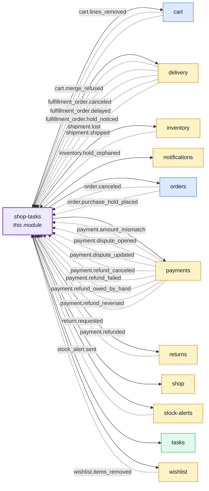
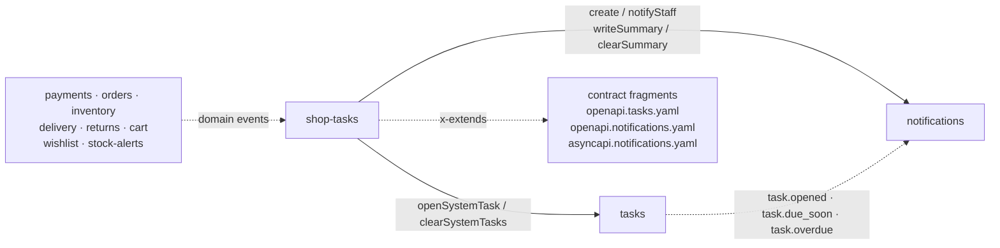
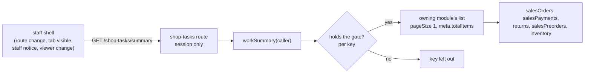
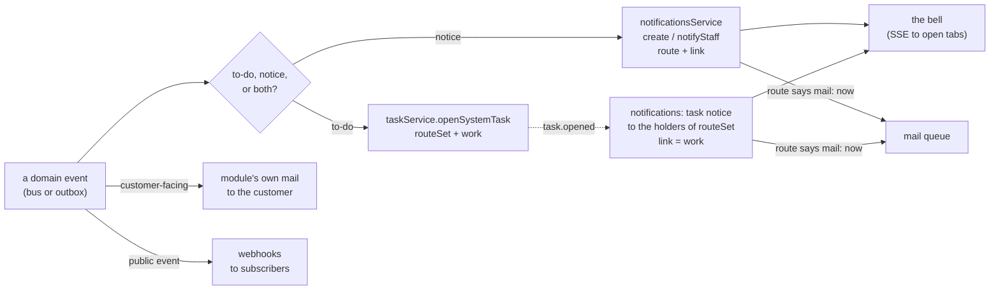

# shop-tasks

::: tip At a glance
**Owns** — the shop's side of the helpdesk: the to-dos a payment, stock or delivery situation opens, the buyer's messages, the staff's work notices and the daily and weekly staff digest. One read route (the nav badge counts), no collection: [`tasks`](./tasks.md) and [`notifications`](./notifications.md) do the writing.
**Depends on** — `tasks` and `notifications` (the doors it writes through), `payments`, `orders`, `inventory`, `delivery`, `returns`, `cart`, `wishlist` and `stock-alerts` (the events it hears, and the counts the digest reads), `users` (who can act today) and `shop` (the shop's country).
**Breaks if you change** — a `shop-tasks.*` notice code: the code is its own dictionary key in both repos, so renaming one orphans the copy that words it.
:::

## Its neighbourhood

<!-- module-graph:shop-tasks:start -->

_Solid arrows are imports. Dotted arrows are domain events — the return path an import
graph cannot see._

<!-- module-graph:shop-tasks:end -->

## The story

`tasks` and `notifications` ship with every project: the contact form, the staff to-do inbox and the
bell. Everything that talks about orders, payments, stock or deliveries lives here instead, so
removing the shop removes it cleanly. The core never names a shop thing: this module adds its own
to-do kinds, categories and notice codes to the contract by **fragments**, and hands its own routing
to the core with each call.

### The shop's to-dos

One task per situation, opened by the event that starts it and cleared by the event that ends it.
The dedup, the replay rules and the overdue sweep are the engine's: see
[System tasks](./tasks.md#system-tasks).

| Kind                    | Opens on                                                                                                      | Cleared by                                                                                   | Due (`dueAt`)                                                                                          | Route set (`routeSet`) | Told                      | `work` screen                  |
| ----------------------- | ------------------------------------------------------------------------------------------------------------- | -------------------------------------------------------------------------------------------- | ------------------------------------------------------------------------------------------------------ | ---------------------- | ------------------------- | ------------------------------ |
| `manual_refund_owed`    | `payment.refund_owed_by_hand`                                                                                 | `payment.refunded`, `payment.refund_canceled`                                                | + `NODE_PAYMENT_ATTENTION_MINUTES`                                                                     | `PaymentRefunding`     | moderator, admin          | `sales/payments?tab=attention` |
| `refund_refused`        | `payment.refund_failed` with `final: true` (a `disputed` failure opens nothing: the dispute to-do carries it) | `payment.refunded`, `payment.refund_canceled`                                                | the legal 14 days for a return refund (`refundLegalDueAt`), else + the attention window from now       | `PaymentRefunding`     | moderator, admin          | `sales/payments?tab=attention` |
| `refund_reversed`       | `payment.refund_reversed` (a `disputed` one opens nothing: the dispute to-do carries it)                      | `payment.refunded` (mark returned), `payment.refund_canceled`                                | the legal 14 days for a return refund, which may already be past; else + the attention window from now | `PaymentRefunding`     | moderator, admin          | `sales/payments?tab=attention` |
| `amount_mismatch`       | `payment.amount_mismatch`                                                                                     | **never**: staff close it once they know why                                                 | + the attention window                                                                                 | `AuditDisplay`         | admin only                | `orders/<orderId>`             |
| `dispute`               | `payment.dispute_opened` / `_updated` while it needs the shop's proof (`needs_response`)                      | the dispute leaves `needs_response`: proof sent, or decided early                            | the provider's `evidenceDueBy`                                                                         | `PaymentRefunding`     | moderator, admin          | `sales/payments?tab=attention` |
| `dispute_awaiting_bank` | `payment.dispute_updated` with `under_review`: proof sent, the bank decides                                   | a decided or closed dispute (`won`, `lost`, `accepted`, `closed`); the closing note names it | opening + 75 days, the card networks' usual outer limit (`AWAITING_BANK_MS`)                           | `PaymentRefunding`     | moderator, admin          | `sales/payments?tab=attention` |
| `paid_without_hold`     | `inventory.hold_orphaned` (the payment step only)                                                             | `order.canceled`, `shipment.shipped`                                                         | +4 h                                                                                                   | `InventoryManagement`  | warehouse, admin          | `orders/<orderId>`             |
| `consent_due`           | `fulfillment_order.delayed`, see below                                                                        | `shipment.shipped`, `fulfillment_order.canceled`                                             | `agreedAt` + 30 d, or the date the buyer holds                                                         | `OrderEditing`         | manager, moderator, admin | `orders/<orderId>`             |

**A refund the bank sends back.** A settled refund can come back weeks later (a closed card), and
the shop owes the money again. `payment.refund_reversed` opens a `refund_reversed` to-do, "Refund
sent back by the bank": agree a way with the buyer, pay, then mark the refund returned (which
closes it). It is mailed on opening and gets a due-soon reminder like any other to-do with time
left. Its date is the legal one only when the law sets one (a return refund's stamped legal deadline, which may
already be past: then the opened and overdue mails both go, truthfully), never the refund's
creation date.
The `refund_refused` and `refund_reversed` to-dos say the rule beside the date: "Legal refund
deadline (withdrawal): 2026-03-15" (a day on the shop's calendar), or "(faulty item): refund now".

**A dispute is two to-dos.** `dispute` is the proof the shop owes; when the proof is sent
(`under_review`) it is closed with the note "Proof sent; the bank is deciding" and one
`dispute_awaiting_bank` opens, a wait with nothing to do unless the bank runs late. Opening it is
the bell's alone (no mail), it gets no due-soon reminder, and past its 75 days the normal overdue
notice goes out. A decision closes whichever is open, naming the outcome. A redelivered event opens
nothing twice, and a dispute decided straight from `needs_response` never opens the waiting one.

The kinds, link types (`order`, `payment`, `refund`, `fulfillment_order`) and categories (`order`,
`cancellation`, `return`, `payment`) are appended to the core's enums by
`openapi.tasks.yaml`. Admin alone closes an `amount_mismatch` and an accepted `consent_due`: the
other roles read the alert and open the screen, but only `TaskManagement` works a task. The route set
says who is told and who may see the task; to be **assigned** one a person needs it _and_
`update:Task`.

**The delay reminder (`consent_due`, 16 CFR 435.2).** The shop never asks the buyer and never
cancels; the task is the reminder that a person must, and by when. `delivery` keeps `promisedAt` on
the fulfillment order, the date the buyer holds now: it starts as `agreedAt`, a later date from a
notice replaces it, a "no date yet" notice removes it.

| Before this notice                    | Opens when                             | Due               |
| ------------------------------------- | -------------------------------------- | ----------------- |
| the buyer holds the date they ordered | no new date, or past `agreedAt` + 30 d | `agreedAt` + 30 d |
| the buyer holds a later date          | no new date, or past that date         | that date         |
| the buyer was told "no date yet"      | never: the earlier task stands         | —                 |

A repeated delay while the task is still open opens nothing new and keeps its earlier due date
([dedup](./tasks.md)).

The rule binds a shop in the United States or one of its territories (`FTC_JURISDICTIONS`: `US`,
`PR`, `GU`, `VI`, `AS`, `MP`, 16 CFR 435) for **every** destination, including a delay with no ship-to
country. A shop elsewhere owes it only to a buyer shipped to one of those places. The shop's country
is `NODE_LEGAL_COUNTRY`; there is no list to configure.

### The notices

Each notice code is its own dictionary key: `shop-tasks.<name>` for a buyer's message,
`shop-tasks.staff.<name>` for a staff work notice. The variants are appended to the `Notification`
union by `openapi.notifications.yaml` and to the stream's `NotificationPayload` by
`asyncapi.notifications.yaml`.

| Code                                                      | Audience | Written on                           | Told                               | Mail                  |
| --------------------------------------------------------- | -------- | ------------------------------------ | ---------------------------------- | --------------------- |
| `shop-tasks.cart-line-removed`                            | buyer    | `cart.lines_removed`                 | whose carts held the product       | —                     |
| `shop-tasks.wishlist-item-removed`                        | buyer    | `wishlist.items_removed`             | whose wishlists held the product   | —                     |
| `shop-tasks.cart-merge-refused`                           | buyer    | `cart.merge_refused`                 | the signed-in user                 | —                     |
| `shop-tasks.fulfillment-delayed`                          | buyer    | `fulfillment_order.delayed`          | the buyer, if the account exists   | —                     |
| `shop-tasks.fulfillment-held`                             | buyer    | `fulfillment_order.hold_noticed`     | the buyer, if the account exists   | —                     |
| `shop-tasks.shipment-lost`                                | buyer    | `shipment.lost`                      | the buyer, if the account exists   | —                     |
| `shop-tasks.stock-alert`                                  | buyer    | `stock_alert.sent`                   | who asked                          | —                     |
| `shop-tasks.staff.purchase-hold-placed`                   | staff    | `order.purchase_hold_placed`         | `UserBanning`                      | now                   |
| `shop-tasks.staff.return-requested`                       | staff    | `return.requested` (not withdrawals) | `ReturnManagement`                 | —                     |
| the ten summary rows, see [the digest](#the-staff-digest) | staff    | the digest jobs                      | the set that does the counted work | digest, where overdue |

The `fulfillment-delayed` and `shipment-lost` params name their dates (`agreedAt`, `expectedAt`) as plain shop days (`YYYY-MM-DD`), converted from the event's instants when the row is written, so the inbox prints the same day as the mail.

`fulfillment_order.delayed` is both a to-do and a message. One module has one handler per event, so
a single handler runs the to-do first (idempotent by `eventId`) and then the notice: a redelivery
after a failed notice re-runs a no-op open and writes the notice once.

### The staff digest

Two jobs keep the staff's summary rows true: `sweep:staff-digest` (daily, 06:30 UTC) and
`sweep:staff-weekly` (Mondays, 06:30 UTC; the late-preorder row). Each row is a count read from the
module that owns it; a count of zero removes the row, one that fell is updated quietly, one that
appeared or grew is unread again, pushed and, where the route says `digest`, mailed once per person
per run.

| Summary row                               | Counts                                    | Run    | Set told              | Mail   |
| ----------------------------------------- | ----------------------------------------- | ------ | --------------------- | ------ |
| `shop-tasks.staff.transfers-due`          | bank transfers due soon                   | daily  | `PaymentRecording`    | bell   |
| `shop-tasks.staff.unshipped`              | paid orders not shipped                   | daily  | `DeliveryStart`       | digest |
| `shop-tasks.staff.returns-undecided`      | return requests still undecided           | daily  | `ReturnManagement`    | digest |
| `shop-tasks.staff.returns-awaiting-goods` | approved returns overdue for their goods  | daily  | `ReturnReceiving`     | digest |
| `shop-tasks.staff.delivery-holds-open`    | held orders open too long                 | daily  | `DeliveryManagement`  | digest |
| `shop-tasks.staff.awaiting-tracking`      | shipped parcels with no tracking code     | daily  | `DeliveryManagement`  | bell   |
| `shop-tasks.staff.undelivered`            | parcels shipped and never marked arrived  | daily  | `DeliveryManagement`  | digest |
| `shop-tasks.staff.stale-refunds`          | refunds open past the attention threshold | daily  | `PaymentRefunding`    | digest |
| `shop-tasks.staff.low-stock`              | products low on stock                     | daily  | `InventoryManagement` | bell   |
| `shop-tasks.staff.preorders-late`         | preorders past their date                 | weekly | `OrderEditing`        | digest |

`returns-awaiting-goods` counts only what needs action: an approved return, a withdrawal or a
faulty or wrong item, with neither goods nor proof of sending after `WITHDRAWAL_SEND_BACK_DAYS` (14)
plus `NODE_STAFF_RETURN_TRANSIT_DAYS` days. The clock starts the day the buyer stated the withdrawal,
or the day staff approved the faulty item. The text tells staff to ask the buyer once for proof of
posting and to keep the refund on hold; one proof recorded takes the return out of the count. The
returns list shows the ones still inside their days.

Each row carries `params.work`: the filtered list path, from the `staffPages:` block of
`shared/rules/frontend-links.yaml` (`SUMMARY_PAGES`). The bell opens it as it is, and the digest mail
links the same entry, so the two cannot drift. Some rows open a list slightly wider than the count
(for instance `unshipped` shows every paid order, not only the late ones).

There is no digest extension point in `notifications`: all ten rows are the shop's, so a registry
would have one caller. The primitives (`writeSummary`, `clearSummary`, `staffRecipients`) are the
extension point; the digest is lifted back into `notifications` only when a foundation row exists.

### The nav badge summary

`GET /shop-tasks/summary` answers one count per staff screen that has a badge. A badge shows open
work, not unread notices, so opening the bell never empties it. The key names live only in the
`ShopWorkSummary` schema of `src/modules/shop-tasks/openapi.yaml`.

Each count is the `meta.totalItems` of the list its screen shows, read through the owning module's
own list as the caller, so a badge and its screen agree by construction. A key is present only when
the caller holds the screen's route gate; zero is sent as `0`, never left out.

| Key              | Screen           | Gate              | Counts                                                  |
| ---------------- | ---------------- | ----------------- | ------------------------------------------------------- |
| `salesOrders`    | sales orders     | `display:Order`   | orders `paid` or `processing`, live, held ones included |
| `salesPayments`  | payments         | `display:Payment` | the rows of `GET /payments/attention`, all six sources  |
| `returns`        | sales returns    | `read:Return`     | returns with `status=requested`                         |
| `salesPreorders` | preorders board  | `display:Order`   | fulfillment orders with `late=true`                     |
| `inventory`      | inventory ledger | `read:StockLevel` | stock levels with `lowOnly=true`                        |

Reading it as the caller is why the route takes a session and no API key: a key resolves to no
`AuthContext`, and the orders scope comes from the caller. The orders read passes no caller
context, because that context fires an `orders_viewed` analytics event on every refresh.

Counts the summary does not carry: Users (`purchaseHoldReview=true`, `deleted=false`) and Webhooks
(`autoDisabled=true`) are read by the frontend from their own list's total, since `users` and
`webhooks` are foundation modules; the Tasks badge is `GET /tasks/summary`.

Known edges, on purpose:

- The payments count can reach 600 (100 per source) and overlaps the Tasks badge: the badge is the
  screen it opens.
- A late preorder is on both the orders and the preorders badge: real work on both screens.
- `salesOrders` includes orders waiting for stock and staff holds; only a person releases a staff
  hold, so hiding them would take them off every badge.
- `salesPayments` includes open disputes in `under_review`, whose to-do says nothing to do.
  Payments' rule to revisit.
- `read:Return` is a staff key: a buyer gets no `returns` key, and the buyer's own returns page has
  no badge.

### Who is told

The shape of every "something happened, who hears it" flow. The diagram names no codes on
purpose: which codes, sets and mails exist is on the pages linked under it.

- To-do kinds, openers, closers, who works them: [Tasks](./tasks.md#who-is-told) and the kind table above.
- Notice codes, sets and mail class: [Notifications](./notifications.md#work-notices-for-staff).
- The daily and weekly counts: [the staff digest](#the-staff-digest) above.
- Every mail, one row each: [Mails we send](../tools/email-and-rendering.md#mails-we-send).
- Events that survive a crash: [Outbox](../tools/outbox.md). Public events: [Webhooks](./webhooks.md).

## Configuration

| Variable                                                                                    | Default | Meaning                                                                |
| ------------------------------------------------------------------------------------------- | ------- | ---------------------------------------------------------------------- |
| `NODE_STAFF_TRANSFER_DUE_HOURS`                                                             | 24      | a transfer counts as due this many hours out                           |
| `NODE_STAFF_HOLD_OPEN_DAYS`, `NODE_STAFF_RETURN_DECISION_DAYS`, `NODE_STAFF_UNSHIPPED_DAYS` | 3       | days before a hold, a return, an order counts                          |
| `NODE_STAFF_RETURN_TRANSIT_DAYS`                                                            | 7       | days of post added to the buyer's 14 before a return counts as overdue |
| `NODE_STAFF_TRACKING_MISSING_HOURS`                                                         | 24      | hours before a missing tracking code counts                            |
| `NODE_DELIVERY_UNDELIVERED_REMINDER_DAYS`                                                   | 14      | days before an unmarked parcel counts                                  |

## Related pages

- [Tasks](./tasks.md) — the engine these openers feed
- [Notifications](./notifications.md) — the inbox, the bell and the work-notice engine
- [Extending another module's contract](../api/contract-fragmentation.md#extending-another-modules-contract) — how the kinds and codes reach the contract
- [Email & PDF Rendering](../tools/email-and-rendering.md) — the digest mail
