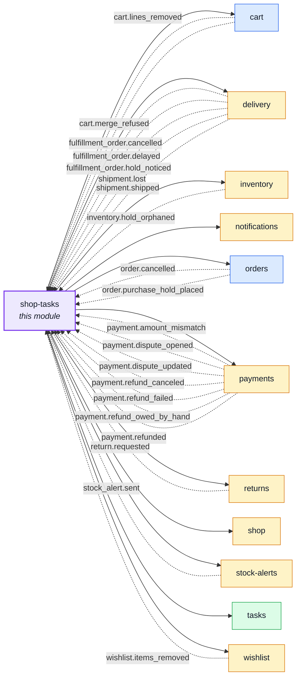
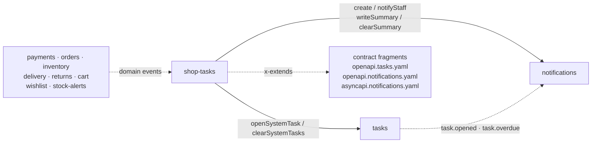
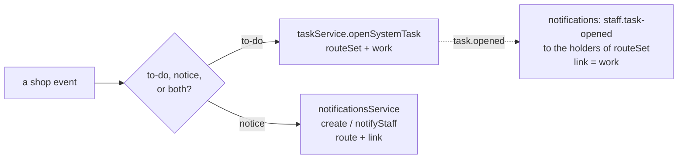

# shop-tasks

::: tip At a glance
**Owns** — the shop's side of the helpdesk: the to-dos a payment, stock or delivery situation opens, the buyer's messages, the staff's work notices and the daily and weekly staff digest. No routes, no collection: [`tasks`](./tasks.md) and [`notifications`](./notifications.md) do the writing.
**Depends on** — `tasks` and `notifications` (the doors it writes through), `payments`, `orders`, `inventory`, `delivery`, `returns`, `cart`, `wishlist` and `stock-alerts` (the events it hears, and the counts the digest reads), `users` (who can act today) and `shop` (the shop's country).
**Breaks if you change** — a `shop-tasks.*` notice code: the code is its own dictionary key in both repos, so renaming one orphans the copy that words it.
:::

## Its neighbourhood

<!-- module-graph:shop-tasks:start -->

_Solid arrows are imports. Dotted arrows are domain events — the return path an import
graph cannot see._

<!-- module-graph:shop-tasks:end -->

## The story

`tasks` and `notifications` ship with every project: the contact form, the staff to-do inbox and the
bell. Everything that talks about orders, payments, stock or deliveries lives here instead, so
removing the shop removes it cleanly. The core never names a shop thing: this module adds its own
to-do kinds, categories and notice codes to the contract by **fragments**, and hands its own routing
to the core with each call.

### The shop's to-dos

One task per situation, opened by the event that starts it and cleared by the event that ends it.
The dedup, the replay rules and the overdue sweep are the engine's: see
[System tasks](./tasks.md#system-tasks).

| Kind                 | Opens on                                                      | Cleared by                                             | Due (`dueAt`)                                                                      | Worked by (`routeSet`) | Told                      | `work` screen                  |
| -------------------- | ------------------------------------------------------------- | ------------------------------------------------------ | ---------------------------------------------------------------------------------- | ---------------------- | ------------------------- | ------------------------------ |
| `manual_refund_owed` | `payment.refund_owed_by_hand`                                 | `payment.refunded`, `payment.refund_canceled`          | + `NODE_PAYMENT_ATTENTION_MINUTES`                                                 | `PaymentRefunding`     | moderator, admin          | `sales/payments?tab=attention` |
| `refund_refused`     | `payment.refund_failed` with `final: true`                    | `payment.refunded`, `payment.refund_canceled`          | the legal 14 days for a return refund (`refundDueBy`), else + the attention window | `PaymentRefunding`     | moderator, admin          | `sales/payments?tab=attention` |
| `amount_mismatch`    | `payment.amount_mismatch`                                     | **never**: staff close it once they know why           | + the attention window                                                             | `AuditDisplay`         | admin only                | `orders/<orderId>`             |
| `dispute`            | `payment.dispute_opened` / `_updated` while it needs the shop | `payment.dispute_updated` with a decided or closed one | the provider's `evidenceDueBy`                                                     | `PaymentRefunding`     | moderator, admin          | `sales/payments?tab=attention` |
| `paid_without_hold`  | `inventory.hold_orphaned` (the payment step only)             | `order.cancelled`, `shipment.shipped`                  | +4 h                                                                               | `InventoryManagement`  | warehouse, admin          | `orders/<orderId>`             |
| `consent_due`        | `fulfillment_order.delayed`, see below                        | `shipment.shipped`, `fulfillment_order.cancelled`      | `agreedAt` + 30 d, or the date the buyer holds                                     | `OrderEditing`         | manager, moderator, admin | `orders/<orderId>`             |

The kinds, link types (`order`, `payment`, `refund`, `fulfillment_order`) and categories (`order`,
`cancellation`, `return`, `payment`) are appended to the core's enums by
`openapi.tasks.yaml`. Admin alone closes an `amount_mismatch` and an accepted `consent_due`: the
other roles read the alert and open the screen, but only `TaskManagement` works a task.

**The delay reminder (`consent_due`, 16 CFR 435.2).** The shop never asks the buyer and never
cancels; the task is the reminder that a person must, and by when. `delivery` keeps `promisedAt` on
the fulfillment order, the date the buyer holds now: it starts as `agreedAt`, a later date from a
notice replaces it, a "no date yet" notice removes it.

| Before this notice                    | Opens when                             | Due               |
| ------------------------------------- | -------------------------------------- | ----------------- |
| the buyer holds the date they ordered | no new date, or past `agreedAt` + 30 d | `agreedAt` + 30 d |
| the buyer holds a later date          | no new date, or past that date         | that date         |
| the buyer was told "no date yet"      | never: the earlier task stands         | —                 |

The rule binds a shop in the United States or one of its territories (`FTC_JURISDICTIONS`: `US`,
`PR`, `GU`, `VI`, `AS`, `MP`, 16 CFR 435) for **every** destination, including a delay with no ship-to
country. A shop elsewhere owes it only to a buyer shipped to one of those places. The shop's country
is `NODE_SHOP_COUNTRY`; there is no list to configure.

### The notices

Each notice code is its own dictionary key: `shop-tasks.<name>` for a buyer's message,
`shop-tasks.staff.<name>` for a staff work notice. The variants are appended to the `Notification`
union by `openapi.notifications.yaml` and to the stream's `NotificationPayload` by
`asyncapi.notifications.yaml`.

| Code                                                      | Audience | Written on                           | Told                               | Mail                  |
| --------------------------------------------------------- | -------- | ------------------------------------ | ---------------------------------- | --------------------- |
| `shop-tasks.cart-line-removed`                            | buyer    | `cart.lines_removed`                 | whose carts held the product       | —                     |
| `shop-tasks.wishlist-item-removed`                        | buyer    | `wishlist.items_removed`             | whose wishlists held the product   | —                     |
| `shop-tasks.cart-merge-refused`                           | buyer    | `cart.merge_refused`                 | the signed-in user                 | —                     |
| `shop-tasks.fulfillment-delayed`                          | buyer    | `fulfillment_order.delayed`          | the buyer, if the account exists   | —                     |
| `shop-tasks.fulfillment-held`                             | buyer    | `fulfillment_order.hold_noticed`     | the buyer, if the account exists   | —                     |
| `shop-tasks.shipment-lost`                                | buyer    | `shipment.lost`                      | the buyer, if the account exists   | —                     |
| `shop-tasks.stock-alert`                                  | buyer    | `stock_alert.sent`                   | who asked                          | —                     |
| `shop-tasks.staff.purchase-hold-placed`                   | staff    | `order.purchase_hold_placed`         | `UserBanning`                      | now                   |
| `shop-tasks.staff.return-requested`                       | staff    | `return.requested` (not withdrawals) | `ReturnManagement`                 | —                     |
| the ten summary rows, see [the digest](#the-staff-digest) | staff    | the digest jobs                      | the set that does the counted work | digest, where overdue |

`fulfillment_order.delayed` is both a to-do and a message. One module has one handler per event, so
a single handler runs the to-do first (idempotent by `eventId`) and then the notice: a redelivery
after a failed notice re-runs a no-op open and writes the notice once.

### The staff digest

Two jobs keep the staff's summary rows true: `sweep:staff-digest` (daily, 06:30 UTC) and
`sweep:staff-weekly` (Mondays, 06:30 UTC; the late-preorder row). Each row is a count read from the
module that owns it; a count of zero removes the row, one that fell is updated quietly, one that
appeared or grew is unread again, pushed and, where the route says `digest`, mailed once per person
per run.

| Summary row                                   | Counts                                    | Run    | Set told              | Mail   |
| --------------------------------------------- | ----------------------------------------- | ------ | --------------------- | ------ |
| `shop-tasks.staff.transfers-due`              | bank transfers due soon                   | daily  | `PaymentRecording`    | bell   |
| `shop-tasks.staff.unshipped`                  | paid orders not shipped                   | daily  | `DeliveryStart`       | digest |
| `shop-tasks.staff.returns-undecided`          | return requests still undecided           | daily  | `ReturnManagement`    | digest |
| `shop-tasks.staff.withdrawals-awaiting-goods` | withdrawals waiting for their goods       | daily  | `ReturnReceiving`     | bell   |
| `shop-tasks.staff.delivery-holds-open`        | held orders open too long                 | daily  | `DeliveryManagement`  | digest |
| `shop-tasks.staff.awaiting-tracking`          | shipped parcels with no tracking code     | daily  | `DeliveryManagement`  | bell   |
| `shop-tasks.staff.undelivered`                | parcels shipped and never marked arrived  | daily  | `DeliveryManagement`  | digest |
| `shop-tasks.staff.stale-refunds`              | refunds open past the attention threshold | daily  | `PaymentRefunding`    | digest |
| `shop-tasks.staff.low-stock`                  | products low on stock                     | daily  | `InventoryManagement` | bell   |
| `shop-tasks.staff.preorders-late`             | preorders past their date                 | weekly | `OrderEditing`        | digest |

There is no digest extension point in `notifications`: all ten rows are the shop's, so a registry
would have one caller. The primitives (`writeSummary`, `clearSummary`, `staffRecipients`) are the
extension point; the digest is lifted back into `notifications` only when a foundation row exists.

### Who is told

## Configuration

| Variable                                                                                    | Default | Meaning                                       |
| ------------------------------------------------------------------------------------------- | ------- | --------------------------------------------- |
| `NODE_STAFF_TRANSFER_DUE_HOURS`                                                             | 24      | a transfer counts as due this many hours out  |
| `NODE_STAFF_HOLD_OPEN_DAYS`, `NODE_STAFF_RETURN_DECISION_DAYS`, `NODE_STAFF_UNSHIPPED_DAYS` | 3       | days before a hold, a return, an order counts |
| `NODE_STAFF_TRACKING_MISSING_HOURS`                                                         | 24      | hours before a missing tracking code counts   |
| `NODE_DELIVERY_UNDELIVERED_REMINDER_DAYS`                                                   | 14      | days before an unmarked parcel counts         |

## Related pages

- [Tasks](./tasks.md) — the engine these openers feed
- [Notifications](./notifications.md) — the inbox, the bell and the work-notice engine
- [Extending another module's contract](../api/contract-fragmentation.md#extending-another-modules-contract) — how the kinds and codes reach the contract
- [Email & PDF Rendering](../tools/email-and-rendering.md) — the digest mail
