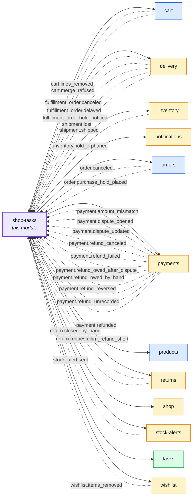
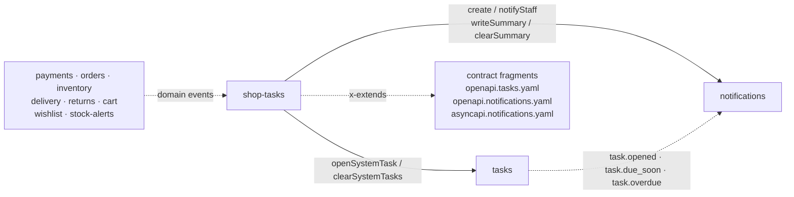

# shop-tasks

The shop's side of the helpdesk: opens a to-do for each payment, stock or delivery situation that needs a person, writes the buyer's messages and the staff's work notices, and sends the staff digest.

::: tip At a glance
**Owns** — the shop's side of the helpdesk: the to-dos a payment, stock or delivery situation opens, the buyer's messages, the staff's work notices and the daily and weekly staff digest. One read route (the nav badge counts), no collection: [`tasks`](./tasks.md) and [`notifications`](./notifications.md) do the writing.
**Depends on** — `tasks` and `notifications` (the doors it writes through), `payments`, `orders`, `inventory`, `delivery`, `returns`, `cart`, `wishlist` and `stock-alerts` (the events it hears; `products` names a product for the unknown-outcome notice, and the counts the digest reads), `users` (who can act today) and `shop` (the shop's country).
**Breaks if you change** — a `shop-tasks.*` notice code: the code is its own dictionary key in both repos, so renaming one orphans the copy that words it.
:::

## Its neighbourhood

<!-- module-graph:shop-tasks:start -->

_Solid arrows are imports. Dotted arrows are domain events — the return path an import
graph cannot see._

<!-- module-graph:shop-tasks:end -->

## The story

`tasks` and `notifications` ship with every project: the contact form, the staff to-do inbox and the
bell. Everything that talks about orders, payments, stock or deliveries lives here instead, so
removing the shop removes it cleanly. The core never names a shop thing: this module adds its own
to-do kinds, categories and notice codes to the contract by **fragments**, and hands its own routing
to the core with each call.

## The shop's to-dos {#the-shop-s-to-dos}

One task per situation, opened by the event that starts it and cleared by the event that ends it.
The dedup, the replay rules and the overdue sweep are the engine's: see
[System tasks](./tasks.md#system-tasks).

Full detail: [Shop to-dos by situation](./shop-tasks-todos.md#the-shop-s-to-dos).

## The notices {#the-notices}

Each notice code is its own dictionary key: `shop-tasks.<name>` for a buyer's message,
`shop-tasks.staff.<name>` for a staff work notice. The variants are appended to the `Notification`
union by `openapi.notifications.yaml` and to the stream's `NotificationPayload` by
`asyncapi.notifications.yaml`.

Full detail: [Shop-tasks notices, digest and badge](./shop-tasks-notices.md#the-notices).

## The staff digest {#the-staff-digest}

Two jobs keep the staff's summary rows true: `sweep:staff-digest` (daily, 06:30 UTC) and
`sweep:staff-weekly` (Mondays, 06:30 UTC; the late-preorder row). Each row is a count read from the
module that owns it; a count of zero removes the row, one that fell is updated quietly, one that
appeared or grew is unread again, pushed and, where the route says `digest`, mailed once per person
per run.

Full detail: [Shop-tasks notices, digest and badge](./shop-tasks-notices.md#the-staff-digest).

## The nav badge summary {#the-nav-badge-summary}

`GET /shop-tasks/summary` answers one count per staff screen that has a badge. A badge shows open
work, not unread notices, so opening the bell never empties it. The key names live only in the
`ShopWorkSummary` schema of `src/modules/shop-tasks/openapi.yaml`.

Full detail: [Shop-tasks notices, digest and badge](./shop-tasks-notices.md#the-nav-badge-summary).

## Who is told {#who-is-told}

The shape of every "something happened, who hears it" flow. The diagram names no codes on
purpose: which codes, sets and mails exist is on the pages linked under it.

Full detail: [Shop-tasks notices, digest and badge](./shop-tasks-notices.md#who-is-told).

## Configuration

| Variable                                                                                    | Default | Meaning                                                                |
| ------------------------------------------------------------------------------------------- | ------- | ---------------------------------------------------------------------- |
| `NODE_STAFF_TRANSFER_DUE_HOURS`                                                             | 24      | a transfer counts as due this many hours out                           |
| `NODE_STAFF_HOLD_OPEN_DAYS`, `NODE_STAFF_RETURN_DECISION_DAYS`, `NODE_STAFF_UNSHIPPED_DAYS` | 3       | days before a hold, a return, an order counts                          |
| `NODE_STAFF_RETURN_TRANSIT_DAYS`                                                            | 7       | days of post added to the buyer's 14 before a return counts as overdue |
| `NODE_STAFF_TRACKING_MISSING_HOURS`                                                         | 24      | hours before a missing tracking code counts                            |
| `NODE_DELIVERY_UNDELIVERED_REMINDER_DAYS`                                                   | 14      | days before an unmarked parcel counts                                  |

## Read next

- [Shop-tasks notices, digest and badge](./shop-tasks-notices.md) — a deeper page of this module
- [Shop to-dos by situation](./shop-tasks-todos.md) — a deeper page of this module
- [Tasks](./tasks.md) — the engine these openers feed
- [Notifications](./notifications.md) — the inbox, the bell and the work-notice engine
- [Extending another module's contract](../build/contract-fragmentation.md#extending-another-modules-contract) — how the kinds and codes reach the contract
- [Email & PDF Rendering](../understand/email-and-rendering.md) — the digest mail
