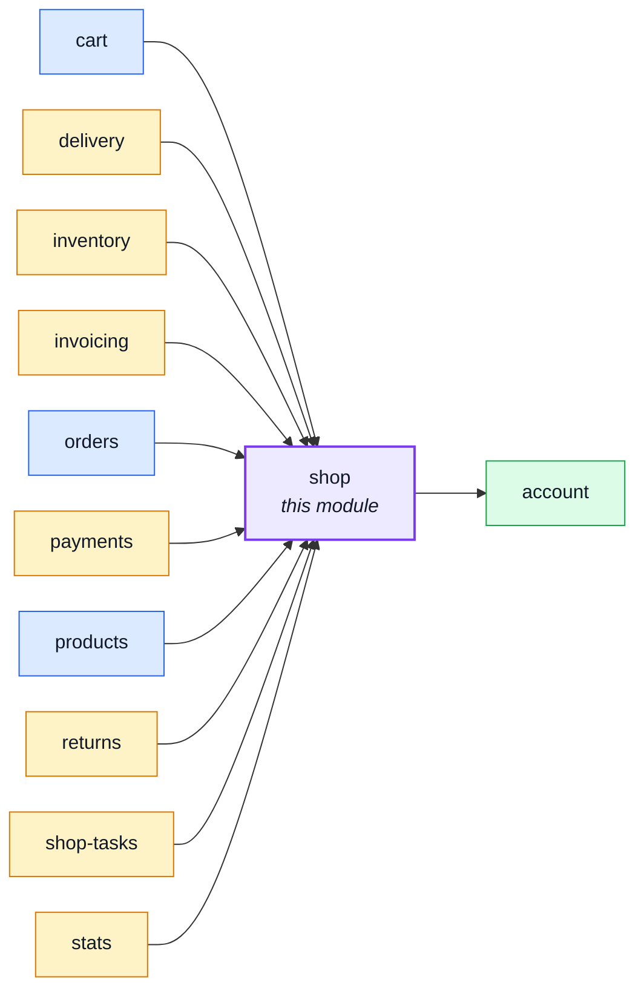

# shop

::: tip At a glance
**Owns** — the shop itself: the time zone its days follow, the one currency it trades in, the
countries it ships to, where returned goods go and who pays the postage, and the backorder promise
in days. One public read, `GET /shop`. Who runs the site (legal name, address, VAT number) is
[`account`'s](./account.md#operator-identity), not the shop's.
**Depends on** — `account`, for the operator's postal address (the VAT country and the return
fallback) and phone (the shop group reaches the foundation, never the reverse). Eight modules read it: `orders`, `products`, `cart`, `delivery`,
`invoicing`, `payments`, `returns` and `stats`.
**Breaks if you change** — the `Shop` wire shape, which the paired frontend reads once into its
shop store: price inputs and the address form's country list draw on it. The legal pages do not:
they read `GET /config`, so a project without the shop keeps them.
:::

## Its neighbourhood

<!-- module-graph:shop:start -->

_Solid arrows are imports. Dotted arrows are domain events — the return path an import
graph cannot see._

<!-- module-graph:shop:end -->

## The story

**It exists because none of these settings is an order concept.** They sat in `orders` only so
that `invoicing`, `delivery` and `returns` — which import `orders` — could read them without a
cycle. That is a reason about the import graph, not about the business, and every new shop-wide
setting made `orders` more of a hub. Every commerce platform models the shop apart from its orders
(Shopify's `Shop`, Saleor's `shop` query, Medusa's Store module).

**Everything is read live, per call.** The readers (`shopCountry`, `shopTimezone`, `traderPhone`,
`shopCurrency`, `shipToCountries`, `returnAddress`, `returnPostagePayer`) ask the config slice on
every call, so a test varies a setting per case and a deployment corrects one with a restart.

**`GET /shop` publishes `minorUnits`**, the places of the shop currency (2 EUR, 0 JPY, 3 KWD). Amounts travel as decimal strings that carry their own scale, so the one client that has to know it up front is a price input that starts empty (`ProductCreate`); no ISO table lives in the client.

**The seller's identity is not here.** The Consumer Rights Directive (Art. 6(1)) wants the
trader's identity, address, phone and email before the contract, and the e-Commerce Directive (Art. 5) wants the VAT number, but any online service owes its provider identity, so
[`account`](./account.md#operator-identity) owns it and serves it on `GET /config` as `operator`.
The shop reads it: `shopCountry()` is the operator's country, and a return with no address of its
own falls back to the operator's. Not published: the bank-transfer details, which travel on each
order and stay with `payments`.

**`GET /shop` publishes `timeZone`** (an IANA name). The promised days (`releaseDate`,
`restockDate`, `agreedAt`, `expectedAt`) are sent and answered as plain `YYYY-MM-DD` days of this
calendar, so a screen never needs it to print one; it is there for a screen that has to name the
calendar. Google AIP-142 and Zalando's guidelines both want a calendar day as a `date`, with an
IANA zone named beside it.

**Required at boot.** The time zone, and the operator's phone, which `account` leaves optional
(the withdrawal form's "To" row prints it; CRD Art. 6(1)(c), Directive 2011/83/EU as amended). A
project without this module boots with no phone. The return address stays optional: one that is
only partly set reads as none and falls back to the operator's postal address, rather than telling
a customer to post a parcel to "Via Roma, ".

**One currency, no per-product override.** `NODE_DEFAULT_CURRENCY` is read here and nowhere else.
A shop that ever needs a second currency needs a real design, not several modules quietly reading
the same variable.

## Configuration

These settings are deploy-time env on purpose: a correction is a restart, not an admin screen. Commerce platforms keep them in a database; this boilerplate declines to become one.

| Variable                                             | Meaning                                                                                                                                                                     |
| ---------------------------------------------------- | --------------------------------------------------------------------------------------------------------------------------------------------------------------------------- |
| `NODE_LEGAL_*`                                       | The operator's identity, owned by [`account`](./account.md#operator-identity); the shop requires `NODE_LEGAL_PHONE` of it and reads `NODE_LEGAL_COUNTRY` as the VAT country |
| `NODE_SHOP_TIMEZONE`                                 | The IANA zone whose calendar numbering series and reports follow                                                                                                            |
| `NODE_RETURN_ADDRESS_*`, `NODE_RETURN_POSTAGE_PAYER` | Where returns go (default: the operator's postal address; the country is a two-letter code, upper-cased at boot) and who pays the postage                                   |
| `NODE_SHIP_TO_COUNTRIES`                             | Countries a physical order ships to, ISO 3166-1 alpha-2 in any case, upper-cased at boot (default: the operator's country)                                                  |
| `NODE_DEFAULT_CURRENCY`                              | The one ISO-4217 currency, `EUR` by default; an unknown code is refused                                                                                                     |
