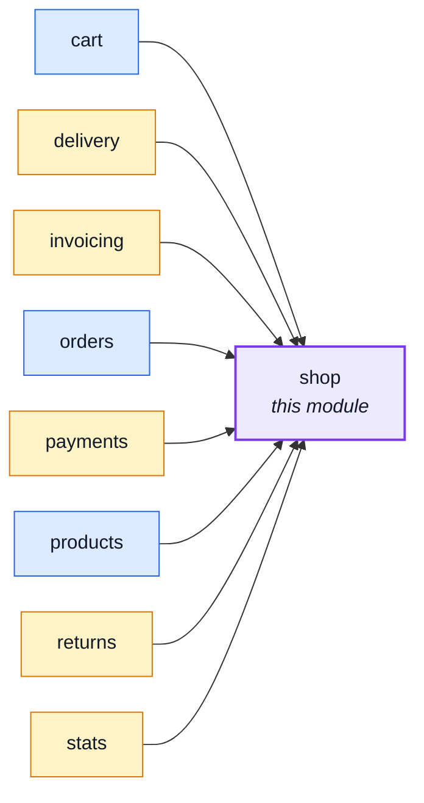

# shop

::: tip At a glance
**Owns** — the shop itself: who the seller is (legal name, address, email, phone, VAT number), the
country VAT is charged in, the time zone its days follow, the one currency it trades in, the
countries it ships to, and where returned goods go and who pays the postage. One public read,
`GET /shop`.
**Depends on** — nothing. Seven modules read it: `orders`, `products`, `cart`, `delivery`,
`invoicing`, `returns` and `stats`.
**Breaks if you change** — the `Shop` wire shape, which the paired frontend reads once into its
shop store: price inputs, the address form's country list and the legal pages all draw on it.
:::

## Its neighbourhood

<!-- module-graph:shop:start -->

_Solid arrows are imports. Dotted arrows are domain events — the return path an import
graph cannot see._

<!-- module-graph:shop:end -->

## The story

**It exists because none of these settings is an order concept.** They sat in `orders` only so
that `invoicing`, `delivery` and `returns` — which import `orders` — could read them without a
cycle. That is a reason about the import graph, not about the business, and every new shop-wide
setting made `orders` more of a hub. Every commerce platform models the shop apart from its orders
(Shopify's `Shop`, Saleor's `shop` query, Medusa's Store module).

**Everything is read live, per call.** The readers (`shopIdentity`, `shopCountry`, `shopTimezone`,
`shopCurrency`, `shipToCountries`, `returnAddress`, `returnPostagePayer`) ask the config slice on
every call, so a test varies a setting per case and a deployment corrects one with a restart.

**The seller is public on purpose.** The Consumer Rights Directive (Art. 6(1)) wants the trader's
identity, address, phone and email before the contract, and the e-Commerce Directive (Art. 5) wants
the VAT number. `GET /shop` is where a visitor, and the Terms page, read them. Not published: the
time zone (an operator's fact, not a visitor's), and the bank-transfer details, which travel on
each order and stay with `payments`.

**Required at boot, because a notice without an address is not one.** The legal name, street,
city, zip, country, email, phone and time zone refuse to boot when unset; the VAT number, the trade
register, the registration number and the return address stay optional. A return address that is only partly set reads as none and falls back
to the legal address, rather than telling a customer to post a parcel to "Via Roma, ".

**One currency, no per-product override.** `NODE_DEFAULT_CURRENCY` is read here and nowhere else.
A shop that ever needs a second currency needs a real design, not several modules quietly reading
the same variable.

## Configuration

These settings are deploy-time env on purpose: a correction is a restart, not an admin screen. Commerce platforms keep them in a database; this boilerplate declines to become one.

| Variable                                             | Meaning                                                                            |
| ---------------------------------------------------- | ---------------------------------------------------------------------------------- |
| `NODE_SHOP_LEGAL_NAME`, `_STREET`, `_CITY`, `_ZIP`   | The seller's name and address (required)                                           |
| `NODE_SHOP_COUNTRY`                                  | The country VAT is charged in (required)                                           |
| `NODE_SHOP_EMAIL`, `NODE_SHOP_PHONE`                 | How a customer reaches the shop (required)                                         |
| `NODE_SHOP_VAT_NUMBER`                               | VAT identification number; absent below the registration threshold                 |
| `NODE_SHOP_TRADE_REGISTER`, `_REGISTRATION_NUMBER`   | The commercial register and the seller's number in it; absent for a seller in none |
| `NODE_SHOP_TIMEZONE`                                 | The IANA zone whose calendar numbering series and reports follow                   |
| `NODE_RETURN_ADDRESS_*`, `NODE_RETURN_POSTAGE_PAYER` | Where returns go (default: the legal address) and who pays the postage             |
| `NODE_SHIP_TO_COUNTRIES`                             | Countries a physical order ships to (default: the shop's own country)              |
| `NODE_DEFAULT_CURRENCY`                              | The one ISO-4217 currency, `EUR` by default; an unknown code is refused            |
