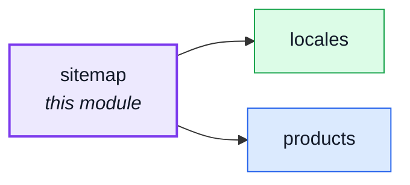
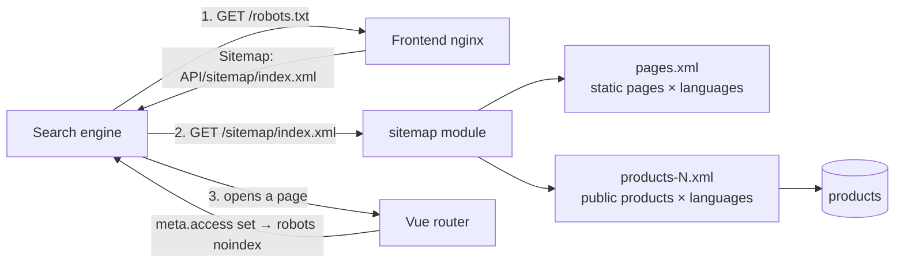

# sitemap

::: tip At a glance
**Owns** — `sitemap.xml`: the shop pages and every public product, once per language, built on request.
**Depends on** — [`products`](./products.md), [`locales`](./locales.md).
**Breaks if you change** — the three file addresses: the frontend's `robots.txt` names `/sitemap/index.xml`.
:::

## Its neighbourhood

<!-- module-graph:sitemap:start -->

_Solid arrows are imports. Dotted arrows are domain events — the return path an import
graph cannot see._

<!-- module-graph:sitemap:end -->

## The story

A client-rendered shop is invisible to a crawler that does not run its scripts, and a crawler that
does still needs a list of what exists. The server that owns the catalogue is the one that knows
the list, so the sitemap is built here from the database, not shipped as a file by the frontend.

The API host serves the sitemap while the pages live on the frontend host. That is allowed: a
`Sitemap:` line in the site's own `robots.txt` may name another host (sitemaps.org, "cross
submits"). The line is written by the frontend only when indexing is switched on there.

## The files

| Address                   | Lists                                                    | `lastmod`                        |
| ------------------------- | -------------------------------------------------------- | -------------------------------- |
| `/sitemap/index.xml`      | `pages.xml` and one `products-N.xml` per run of products | none                             |
| `/sitemap/pages.xml`      | the static pages (`STATIC_PAGES` in `config.ts`)         | none: nothing dates a prose page |
| `/sitemap/products-N.xml` | public products: active and not deleted                  | the product's `updatedAt`        |

- **Always an index.** The address `robots.txt` names never changes as the catalogue grows
  (Shopify and Yoast do the same).
- **One `<url>` per language,** each with `xhtml:link rel="alternate"` for every active language and
  an `x-default` pointing at the default language. Only active languages are listed.
- **A file never passes 50,000 `<url>`** (the sitemaps.org limit). Each product counts once per
  language, so a run holds `⌊limit ÷ languages⌋` products.
- **`lastmod` is `updatedAt`** because it is accurate: a translation edit writes the product with
  `touch`, and a sale writes the stock level in `inventory`, which does not touch the product.
  Google uses `lastmod` only when it is reliable, and ignores `priority` and `changefreq`, so those
  are not written.
- **Cached for an hour** (`Cache-Control: public, max-age=3600`). No job and no file on disk: the
  answer is always current, and one process is the supported shape.
- **No switch.** It holds only addresses a stranger can already open. Whether anyone is pointed at
  it is the frontend's `VITE_ROBOTS_INDEX`.
- A product page is `NODE_FRONTEND_URL/<language>/<NODE_FRONTEND_LINK_PRODUCT>`, the same
  template pattern as the mail links. The static page list is code, not configuration: a page
  exists with the frontend's router, not per deployment.
- The `example` module's pages are not listed: it is a demo module.

## Configuration

| Variable                     | Default         | Meaning                                                       |
| ---------------------------- | --------------- | ------------------------------------------------------------- |
| `NODE_FRONTEND_LINK_PRODUCT` | `products/{id}` | path of a product page under the language                     |
| `NODE_SITEMAP_URL_LIMIT`     | `50000`         | most `<url>` entries in one file; lowered only to see a split |

## Libraries

- **[`sitemap`](https://github.com/ekalinin/sitemap.js)** (npm, `^9`) writes the XML: `SitemapStream`
  for a file, `SitemapIndexStream` for the index, `xhtml:link` alternates included. Chosen over a
  hand-rolled writer because escaping, namespaces and the schema's element order are what go wrong
  by hand. It streams, so a 50,000-entry file never sits in memory as one string. Maintained
  (released 2026, Node ≥ 20.19.5; the repo needs ≥ 24.7). Only this module imports it.

## What this module deliberately does not do

- No per-page meta or Open Graph tags: that needs server rendering or prerendering.
- No image or news sitemaps, and no ping endpoint (Google retired sitemap ping in 2023).
- No category pages: categories are tags on a product, not pages.

## Related pages

- [`products`](./products.md) — owns the catalogue the product files read
- [`locales`](./locales.md) — says which languages are active
- [Adding & Removing a Module](../theory/module-lifecycle.md) — the deletability procedure
