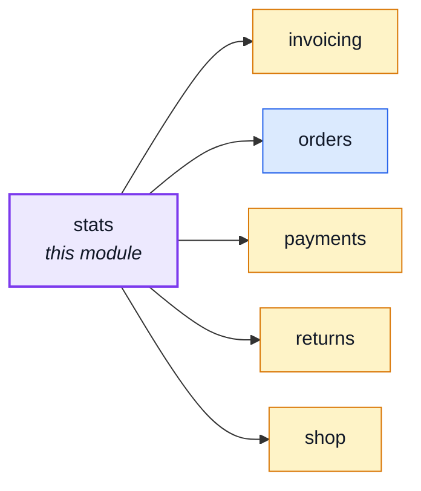
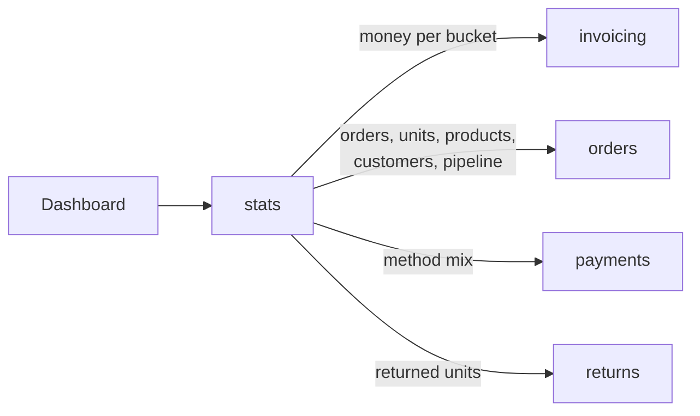
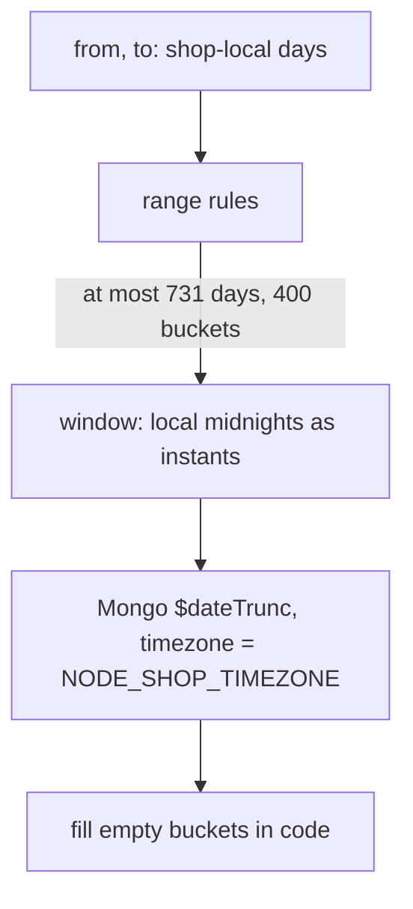

# stats

::: tip At a glance
**Owns** — nothing stored. No collection, no cache: every figure is read on demand.
**Depends on** — [`invoicing`](./invoicing.md) (every money figure), [`orders`](./orders.md)
(counts, units, products, customers, the open pipeline), [`payments`](./payments.md) (the mix) and
[`returns`](./returns.md) (units that came back).
**Breaks if you change** — a frozen field on an invoice, a credit note or an order line
(`netTotal`, `shippingNetAmount`, `items.product.price`, `categories`): the formulas below read
them by name.
:::

## Its neighbourhood

<!-- module-graph:stats:start -->

_Solid arrows are imports. Dotted arrows are domain events — the return path an import
graph cannot see._

<!-- module-graph:stats:end -->

## The story

The staff dashboard needs sales numbers: how much, how many, which products, who bought. Each owner
module already holds the rows those numbers are made of, so this module stores nothing. It asks each
owner for a grouped answer (a few hundred rows at most) and merges the answers by key.

Why not a precomputed table (WooCommerce, Magento): the one benefit of one, frozen and dated money
rows, `invoicing` already has. A table would add a backfill, drift and replays for nothing more, and
an on-read composer never has to be told to refresh. Why not a single owner doing it all: `orders`
may not import its siblings, and the money is not on the order at all.

**The money comes from `invoicing`, not from `orders` and `payments`.** An order stores no total, its
prices include VAT, and a refund in `payments` is one gross amount with no VAT or shipping split. An
invoice and a credit note carry exactly the split a net figure needs.

## Definitions

Shopify's metric names; the sale date and "paid orders only" are WooCommerce's default
(`date_paid`). Shopify counts an order when placed, unpaid included, which would be wrong here: an
unpaid transfer that lapses has no reversal to offset it. Prices include VAT, so every "net" figure
is the amount with VAT taken out.

| Metric                   | Definition                                                                               | Source                                         |
| ------------------------ | ---------------------------------------------------------------------------------------- | ---------------------------------------------- |
| Orders                   | orders paid in the period                                                                | `orders`, by `paidAt`                          |
| Gross sales              | goods net of VAT on invoices issued in the period, before shipping, discounts, reversals | invoices: `netTotal` minus `shippingNetAmount` |
| Discounts                | none exist yet; kept in the formula at 0                                                 | none                                           |
| Reversals                | goods net of VAT on credit notes issued in the period                                    | credit notes, same formula                     |
| Net sales                | gross minus discounts minus reversals                                                    | computed                                       |
| Shipping                 | shipping net charged minus refunded                                                      | `shippingNetAmount`                            |
| Taxes                    | VAT charged minus VAT refunded                                                           | `taxTotal`                                     |
| Total sales              | net sales plus shipping plus taxes                                                       | computed                                       |
| Refunds                  | credit notes issued in the period, VAT included                                          | `grandTotal`                                   |
| Average order value      | (gross minus discounts) divided by orders                                                | computed                                       |
| Units                    | ordered, reversed, net                                                                   | order lines; returns received                  |
| Top products, categories | net sales from the frozen line price and rate                                            | order lines                                    |
| Payments mix             | payments that took money, by method and provider                                         | `payments`                                     |
| Cancellation rate        | orders placed in the period that ended cancelled (a cohort)                              | `orders`, by `createdAt`                       |
| Return rate              | units received back divided by units ordered                                             | `returns`, `orders`                            |
| Customers                | accounts that paid in the period; new = first paid order falls in it                     | `orders`, by `userId`                          |
| Pipeline                 | transfers awaiting money (count, amount, nearest `payBy`), paid orders not shipped       | `orders`, a snapshot                           |

Money is grouped by currency and never converted. One deployment has one currency
(`NODE_DEFAULT_CURRENCY`), so a second group appears only after a config change. Money is stored as
Decimal128, so Mongo's plain `$sum` is exact; one conversion to minor units per currency follows in
code (`shared-kernel/money.ts#toMinorUnits`, reading the sum as text). See
[Money at rest](../theory/tactical-ddd.md#at-rest-decimal128).

## Dates and the time zone

| Question        | Rule                                                                                                          |
| --------------- | ------------------------------------------------------------------------------------------------------------- |
| A sale's date   | `paidAt`, written in one place (`orders` `markPaid`), reached by card, sync, webhook and offline              |
| Money's date    | the document's `issuedAt`: an invoice follows its payment by seconds, a credit note its refund                |
| A refund's date | its credit note's `issuedAt`                                                                                  |
| Whose days      | the shop's: `NODE_SHOP_TIMEZONE`, a named IANA zone (a fixed offset is refused, since it ignores summer time) |
| Week            | starts Monday                                                                                                 |
| `from`, `to`    | shop-local calendar days, both inclusive, as `YYYY-MM-DD`                                                     |
| Bounds          | at most two years and 400 buckets, else 422                                                                   |

Bucket edges and window bounds both come from the same zone: `$dateTrunc` cuts buckets with Mongo's
own tz database, and the bounds use `Intl` through `zonedStartOfDay`. A test on the real binary
passes a real zone name through `$dateTrunc` so the two cannot silently disagree.

## Known limits

- **An offline payment's `paidAt` is when the admin recorded it**, not when the money arrived.
  Moving it is unsafe: `paidAt` also starts the digital withdrawal clock. The dashboard figure is
  money in, not IFRS 15 revenue.
- **Partial credit notes fold shipping into goods**, so the shipping line is exact for full refunds
  only.
- **A cancellation has no date**, so units on a cancelled order are not in "units reversed". The
  cancellation rate is a cohort instead.
- **A product in two categories counts in both**, so category rows do not add up to the total
  (WooCommerce's documented rule).
- **Deleted orders**: the money stays (the invoice stays, which is right for accounting); counts and
  product tables lose them.
- **Customers by account only.** Never by email: every anonymised order carries one placeholder
  address, so all erased accounts would merge into one "returning" customer.
- **Not built:** median hours from paid to first shipment (needs `delivery`, which this module does
  not depend on), preorders waiting (needs preorders), payment failure rate (a declined payment is
  re-confirmed in place, so only an in-memory counter remembers attempts).

## Caching

None. The shared `setCache` keys on a guest caller and sends `Cache-Control: public`, so reusing it
would put sales data in a shared cache. Responses are `private`. A service-level cache is a
production follow-up if a query turns out slow.

## Access

One key, `read:Stats`, held by `admin` (and `system` through the YAML alias) and `manager`. A
session, not an API key.

## Who can do what

Every rule this module declares and who holds it, role by role. The rule is what a route guard asks for; the set is what a role lists.

<!-- permissions:start -->

| Rule         | Set            | `guest` | `unverified` | `customer` | `manager` | `warehouse` | `support` | `editor` | `moderator` | `admin` | `operator` | Credential | What it lets them do                                                                    |
| ------------ | -------------- | ------- | ------------ | ---------- | --------- | ----------- | --------- | -------- | ----------- | ------- | ---------- | ---------- | --------------------------------------------------------------------------------------- |
| `read:Stats` | `StatsDisplay` | —       | —            | —          | ✅        | —           | —         | —        | —           | ✅      | —          | ✅         | Read the shop's sales numbers — revenue, orders, products, customers, the payments mix. |

✅ held · `own` only the caller’s own rows · ⚡c / ⚡s needs a freshly proved session (critical / sensitive) ·
Credential: ✅ when an API key can be minted with the rule. Generated from the rules and sets in
`src/modules/*/authorization.yaml` and the roles in `shared/authorization-roles.yaml`, asked of the
evaluator — [Authorization](../theory/authorization.md) explains the model.

<!-- permissions:end -->

## Related pages

- [invoicing](./invoicing.md), [orders](./orders.md), [payments](./payments.md),
  [returns](./returns.md)
