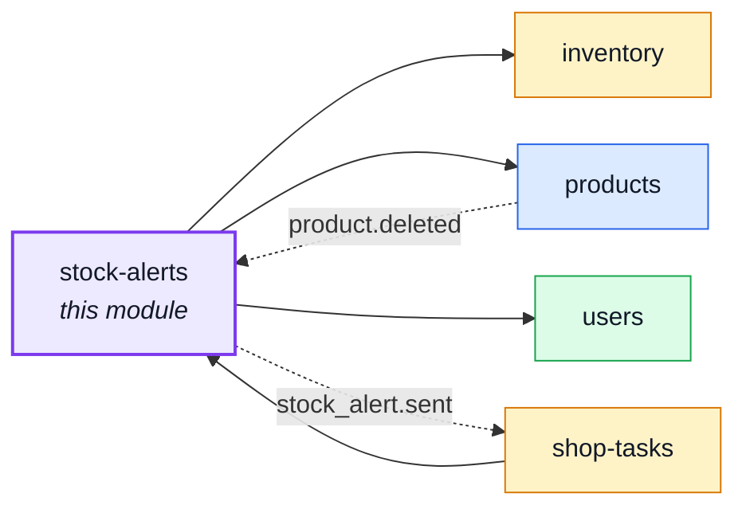
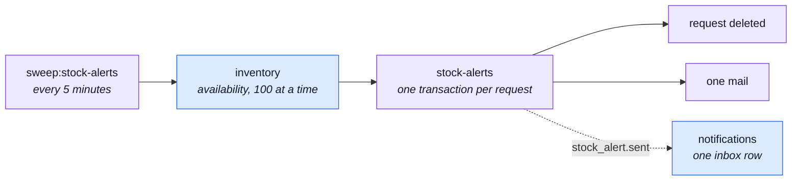

# stock-alerts

Back-in-stock requests: a signed-in buyer asks to be told once when a product they cannot order can be again.

::: tip At a glance
**Owns** — back-in-stock requests: one row per user and product, used once, and the one mail they earn.
**Depends on** — [`inventory`](./inventory.md), [`products`](./products.md), [`users`](./users.md).
**Breaks if you change** — `STOCK_ALERT_SENT`. [`notifications`](./notifications.md) imports that event name to write the inbox row.
:::

## Its neighbourhood

<!-- module-graph:stock-alerts:start -->

_Solid arrows are imports. Dotted arrows are domain events — the return path an import
graph cannot see._

<!-- module-graph:stock-alerts:end -->

## The story

A sold-out page with no way to say "tell me" is a standard feature missing. Magento
(`Magento_ProductAlert`) and PrestaShop (`mailalerts`) ship it as a module of their own; so does
this repo.

**The click is the consent.** An explicit "Notify me" on one product is specific prior consent for
that one mail, so the mail carries no other promotion (adding one, or sending it twice, makes it
marketing: it then needs an unsubscribe and ePrivacy Art. 13 consent), and the request is deleted
when it is answered. The consent counts only from a proven mailbox: an account whose address is
unverified gets the inbox row and never the mail, checked at send time (so verifying before the
restock is enough). Signed-in only: there is no guest double opt-in to run, and
[account erase](./account.md) covers the rows through `personalData`.

**The button only exists while the product is `out_of_stock`.** `POST /stock-alerts` (the product in
the body) is refused with `STOCK_ALERT_PRODUCT_BUYABLE` unless [`inventory`'s availability
read](./inventory.md#the-availability-reads) says `out_of_stock`: shelf units, a backorder open
under its cap and date, or a preorder with allowance left all read otherwise. An unknown, hidden or
removed product is a `404`. One read, `availability`, decides both when to refuse and when to answer.

## The cap

**An account holds at most `NODE_STOCK_ALERTS_MAX` requests** (default 100, at most 250).
`GET /stock-alerts` is never paginated, so the list is bounded where a request is written. A request
for a NEW product past it answers `409 STOCK_ALERT_LIMIT_REACHED`; asking again for one already
waited for stays a 200. The write counts the account's rows for other products, then upserts, so two
concurrent asks for different products can overshoot the cap by one. That is accepted: a transaction
would not stop it either, and a counter document is not worth the second write. The inbox's own cap of
100 is a different thing and is not the reason for this number.

## The sweep

Nothing announces that a product is orderable again: stock arrives, a backorder opens, a product is
shown again, a release date passes, and none of it is told to this module. `npm run job
sweep:stock-alerts` runs every five minutes. It takes the distinct products anyone waits for, asks
`inventory` for their availability 100 at a time (the contract's bound on the batch read), and hands
each one that is no longer `out_of_stock` to the answer. It calls the inventory service directly,
with no caller: a sweep has no permissions to judge, and a hidden or removed product reads
`out_of_stock`, so it is never answered. Running it again sends nothing, since an answered request
is deleted. A restock is therefore noticed within five minutes, plus up to 60 seconds of the
availability entry's own cache.

The delete is the guard: a request cancelled meanwhile, or answered by a second run of the sweep,
finds nothing to delete and sends nothing. A mail that fails is logged; the inbox row stands. An account that is locked (banned, or in the grace
of its own deletion) or whose address is unverified is not mailed at all: the request is still answered and deleted, the inbox row
stands.

## Read next

- [`inventory`](./inventory.md#the-availability-reads) — the availability read the sweep and the refusal ask
- [`notifications`](./notifications.md) — writes the inbox row
- [Adding & Removing a Module](../build/module-lifecycle.md) — the deletability procedure
