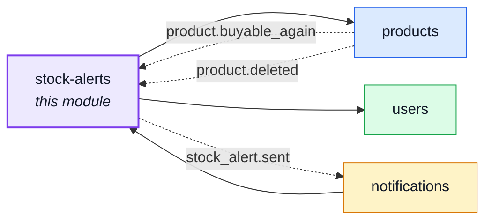
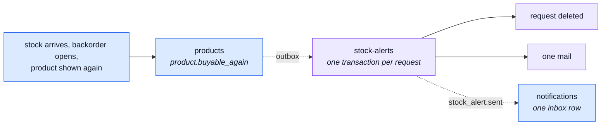

# stock-alerts

::: tip At a glance
**Owns** — back-in-stock requests: one row per user and product, used once, and the one mail they earn.
**Depends on** — [`products`](./products.md), [`users`](./users.md).
**Breaks if you change** — `STOCK_ALERT_SENT`. [`notifications`](./notifications.md) imports that event name to write the inbox row.
:::

## Its neighbourhood

<!-- module-graph:stock-alerts:start -->

_Solid arrows are imports. Dotted arrows are domain events — the return path an import
graph cannot see._

<!-- module-graph:stock-alerts:end -->

## The story

A sold-out page with no way to say "tell me" is a standard feature missing. Magento
(`Magento_ProductAlert`) and PrestaShop (`mailalerts`) ship it as a module of their own; so does
this repo.

**The click is the consent.** An explicit "Notify me" on one product is specific prior consent for
that one mail, so the mail carries no other promotion, and the request is deleted when it is
answered. Signed-in only: there is no guest double opt-in to run, and
[account erase](./account.md) covers the rows through `personalData`.

**The button only exists while the product cannot be ordered.** `POST /stock-alerts/{productId}` is
refused with `STOCK_ALERT_PRODUCT_BUYABLE` when the product can be ordered now: shelf units, a
backorder open under its cap and date, or a preorder with allowance left. One rule, `isBuyable`,
decides it here and decides when to fire.

## The signal

`products` announces `product.buyable_again` through the outbox, in the transaction of the write that
made the product orderable, once per flip and never while it stays orderable. The flips: synced stock
arriving, a backorder opening or its date moving on, the product shown or put back on sale.

The delete is the guard: a request cancelled meanwhile, or answered by a redelivery of the signal,
finds nothing to delete and sends nothing. A mail that fails is logged; the inbox row stands.

## Related pages

- [`products`](./products.md) — owns the signal and the rule behind it
- [`notifications`](./notifications.md) — writes the inbox row
- [Adding & Removing a Module](../theory/module-lifecycle.md) — the deletability procedure
