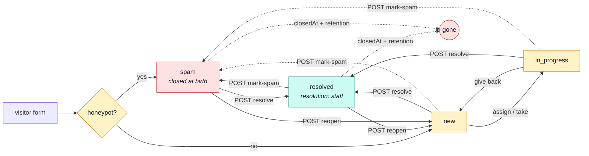

# Task kinds, jurisdiction and lifecycle

What kinds of task exist, which staff may take them, and how a task moves from open to closed.

## System tasks {#system-tasks}

A producer module announces a situation through the outbox; `tasks` subscribes (`module.ts`,
`services/system.ts`) and opens **one task per situation**. The event that ends the situation
closes it as `resolved` with `resolution: cleared`, so "the system closed it" shows, and its notes
are kept. The producers never import `tasks`.

| Kind             | Opens on                                                  | Cleared by                                          | Due (`dueAt`) |
| ---------------- | --------------------------------------------------------- | --------------------------------------------------- | ------------- |
| `account_review` | `user.review_flagged` (paid cancellations over the limit) | `user.review_cleared` (a hold placed or lifted)     | +72 h         |
| `export_failed`  | `account.export_failed`                                   | a later `account.export_ready` for the same account | +72 h         |

**One situation is a task or a notice, never both.** `account_review` is opened only by the
review flag that pauses nothing; the automatic hold already tells the staff who can ban it
(`shop-tasks.staff.purchase-hold-placed`). A `task.opened` is what `notifications` turns into
a work notice.

**Dedup and replays.** The dedup key is `<kind>:<link.type>:<link.id>`, unique while open. A repeat
of an open situation only stamps `lastSeenAt` / `seenCount` and keeps the earlier `dueAt`; two racing
events open one task (the loser of the unique key touches). Each task remembers its last 20
event ids, and an id already seen is a no-op, so a redelivery after the task closed cannot open
it again. The same situation returning after a close opens a **new** task. A clearing event on a
task staff closed first does nothing.

**Replacing an open task.** A producer whose new event may make the open task of the same situation
out of date passes `replaceOpen: { note }` to `openSystemTask`. After the replay check: an open task
with the same message is only touched; one with another message is closed as `cleared` with that note
(and the close is audited) in the one transaction that inserts the new task, which takes its key. A
redelivered event is a no-op, so it never closes the task it opened.

**The shop's kinds.** The kinds a payment, stock or delivery situation opens (for example a refund owed by
hand, a refused refund, a mismatch, a dispute, a payment with no hold, the delay reminder) belong
to [`shop-tasks`](./shop-tasks.md#the-shop-s-to-dos), which opens them through this engine. The
dedup and replay rules above apply to them unchanged.

## Jurisdiction {#jurisdiction}

Each kind of task is routed to one **permission set**, frozen on the task when it opens
(`domain/routing.ts`). A role is a bundle of sets, so routing to a set routes to every role that
holds it, and the administrator holds every set, with no special case.

| Kind             | Route set     |
| ---------------- | ------------- |
| `contact`        | `TaskDisplay` |
| `account_review` | `UserBanning` |
| `export_failed`  | `UserErasure` |

The shop's kinds route to the sets listed in [shop-tasks](./shop-tasks.md#the-shop-s-to-dos).

A visitor task is the inbox's: anyone who may read tasks reads it. A system task is visible
and workable only to a caller who holds its route set; to anyone else it is a **404**, not a 403 (it
does not admit to existing). Every route also asks the plain `Task` rule, so today the people who
reach this page are the holders of `TaskDisplay` / `TaskManagement`; a role that holds only a
routed set (a warehouse worker and a shop to-do) needs the route guard widened first.
Assignment is stricter on purpose: an assignee needs the route set and `update:Task`, so with the
preset roles only `admin` can be handed a system task, and `support` can also be handed a contact
message (a contact message is a visitor task).

## Lifecycle {#lifecycle}

`status` is **read-only**. It moves through three bodyless doors, and through assignment.

| Door               | From                       | To                                     | Stamps                                                                                                                                                  |
| ------------------ | -------------------------- | -------------------------------------- | ------------------------------------------------------------------------------------------------------------------------------------------------------- |
| `POST …/resolve`   | new, in progress, spam     | resolved                               | `resolution: staff`, `closedAt` (kept if already closed), `respondedAt` once; releases the dedup key                                                    |
| `POST …/mark-spam` | new, in progress, resolved | spam                                   | `resolution: spam`, `closedAt` (kept); releases the dedup key                                                                                           |
| `POST …/reopen`    | resolved, spam             | in progress with an assignee, else new | clears `closedAt` and `resolution`; restores the dedup key; **keeps `dueAt`**                                                                           |
| `POST …/assign`    | new, in progress           | in progress                            | the assignee must hold the task's route set and `update:Task` (else 422); the person who holds it already: 409 `TASK_ALREADY_ASSIGNED`, nothing written |
| `POST …/unassign`  | any                        | an in-progress task goes back to new   | clears the assignee; nobody held it: 409 `TASK_NOT_ASSIGNED`, nothing written or audited                                                                |

Every move is **one conditional write** filtered on the status that was read, so two clicks give one
200 and one 409. A repeat answers 409 with `TASK_ALREADY_RESOLVED`, `TASK_ALREADY_SPAM` or
`TASK_ALREADY_OPEN`; a reopen that finds a newer open task holding the same dedup key answers
`TASK_SUPERSEDED` with that task's id in `details`. Spam to resolve keeps the time the task
was first closed. A move that loses the race three times in a row (the task keeps changing under
it) answers the app-wide 409 `CONFLICT`, never a code about the task's state: reload and retry.
The deadline (`dueAt`) belongs to the situation, not to the reopen, so it is kept.
Every answer is the task, with the caller's `actions` telling a screen which buttons to show.

## Notes {#notes}

`POST /tasks/{id}/notes` appends to the staff thread: append-only, with author and time, allowed
on a closed task too. Write each note as if the customer will read it: the data subject's export
carries the words and the time, never the author.

## Read next

- [tasks](./tasks.md) — the module's own page
