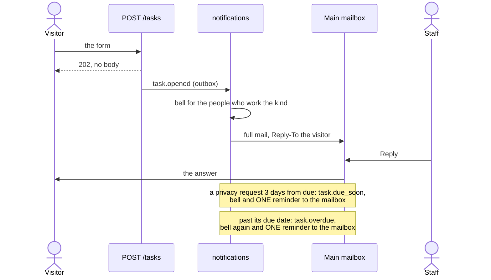
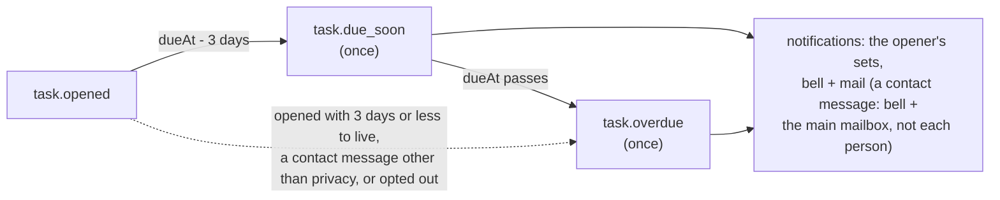
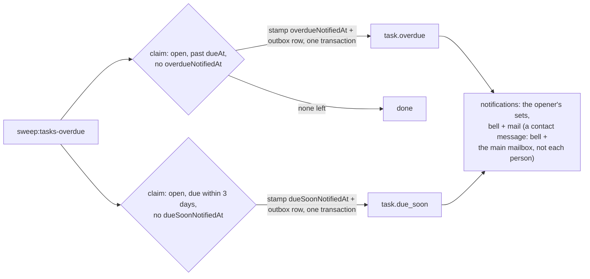

# Task notices and the staff badge

Who is told about a task, the overdue reminder and the staff badge.

## Who is told {#who-is-told}

A task never mails anyone itself. A new one (spam excluded) is announced as `task.opened`
`{ taskId, kind, routeSet, category?, work? }`, handing one to a colleague as `task.assigned`
(taking your own announces nothing), an open one three days from its due date as `task.due_soon`
and one that passes it as `task.overdue` (both with the payload of `task.opened`, see
[the reminders](#the-overdue-reminder)).
[`notifications`](./notifications.md#work-notices-for-staff) hears all four and does the telling,
so a situation is one task kind or one notice code, never both.

All four go through the [transactional outbox](../understand/outbox.md): the event row is written in
the same transaction as the change it announces (the insert, the assignment, the due-soon and overdue claims),
so a crash or a failing listener cannot lose a notice. Delivery is at-least-once, and the receiver
dedupes (`task-opened:<id>`, `task-due-soon:<id>`, `task-overdue:<id>`, `task-assigned:<id>:<assignedAt>`). The
`aggregateId` is the task id, so a task's events arrive in order. Contact spam writes no row.

| Event           | Told                                                                                          | Mail                                                                                                                                                                                                                                                  |
| --------------- | --------------------------------------------------------------------------------------------- | ----------------------------------------------------------------------------------------------------------------------------------------------------------------------------------------------------------------------------------------------------- |
| `task.opened`   | everyone who works the kind (a contact message: `TaskManagement`, not the read-only managers) | a contact message: none per person, the [main mailbox](#who-is-told) gets it. Other kinds: a fixed phrase, the kind (a contact message also its category) and a link to the task. Never the visitor's name, address, subject, message or order number |
| `task.due_soon` | the same people as `task.opened`, once; of the contact messages only a privacy request        | the same phrase, kind and link as the opener's, worded as a reminder that the deadline is three days away. A privacy request: none per person, ONE reminder to the main mailbox, in the first mail's thread                                           |
| `task.overdue`  | the same people as `task.opened`, once                                                        | a contact message: none per person, ONE reminder to the main mailbox ("message #ref from `<address>` is still unanswered"). Other kinds: the opener's phrase, worded as a reminder                                                                    |
| `task.assigned` | the assignee only                                                                             | none (the bell)                                                                                                                                                                                                                                       |

**The main mailbox.** A contact message is answered from ONE mailbox, `NODE_SUPPORT_EMAIL`
(required). It is mailed every time, on `task.opened`, on `task.due_soon` (a privacy request only) and again on `task.overdue`, and carries the
full message, the order number, the category as a word, a link to the item, a plain-text part and
`Reply-To: <the visitor's bare address>`, so pressing Reply in that mailbox reaches them. The
subject carries `[#ref]` (the last eight characters of the task id) and, for a privacy request,
`[privacy]`. No person is mailed for a contact message: it stays in the bell. The other kinds
(account review, export failed, the shop's) keep their per-person mail. The mailbox sits outside
the retention TTL and outside `DELETE /tasks/{id}`: the mailbox copy of a message is cleaned by
hand. An erasure that deleted messages mails the mailbox ONE notice naming them by `[#ref]` alone
(no address, name or text), and staff follow
[the guide](../use-the-shop/support.md#mailbox-after-erasure); the retention rule is in
[data retention](../understand/data-retention.md#the-support-mailbox). The reminders thread under the first mail (`Message-ID` `<task-<id>@<support domain>>`, then `In-Reply-To`
and `References` pointing at it). Nothing is mailed to the visitor.

## The overdue reminder {#the-overdue-reminder}

An open task (`new` or `in_progress`) past its `dueAt` is announced once as `task.overdue`, by
the daily job `sweep:tasks-overdue` (06:40 UTC, ten minutes after the staff digest). The same
sweep announces once, three days ahead, an open task about to fall due as `task.due_soon`. The
sweep lives here, not in the shop's openers, because every kind has the same clock.

- **Who gets a due-soon reminder.** Only a task whose whole life (`dueAt` minus `createdAt`) was
  longer than `DUE_SOON_MS` (3 days, a constant in `domain/lifecycle.ts`, no env var) and that is
  still ahead of its deadline: one opened already past due, or with a short life, goes straight to
  overdue. A contact message gets one only when it is a privacy request, whose deadline is a
  month (an ordinary contact message has a 48-hour life: its single reminder is the overdue one,
  to the support address), and neither does a task whose opener set `noDueSoon` (a wait on someone
  else). The
  stamp is `dueSoonNotifiedAt`, internal like `overdueNotifiedAt`; a later overdue is still sent.

- **Once, never again.** The claim and the stamp (`overdueNotifiedAt`, internal, not on the wire)
  are one transaction with the `task.overdue` outbox row, so overlapping sweeps cannot claim a task
  twice, and a crash rolls back both: the next sweep claims it again. A task is reminded once; a
  reopened task keeps that state. Delivery is at-least-once, deduped on `task-overdue:<id>`.
- **Closed first, nothing sent.** A resolved or spam task is never claimed.
- **Same audience as the opener.** `notifications` tells the sets that work the kind (a contact
  message: `TaskManagement`, by bell only) and mails the main mailbox the one reminder for a
  contact message; any other kind with nobody to tell goes nowhere, exactly as at opening.
- **The clock.** A contact message is due `NODE_TASKS_CONTACT_SLA_HOURS` (default 48) after it was
  filed; a message in the `privacy` category is due one calendar month after (GDPR Art. 12(3)).

## The staff badge {#the-staff-badge}

This is the Tasks badge only; the other staff badges are counted by [`GET /shop-tasks/summary`](./shop-tasks.md#the-nav-badge-summary).

`GET /tasks/summary` answers `{ open, mine, overdue, unassigned }`, scoped to the caller's
jurisdiction. `overdue` is read-time arithmetic (open and past `dueAt`): no sweep keeps it true.

**The honeypot.** `website` is a field a real browser always submits empty and a bot reliably
fills — declared in the contract (so an undeclared field wouldn't 422 real browsers too) but never
persisted or returned. A non-empty value — or an address the email policy `refused`
(`checkEmailPolicy`, `services/contact.ts`) — writes the row straight to `status: spam`, closed at birth, and
announces nothing; the caller still gets the same `202` a real submission gets, so a
bot learns nothing from the response. That trades an email amplifier for a storage amplifier,
which `contactLimiters` bounds and the TTL index expires.

`POST /tasks` answers `202` with no body, in every case: the sender is a visitor with nothing to do
with the stored task. Staff read it from the bell, the inbox and the main mailbox.

## Read next

- [tasks](./tasks.md) — the module's own page
