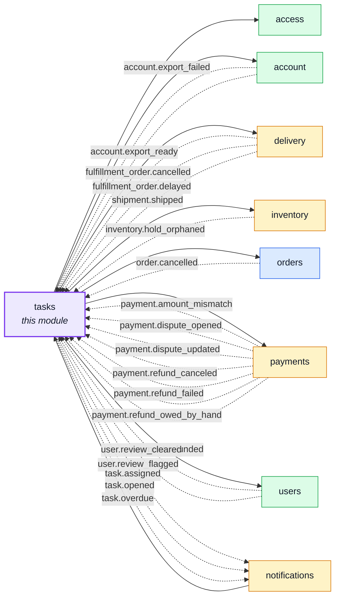
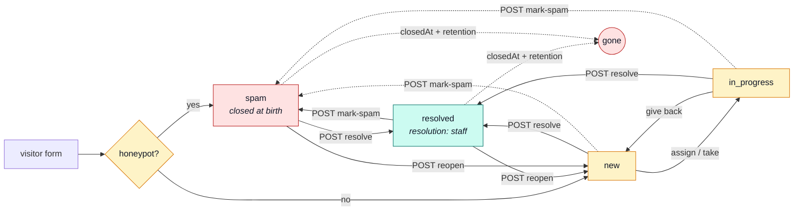
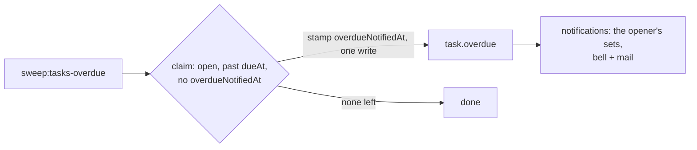

# tasks

::: tip At a glance
**Owns** — situations someone must take and close: a contact message a visitor sent, or a task the system opened for staff. A signed-in sender's account is recorded, so erasure and export follow it.
**Depends on** — [`users`](./users.md) (the assignee's name) and [`access`](./access.md) (the roles of a person a task may be given to). [`notifications`](./notifications.md) depends on it (the two task events, and the fallback mailbox mail); the account erasure reaches it through the `personalData` manifest, never an import.
**Breaks if you change** — the `status` doors and their stamps (`closedAt`, `resolution`, the dedup key): the retention clock and the one-open-task-per-situation rule both live there.
:::

## Its neighbourhood

<!-- module-graph:tasks:start -->

_Solid arrows are imports. Dotted arrows are domain events — the return path an import
graph cannot see._

<!-- module-graph:tasks:end -->

## The story

A task is **one situation someone must take and close**. Two sources open one:

| Source    | Opened by                                         | Is about                                  | Worked by                                      |
| --------- | ------------------------------------------------- | ----------------------------------------- | ---------------------------------------------- |
| `visitor` | the contact form, `POST /tasks`                   | what the person wrote                     | whoever holds `TaskDisplay` / `TaskManagement` |
| `system`  | a domain event, see [System tasks](#system-tasks) | a record: an order, a refund, an account… | whoever holds the task's **route set**         |

The form is open to anyone, a stranger's write alongside signup, login, password reset,
second-factor login and analytics events. It always records the address typed; when the sender is
signed in it also records the account (`subjectId`, read from the session token the browser sends
along — an absent or expired token files the message as anonymous).

A visitor may add a **category** (`order`, `cancellation`, `return`, `payment`, `account`,
`privacy`, `other`) and the order number they typed (`orderNumber`, free text, never checked
against an order). Both are the filer's own words, so the export includes them.

### System tasks

A producer module announces a situation through the outbox; `tasks` subscribes (`module.ts`,
`services/system.ts`) and opens **one task per situation**. The event that ends the situation
closes it as `resolved` with `resolution: cleared`, so "the system closed it" shows, and its notes
are kept. The producers never import `tasks`.

| Kind                 | Opens on                                                      | Cleared by                                             | Due (`dueAt`)                                                                      |
| -------------------- | ------------------------------------------------------------- | ------------------------------------------------------ | ---------------------------------------------------------------------------------- |
| `account_review`     | `user.review_flagged` (paid cancellations over the limit)     | `user.review_cleared` (a hold placed or lifted)        | +72 h                                                                              |
| `manual_refund_owed` | `payment.refund_owed_by_hand`                                 | `payment.refunded`, `payment.refund_canceled`          | + `NODE_PAYMENT_ATTENTION_MINUTES`                                                 |
| `refund_refused`     | `payment.refund_failed` with `final: true`                    | `payment.refunded`, `payment.refund_canceled`          | the legal 14 days for a return refund (`refundDueBy`), else + the attention window |
| `amount_mismatch`    | `payment.amount_mismatch`                                     | **never**: staff close it once they know why           | + the attention window                                                             |
| `dispute`            | `payment.dispute_opened` / `_updated` while it needs the shop | `payment.dispute_updated` with a decided or closed one | the provider's `evidenceDueBy`                                                     |
| `paid_without_hold`  | `inventory.hold_orphaned` (the payment step only)             | `order.cancelled`, `shipment.shipped`                  | +4 h                                                                               |
| `export_failed`      | `account.export_failed`                                       | a later `account.export_ready` for the same account    | +72 h                                                                              |
| `consent_due`        | `fulfillment_order.delayed`, see below                        | `shipment.shipped`, `fulfillment_order.cancelled`      | `agreedAt` + 30 d, or the date the buyer holds                                     |

**One situation is a task or a notice, never both.** `account_review` is opened only by the
review flag that pauses nothing; the automatic hold already tells the staff who can ban it
(`notifications.staff.purchase-hold-placed`). A `task.opened` is what `notifications` turns into
a work notice.

**Dedup and replays.** The dedup key is `<kind>:<link.type>:<link.id>`, unique while open. A repeat
of an open situation only stamps `lastSeenAt` / `seenCount` and keeps the earlier `dueAt`; two racing
events open one task (the loser of the unique key touches). Each task remembers its last 20
event ids, and an id already seen is a no-op, so a redelivery after the task closed cannot open
it again. The same situation returning after a close opens a **new** task. A clearing event on a
task staff closed first does nothing.

**The delay reminder (`consent_due`, 16 CFR 435.2).** The shop never asks the buyer and never
cancels; the task is the reminder that a person must, and by when. `delivery` keeps
`promisedAt` on the fulfillment order, the date the buyer holds now: it starts as `agreedAt`, a
later date from a notice replaces it, a "no date yet" notice removes it. The `delayed` event
carries the value before the notice and the ship-to country.

| Before this notice                    | Opens when                             | Due               |
| ------------------------------------- | -------------------------------------- | ----------------- |
| the buyer holds the date they ordered | no new date, or past `agreedAt` + 30 d | `agreedAt` + 30 d |
| the buyer holds a later date          | no new date, or past that date         | that date         |
| the buyer was told "no date yet"      | never: the earlier task stands         | —                 |

Only for ship-to countries in `NODE_TICKETS_FTC_COUNTRIES` (default `US,PR,GU,VI,AS,MP`).

### Jurisdiction

Each kind of task is routed to one **permission set**, frozen on the task when it opens
(`domain/routing.ts`). A role is a bundle of sets, so routing to a set routes to every role that
holds it, and the administrator holds every set, with no special case.

| Kind                                                                 | Route set             |
| -------------------------------------------------------------------- | --------------------- |
| `contact`                                                            | `TaskDisplay`         |
| `account_review`                                                     | `UserBanning`         |
| `manual_refund_owed`, `amount_mismatch`, `refund_refused`, `dispute` | `PaymentRefunding`    |
| `paid_without_hold`                                                  | `InventoryManagement` |
| `export_failed`                                                      | `UserErasure`         |
| `consent_due`                                                        | `OrderEditing`        |

A visitor task is the inbox's: anyone who may read tasks reads it. A system task is visible
and workable only to a caller who holds its route set; to anyone else it is a **404**, not a 403 (it
does not admit to existing). Every route also asks the plain `Task` rule, so today the people who
reach this page are the holders of `TaskDisplay` / `TaskManagement`; a role that holds only a
routed set (a warehouse worker and `paid_without_hold`) needs the route guard widened first — see
the open question in the lane report.

### Lifecycle

`status` is **read-only**. It moves through three bodyless doors, and through assignment.

| Door                | From                       | To                                     | Stamps                                                                                               |
| ------------------- | -------------------------- | -------------------------------------- | ---------------------------------------------------------------------------------------------------- |
| `POST …/resolve`    | new, in progress, spam     | resolved                               | `resolution: staff`, `closedAt` (kept if already closed), `respondedAt` once; releases the dedup key |
| `POST …/mark-spam`  | new, in progress, resolved | spam                                   | `resolution: spam`, `closedAt` (kept); releases the dedup key                                        |
| `POST …/reopen`     | resolved, spam             | in progress with an assignee, else new | clears `closedAt` and `resolution`; restores the dedup key; **keeps `dueAt`**                        |
| `PUT …/assignee`    | new, in progress           | in progress                            | the assignee must hold the task's route set (else 422)                                               |
| `DELETE …/assignee` | any                        | an in-progress task goes back to new   | clears the assignee                                                                                  |

Every move is **one conditional write** filtered on the status that was read, so two clicks give one
200 and one 409. A repeat answers 409 with `TASK_ALREADY_RESOLVED`, `TASK_ALREADY_SPAM` or
`TASK_ALREADY_OPEN`; a reopen that finds a newer open task holding the same dedup key answers
`TASK_SUPERSEDED` with that task's id in `details`. Spam to resolve keeps the time the task
was first closed. The deadline (`dueAt`) belongs to the situation, not to the reopen, so it is kept.
Every answer is the task, with the caller's `actions` telling a screen which buttons to show.

### Notes

`POST /tasks/{id}/notes` appends to the staff thread: append-only, with author and time, allowed
on a closed task too. Write each note as if the customer will read it: the data subject's export
carries the words and the time, never the author.

### Who is told

A task never mails anyone itself. A new one (spam excluded) is announced as `task.opened`
`{ taskId, kind, routeSet, category? }`, handing one to a colleague as `task.assigned`
(taking your own announces nothing), and an open one that passes its due date as `task.overdue`
(same payload as `task.opened`, see [the overdue reminder](#the-overdue-reminder)).
[`notifications`](./notifications.md#work-notices-for-staff) hears all three and does the telling,
so a situation is one task kind or one notice code, never both.

| Event           | Told                                                                                          | Mail                                                                                                                                                       |
| --------------- | --------------------------------------------------------------------------------------------- | ---------------------------------------------------------------------------------------------------------------------------------------------------------- |
| `task.opened`   | everyone who works the kind (a contact message: `TaskManagement`, not the read-only managers) | a fixed phrase, the kind (a contact message also its category) and a link to the task. Never the visitor's name, address, subject, message or order number |
| `task.overdue`  | the same people as `task.opened`, once                                                        | the same phrase, kind and link as the opener's, worded as a reminder                                                                                       |
| `task.assigned` | the assignee only                                                                             | none (the bell)                                                                                                                                            |

**The fallback mailbox.** `NODE_CONTACT_NOTIFY_EMAIL` (optional) is mailed only when a contact
message finds nobody to tell: no staff member holding the set has an address that can act. It then
carries the full message, the category and `Reply-To: <the visitor's bare address>`, because that
mailbox is the whole inbox. With even one permitted recipient it hears nothing. It sits outside
the retention TTL and outside `DELETE /tasks/{id}`: erasing a message there is done by hand. The
overdue reminder reaches it by the same rule, worded as `Overdue contact request`.

### The overdue reminder

An open task (`new` or `in_progress`) past its `dueAt` is announced once as `task.overdue`, by
the daily job `sweep:tasks-overdue` (06:40 UTC, ten minutes after the staff digest). The sweep
lives here, not in the shop's openers, because every kind has the same clock.

- **Once, never again.** The claim and the stamp (`overdueNotifiedAt`, internal, not on the wire)
  are one conditional write, so overlapping sweeps cannot announce a task twice. A task is reminded once; a reopened task keeps that state. The cost is at-most-once: a crash between stamp
  and event loses that one reminder.
- **Closed first, nothing sent.** A resolved or spam task is never claimed.
- **Same audience as the opener.** `notifications` tells the sets that work the kind (a contact
  message: `TaskManagement`); a contact message nobody could be told of goes to the fallback
  mailbox; any other kind with nobody to tell goes nowhere, exactly as at opening.

### The staff badge

`GET /tasks/summary` answers `{ open, mine, overdue, unassigned }`, scoped to the caller's
jurisdiction. `overdue` is read-time arithmetic (open and past `dueAt`): no sweep keeps it true.
A contact message is due `NODE_TASKS_CONTACT_SLA_HOURS` (default 48) after it was filed.

**The honeypot.** `website` is a field a real browser always submits empty and a bot reliably
fills — declared in the contract (so an undeclared field wouldn't 422 real browsers too) but never
persisted or returned. A non-empty value — or an address the email policy `refused`
(`checkEmailPolicy`, `service.ts`) — writes the row straight to `status: spam`, closed at birth, and
announces nothing; the caller still gets the same `201` a real submission gets, so a
bot learns nothing from the response. That trades an email amplifier for a storage amplifier,
which `contactLimiters` bounds and the TTL index expires.

## Personal data

| Topic       | Rule                                                                                                                                                                                                                                                                                                                                                                  |
| ----------- | --------------------------------------------------------------------------------------------------------------------------------------------------------------------------------------------------------------------------------------------------------------------------------------------------------------------------------------------------------------------- |
| Export      | Two sections, both always present. `tasks`: the visitor tasks the person owns (sent signed in, or under their **verified** address). `systemTasks`: the system tasks about them, by `subjectId`, every field except the staff ids and the dedup key                                                                                                                   |
| Notes       | Exported as words and time, never the author. A task is itself an assessment of the person, so it is theirs to read (CJEU C-434/16)                                                                                                                                                                                                                                   |
| Erasure     | In the hard-delete transaction only (the purge, an admin hard delete, the inactivity erasure), **never at the reversible lock**. Visitor tasks: deleted. System tasks whose record IS the person (a `user` or `export` link): deleted. Others (order, payment…): kept, detached from the account. An erased member of staff is removed as assignee and as note author |
| Retention   | A TTL on `closedAt` (`NODE_TASKS_RETENTION_DAYS`, default 730 — 24 months). An open task never expires; a reopen stops the clock. Changing the window on a live database needs `npm run db:sync` — a restart alone fails the boot, the same caveat [`audit-logs`](./audit-logs.md) carries                                                                            |
| Not matched | An old address after an email change, or a message typed under another address while signed out, is not matched: the technician finds those by hand                                                                                                                                                                                                                   |

The owned set is one pure rule, `ownTasksFilter` in `domain/ownership.ts`, used by both the export
and the erasure, so they cannot disagree. The `{ subjectId }` and `{ email }` indexes serve it.

## Who can do what

Every rule this module declares and who holds it, role by role. The rule is what a route guard asks for; the set is what a role lists.

<!-- permissions:start -->

| Rule          | Set              | `guest` | `unverified` | `customer` | `manager` | `warehouse` | `support` | `editor` | `moderator` | `admin` | `operator` | Credential | What it lets them do                                                                                                     |
| ------------- | ---------------- | ------- | ------------ | ---------- | --------- | ----------- | --------- | -------- | ----------- | ------- | ---------- | ---------- | ------------------------------------------------------------------------------------------------------------------------ |
| `read:Task`   | `TaskDisplay`    | —       | —            | —          | ✅        | —           | ✅        | —        | —           | ✅      | —          | ✅         | Read tasks — contact messages, and the system tasks of a permission set the caller holds.                                |
| `update:Task` | `TaskManagement` | —       | —            | —          | —         | —           | ✅        | —        | —           | ✅      | —          | ✅         | Work a task — resolve, mark as spam, reopen, assign, add a note. A system task also needs the task's own permission set. |
| `delete:Task` | `TaskManagement` | —       | —            | —          | —         | —           | ✅        | —        | —           | ✅      | —          | ✅         | Remove a task. A system task also needs the task's own permission set.                                                   |

✅ held · `own` only the caller’s own rows · ⚡c / ⚡s needs a freshly proved session (critical / sensitive) ·
Credential: ✅ when an API key can be minted with the rule. Generated from the rules and sets in
`src/modules/*/authorization.yaml` and the roles in `shared/authorization-roles.yaml`, asked of the
evaluator — [Authorization](../theory/authorization.md) explains the model.

<!-- permissions:end -->

## Related pages

- [Users](./users.md) — the assignee, and the erase cascade this module joins
- [Access](./access.md) — the roles a task may be given to
- [Modules overview](./index.md) — the whole context map
- [Email & PDF Rendering](../tools/email-and-rendering.md) — the triage notification
- [Security](../tools/security.md) — the rate-limit budgets, including this module's own
- [Winston & Audit Logs](../tools/winston.md) — what a triage action records
- [Ops & Assets](../reference/ops.md) — the retention window and why changing it needs `db:sync`
