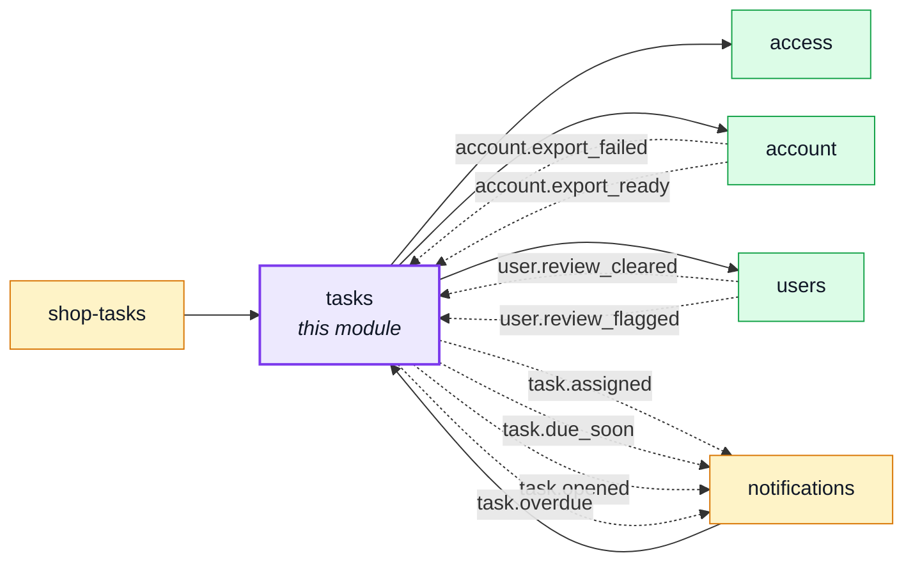
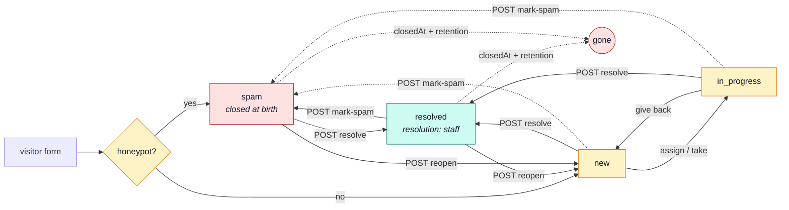
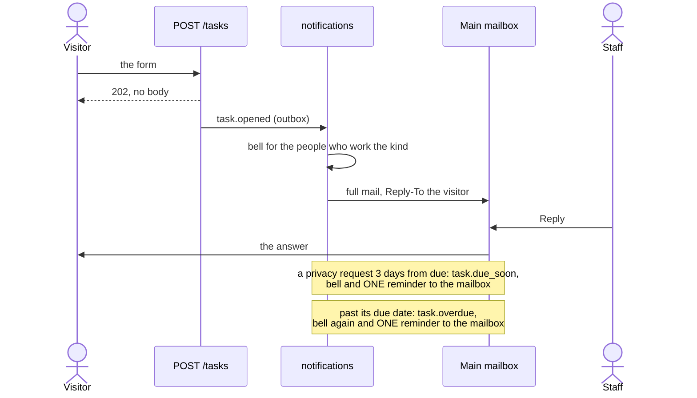
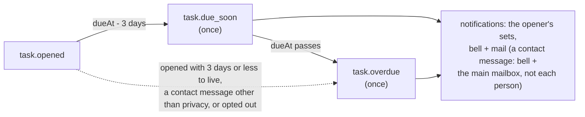
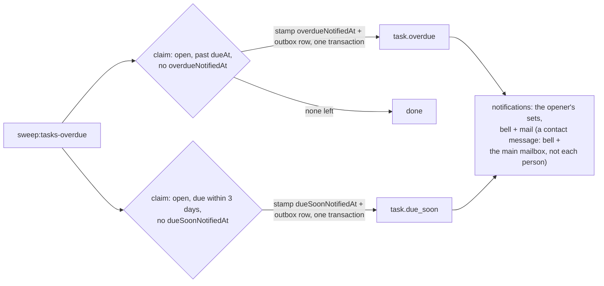

# tasks

::: tip At a glance
**Owns** — situations someone must take and close: a contact message a visitor sent, or a task the system opened for staff. A signed-in sender's account is recorded, so erasure and export follow it.
**Depends on** — [`users`](./users.md) (the assignee's name) and [`access`](./access.md) (the roles of a person a task may be given to). [`notifications`](./notifications.md) depends on it (the two task events, and the main mailbox mail); the account erasure reaches it through the `personalData` manifest, never an import.
**Breaks if you change** — the `status` doors and their stamps (`closedAt`, `resolution`, the dedup key): the retention clock and the one-open-task-per-situation rule both live there.
:::

## Its neighbourhood

<!-- module-graph:tasks:start -->

_Solid arrows are imports. Dotted arrows are domain events — the return path an import
graph cannot see._

<!-- module-graph:tasks:end -->

## The story

A task is **one situation someone must take and close**. Two sources open one:

| Source    | Opened by                                         | Is about                                  | Worked by                                      |
| --------- | ------------------------------------------------- | ----------------------------------------- | ---------------------------------------------- |
| `visitor` | the contact form, `POST /tasks`                   | what the person wrote                     | whoever holds `TaskDisplay` / `TaskManagement` |
| `system`  | a domain event, see [System tasks](#system-tasks) | a record: an order, a refund, an account… | whoever holds the task's **route set**         |

The form is open to anyone, a stranger's write alongside signup, login, password reset,
second-factor login and analytics events. It always records the address typed; when the sender is
signed in it also records the account (`subjectId`, read from the session token the browser sends
along. No token files the message as anonymous; a token that names no live session is refused `401`, so the client refreshes and sends it again as the person).

A visitor may add a **category** (`order`, `cancellation`, `return`, `payment`, `account`,
`privacy`, `other`) and the order number they typed (`orderNumber`, free text, never checked
against an order). Both are the filer's own words, so the export includes them.

### System tasks

A producer module announces a situation through the outbox; `tasks` subscribes (`module.ts`,
`services/system.ts`) and opens **one task per situation**. The event that ends the situation
closes it as `resolved` with `resolution: cleared`, so "the system closed it" shows, and its notes
are kept. The producers never import `tasks`.

| Kind             | Opens on                                                  | Cleared by                                          | Due (`dueAt`) |
| ---------------- | --------------------------------------------------------- | --------------------------------------------------- | ------------- |
| `account_review` | `user.review_flagged` (paid cancellations over the limit) | `user.review_cleared` (a hold placed or lifted)     | +72 h         |
| `export_failed`  | `account.export_failed`                                   | a later `account.export_ready` for the same account | +72 h         |

**One situation is a task or a notice, never both.** `account_review` is opened only by the
review flag that pauses nothing; the automatic hold already tells the staff who can ban it
(`shop-tasks.staff.purchase-hold-placed`). A `task.opened` is what `notifications` turns into
a work notice.

**Dedup and replays.** The dedup key is `<kind>:<link.type>:<link.id>`, unique while open. A repeat
of an open situation only stamps `lastSeenAt` / `seenCount` and keeps the earlier `dueAt`; two racing
events open one task (the loser of the unique key touches). Each task remembers its last 20
event ids, and an id already seen is a no-op, so a redelivery after the task closed cannot open
it again. The same situation returning after a close opens a **new** task. A clearing event on a
task staff closed first does nothing.

**The shop's kinds.** The kinds a payment, stock or delivery situation opens (a refund owed by
hand, a refused refund, a mismatch, a dispute, a payment with no hold, the delay reminder) belong
to [`shop-tasks`](./shop-tasks.md#the-shops-to-dos), which opens them through this engine. The
dedup and replay rules above apply to them unchanged.

### Jurisdiction

Each kind of task is routed to one **permission set**, frozen on the task when it opens
(`domain/routing.ts`). A role is a bundle of sets, so routing to a set routes to every role that
holds it, and the administrator holds every set, with no special case.

| Kind             | Route set     |
| ---------------- | ------------- |
| `contact`        | `TaskDisplay` |
| `account_review` | `UserBanning` |
| `export_failed`  | `UserErasure` |

The shop's kinds route to the sets listed in [shop-tasks](./shop-tasks.md#the-shops-to-dos).

A visitor task is the inbox's: anyone who may read tasks reads it. A system task is visible
and workable only to a caller who holds its route set; to anyone else it is a **404**, not a 403 (it
does not admit to existing). Every route also asks the plain `Task` rule, so today the people who
reach this page are the holders of `TaskDisplay` / `TaskManagement`; a role that holds only a
routed set (a warehouse worker and a shop to-do) needs the route guard widened first.
Assignment is stricter on purpose: an assignee needs the route set and `update:Task`, so with the
preset roles only `admin` can be handed a system task, and `support` can also be handed a contact
message (a contact message is a visitor task).

### Lifecycle

`status` is **read-only**. It moves through three bodyless doors, and through assignment.

| Door                | From                       | To                                     | Stamps                                                                                               |
| ------------------- | -------------------------- | -------------------------------------- | ---------------------------------------------------------------------------------------------------- |
| `POST …/resolve`    | new, in progress, spam     | resolved                               | `resolution: staff`, `closedAt` (kept if already closed), `respondedAt` once; releases the dedup key |
| `POST …/mark-spam`  | new, in progress, resolved | spam                                   | `resolution: spam`, `closedAt` (kept); releases the dedup key                                        |
| `POST …/reopen`     | resolved, spam             | in progress with an assignee, else new | clears `closedAt` and `resolution`; restores the dedup key; **keeps `dueAt`**                        |
| `PUT …/assignee`    | new, in progress           | in progress                            | the assignee must hold the task's route set and `update:Task` (else 422)                             |
| `DELETE …/assignee` | any                        | an in-progress task goes back to new   | clears the assignee                                                                                  |

Every move is **one conditional write** filtered on the status that was read, so two clicks give one
200 and one 409. A repeat answers 409 with `TASK_ALREADY_RESOLVED`, `TASK_ALREADY_SPAM` or
`TASK_ALREADY_OPEN`; a reopen that finds a newer open task holding the same dedup key answers
`TASK_SUPERSEDED` with that task's id in `details`. Spam to resolve keeps the time the task
was first closed. The deadline (`dueAt`) belongs to the situation, not to the reopen, so it is kept.
Every answer is the task, with the caller's `actions` telling a screen which buttons to show.

### Notes

`POST /tasks/{id}/notes` appends to the staff thread: append-only, with author and time, allowed
on a closed task too. Write each note as if the customer will read it: the data subject's export
carries the words and the time, never the author.

### Who is told

A task never mails anyone itself. A new one (spam excluded) is announced as `task.opened`
`{ taskId, kind, routeSet, category? }`, handing one to a colleague as `task.assigned`
(taking your own announces nothing), an open one three days from its due date as `task.due_soon`
and one that passes it as `task.overdue` (both with the payload of `task.opened`, see
[the reminders](#the-overdue-reminder)).
[`notifications`](./notifications.md#work-notices-for-staff) hears all four and does the telling,
so a situation is one task kind or one notice code, never both.

All four go through the [transactional outbox](../tools/outbox.md): the event row is written in
the same transaction as the change it announces (the insert, the assignment, the due-soon and overdue claims),
so a crash or a failing listener cannot lose a notice. Delivery is at-least-once, and the receiver
dedupes (`task-opened:<id>`, `task-due-soon:<id>`, `task-overdue:<id>`, `task-assigned:<id>:<assignedAt>`). The
`aggregateId` is the task id, so a task's events arrive in order. Contact spam writes no row.

| Event           | Told                                                                                          | Mail                                                                                                                                                                                                                                                  |
| --------------- | --------------------------------------------------------------------------------------------- | ----------------------------------------------------------------------------------------------------------------------------------------------------------------------------------------------------------------------------------------------------- |
| `task.opened`   | everyone who works the kind (a contact message: `TaskManagement`, not the read-only managers) | a contact message: none per person, the [main mailbox](#who-is-told) gets it. Other kinds: a fixed phrase, the kind (a contact message also its category) and a link to the task. Never the visitor's name, address, subject, message or order number |
| `task.due_soon` | the same people as `task.opened`, once; of the contact messages only a privacy request        | the same phrase, kind and link as the opener's, worded as a reminder that the deadline is three days away. A privacy request: none per person, ONE reminder to the main mailbox, in the first mail's thread                                           |
| `task.overdue`  | the same people as `task.opened`, once                                                        | a contact message: none per person, ONE reminder to the main mailbox ("message #ref from `<address>` is still unanswered"). Other kinds: the opener's phrase, worded as a reminder                                                                    |
| `task.assigned` | the assignee only                                                                             | none (the bell)                                                                                                                                                                                                                                       |

**The main mailbox.** A contact message is answered from ONE mailbox, `NODE_SUPPORT_EMAIL`
(required). It is mailed every time, on `task.opened`, on `task.due_soon` (a privacy request only) and again on `task.overdue`, and carries the
full message, the order number, the category as a word, a link to the item, a plain-text part and
`Reply-To: <the visitor's bare address>`, so pressing Reply in that mailbox reaches them. The
subject carries `[#ref]` (the last eight characters of the task id) and, for a privacy request,
`[privacy]`. No person is mailed for a contact message: it stays in the bell. The other kinds
(account review, export failed, the shop's) keep their per-person mail. The mailbox sits outside
the retention TTL and outside `DELETE /tasks/{id}`: the mailbox copy of a message is cleaned by
hand. An erasure that deleted messages mails the mailbox ONE notice naming them by `[#ref]` alone
(no address, name or text), and staff follow
[the guide](../demo-ecommerce/support.md#mailbox-after-erasure); the retention rule is in
[data retention](../theory/data-retention.md#the-support-mailbox). The reminders thread under the first mail (`Message-ID` `<task-<id>@<support domain>>`, then `In-Reply-To`
and `References` pointing at it). Nothing is mailed to the visitor.

### The overdue reminder

An open task (`new` or `in_progress`) past its `dueAt` is announced once as `task.overdue`, by
the daily job `sweep:tasks-overdue` (06:40 UTC, ten minutes after the staff digest). The same
sweep announces once, three days ahead, an open task about to fall due as `task.due_soon`. The
sweep lives here, not in the shop's openers, because every kind has the same clock.

- **Who gets a due-soon reminder.** Only a task whose whole life (`dueAt` minus `createdAt`) was
  longer than `DUE_SOON_MS` (3 days, a constant in `domain/lifecycle.ts`, no env var) and that is
  still ahead of its deadline: one opened already past due, or with a short life, goes straight to
  overdue. A contact message gets one only when it is a privacy request, whose deadline is a
  month (an ordinary contact message has a 48-hour life: its single reminder is the overdue one,
  to the support address), and neither does a task whose opener set `noDueSoon` (a wait on someone
  else). The
  stamp is `dueSoonNotifiedAt`, internal like `overdueNotifiedAt`; a later overdue is still sent.

- **Once, never again.** The claim and the stamp (`overdueNotifiedAt`, internal, not on the wire)
  are one transaction with the `task.overdue` outbox row, so overlapping sweeps cannot claim a task
  twice, and a crash rolls back both: the next sweep claims it again. A task is reminded once; a
  reopened task keeps that state. Delivery is at-least-once, deduped on `task-overdue:<id>`.
- **Closed first, nothing sent.** A resolved or spam task is never claimed.
- **Same audience as the opener.** `notifications` tells the sets that work the kind (a contact
  message: `TaskManagement`, by bell only) and mails the main mailbox the one reminder for a
  contact message; any other kind with nobody to tell goes nowhere, exactly as at opening.
- **The clock.** A contact message is due `NODE_TASKS_CONTACT_SLA_HOURS` (default 48) after it was
  filed; a message in the `privacy` category is due one calendar month after (GDPR Art. 12(3)).

### The staff badge

This is the Tasks badge only; the other staff badges are counted by [`GET /shop-tasks/summary`](./shop-tasks.md#the-nav-badge-summary).

`GET /tasks/summary` answers `{ open, mine, overdue, unassigned }`, scoped to the caller's
jurisdiction. `overdue` is read-time arithmetic (open and past `dueAt`): no sweep keeps it true.

**The honeypot.** `website` is a field a real browser always submits empty and a bot reliably
fills — declared in the contract (so an undeclared field wouldn't 422 real browsers too) but never
persisted or returned. A non-empty value — or an address the email policy `refused`
(`checkEmailPolicy`, `services/contact.ts`) — writes the row straight to `status: spam`, closed at birth, and
announces nothing; the caller still gets the same `202` a real submission gets, so a
bot learns nothing from the response. That trades an email amplifier for a storage amplifier,
which `contactLimiters` bounds and the TTL index expires.

`POST /tasks` answers `202` with no body, in every case: the sender is a visitor with nothing to do
with the stored task. Staff read it from the bell, the inbox and the main mailbox.

## Personal data

| Topic       | Rule                                                                                                                                                                                                                                                                                                                                                                                                                                                                                         |
| ----------- | -------------------------------------------------------------------------------------------------------------------------------------------------------------------------------------------------------------------------------------------------------------------------------------------------------------------------------------------------------------------------------------------------------------------------------------------------------------------------------------------- |
| Export      | Two sections, both always present. `tasks`: the visitor tasks the person owns (sent signed in, or under their **verified** address). `systemTasks`: the system tasks about them, by `subjectId`, every field except the staff ids and the dedup key                                                                                                                                                                                                                                          |
| Notes       | Exported as words and time, never the author. A task is itself an assessment of the person, so it is theirs to read (CJEU C-434/16)                                                                                                                                                                                                                                                                                                                                                          |
| Erasure     | In the hard-delete transaction only (the purge, an admin hard delete, the inactivity erasure), **never at the reversible lock**. Visitor tasks: deleted, and once the erasure commits the main mailbox gets ONE notice with their `[#ref]`s (none when there were no messages). System tasks whose record IS the person (a `user` or `export` link): deleted. Others (order, payment…): kept, detached from the account. An erased member of staff is removed as assignee and as note author |
| Retention   | A TTL on `closedAt` (`NODE_TASKS_RETENTION_DAYS`, default 730 — 24 months). An open system to-do never expires; a reopen stops the clock. A visitor's message has a second TTL on `createdAt` (same window, partial on `source: visitor`), so a forgotten one is deleted 730 days after it arrived, closed or not. Changing the window on a live database needs `npm run db:sync` — a restart alone fails the boot, the same caveat [`audit-logs`](./audit-logs.md) carries                  |
| Not matched | An old address after an email change, or a message typed under another address while signed out, is not matched: the technician finds those by hand                                                                                                                                                                                                                                                                                                                                          |

The owned set is one pure rule, `ownTasksFilter` in `domain/ownership.ts`, used by both the export
and the erasure, so they cannot disagree. The `{ subjectId }` and `{ email }` indexes serve it.

## Who can do what

Every rule this module declares and who holds it, role by role. The rule is what a route guard asks for; the set is what a role lists.

<!-- permissions:start -->

| Rule          | Set              | `guest` | `unverified` | `customer` | `manager` | `warehouse` | `support` | `editor` | `moderator` | `admin` | `operator` | Credential | What it lets them do                                                                                                     |
| ------------- | ---------------- | ------- | ------------ | ---------- | --------- | ----------- | --------- | -------- | ----------- | ------- | ---------- | ---------- | ------------------------------------------------------------------------------------------------------------------------ |
| `read:Task`   | `TaskDisplay`    | —       | —            | —          | ✅        | —           | ✅        | —        | —           | ✅      | —          | ✅         | Read tasks — contact messages, and the system tasks of a permission set the caller holds.                                |
| `update:Task` | `TaskManagement` | —       | —            | —          | —         | —           | ✅        | —        | —           | ✅      | —          | ✅         | Work a task — resolve, mark as spam, reopen, assign, add a note. A system task also needs the task's own permission set. |
| `delete:Task` | `TaskManagement` | —       | —            | —          | —         | —           | ✅        | —        | —           | ✅      | —          | ✅         | Remove a task. A system task also needs the task's own permission set.                                                   |

✅ held · `own` only the caller’s own rows · ⚡c / ⚡s needs a freshly proved session (critical / sensitive) ·
Credential: ✅ when an API key can be minted with the rule. Generated from the rules and sets in
`src/modules/*/authorization.yaml` and the roles in `shared/authorization-roles.yaml`, asked of the
evaluator — [Authorization](../theory/authorization.md) explains the model.

<!-- permissions:end -->

## Related pages

- [Users](./users.md) — the assignee, and the erase cascade this module joins
- [Access](./access.md) — the roles a task may be given to
- [Modules overview](./index.md) — the whole context map
- [Email & PDF Rendering](../tools/email-and-rendering.md) — the triage notification
- [Security](../tools/security.md) — the rate-limit budgets, including this module's own
- [Winston & Audit Logs](../tools/winston.md) — what a triage action records
- [Ops & Assets](../reference/ops.md) — the retention window and why changing it needs `db:sync`
