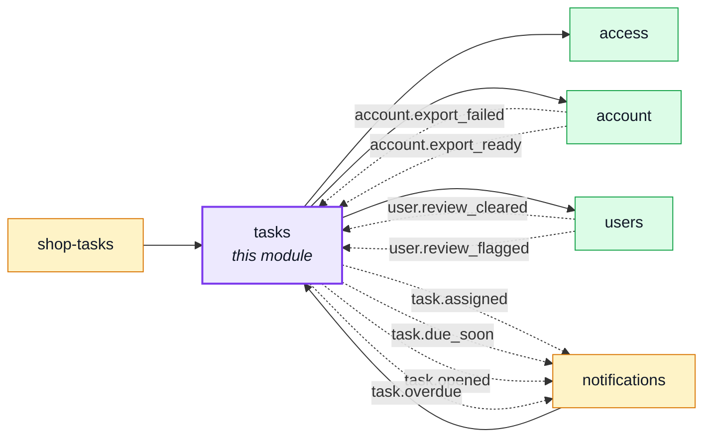

# tasks

Situations someone must take and close: contact messages and system-opened tasks, routed to the staff who hold the matching permission set.

::: tip At a glance
**Owns** — situations someone must take and close: a contact message a visitor sent, or a task the system opened for staff. A signed-in sender's account is recorded, so erasure and export follow it.
**Depends on** — [`users`](./users.md) (the assignee's name) and [`access`](./access.md) (the roles of a person a task may be given to). [`notifications`](./notifications.md) depends on it (the two task events, and the main mailbox mail); the account erasure reaches it through the `personalData` manifest, never an import.
**Breaks if you change** — the `status` doors and their stamps (`closedAt`, `resolution`, the dedup key): the retention clock and the one-open-task-per-situation rule both live there.
:::

## Its neighbourhood

<!-- module-graph:tasks:start -->

_Solid arrows are imports. Dotted arrows are domain events — the return path an import
graph cannot see._

<!-- module-graph:tasks:end -->

## Who can do what

Every rule this module declares and who holds it, role by role. The rule is what a route guard asks for; the set is what a role lists.

<!-- permissions:start -->

| Rule          | Set              | `guest` | `unverified` | `customer` | `manager` | `warehouse` | `support` | `editor` | `moderator` | `admin` | `operator` | Credential | What it lets them do                                                                                                     |
| ------------- | ---------------- | ------- | ------------ | ---------- | --------- | ----------- | --------- | -------- | ----------- | ------- | ---------- | ---------- | ------------------------------------------------------------------------------------------------------------------------ |
| `read:Task`   | `TaskDisplay`    | —       | —            | —          | ✅        | —           | ✅        | —        | —           | ✅      | —          | ✅         | Read tasks — contact messages, and the system tasks of a permission set the caller holds.                                |
| `update:Task` | `TaskManagement` | —       | —            | —          | —         | —           | ✅        | —        | —           | ✅      | —          | ✅         | Work a task — resolve, mark as spam, reopen, assign, add a note. A system task also needs the task's own permission set. |
| `delete:Task` | `TaskManagement` | —       | —            | —          | —         | —           | ✅        | —        | —           | ✅      | —          | ✅         | Remove a task. A system task also needs the task's own permission set.                                                   |

✅ held · `own` only the caller’s own rows · ⚡c / ⚡s needs a freshly proved session (critical / sensitive) ·
Credential: ✅ when an API key can be minted with the rule. Generated from the rules and sets in
`src/modules/*/authorization.yaml` and the roles in `shared/rules/authorization-roles.yaml`, asked of the
evaluator — [Authorization](../understand/authorization.md) explains the model.

<!-- permissions:end -->

## The story

A task is **one situation someone must take and close**. Two sources open one:

| Source    | Opened by                                         | Is about                                  | Worked by                                      |
| --------- | ------------------------------------------------- | ----------------------------------------- | ---------------------------------------------- |
| `visitor` | the contact form, `POST /tasks`                   | what the person wrote                     | whoever holds `TaskDisplay` / `TaskManagement` |
| `system`  | a domain event, see [System tasks](#system-tasks) | a record: an order, a refund, an account… | whoever holds the task's **route set**         |

The form is open to anyone, a stranger's write alongside signup, login, password reset,
second-factor login and analytics events. It always records the address typed; when the sender is
signed in it also records the account (`subjectId`, read from the session token the browser sends
along. No token files the message as anonymous; a token that names no live session is refused `401`, so the client refreshes and sends it again as the person).

A visitor may add a **category** (`order`, `cancellation`, `return`, `payment`, `account`,
`privacy`, `other`) and the order number they typed (`orderNumber`, free text, never checked
against an order). Both are the filer's own words, so the export includes them.

## The list row {#the-list-row}

`GET /tasks` and `POST /tasks/search` answer a `TaskListItem`: the sender's name and email, subject,
a `messagePreview` of the first 160 characters, category, order number, assignee, due date, status
and `actions`. The whole message, the staff notes and the sender's account are `GET /tasks/{id}`, the
audited read. See [a list row is a list item](../reference/responses.md#a-list-row-is-a-list-item).

## System tasks {#system-tasks}

A producer module announces a situation through the outbox; `tasks` subscribes (`module.ts`,
`services/system.ts`) and opens **one task per situation**. The event that ends the situation
closes it as `resolved` with `resolution: cleared`, so "the system closed it" shows, and its notes
are kept. The producers never import `tasks`.

Full detail: [Task kinds, jurisdiction and lifecycle](./tasks-lifecycle.md#system-tasks).

## Jurisdiction {#jurisdiction}

Each kind of task is routed to one **permission set**, frozen on the task when it opens
(`domain/routing.ts`). A role is a bundle of sets, so routing to a set routes to every role that
holds it, and the administrator holds every set, with no special case.

Full detail: [Task kinds, jurisdiction and lifecycle](./tasks-lifecycle.md#jurisdiction).

## Lifecycle {#lifecycle}

`status` is **read-only**. It moves through three bodyless doors, and through assignment.

Full detail: [Task kinds, jurisdiction and lifecycle](./tasks-lifecycle.md#lifecycle).

## Notes {#notes}

`POST /tasks/{id}/notes` appends to the staff thread: append-only, with author and time, allowed
on a closed task too. Write each note as if the customer will read it: the data subject's export
carries the words and the time, never the author.

Full detail: [Task kinds, jurisdiction and lifecycle](./tasks-lifecycle.md#notes).

## Who is told {#who-is-told}

A task never mails anyone itself. A new one (spam excluded) is announced as `task.opened`
`{ taskId, kind, routeSet, category?, work? }`, handing one to a colleague as `task.assigned`
(taking your own announces nothing), an open one three days from its due date as `task.due_soon`
and one that passes it as `task.overdue` (both with the payload of `task.opened`, see
[the reminders](#the-overdue-reminder)).
[`notifications`](./notifications.md#work-notices-for-staff) hears all four and does the telling,
so a situation is one task kind or one notice code, never both.

Full detail: [Task notices and the staff badge](./tasks-notices.md#who-is-told).

## The overdue reminder {#the-overdue-reminder}

An open task (`new` or `in_progress`) past its `dueAt` is announced once as `task.overdue`, by
the daily job `sweep:tasks-overdue` (06:40 UTC, ten minutes after the staff digest). The same
sweep announces once, three days ahead, an open task about to fall due as `task.due_soon`. The
sweep lives here, not in the shop's openers, because every kind has the same clock.

Full detail: [Task notices and the staff badge](./tasks-notices.md#the-overdue-reminder).

## The staff badge {#the-staff-badge}

This is the Tasks badge only; the other staff badges are counted by [`GET /shop-tasks/summary`](./shop-tasks.md#the-nav-badge-summary).

Full detail: [Task notices and the staff badge](./tasks-notices.md#the-staff-badge).

## Personal data

| Topic       | Rule                                                                                                                                                                                                                                                                                                                                                                                                                                                                                         |
| ----------- | -------------------------------------------------------------------------------------------------------------------------------------------------------------------------------------------------------------------------------------------------------------------------------------------------------------------------------------------------------------------------------------------------------------------------------------------------------------------------------------------- |
| Export      | Two sections, both always present. `tasks`: the visitor tasks the person owns (sent signed in, or under their **verified** address). `systemTasks`: the system tasks about them, by `subjectId`, every field except the staff ids and the dedup key                                                                                                                                                                                                                                          |
| Notes       | Exported as words and time, never the author. A task is itself an assessment of the person, so it is theirs to read (CJEU C-434/16)                                                                                                                                                                                                                                                                                                                                                          |
| Erasure     | In the hard-delete transaction only (the purge, an admin hard delete, the inactivity erasure), **never at the reversible lock**. Visitor tasks: deleted, and once the erasure commits the main mailbox gets ONE notice with their `[#ref]`s (none when there were no messages). System tasks whose record IS the person (a `user` or `export` link): deleted. Others (order, payment…): kept, detached from the account. An erased member of staff is removed as assignee and as note author |
| Retention   | A TTL on `closedAt` (`NODE_TASKS_RETENTION_DAYS`, default 730 — 24 months). An open system to-do never expires; a reopen stops the clock. A visitor's message has a second TTL on `createdAt` (same window, partial on `source: visitor`), so a forgotten one is deleted 730 days after it arrived, closed or not. Changing the window on a live database needs `npm run db:sync` — a restart alone fails the boot, the same caveat [`audit-logs`](./audit-logs.md) carries                  |
| Not matched | An old address after an email change, or a message typed under another address while signed out, is not matched: the technician finds those by hand                                                                                                                                                                                                                                                                                                                                          |

The owned set is one pure rule, `ownTasksFilter` in `domain/ownership.ts`, used by both the export
and the erasure, so they cannot disagree. The `{ subjectId }` and `{ email }` indexes serve it.

## Read next

- [Task kinds, jurisdiction and lifecycle](./tasks-lifecycle.md) — a deeper page of this module
- [Task notices and the staff badge](./tasks-notices.md) — a deeper page of this module
- [Users](./users.md) — the assignee, and the erase cascade this module joins
- [Access](./access.md) — the roles a task may be given to
- [Modules overview](./start.md) — the whole context map
- [Email & PDF Rendering](../understand/email-and-rendering.md) — the triage notification
- [Security](../understand/security.md) — the rate-limit budgets, including this module's own
- [Winston & Audit Logs](../operate/winston.md) — what a triage action records
- [Ops & Assets](../reference/ops.md) — the retention window and why changing it needs `db:sync`
