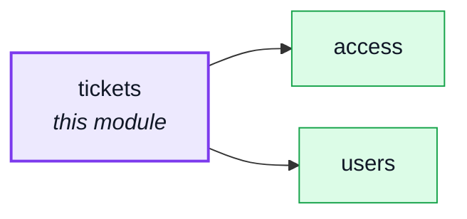
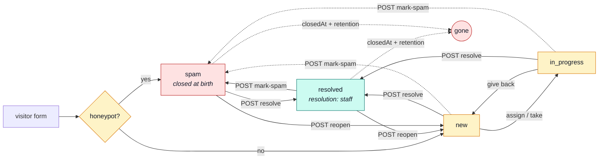

# tickets

::: tip At a glance
**Owns** — situations someone must take and close: a contact message a visitor sent, or a ticket the system opened for staff. A signed-in sender's account is recorded, so erasure and export follow it.
**Depends on** — [`users`](./users.md) (the assignee's name) and [`access`](./access.md) (the roles of a person a ticket may be given to). Nothing depends on it: the account erasure reaches it through the `personalData` manifest, never an import.
**Breaks if you change** — the `status` doors and their stamps (`closedAt`, `resolution`, the dedup key): the retention clock and the one-open-ticket-per-situation rule both live there.
:::

## Its neighbourhood

<!-- module-graph:tickets:start -->

_Solid arrows are imports. Dotted arrows are domain events — the return path an import
graph cannot see._

<!-- module-graph:tickets:end -->

## The story

A ticket is **one situation someone must take and close**. Two sources open one:

| Source    | Opened by                                | Is about                                  | Worked by                                          |
| --------- | ---------------------------------------- | ----------------------------------------- | -------------------------------------------------- |
| `visitor` | the contact form, `POST /tickets`        | what the person wrote                     | whoever holds `TicketDisplay` / `TicketManagement` |
| `system`  | a domain event (a later lane subscribes) | a record: an order, a refund, an account… | whoever holds the ticket's **route set**           |

The form is open to anyone, a stranger's write alongside signup, login, password reset,
second-factor login and analytics events. It always records the address typed; when the sender is
signed in it also records the account (`subjectId`, read from the session token the browser sends
along — an absent or expired token files the message as anonymous).

A visitor may add a **category** (`order`, `cancellation`, `return`, `payment`, `account`,
`privacy`, `other`) and the order number they typed (`orderNumber`, free text, never checked
against an order). Both are the filer's own words, so the export includes them.

### Jurisdiction

Each kind of ticket is routed to one **permission set**, frozen on the ticket when it opens
(`domain/routing.ts`). A role is a bundle of sets, so routing to a set routes to every role that
holds it, and the administrator holds every set, with no special case.

| Kind                                                                 | Route set             |
| -------------------------------------------------------------------- | --------------------- |
| `contact`                                                            | `TicketDisplay`       |
| `account_review`                                                     | `UserBanning`         |
| `manual_refund_owed`, `amount_mismatch`, `refund_refused`, `dispute` | `PaymentRefunding`    |
| `paid_without_hold`                                                  | `InventoryManagement` |
| `export_failed`                                                      | `UserErasure`         |
| `consent_due`                                                        | `OrderEditing`        |

A visitor ticket is the inbox's: anyone who may read tickets reads it. A system ticket is visible
and workable only to a caller who holds its route set; to anyone else it is a **404**, not a 403 (it
does not admit to existing). Every route also asks the plain `Ticket` rule, so today the people who
reach this page are the holders of `TicketDisplay` / `TicketManagement`; a role that holds only a
routed set (a warehouse worker and `paid_without_hold`) needs the route guard widened first — see
the open question in the lane report.

### Lifecycle

`status` is **read-only**. It moves through three bodyless doors, and through assignment.

| Door                | From                       | To                                     | Stamps                                                                                               |
| ------------------- | -------------------------- | -------------------------------------- | ---------------------------------------------------------------------------------------------------- |
| `POST …/resolve`    | new, in progress, spam     | resolved                               | `resolution: staff`, `closedAt` (kept if already closed), `respondedAt` once; releases the dedup key |
| `POST …/mark-spam`  | new, in progress, resolved | spam                                   | `resolution: spam`, `closedAt` (kept); releases the dedup key                                        |
| `POST …/reopen`     | resolved, spam             | in progress with an assignee, else new | clears `closedAt` and `resolution`; restores the dedup key; **keeps `dueAt`**                        |
| `PUT …/assignee`    | new, in progress           | in progress                            | the assignee must hold the ticket's route set (else 422)                                             |
| `DELETE …/assignee` | any                        | an in-progress ticket goes back to new | clears the assignee                                                                                  |

Every move is **one conditional write** filtered on the status that was read, so two clicks give one
200 and one 409. A repeat answers 409 with `TICKET_ALREADY_RESOLVED`, `TICKET_ALREADY_SPAM` or
`TICKET_ALREADY_OPEN`; a reopen that finds a newer open ticket holding the same dedup key answers
`TICKET_SUPERSEDED` with that ticket's id in `details`. Spam to resolve keeps the time the ticket
was first closed. The deadline (`dueAt`) belongs to the situation, not to the reopen, so it is kept.
Every answer is the ticket, with the caller's `actions` telling a screen which buttons to show.

### Notes

`POST /tickets/{id}/notes` appends to the staff thread: append-only, with author and time, allowed
on a closed ticket too. Write each note as if the customer will read it: the data subject's export
carries the words and the time, never the author.

### The staff badge

`GET /tickets/summary` answers `{ open, mine, overdue, unassigned }`, scoped to the caller's
jurisdiction. `overdue` is read-time arithmetic (open and past `dueAt`): no sweep keeps it true.
A contact message is due `NODE_TICKETS_CONTACT_SLA_HOURS` (default 48) after it was filed.

**The honeypot.** `website` is a field a real browser always submits empty and a bot reliably
fills — declared in the contract (so an undeclared field wouldn't 422 real browsers too) but never
persisted or returned. A non-empty value — or an address the email policy `refused`
(`checkEmailPolicy`, `service.ts`) — writes the row straight to `status: spam`, closed at birth, and
skips the operator notification; the caller still gets the same `201` a real submission gets, so a
bot learns nothing from the response. That trades an email amplifier for a storage amplifier,
which `contactLimiters` bounds and the TTL index expires.

## Personal data

| Topic       | Rule                                                                                                                                                                                                                                                                                                                                                                      |
| ----------- | ------------------------------------------------------------------------------------------------------------------------------------------------------------------------------------------------------------------------------------------------------------------------------------------------------------------------------------------------------------------------- |
| Export      | Two sections, both always present. `tickets`: the visitor tickets the person owns (sent signed in, or under their **verified** address). `systemTickets`: the system tickets about them, by `subjectId`, every field except the staff ids and the dedup key                                                                                                               |
| Notes       | Exported as words and time, never the author. A ticket is itself an assessment of the person, so it is theirs to read (CJEU C-434/16)                                                                                                                                                                                                                                     |
| Erasure     | In the hard-delete transaction only (the purge, an admin hard delete, the inactivity erasure), **never at the reversible lock**. Visitor tickets: deleted. System tickets whose record IS the person (a `user` or `export` link): deleted. Others (order, payment…): kept, detached from the account. An erased member of staff is removed as assignee and as note author |
| Retention   | A TTL on `closedAt` (`NODE_TICKETS_RETENTION_DAYS`, default 730 — 24 months). An open ticket never expires; a reopen stops the clock. Changing the window on a live database needs `npm run db:sync` — a restart alone fails the boot, the same caveat [`audit-logs`](./audit-logs.md) carries                                                                            |
| Not matched | An old address after an email change, or a message typed under another address while signed out, is not matched: the technician finds those by hand                                                                                                                                                                                                                       |

The owned set is one pure rule, `ownTicketsFilter` in `domain/ownership.ts`, used by both the export
and the erasure, so they cannot disagree. The `{ subjectId }` and `{ email }` indexes serve it.

## Who can do what

Every rule this module declares and who holds it, role by role. The rule is what a route guard asks for; the set is what a role lists.

<!-- permissions:start -->

| Rule            | Set                | `guest` | `unverified` | `customer` | `manager` | `warehouse` | `support` | `editor` | `moderator` | `admin` | `operator` | Credential | What it lets them do                                                                                                           |
| --------------- | ------------------ | ------- | ------------ | ---------- | --------- | ----------- | --------- | -------- | ----------- | ------- | ---------- | ---------- | ------------------------------------------------------------------------------------------------------------------------------ |
| `read:Ticket`   | `TicketDisplay`    | —       | —            | —          | ✅        | —           | ✅        | —        | —           | ✅      | —          | ✅         | Read tickets — contact messages, and the system tickets of a permission set the caller holds.                                  |
| `update:Ticket` | `TicketManagement` | —       | —            | —          | —         | —           | ✅        | —        | —           | ✅      | —          | ✅         | Work a ticket — resolve, mark as spam, reopen, assign, add a note. A system ticket also needs the ticket's own permission set. |
| `delete:Ticket` | `TicketManagement` | —       | —            | —          | —         | —           | ✅        | —        | —           | ✅      | —          | ✅         | Remove a ticket. A system ticket also needs the ticket's own permission set.                                                   |

✅ held · `own` only the caller’s own rows · ⚡c / ⚡s needs a freshly proved session (critical / sensitive) ·
Credential: ✅ when an API key can be minted with the rule. Generated from the rules and sets in
`src/modules/*/authorization.yaml` and the roles in `shared/authorization-roles.yaml`, asked of the
evaluator — [Authorization](../theory/authorization.md) explains the model.

<!-- permissions:end -->

## Related pages

- [Users](./users.md) — the assignee, and the erase cascade this module joins
- [Access](./access.md) — the roles a ticket may be given to
- [Modules overview](./index.md) — the whole context map
- [Email & PDF Rendering](../tools/email-and-rendering.md) — the triage notification
- [Security](../tools/security.md) — the rate-limit budgets, including this module's own
- [Winston & Audit Logs](../tools/winston.md) — what a triage action records
- [Ops & Assets](../reference/ops.md) — the retention window and why changing it needs `db:sync`
