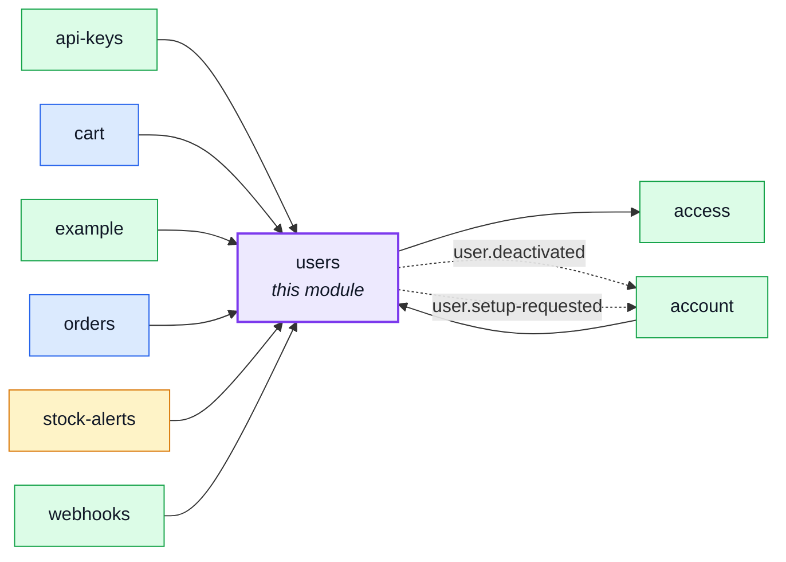
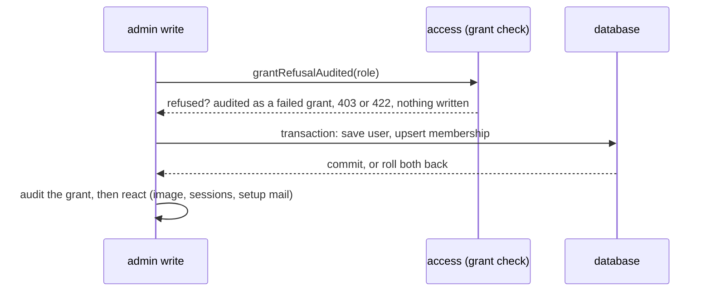

# users

::: tip At a glance
**Owns** — the user record: email, password hash, the second-factor and linked-provider material, and the session epoch. Credentials stay on the record on purpose: bounded, read at login, dying with the user ([why](./account-two-factor.md#what-the-user-document-carries)). Sessions and one-time tokens are [`account`](./account.md)'s own collections.
**Depends on** — [`access`](./access.md), for the role half of a write: the role lives in a membership, never on the record. Authentication is next door in [`account`](./account.md).
**Breaks if you change** — the credential fields (password, second factors, linked providers, the epoch). `account` reads and writes them, and it is the repo's only shared-kernel edge.
:::

## Its neighbourhood

<!-- module-graph:users:start -->

_Solid arrows are imports. Dotted arrows are domain events — the return path an import
graph cannot see._

<!-- module-graph:users:end -->

## The story

A user record with an email and a password hash is the same problem in every application that
has ever had one. Nothing about it differentiates this shop — which is exactly
what `generic` means, and why no aggregate belongs here however central the record feels.

The record carries no role: a staff role is a membership in [`access`](./access.md), and a
customer is whoever has no membership. See [Authorization](../theory/authorization.md) for where
the decision actually gets made.

**Authentication is not here.** Signup, login, password reset, sessions and the one-time-token lifecycle all live in
[`account`](./account.md), which is a _second service over this same collection_. That split is why
this module's barrel is the widest in the repo: alongside `userService`, it publishes its events
and the model's types — `account` needs them to authenticate the same document. `userRepository` and the model's
runtime value stay inside even so: every read or write, `account`'s included, goes through
`userService`, never the collection directly.

::: tip Why two modules and not one
`/users` and `/account` are different mounts, and a manifest carries one `basePath`. Merging them
would collapse two URL surfaces into one module for no gain — and the cost of keeping them apart is
visible on the map as a `shared-kernel` arrow rather than hidden inside a barrel.
:::

Several modules depend on this one and it depends on none, so it sits at the bottom of the graph —
see the generated diagram above for exactly which ones, and which declare a `personalData.erase` hook; that
list is checked on every regenerate, so it is never repeated by hand here.

## The pipeline

One collection, two services over it: `/users` (admin) and `/account` (signup, login, reset) both
write through `userService`, never the collection directly.

`PUT /users/{id}` replaces the record (a field left out reverts to its default); `PATCH /users/{id}`
merges (a field left out keeps its current value) — the same replace/merge split
[`request-flow.md`](../theory/request-flow.md) documents for the rest of the API, through the same
shared factory.

**What an edit needs, beyond the route's key.** Three rules sit in `services/update.ts` and
`services/remove.ts`, asked before anything is written:

| Rule                           | Refusal                                            | Why                                                           |
| ------------------------------ | -------------------------------------------------- | ------------------------------------------------------------- |
| the field's own key            | `403 FORBIDDEN`                                    | `active` needs `ban:User`, a different key from `update:User` |
| the account holds a staff role | `403 ROLE_MANAGEMENT_REQUIRED`                     | [R1](../theory/authorization.md#protecting-people)            |
| handing a role out             | `403 ROLE_MANAGEMENT_REQUIRED`, or `422` on `role` | only a holder of `assign:Role` hands out a staff role         |

A key is asked only when the field **changes**: a `PUT` resends `active` and `role` on every save,
and resending what the account already has is no ban and no role change (`role: null` is a plain
customer). The same protection covers soft delete, hard delete and restore. A refused attempt on a
staff account is audited as `security.forbidden` with `metadata.reason: role_protected`.

**The fresh-login step-up** asks only a caller holding `assign:Role`, and only when the write changes
who holds powers: a role that differs from the stored one, or an `active` flag that flips. A `PUT`
that resends what is stored is not challenged. A caller without `assign:Role` is never asked, and
the service refuses a role change with the audited `403 ROLE_MANAGEMENT_REQUIRED` instead. An API
key can never step up, so a key reaching a step-up guard is refused `403 FORBIDDEN` (audited as
`credential_cannot_step_up`), not told to log in again.

### Creating and updating with a role

An account and its role live in two collections (`users`, and `access`' memberships), and an admin
write touches both. It is **one transaction**, with the grant checked first:

- **Before any write**, the grant is validated (a role that exists, a granter who holds
  `assign:Role`) and a refusal is audited as `access.role.assigned` / `failure`, even though no account
  exists yet to point at.
- **One commit.** A failure of the role write rolls the account write back: no row left holding an
  email with no role, and no half-applied update (a ban, a rename) under a request that failed.
- **Audit after commit.** The success row for the grant is written once the transaction has
  committed, because it is not true before.
- **Self-service and OAuth signup follow the same shape** (see [`account`](./account.md)): the row
  and its starting role commit together or not at all.

**Credentials are the owner's alone.** `POST /users` takes no password: the account is created
without one and always mails a setup link (`USER_SETUP_REQUESTED`, handled in
[`account`](./account.md); it rides the [outbox](../tools/outbox.md) in the account's own
transaction, so a lost mail is retried and a refused grant sends none), so no administrator ever types, sees or resets another person's
password, second factor or sign-in email. Each row also carries an `actions` block (`update`,
`ban`, `delete`) with the rank already applied, which is what a screen renders its buttons from.

`phone` is stored AES-256-GCM under `NODE_PII_ENCRYPTION_KEY`
(`@infrastructure/security/pii-encryption`) — `services/update.ts`'s `update` encrypts it on the one write
path, `presentUser` (`presenter.ts`) decrypts it on the way out, whether the source document was hydrated or
`search()`'s `.lean()` result. See
[Secrets at rest](../theory/defences/crypto-and-secrets.md#secrets-at-rest).

Post-commit steps log and continue (`afterCommit`, `@infrastructure/runtime/after-commit`): once a
create or update has committed, a failed image hand-off is logged and the saved user answered, never
a 500 on a write that landed. Ending sessions is not such a step — it rides in the same save as the
session epoch.

## The doors a sibling module may use

Two writes skip the ban check and the staff protection the admin routes enforce: the raw `update`
and `remove`. Both are `@internal` and never leave the module. `account` reaches the record through
four named doors instead, each narrower than the write beneath it:

| Door                 | Who calls it                                | What it cannot do                                                  |
| -------------------- | ------------------------------------------- | ------------------------------------------------------------------ |
| `updateOwnProfile`   | the owner, `PUT`/`PATCH /account`           | take `active` or `role`: a profile edit cannot ban its own account |
| `eraseOwnAccount`    | the owner, `DELETE /account/delete-confirm` | take a bare document: it asks for the spent deletion link's proof  |
| `softDeleteInactive` | the inactivity reaper                       | take an account never warned, or one that holds a staff role (409) |
| `eraseInactive`      | the inactivity reaper                       | erase a row the reaper did not soft-delete itself (409)            |

`eraseOwnAccount` takes a `RedeemedOwner`, which `userService.redeemedOwner(user)` mints from the
document the deletion link just resolved. The route is anonymous, so the spent link is the only thing
that says the person asking owns the account; the type makes a caller say so out loud, and a test or
a reviewer can see who claims it. No rank check applies, so a staff member may erase themselves.

`updateById` and `removeById` stay the doors for an admin: they load by id and ask first.

## Purchase hold

A protective pause on checkout for one account, so a person steps in before a bot or a loop does
damage. It is a field on the user (`purchaseHold`) with its own two doors and one reader:

| Door                               | Who                                        | What it does                                                                                   |
| ---------------------------------- | ------------------------------------------ | ---------------------------------------------------------------------------------------------- |
| `PUT /users/{id}/purchase-hold`    | staff with `ban:User`                      | a manual hold ending at `until`, with an optional `note` written for the buyer; replaces any   |
| `DELETE /users/{id}/purchase-hold` | staff with `ban:User`                      | the review: ends the hold now and restarts the count of cancellations from this moment         |
| `takeAutomaticPurchaseHold`        | `orders` only (a lint-guarded friend door) | the shop's own hold after repeated cancellations; atomic, so only one of two racing calls wins |
| `purchaseHoldOf`                   | `cart`'s checkout                          | the hold in force, if any                                                                      |

A hold is in force while `until` is in the future, so an expired one needs no sweep. Reads show it only
while in force, to staff on `/users` and to the buyer on `/account` (for a banner); the export carries it
with the profile. `setBy` (which staff member) never reaches the wire, the audit row names them. The
count and the trigger are `orders`' ([the purchase hold](./orders.md#the-purchase-hold)).

Audit: `admin.user.purchase_hold_set`, `admin.user.purchase_hold_lifted` (only when a hold was in
force), `system.user.purchase_hold_set`. The users list takes `purchaseHold=true` to find them.

## Soft delete vs. erasure

`DELETE /users/:id` soft-deletes by default — `deletedAt` is stamped, the account's sessions are
revoked (the [session epoch](./account-sessions.md#the-session-epoch) moves in the same save, as it
does when an update bans the account, so a restore or an unban never revives an old token), and a
repeated `DELETE` changes nothing. `POST /users/:id/restore` undoes it; the owner
signs in again. `?hardDelete=true` is the one that runs every module's `personalData.erase` hook (the cascade above) and
actually removes the row.

Only the hard path **discharges an Art. 17 erasure request**. The audit trail says
so explicitly: a soft delete emits `admin.user.soft_deleted`, a hard one `admin.user.erased` — two
actions rather than one `admin.user.deleted`, so "was this request actually closed out" is
answerable from the log alone, not from remembering which flag an admin clicked.

[`access`](./access.md#when-the-account-is-erased) is one of the modules in that cascade: the account's roles, tenant and platform, leave in the same
transaction as the row, so a failed erasure takes no role from an account that stays.

A module's erase hook may hand back work to run once the transaction has committed (`AfterErase`):
anything that is not a database write, so a rollback could not undo it. `orders` uses it to cancel
the account's never-paid orders, see [When the account is erased](./orders.md#when-the-account-is-erased).
A failing step is logged and never turns a committed erasure into an error.

## What this module adds to the data export

Two sections of `POST /account/export`: `profile` (the record, its purchase hold included while one is in force) and `signInMethods`. The second
exists because a linked provider's own subject id is an online identifier (GDPR Art. 4(1)) and
part of what an access request answers (Art. 15), yet it sits behind `select: false` and so is not
in `profile`.

| Exported                                                      | Never exported                                                 |
| ------------------------------------------------------------- | -------------------------------------------------------------- |
| each linked provider: `provider`, `providerId`, `connectedAt` | a second factor's secret, a code in flight, its delivery state |
| each armed second factor: `method`, `enrolledAt`              | the backup-code digests, the password hash                     |

A factor whose setup was never confirmed has no `enrolledAt`, guards no login, and is left out.

## Libraries

None. Passwords are hashed with argon2id from `node:crypto` (`infrastructure/security/password-hash.ts`),
which `account` verifies against as well: no package to choose, keep patched or list on the
[Package Dependencies](../tools/package-dependencies.md) page.

## Who can do what

Every rule this module declares and who holds it, role by role. The rule is what a route guard asks for; the set is what a role lists.

<!-- permissions:start -->

| Rule          | Set            | `guest` | `unverified` | `customer` | `manager` | `warehouse` | `support` | `editor` | `moderator` | `admin` | `operator` | Credential | What it lets them do                                                                                                                                               |
| ------------- | -------------- | ------- | ------------ | ---------- | --------- | ----------- | --------- | -------- | ----------- | ------- | ---------- | ---------- | ------------------------------------------------------------------------------------------------------------------------------------------------------------------ |
| `read:User`   | `UserDisplay`  | —       | —            | —          | —         | —           | ✅        | —        | ✅          | ✅      | —          | ✅         | Read other people's accounts. Reading your own is `account`, not a key.                                                                                            |
| `create:User` | `UserCreation` | —       | —            | —          | —         | —           | —         | —        | ✅          | ✅      | —          | ✅         | Create an account for someone else.                                                                                                                                |
| `update:User` | `UserEditing`  | —       | —            | —          | —         | —           | ✅        | —        | ✅          | ✅      | —          | ✅         | Change someone else's profile: username, image, locale, phone, website, and the role (only for a holder of `assign:Role`). Never a credential, and never `active`. |
| `ban:User`    | `UserBanning`  | —       | —            | —          | —         | —           | —         | —        | ✅          | ✅      | —          | ✅         | Deactivate someone else's account, or lift the deactivation; pause someone's checkout, or lift the pause.                                                          |
| `delete:User` | `UserErasure`  | —       | —            | —          | —         | —           | —         | —        | ✅ ⚡c      | ✅ ⚡c  | —          | —          | Erase someone else's account.                                                                                                                                      |

✅ held · `own` only the caller’s own rows · ⚡c / ⚡s needs a freshly proved session (critical / sensitive) ·
Credential: ✅ when an API key can be minted with the rule. Generated from the rules and sets in
`src/modules/*/authorization.yaml` and the roles in `shared/authorization-roles.yaml`, asked of the
evaluator — [Authorization](../theory/authorization.md) explains the model.

<!-- permissions:end -->

## Related pages

- [Modules overview](./index.md) — the whole context map
- [`account`](./account.md) — the other service over this collection
- [Strategic DDD](../theory/strategic-ddd.md#_5-published-language-—-the-barrel) — why a wide barrel is a map edge, not a private detail
- [Security](../tools/security.md) — password hashing and the token shapes
- [Events & Logging](../tools/events-and-logging.md) — the domain-event bus
