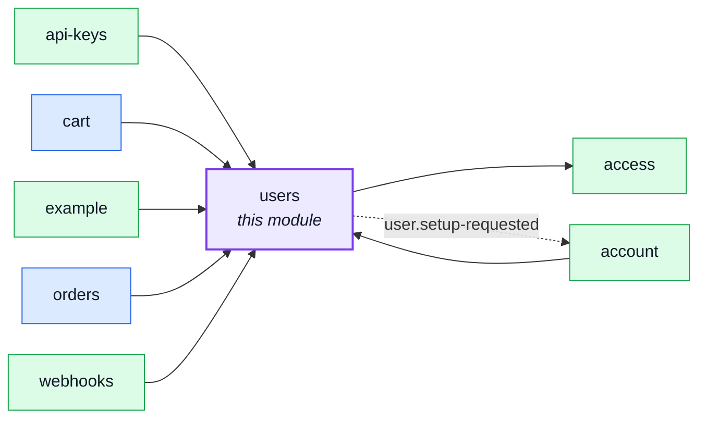
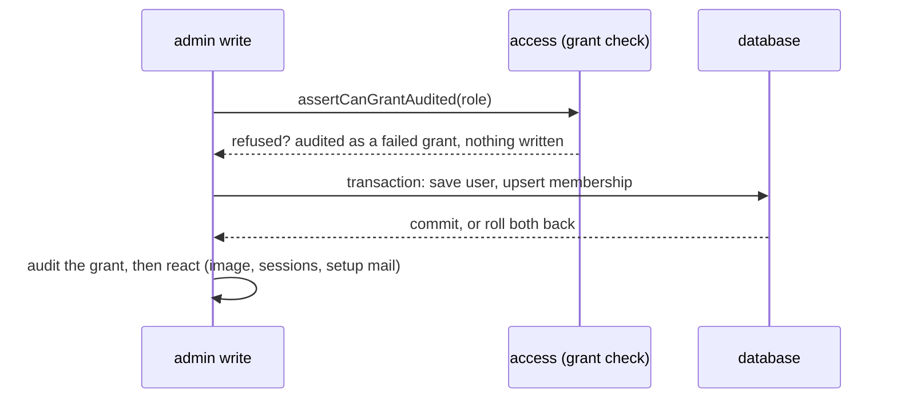

# users

::: tip At a glance
**Owns** — the user record: email, password hash, role name, the second-factor and linked-provider material, and the session epoch. Sessions and one-time tokens are [`account`](./account.md)'s own collections.
**Depends on** — nothing. Authentication is next door in [`account`](./account.md).
**Breaks if you change** — the credential fields (password, second factors, linked providers, the epoch). `account` reads and writes them, and it is the repo's only shared-kernel edge.
:::

## Its neighbourhood

<!-- module-graph:users:start -->

_Solid arrows are imports. Dotted arrows are domain events — the return path an import
graph cannot see._

<!-- module-graph:users:end -->

## The story

A user record with an email, a password hash and a role name is the same problem in every
application that has ever had one. Nothing about it differentiates this shop — which is exactly
what `generic` means, and why no aggregate belongs here however central the record feels.

The role name is a fallback, not the source of truth — a stored membership always wins, and this
module publishes its own field alongside it purely so a staff list has something to show. See
[Authorization](../theory/authorization.md) for where the decision actually gets made.

**Authentication is not here.** Signup, login, password reset, sessions and the one-time-token lifecycle all live in
[`account`](./account.md), which is a _second service over this same collection_. That split is why
this module's barrel is the widest in the repo: alongside `userService`, it publishes its events
and the model's types — `account` needs them to authenticate the same document. `userRepository` and the model's
runtime value stay inside even so: every read or write, `account`'s included, goes through
`userService`, never the collection directly.

::: tip Why two modules and not one
`/users` and `/account` are different mounts, and a manifest carries one `basePath`. Merging them
would collapse two URL surfaces into one module for no gain — and the cost of keeping them apart is
visible on the map as a `shared-kernel` arrow rather than hidden inside a barrel.
:::

Several modules depend on this one and it depends on none, so it sits at the bottom of the graph —
see the generated diagram above for exactly which ones, and which declare a `personalData.erase` hook; that
list is checked on every regenerate, so it is never repeated by hand here.

## The pipeline

One collection, two services over it: `/users` (admin) and `/account` (signup, login, reset) both
write through `userService`, never the collection directly.

`PUT /users/{id}` replaces the record (a field left out reverts to its default); `PATCH /users/{id}`
merges (a field left out keeps its current value) — the same replace/merge split
[`request-flow.md`](../theory/request-flow.md) documents for the rest of the API, through the same
shared factory.

**What an edit needs, beyond the route's key.** Three rules sit in `services/update.ts` and
`services/remove.ts`, asked before anything is written:

| Rule                      | Refusal         | Why                                                                     |
| ------------------------- | --------------- | ----------------------------------------------------------------------- |
| the field's own key       | `403 FORBIDDEN` | `active` needs `users.any.ban`, a different key from `users.any.update` |
| the owner ranks below you | `403 OUTRANKED` | [R1](../theory/authorization.md#acting-on-someone-else-s-things)        |
| not your own role         | `403 FORBIDDEN` | promotion is somebody else's act                                        |

A key is asked only when the field **changes**: a `PUT` resends `active` and `role` on every save,
and resending what the account already has is no ban and no promotion. The same rank rule covers
soft delete, hard delete and restore. A refused attempt on a rank is audited as `security.forbidden`
with `metadata.reason: outranked`.

### Creating and updating with a role

An account and its role live in two collections (`users`, and `access`' memberships), and an admin
write touches both. It is **one transaction**, with the grant checked first:

- **Before any write**, the grant is validated (a role that exists, nothing the granter does not
  hold) and a refusal is audited as `access.role.assigned` / `failure`, even though no account
  exists yet to point at.
- **One commit.** A failure of the role write rolls the account write back: no row left holding an
  email with no role, and no half-applied update (a ban, a rename) under a request that failed.
- **Audit after commit.** The success row for the grant is written once the transaction has
  committed, because it is not true before.
- **Self-service and OAuth signup follow the same shape** (see [`account`](./account.md)): the row
  and its starting role commit together or not at all.

**Credentials are the owner's alone.** `POST /users` takes no password: the account is created
without one and always mails a setup link (`USER_SETUP_REQUESTED`, handled in
[`account`](./account.md); it rides the [outbox](../tools/outbox.md) in the account's own
transaction, so a lost mail is retried and a refused grant sends none), so no administrator ever types, sees or resets another person's
password, second factor or sign-in email. Each row also carries an `actions` block (`update`,
`ban`, `delete`) with the rank already applied, which is what a screen renders its buttons from.

`phone` is stored AES-256-GCM under `NODE_PII_ENCRYPTION_KEY`
(`@infrastructure/security/pii-encryption`) — `services/update.ts`'s `update` encrypts it on the one write
path, `toUser` (`model.ts`) decrypts it on the way out, whether the source document was hydrated or
`search()`'s `.lean()` result. See
[Secrets at rest](../theory/defences/crypto-and-secrets.md#secrets-at-rest).

## Soft delete vs. erasure

`DELETE /users/:id` soft-deletes by default — `deletedAt` is stamped, the account's sessions are
revoked (the [session epoch](./account-sessions.md#the-session-epoch) moves in the same save, as it
does when an update bans the account, so a restore or an unban never revives an old token), and a
repeated `DELETE` changes nothing. `POST /users/:id/restore` undoes it; the owner
signs in again. `?hardDelete=true` is the one that runs every module's `personalData.erase` hook (the cascade above) and
actually removes the row.

Only the hard path **discharges an Art. 17 erasure request**. The audit trail says
so explicitly: a soft delete emits `admin.user.soft_deleted`, a hard one `admin.user.erased` — two
actions rather than one `admin.user.deleted`, so "was this request actually closed out" is
answerable from the log alone, not from remembering which flag an admin clicked.

[`access`](./access.md#when-the-account-is-erased) is one of the modules in that cascade: the account's roles, tenant and platform, leave in the same
transaction as the row, so a failed erasure takes no role from an account that stays.

A module's erase hook may hand back work to run once the transaction has committed (`AfterErase`):
anything that is not a database write, so a rollback could not undo it. `orders` uses it to cancel
the account's never-paid orders, see [When the account is erased](./orders.md#when-the-account-is-erased).
A failing step is logged and never turns a committed erasure into an error.

## Libraries

None. Passwords are hashed with argon2id from `node:crypto` (`infrastructure/security/password-hash.ts`),
which `account` verifies against as well: no package to choose, keep patched or list on the
[Package Dependencies](../tools/package-dependencies.md) page.

## Related pages

- [Modules overview](./index.md) — the whole context map
- [`account`](./account.md) — the other service over this collection
- [Strategic DDD](../theory/strategic-ddd.md#_5-published-language-—-the-barrel) — why a wide barrel is a map edge, not a private detail
- [Security](../tools/security.md) — password hashing and the token shapes
- [Events & Logging](../tools/events-and-logging.md) — the domain-event bus
