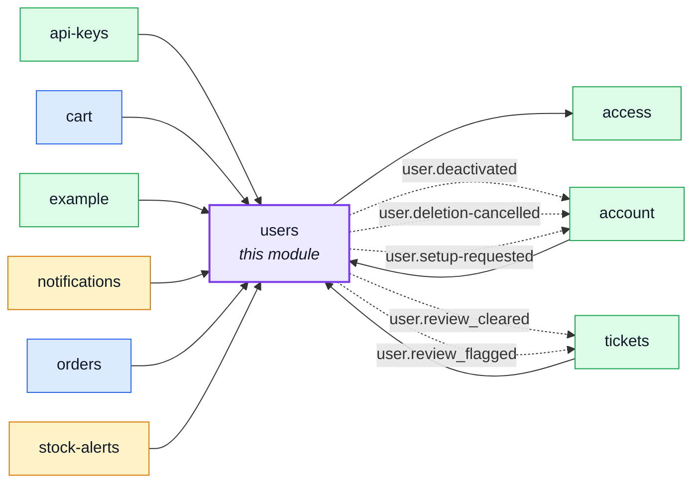
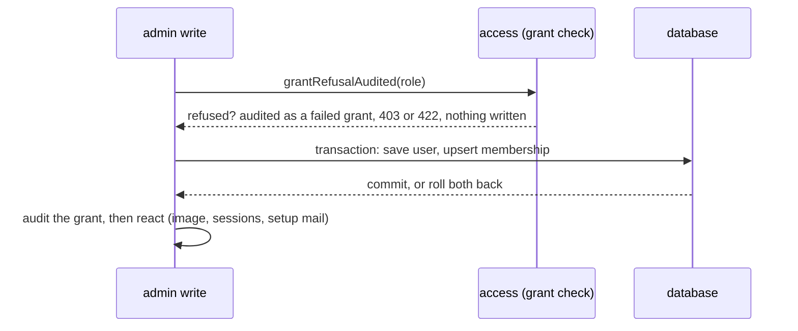
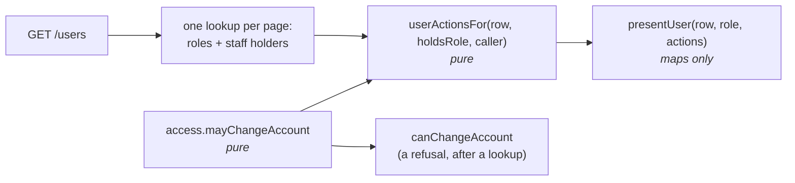

# users

::: tip At a glance
**Owns** — the user record: email, password hash, the second-factor and linked-provider material, and the session epoch. Credentials stay on the record on purpose: bounded, read at login, dying with the user ([why](./account-two-factor.md#what-the-user-document-carries)). Sessions and one-time tokens are [`account`](./account.md)'s own collections.
**Depends on** — [`access`](./access.md), for the role half of a write: the role lives in a membership, never on the record. Authentication is next door in [`account`](./account.md).
**Breaks if you change** — the credential fields (password, second factors, linked providers, the epoch). `account` reads and writes them, and it is the repo's only shared-kernel edge.
:::

## Its neighbourhood

<!-- module-graph:users:start -->

_Solid arrows are imports. Dotted arrows are domain events — the return path an import
graph cannot see._

<!-- module-graph:users:end -->

## The story

A user record with an email and a password hash is the same problem in every application that
has ever had one. Nothing about it differentiates this shop — which is exactly
what `generic` means, and why no aggregate belongs here however central the record feels.

The record carries no role: a staff role is a membership in [`access`](./access.md), and a
customer is whoever has no membership. See [Authorization](../theory/authorization.md) for where
the decision actually gets made.

**Authentication is not here.** Signup, login, password reset, sessions and the one-time-token lifecycle all live in
[`account`](./account.md), which is a _second service over this same collection_. That split is why
this module's barrel is the widest in the repo: alongside `userService`, it publishes its events
and the model's types — `account` needs them to authenticate the same document. `userRepository` and the model's
runtime value stay inside even so: every read or write, `account`'s included, goes through
`userService`, never the collection directly.

::: tip Why two modules and not one
`/users` and `/account` are different mounts. Merging them
would collapse two URL surfaces into one module for no gain — and the cost of keeping them apart is
visible on the map as an `account → users` arrow, which this page labels `shared-kernel`, rather than hidden inside a barrel.
:::

Several modules depend on this one and it depends only on `access`, so it sits near the bottom of the graph —
see the generated diagram above for exactly which ones, and which declare a `personalData.erase` hook; that
list is checked on every regenerate, so it is never repeated by hand here.

## The pipeline

One collection, two services over it: `/users` (admin) and `/account` (signup, login, reset) both
write through `userService`, never the collection directly.

`PUT /users/{id}` replaces the record (a field left out reverts to its default); `PATCH /users/{id}`
merges (a field left out keeps its current value) — the same replace/merge split
[`request-flow.md`](../theory/request-flow.md) documents for the rest of the API, through the same
shared factory.

**What an edit needs, beyond the route's key.** Two rules sit in `services/update.ts` and
`services/remove.ts`, asked before anything is written:

| Rule                           | Refusal                                            | Why                                                   |
| ------------------------------ | -------------------------------------------------- | ----------------------------------------------------- |
| the account holds a staff role | `403 ROLE_MANAGEMENT_REQUIRED`                     | [R1](../theory/authorization.md#protecting-people)    |
| handing a role out             | `403 ROLE_MANAGEMENT_REQUIRED`, or `422` on `role` | only a holder of `assign:Role` hands out a staff role |

A role is asked only when it **changes**: a `PUT` resends `role` on every save, and resending what
the account already has is no role change (`role: null` is a plain customer). The same protection
covers soft delete, hard delete, restore, the purchase hold and the activate / deactivate switch. A
refused attempt on a staff account is audited as `security.forbidden` with
`metadata.reason: role_protected`.

`active` is not a field of `PUT` / `PATCH`: a status change is an action endpoint
([Activating and deactivating](#activating-and-deactivating)).

**The fresh-login step-up** asks only a caller holding `assign:Role`, and only when the write changes
who holds powers: a role that differs from the stored one, an account created deactivated, or a
call to `activate` / `deactivate`. A `PUT` that resends what is stored is not challenged. A caller without `assign:Role` is never asked, and
the service refuses a role change with the audited `403 ROLE_MANAGEMENT_REQUIRED` instead. An API
key can never step up, so a key reaching a step-up guard is refused `403 FORBIDDEN` (audited as
`credential_cannot_step_up`), not told to log in again.

### Creating and updating with a role

An account and its role live in two collections (`users`, and `access`' memberships), and an admin
write touches both. It is **one transaction**, with the grant checked first:

- **Before any write**, the grant is validated (a role that exists, a granter who holds
  `assign:Role`) and a refusal is audited as `access.role.assigned` / `failure`, even though no account
  exists yet to point at.
- **One commit.** A failure of the role write rolls the account write back: no row left holding an
  email with no role, and no half-applied update (a ban, a rename) under a request that failed.
- **Audit after commit.** The success row for the grant is written once the transaction has
  committed, because it is not true before.
- **Self-service and OAuth signup follow the same shape** (see [`account`](./account.md)): the row
  and its starting role commit together or not at all.

**Credentials are the owner's alone.** `POST /users` takes no password: the account is created
without one and always mails a setup link (`USER_SETUP_REQUESTED`, handled in
[`account`](./account.md); it rides the [outbox](../tools/outbox.md) in the account's own
transaction, so a lost mail is retried and a refused grant sends none), so no administrator ever types, sees or resets another person's
password, second factor or sign-in email. Each row also carries an [`actions` block](#actions) with
the rank and the account's state already applied, which is what a screen renders its buttons from.

`phone` is stored AES-256-GCM under `NODE_PII_ENCRYPTION_KEY`
(`@infrastructure/security/pii-encryption`) — `services/update.ts`'s `update` encrypts it on the one write
path, `presentAccount` and `presentUser` (`presenter.ts`) decrypt it on the way out, whether the source document was hydrated or
`search()`'s `.lean()` result. See
[Secrets at rest](../theory/defences/crypto-and-secrets.md#secrets-at-rest).

Post-commit steps log and continue (`afterCommit`, `@infrastructure/runtime/after-commit`): once a
create or update has committed, a failed image hand-off is logged and the saved user answered, never
a 500 on a write that landed. Ending sessions is not such a step — it rides in the same save as the
session epoch.

## Actions

`User.actions` (required, on every `/users` read and write, list rows included) is one boolean per
endpoint, computed per request by `userActionsFor` (`services/actions.ts`): pure, with the two
lookups it needs (the caller's keys, who holds a staff role) made once per request or once per page.
The presenter only maps the finished block. `/account` serves a different schema, `Account`, which
has no `actions` and no review flag: a person's own record has no one to protect.

| Flag               | Endpoint                           | The caller needs            | And the account must be         |
| ------------------ | ---------------------------------- | --------------------------- | ------------------------------- |
| `update`           | `PUT` / `PATCH /users/{id}`        | `update:User`               | reachable (below)               |
| `assignRole`       | the `role` field of those          | `update`, and `assign:Role` | reachable                       |
| `delete`           | `DELETE /users/{id}`               | `delete:User`               | not soft-deleted                |
| `hardDelete`       | `DELETE /users/{id}/hard`          | `delete:User`               | reachable                       |
| `restore`          | `POST /users/{id}/restore`         | `delete:User`               | soft-deleted                    |
| `setPurchaseHold`  | `PUT /users/{id}/purchase-hold`    | `ban:User`                  | reachable                       |
| `liftPurchaseHold` | `DELETE /users/{id}/purchase-hold` | `ban:User`                  | holding a hold or a review flag |
| `activate`         | `POST /users/{id}/activate`        | `ban:User`                  | deactivated                     |
| `deactivate`       | `POST /users/{id}/deactivate`      | `ban:User`                  | active                          |

"Reachable" is `access`'s one pure rule, `mayChangeAccount`: an account that holds no staff role, or
is the caller's own, or the caller holds `assign:Role`. The service's `canChangeAccount` asks the
same function after a lookup, so the flag and the refusal cannot disagree. `ban:User` is the key of
every ban-class move: deactivating is a ban today, and [support](../demo-ecommerce/support.md) keeps none of it.

## Activating and deactivating

`POST /users/{id}/deactivate` and `POST /users/{id}/activate` are the only way `active` changes
after creation (a create body may still set the initial value). Deactivating ends every session in
the same save (the [session epoch](./account-sessions.md#the-session-epoch) moves with it) and
announces `user.deactivated` in that transaction, so `account` purges the pending links when the
sessions died. A repeat is a conflict, not a second success: `409 USER_ALREADY_INACTIVE` /
`USER_ALREADY_ACTIVE` ([the rule](../api/write-methods.md#repeating-an-action-409)). Audit: `admin.user.banned` / `admin.user.unbanned`.

A hard erasure also writes `user.erased` in its transaction; this module's own subscriber asks the
analytics provider to forget the id ([PostHog erasure](../tools/analytics.md#erasure-in-posthog)).

## The doors a sibling module may use

Two writes skip the ban check and the staff protection the admin routes enforce: the raw `update`
and `remove`. Both are `@internal` and never leave the module. `account` reaches the record through
named doors instead, each narrower than the write beneath it:

| Door                     | Who calls it                      | What it cannot do                                                                      |
| ------------------------ | --------------------------------- | -------------------------------------------------------------------------------------- |
| `updateOwnProfile`       | the owner, `PUT`/`PATCH /account` | take `active` or `role`: a profile edit cannot ban its own account                     |
| `scheduleOwnDeletion`    | the owner, `DELETE /account`      | erase anything: it locks the row, stamps `purgeAt` and moves the session epoch         |
| `restoreOwnAccount`      | the owner, by link or at sign-in  | restore a row past `purgeAt`, or one the owner did not schedule (a conditional update) |
| `eraseScheduledDeletion` | the purge job                     | erase a row not yet due: its first write is a claim on `purgeAt <= now`, else 409      |
| `softDeleteInactive`     | the inactivity reaper             | take an account never warned, or one that holds a staff role (409)                     |
| `eraseInactive`          | the inactivity reaper             | erase a row the reaper did not soft-delete itself (409)                                |

The state itself is the proof: an owner-scheduled row carries `deletedBy: 'owner'` and a `purgeAt`,
as a reaper row carries `deletedBy: 'reaper'`. No rank check applies, so a staff member may delete
and later be erased like anyone else. The purge hands a system context, so the trail says
`system.user.erased`, not an admin erase.

`updateById` and `removeById` stay the doors for an admin: they load by id and ask first.

`staffContacts(ids)` is the read a staff notice makes of the members it found: of those ids, the
accounts that are live, enabled and have an authenticator app armed, with their address and
language. An account without an app has its staff role withheld, so it could not act on the notice
and is left out; so is a banned or deleted one.

## Purchase hold

A protective pause on checkout for one account, so a person steps in before a bot or a loop does
damage. It is a field on the user (`purchaseHold`) with its own two doors and one reader:

| Door                               | Who                                        | What it does                                                                                     |
| ---------------------------------- | ------------------------------------------ | ------------------------------------------------------------------------------------------------ |
| `PUT /users/{id}/purchase-hold`    | staff with `ban:User`                      | a manual hold ending at `until`, with an optional `note` written for the buyer; replaces any     |
| `DELETE /users/{id}/purchase-hold` | staff with `ban:User`                      | the review: ends the hold now and restarts the count; `409 USER_PURCHASE_HOLD_NOT_SET` with none |
| `takeAutomaticPurchaseHold`        | `orders` only (a lint-guarded friend door) | the shop's own hold after repeated cancellations; atomic, so only one of two racing calls wins   |
| `purchaseHoldOf`                   | `cart`'s checkout                          | the hold in force, if any                                                                        |

A hold is in force while `until` is in the future, so every reader ignores an expired one at once.
Reads show it only while in force, to staff on `/users` and to the buyer on `/account` and in the cart
(a banner). `setBy` (which staff member) is never in any output, the export included: the audit row
names them. The data export carries the stored hold, so an ended one is in it until the nightly
`reap:purchase-holds` reduces it to `purchaseHoldResetAt`, the later of its own `setAt` and the last
staff lift, which is where `orders` restarts the count of cancellations. The count and the trigger are
`orders'` ([the purchase hold](./orders.md#the-purchase-hold)).

**The buyer's mail.** Every hold placed, by staff or by the shop's rule, mails the account's own
address once (an automatic race has one winner, so one mail). It says until when (the instant in UTC:
`users` is a foundation module and may not read the shop's timezone), why (the rule's count and window,
or the staff note), what still works, a link to the contact page pre-filled for an account question
(`NODE_FRONTEND_LINK_CONTACT`), and, in its own paragraph, the right to object and to complain with the
privacy notice linked (`NODE_FRONTEND_LINK_PRIVACY`). The greeting names nobody: the display name is
free text. A mail that cannot be built or queued is logged and never undoes the hold.

**The review flag.** `User.purchaseHoldFlaggedAt` marks an account for a person to look at: it is set
in the same write as an automatic hold, or alone when only PAID cancellations reached the limit
(`system.user.purchase_hold_flagged`; those are statutory withdrawals and never pause anyone). It
outlives the hold, so an unreviewed pause does not drop off the staff list when it ends by itself; it
stays until a staff member acts. Placing a hold or lifting one clears it. Setting the flag alone (paid
cancellations only) announces `user.review_flagged` and clearing it `user.review_cleared`, in the same
transaction: [`tickets`](./tickets.md#system-tickets) opens and closes the review ticket from them. The
automatic hold announces neither; it has its own staff notice. The `/users` reads show it
(never `/account`); the data export carries it with the rest of the profile.

Audit: `admin.user.purchase_hold_set`; `admin.user.purchase_hold_lifted` (`metadata.inForce` says
whether a hold was still running, so "reviewed, no hold" is audited too; a lift with nothing to clear
is refused, so it writes no row); `system.user.purchase_hold_set`; `system.user.purchase_hold_flagged`. The users list
takes `purchaseHold=true` (held right now) and `purchaseHoldReview=true` (flagged, not yet reviewed)
to find them.
The nightly job `reap:purchase-holds` is listed with the others in
[scheduled jobs](../reference/ops.md#scheduled-jobs).

## Soft delete vs. erasure

`DELETE /users/:id` soft-deletes by default — `deletedAt` is stamped, the account's sessions are
revoked (the [session epoch](./account-sessions.md#the-session-epoch) moves in the same save, as it
does when the account is deactivated, so a restore or an activation never revives an old token), and a
repeated `DELETE` changes nothing. `POST /users/:id/restore` undoes it; the owner
signs in again. `?hardDelete=true` is the one that runs every module's `personalData.erase` hook (the cascade above) and
actually removes the row.

Only the hard path **discharges an Art. 17 erasure request**. The audit trail says
so explicitly: a soft delete emits `admin.user.soft_deleted`, a hard one `admin.user.erased` — two
actions rather than one `admin.user.deleted`, so "was this request actually closed out" is
answerable from the log alone, not from remembering which flag an admin clicked.

[`access`](./access.md#when-the-account-is-erased) is one of the modules in that cascade: the account's roles, tenant and platform, leave in the same
transaction as the row, so a failed erasure takes no role from an account that stays.

Every erase hook receives the **subject** (`userId`, `email`, `emailVerified`, built once by
`personalDataSubjectOf` from the stored account), not just the id: a module that also matches rows
by address, as [`tickets`](./tickets.md) does, needs the address and whether it was proven. The
cascade still writes exactly one `user.erased` outbox row per erasure, inside the same transaction.

A module's erase hook may hand back work to run once the transaction has committed (`AfterErase`):
anything that is not a database write, so a rollback could not undo it. `orders` uses it to cancel
the account's never-paid orders, see [When the account is erased](./orders.md#when-the-account-is-erased).
A failing step is logged and never turns a committed erasure into an error.

A third kind of soft delete is the **owner's own**: `DELETE /account` stamps `deletedAt` (the request
time), `deletedBy: 'owner'` and `purgeAt`, and the account is erased by the `reap:scheduled-deletions`
job once `purgeAt` passes ([the grace](../theory/data-retention.md#self-deletion-a-grace-under-one-month)).
Staff see it in the list (`User.purgeAt`, "erases on {date}") and may restore it with
`POST /users/{id}/restore` while `purgeAt` is ahead, the same `delete:User` key as any restore. Past
it the answer is 409 `USER_ERASURE_DUE` and `actions.restore` is false. The restore commits with the
outbox event `user.deletion-cancelled`; `account` drops the restore link and tells the owner staff did
it. There is no reason field: the audit row records who.

## Webhook events

Erasing or rectifying a person tells connected tools (GDPR Art. 19). Ids and field names only, never
a value, so the delivery log never holds a fresh copy of the person's data.

| Webhook        | `data`                  | Fires on                                                                                                                               | Does not fire on                                                                                                                                                             |
| -------------- | ----------------------- | -------------------------------------------------------------------------------------------------------------------------------------- | ---------------------------------------------------------------------------------------------------------------------------------------------------------------------------- |
| `user.erased`  | `{ userId }`            | admin hard delete, the purge after the grace, the inactivity erase (same commit)                                                       | the lock, the grace starting, a soft delete, a restore that wins the claim                                                                                                   |
| `user.updated` | `{ userId, changed[] }` | a username, phone, website or picture that really moved (admin or owner edit); an email-change confirmation and its undo (`['email']`) | a resent value, an email-change request not yet confirmed, locale or consent, the address book, a role-only edit. A phone is compared as plaintext, not as stored ciphertext |

`user.updated` is projected from the outbox event `user.profile_changed`, written in the save's own
transaction (`services/update.ts`, `services/credentials.ts`). A recipient that syncs customers
stores our `userId`, drops what it holds on `user.erased`, and refetches on `user.updated`. The
catalogue and the delivery pipeline are [`webhooks`](./webhooks.md).

## What this module adds to the data export

Two sections of `POST /account/export`: `profile` (the record, its purchase hold included while one is in force) and `signInMethods`. The second
exists because a linked provider's own subject id is an online identifier (GDPR Art. 4(1)) and
part of what an access request answers (Art. 15), yet it sits behind `select: false` and so is not
in `profile`.

| Exported                                                      | Never exported                                                 |
| ------------------------------------------------------------- | -------------------------------------------------------------- |
| each linked provider: `provider`, `providerId`, `connectedAt` | a second factor's secret, a code in flight, its delivery state |
| each armed second factor: `method`, `enrolledAt`              | the backup-code digests, the password hash                     |

A factor whose setup was never confirmed has no `enrolledAt`, guards no login, and is left out.

## Libraries

None. Passwords are hashed with argon2id from `node:crypto` (`infrastructure/security/password-hash.ts`),
which `account` verifies against as well: no package to choose, keep patched or list on the
[Package Dependencies](../tools/package-dependencies.md) page.

## Who can do what

Every rule this module declares and who holds it, role by role. The rule is what a route guard asks for; the set is what a role lists.

<!-- permissions:start -->

| Rule          | Set            | `guest` | `unverified` | `customer` | `manager` | `warehouse` | `support` | `editor` | `moderator` | `admin` | `operator` | Credential | What it lets them do                                                                                                                                               |
| ------------- | -------------- | ------- | ------------ | ---------- | --------- | ----------- | --------- | -------- | ----------- | ------- | ---------- | ---------- | ------------------------------------------------------------------------------------------------------------------------------------------------------------------ |
| `read:User`   | `UserDisplay`  | —       | —            | —          | —         | —           | ✅        | —        | ✅          | ✅      | —          | ✅         | Read other people's accounts. Reading your own is `account`, not a key.                                                                                            |
| `create:User` | `UserCreation` | —       | —            | —          | —         | —           | —         | —        | ✅          | ✅      | —          | ✅         | Create an account for someone else.                                                                                                                                |
| `update:User` | `UserEditing`  | —       | —            | —          | —         | —           | ✅        | —        | ✅          | ✅      | —          | ✅         | Change someone else's profile: username, image, locale, phone, website, and the role (only for a holder of `assign:Role`). Never a credential, and never `active`. |
| `ban:User`    | `UserBanning`  | —       | —            | —          | —         | —           | —         | —        | ✅          | ✅      | —          | ✅         | Deactivate someone else's account, or lift the deactivation; pause someone's checkout, or lift the pause.                                                          |
| `delete:User` | `UserErasure`  | —       | —            | —          | —         | —           | —         | —        | ✅ ⚡c      | ✅ ⚡c  | —          | —          | Erase someone else's account.                                                                                                                                      |

✅ held · `own` only the caller’s own rows · ⚡c / ⚡s needs a freshly proved session (critical / sensitive) ·
Credential: ✅ when an API key can be minted with the rule. Generated from the rules and sets in
`src/modules/*/authorization.yaml` and the roles in `shared/authorization-roles.yaml`, asked of the
evaluator — [Authorization](../theory/authorization.md) explains the model.

<!-- permissions:end -->

## Related pages

- [Modules overview](./index.md) — the whole context map
- [`account`](./account.md) — the other service over this collection
- [Strategic DDD](../theory/strategic-ddd.md#_5-published-language-—-the-barrel) — why a wide barrel is a map edge, not a private detail
- [Security](../tools/security.md) — password hashing and the token shapes
- [Events & Logging](../tools/events-and-logging.md) — the domain-event bus
