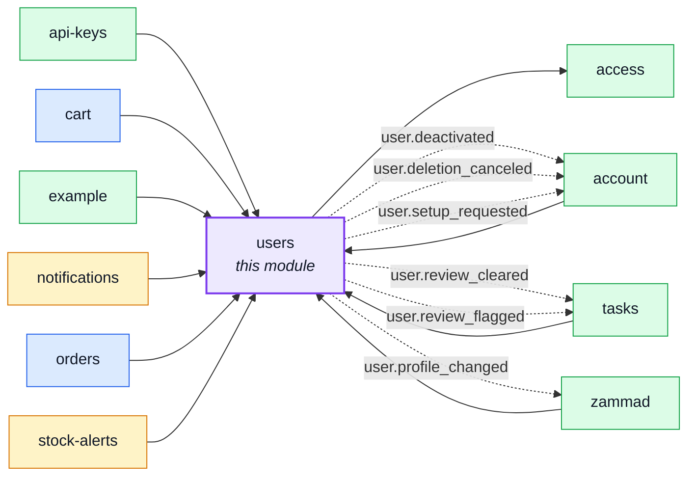
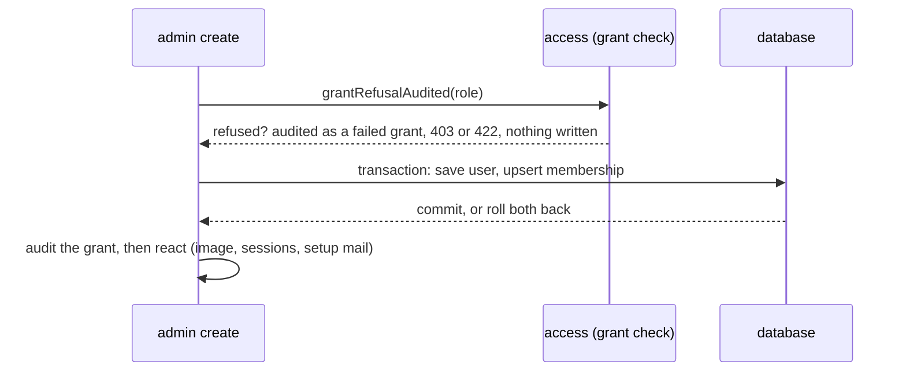
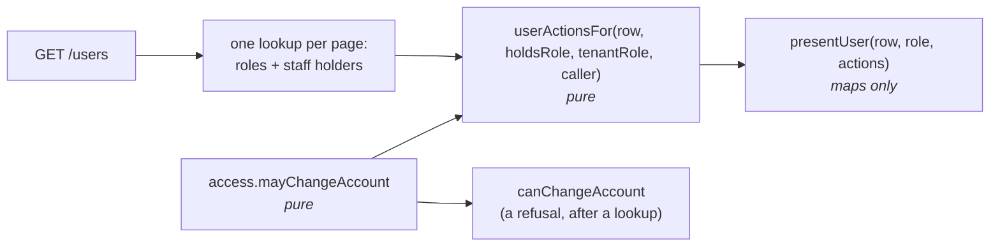

# users

Admin-side user management; the self-service half is account.

::: tip At a glance
**Owns** — the user record: email, password hash, the second-factor and linked-provider material, and the session epoch. Credentials stay on the record on purpose: bounded, read at login, dying with the user ([why](./account-two-factor.md#what-the-user-document-carries)). Sessions and one-time tokens are [`account`](./account.md)'s own collections.
**Depends on** — [`access`](./access.md), for the role half of a write: the role lives in a membership, never on the record. Authentication is next door in [`account`](./account.md).
**Breaks if you change** — the credential fields (password, second factors, linked providers, the epoch). `account` reads and writes them, and it is the repo's only shared-kernel edge.
:::

## Its neighbourhood

<!-- module-graph:users:start -->

_Solid arrows are imports. Dotted arrows are domain events — the return path an import
graph cannot see._

<!-- module-graph:users:end -->

## Who can do what

Every rule this module declares and who holds it, role by role. The rule is what a route guard asks for; the set is what a role lists.

<!-- permissions:start -->

| Rule          | Set            | `guest` | `unverified` | `customer` | `manager` | `warehouse` | `support` | `editor` | `moderator` | `admin` | `operator` | Credential | What it lets them do                                                                                                                                    |
| ------------- | -------------- | ------- | ------------ | ---------- | --------- | ----------- | --------- | -------- | ----------- | ------- | ---------- | ---------- | ------------------------------------------------------------------------------------------------------------------------------------------------------- |
| `read:User`   | `UserDisplay`  | —       | —            | —          | —         | —           | ✅        | —        | ✅          | ✅      | —          | ✅         | Read other people's accounts. Reading your own is `account`, not a key.                                                                                 |
| `create:User` | `UserCreation` | —       | —            | —          | —         | —           | —         | —        | ✅          | ✅      | —          | ✅         | Create an account for someone else.                                                                                                                     |
| `update:User` | `UserEditing`  | —       | —            | —          | —         | —           | ✅        | —        | ✅          | ✅      | —          | ✅         | Change someone else's profile: username, image, locale, phone, website. Never a credential, never `active`, and never the role (that is `assign:Role`). |
| `ban:User`    | `UserBanning`  | —       | —            | —          | —         | —           | —         | —        | ✅          | ✅      | —          | ✅         | Deactivate someone else's account, or lift the deactivation; pause someone's checkout, or lift the pause.                                               |
| `delete:User` | `UserErasure`  | —       | —            | —          | —         | —           | —         | —        | ✅ ⚡c      | ✅ ⚡c  | —          | —          | Erase someone else's account.                                                                                                                           |

✅ held · `own` only the caller’s own rows · ⚡c / ⚡s needs a freshly proved session (critical / sensitive) ·
Credential: ✅ when an API key can be minted with the rule. Generated from the rules and sets in
`src/modules/*/authorization.yaml` and the roles in `shared/rules/authorization-roles.yaml`, asked of the
evaluator — [Authorization](../understand/authorization.md) explains the model.

<!-- permissions:end -->

## The story

A user record with an email and a password hash is the same problem in every application that
has ever had one. Nothing about it differentiates this shop — which is exactly
what `generic` means, and why no aggregate belongs here however central the record feels.

The record carries no role: a staff role is a membership in [`access`](./access.md), and a
customer is whoever has no membership. See [Authorization](../understand/authorization.md) for where
the decision actually gets made.

**Authentication is not here.** Signup, login, password reset, sessions and the one-time-token lifecycle all live in
[`account`](./account.md), which is a _second service over this same collection_. That split is why
this module's barrel is the widest in the repo: `account` needs more of it to authenticate the same
document. What a barrel publishes, and the deny-list that holds even here, is
[Published language](../understand/strategic-ddd.md#_5-published-language-—-the-barrel). Every read or
write goes through a service, never the collection directly: `userService` for a sibling,
`accountUserService` (`friends/account.ts`) for `account`.

::: tip Why two modules and not one
`/users` and `/account` are different mounts. Merging them
would collapse two URL surfaces into one module for no gain — and the cost of keeping them apart is
visible on the map as an `account → users` arrow, which this page labels `shared-kernel`, rather than hidden inside a barrel.
:::

Several modules depend on this one and it depends only on `access`, so it sits near the bottom of the graph —
see the generated diagram above for exactly which ones, and which declare a `personalData.erase` hook; that
list is checked on every regenerate, so it is never repeated by hand here.

## The pipeline

One collection, two services over it: `/users` (admin) and `/account` (signup, login, reset) both
write through a service, never the collection directly (`userService`, and `accountUserService` for `account`).

`PUT /users/{id}` replaces the record (a field left out reverts to its default); `PATCH /users/{id}`
merges (a field left out keeps its current value). Neither carries the role: that has its own door
([The role door](#the-role-door)). The same replace/merge split
[`request-flow.md`](../understand/request-flow.md) documents for the rest of the API, through the same
shared factory.

**What an edit needs, beyond the route's key.** Two rules sit in `services/update.ts` and
`services/remove.ts`, asked before anything is written:

| Rule                           | Refusal                                            | Why                                                    |
| ------------------------------ | -------------------------------------------------- | ------------------------------------------------------ |
| the account holds a staff role | `403 ROLE_MANAGEMENT_REQUIRED`                     | [R1](../understand/authorization.md#protecting-people) |
| handing a role out (create)    | `403 ROLE_MANAGEMENT_REQUIRED`, or `422` on `role` | only a holder of `assign:Role` hands out a staff role  |

The same protection covers soft delete, hard delete, restore, the purchase hold and the activate / deactivate switch. A
refused attempt on a staff account is audited as `security.forbidden` with
`metadata.reason: role_protected`.

`active` is not a field of a user's `PUT` / `PATCH`: here the flip ends sessions and needs its own
permission, so it is an action endpoint ([Activating and deactivating](#activating-and-deactivating)).
A product's `active` has no such effect and stays a field
(the [action-or-field test](../understand/write-methods.md#action-or-field)).

**The fresh-login step-up** asks only a caller holding `assign:Role`, and only when the write changes
who holds powers: a create that names a role or starts deactivated, a call to `activate` /
`deactivate`, or any call to the role door (which carries its own, on the key). A caller without
`assign:Role` is never asked, and is refused with the audited `403 ROLE_MANAGEMENT_REQUIRED` instead.
An API key can never step up, so a key reaching a step-up guard is refused `403 FORBIDDEN` (audited as
`credential_cannot_step_up`), not told to log in again.

### Creating with a role

An account and its role live in two collections (`users`, and `access`' memberships), and an admin
create touches both. It is **one transaction**, with the grant checked first:

- **Before any write**, the grant is validated (a role that exists, a granter who holds
  `assign:Role`) and a refusal is audited as `access.role.assigned` / `failure`, even though no account
  exists yet to point at.
- **One commit.** A failure of the role write rolls the account write back: no row left holding an
  email with no role.
- **Audit after commit.** The success row for the grant is written once the transaction has
  committed, because it is not true before.
- **Self-service and OAuth signup follow the same shape** (see [`account`](./account.md)): the row
  and its starting role commit together or not at all.

### The role door

`POST /users/{id}/assign-role {role}` and `POST /users/{id}/revoke-role` are the only way an existing
account is given a staff role or loses one (`services/role.ts`, public as `userService.assignUserRole`
and `revokeUserRole`). Each is a state change with its own check and audit row, so it is a POST pair
([a toggle is a pair of actions](../understand/write-methods.md#a-toggle-is-a-pair-of-actions)):

| Call                                   | Answers                                                                              |
| -------------------------------------- | ------------------------------------------------------------------------------------ |
| `assign-role`, a role the account has  | `409 USER_ROLE_ALREADY_ASSIGNED`, nothing written or audited                         |
| `assign-role`, a different role        | 200: it replaces the one held; two callers naming different roles, the last one wins |
| `assign-role`, a name nobody can have  | `422` on `role`, audited as a failed `access.role.assigned`                          |
| `revoke-role`, an account with no role | `409 USER_ROLE_NOT_ASSIGNED`                                                         |
| a caller without `assign:Role`         | `403 ROLE_MANAGEMENT_REQUIRED` (the rule's own `deniedCode`)                         |
| an API key                             | `401`, from `isAuth`: the door is session-only, before any permission is asked       |
| a stale session                        | `401 REAUTH_REQUIRED`: `assign:Role` is `stepUp: critical`, asked of a repeat too    |

- **Session only.** The door is its own router (`role-routes.ts`), mounted after the rest of `/users`
  behind `getAuth, isAuth` instead of `isAuthOrCredential`: `assign:Role` is `credential: false`, so a
  key is never let in. `isAuth` refuses a caller with no session `401`, and the contract lists only
  `bearerAuth` on both operations.
- **Judged by the grant, not the protection.** The door is not a row of the account-protection list:
  a holder of `assign:Role` passes that anyway, and nobody else reaches the door.
- **No `If-Match`.** Last write wins between two different roles. The write still moves the row's
  `editRevision` (the role lives in a membership, so the stamp is touched on purpose), so an edit
  holding an older tag is refused.
- **One commit, audit after.** The stamp and the membership write share one transaction; the
  `access.role.assigned` / `access.role.revoked` row is written once it has committed.

**Credentials are the owner's alone.** `POST /users` takes no password: the account is created
without one and always mails a setup link (`USER_SETUP_REQUESTED`, handled in
[`account`](./account.md); it rides the [outbox](../understand/outbox.md) in the account's own
transaction, so a lost mail is retried and a refused grant sends none), so no administrator ever types, sees or resets another person's
password, second factor or sign-in email. The setup page is where its holder accepts the Terms
(see [`account`](./account.md)); creating the row stamps no Terms record. Each row also carries an [`actions` block](#actions) with
the rank and the account's state already applied, which is what a screen renders its buttons from.

`phone` is stored AES-256-GCM under `NODE_PII_ENCRYPTION_KEY`
(`@infrastructure/security/pii-encryption`) — `services/update.ts`'s `update` encrypts it on the one write
path, `presentAccount` and `presentUser` (`presenter.ts`) decrypt it on the way out, whether the source document was hydrated or
`search()`'s `.lean()` result. See
[Secrets at rest](../understand/defences/crypto-and-secrets.md#secrets-at-rest).

Post-commit steps log and continue (`afterCommit`, `@infrastructure/runtime/after-commit`): once a
create or update has committed, a failed image hand-off is logged and the saved user answered, never
a 500 on a write that landed. Ending sessions is not such a step — it rides in the same save as the
session epoch.

## Actions

`User.actions` (required, on every `/users` read and write, list rows included) is one boolean per
endpoint, computed per request by `userActionsFor` (`services/actions.ts`): pure, with the two
lookups it needs (the caller's keys, who holds a staff role) made once per request or once per page.
The presenter only maps the finished block. `/account` serves a different schema, `Account`, which
has no `actions` and no review flag: a person's own record has no one to protect.

| Flag                | Endpoint                               | The caller needs | And the account must be         |
| ------------------- | -------------------------------------- | ---------------- | ------------------------------- |
| `update`            | `PUT` / `PATCH /users/{id}`            | `update:User`    | reachable (below)               |
| `assignRole`        | `POST /users/{id}/assign-role`         | `assign:Role`    | not soft-deleted                |
| `revokeRole`        | `POST /users/{id}/revoke-role`         | `assign:Role`    | holding a tenant role           |
| `delete`            | `DELETE /users/{id}`                   | `delete:User`    | not soft-deleted                |
| `hardDelete`        | `DELETE /users/{id}/hard`              | `delete:User`    | reachable                       |
| `restore`           | `POST /users/{id}/restore`             | `delete:User`    | soft-deleted                    |
| `placePurchaseHold` | `POST /users/{id}/place-purchase-hold` | `ban:User`       | reachable                       |
| `liftPurchaseHold`  | `POST /users/{id}/lift-purchase-hold`  | `ban:User`       | holding a hold or a review flag |
| `activate`          | `POST /users/{id}/activate`            | `ban:User`       | deactivated                     |
| `deactivate`        | `POST /users/{id}/deactivate`          | `ban:User`       | active                          |

"Reachable" is `access`'s one pure rule, `mayChangeAccount`: an account that holds no staff role, or
the caller holds `assign:Role` (the caller's own account is judged like any other). The role door's
two flags are the grant alone, not this rule. The service's `canChangeAccount` asks the
same function after a lookup, so the flag and the refusal cannot disagree. `ban:User` is the key of
every ban-class move: deactivating is a ban today, and [support](../use-the-shop/support.md) keeps none of it.

## Activating and deactivating

`POST /users/{id}/deactivate` and `POST /users/{id}/activate` are the only way `active` changes
after creation (a create body may still set the initial value). Deactivating ends every session in
the same save (the [session epoch](./account-sessions.md#the-session-epoch) moves with it) and
announces `user.deactivated` in that transaction, so `account` purges the pending links when the
sessions died. A repeat is a conflict, not a second success: `409 USER_ALREADY_INACTIVE` /
`USER_ALREADY_ACTIVE` ([the rule](../understand/write-methods.md#repeating-an-action-409)). Audit: `admin.user.banned` / `admin.user.unbanned`.

A hard erasure also writes `user.erased` in its transaction; this module's own subscriber asks the
analytics provider to forget the id ([PostHog erasure](../understand/analytics.md#erasure-in-posthog)).

## The doors a sibling module may use {#the-doors-a-sibling-module-may-use}

A sibling reaches `users` through two objects, and the second is for one module only:

Full detail: [Sibling doors, purchase hold and erasure](./users-siblings-and-erasure.md#the-doors-a-sibling-module-may-use).

## The list row {#the-list-row}

`GET /users` and `POST /users/search` answer a `UserListItem`: identity, role, active, avatar, dates,
the `purchaseHeld` flag, the review flag and `actions`. No phone, website or pending address, and not
the hold's reason or note: those are `GET /users/{id}`, the audited read. See
[a list row is a list item](../reference/responses.md#a-list-row-is-a-list-item).

## Purchase hold {#purchase-hold}

A protective pause on checkout for one account, so a person steps in before a bot or a loop does
damage. It is a field on the user (`purchaseHold`) with its own two doors and one reader:

Full detail: [Sibling doors, purchase hold and erasure](./users-siblings-and-erasure.md#purchase-hold).

## Soft delete vs. erasure {#soft-delete-vs-erasure}

`DELETE /users/:id` soft-deletes by default — `deletedAt` is stamped, the account's sessions are
revoked (the [session epoch](./account-sessions.md#the-session-epoch) moves in the same save, as it
does when the account is deactivated, so a restore or an activation never revives an old token), and a
repeated `DELETE` changes nothing. `POST /users/:id/restore` undoes it; the owner
signs in again. `?hardDelete=true` is the one that runs every module's `personalData.erase` hook (the cascade above) and
actually removes the row.

Full detail: [Sibling doors, purchase hold and erasure](./users-siblings-and-erasure.md#soft-delete-vs-erasure).

## Webhook events

Erasing or rectifying a person tells connected tools (GDPR Art. 19). Ids and field names only, never
a value, so the delivery log never holds a fresh copy of the person's data.

| Webhook        | `data`                  | Fires on                                                                                                                               | Does not fire on                                                                                                                                                                      |
| -------------- | ----------------------- | -------------------------------------------------------------------------------------------------------------------------------------- | ------------------------------------------------------------------------------------------------------------------------------------------------------------------------------------- |
| `user.erased`  | `{ userId }`            | admin hard delete, the purge after the grace, the inactivity erase (same commit)                                                       | the lock, the grace starting, a soft delete, a restore that wins the claim                                                                                                            |
| `user.updated` | `{ userId, changed[] }` | a username, phone, website or picture that really moved (admin or owner edit); an email-change confirmation and its undo (`['email']`) | a resent value, an email-change request not yet confirmed, locale or consent, the address book, a role change at the door. A phone is compared as plaintext, not as stored ciphertext |

`user.updated` is projected from the outbox event `user.profile_changed`, written in the save's own
transaction (`services/update.ts`, `services/credentials.ts`). A recipient that syncs customers
stores our `userId`, drops what it holds on `user.erased`, and refetches on `user.updated`. The
catalogue and the delivery pipeline are [`webhooks`](./webhooks.md). In process, [`zammad`](./zammad.md#profile-sync) hears the same event to keep its copy of a customer current.

## What this module adds to the data export {#what-this-module-adds-to-the-data-export}

Two sections of `POST /account/export`: `profile` (the record, its purchase hold included while one is in force) and `signInMethods`. The second
exists because a linked provider's own subject id is an online identifier (GDPR Art. 4(1)) and
part of what an access request answers (Art. 15), yet it sits behind `select: false` and so is not
in `profile`.

Full detail: [Sibling doors, purchase hold and erasure](./users-siblings-and-erasure.md#what-this-module-adds-to-the-data-export).

## Libraries

None. Passwords are hashed with argon2id from `node:crypto` (`infrastructure/security/password-hash.ts`),
which `account` verifies against as well: no package to choose, keep patched or list on the
[Package Dependencies](../reference/package-dependencies.md) page.

## Read next

- [Sibling doors, purchase hold and erasure](./users-siblings-and-erasure.md) — a deeper page of this module
- [Modules overview](./start.md) — the whole context map
- [`account`](./account.md) — the other service over this collection
- [Strategic DDD](../understand/strategic-ddd.md#_5-published-language-—-the-barrel) — why a wide barrel is a map edge, not a private detail
- [Security](../understand/security.md) — password hashing and the token shapes
- [Events & Logging](../understand/events-and-logging.md) — the domain-event bus
