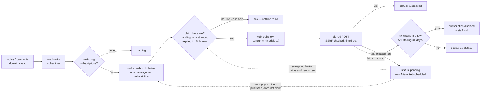
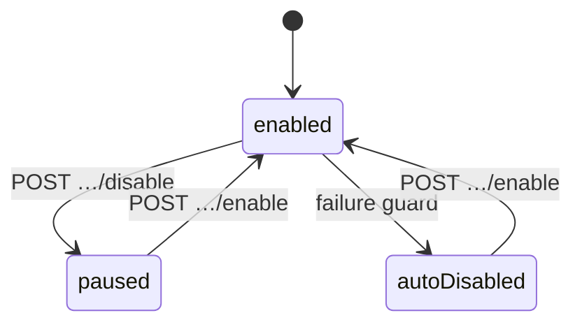

# Webhook delivery, switches and updates

How a delivery is made and retried, how a webhook is switched on, off and auto-off, and what an update records.

## The delivery path {#the-delivery-path}

**An event that came through the [outbox](../understand/outbox.md) is fanned out idempotently.** The
relay is at-least-once, so the subscriber can see one event twice. It keeps the outbox row's id as
the delivery's `eventId`, and a unique `(subscriptionId, eventId)` index makes the second arrival a
no-op. A failed fan-out throws, so the relay retries it; subscriptions that already have their row
are skipped. Every event announced inside a transaction travels this way: `order.created`, `order.canceled`, the payment settle and decline events, and `return.requested`, `return.received` and `return.closed`. `user.erased`, `user.updated` and `order.redacted` ride the transaction of the write they announce the same way.

The queued message itself carries only `{ deliveryId }` — a Claim Check, not a copy of the
delivery. The row is the payload's only source of truth once the consumer claims it, which is what
keeps a replay's own `attempt` count (or any other field that changes after the message was
published) from ever going stale inside the queue.

**Staff who manage webhooks hear about an endpoint; operators hear a fleet-wide signal, never a per-endpoint one.**
Once a subscription auto-disables, `services/attempt.ts#announceAutoDisable` audits it and emits
`webhook.subscription_auto_disabled` (internal: no channel, no webhook). `notifications` turns that
into a work notice in the bell of every member whose role lists `WebhookManagement`, and every
administrator ([how](./notifications.md#work-notices-for-staff)). No mail: a dead endpoint is worth
a look, not an interruption. The notice replaces the old mail to whoever created the subscription;
`ownerUserId` stays as the record of who configured the integration (a pointer, forgotten on erasure).

This is deliberately a DIFFERENT channel from what operators hear. A failed delivery never parks —
it reschedules on its own row, and the sweep republishes — so `QueueJobsParked` never fires for a
webhook queue backing up; `metrics.ts` is what actually feeds the operator side, with two alerts
(`docs/operate/prometheus.md`) tuned to stay quiet when one subscriber's endpoint is down among
healthy ones:

- **`WebhookDeliveriesFailingEverywhere`** — zero successes while attempts keep landing, over 30
  minutes (`webhook_delivery_attempts_total`). A fleet-wide symptom: egress blocked, DNS broken,
  our own signing key rotated wrong — never one customer's endpoint.
- **`WebhookRetriesStalled`** — `webhook_deliveries_overdue > 0` for 15 minutes
  (`webhook_deliveries_overdue`, pending rows more than 10 minutes past their `nextAttemptAt`). The
  retry sweep itself has stopped running.

**Auto-disable is time-based, like Stripe (3 days) and Svix (5), not chain-count-alone.** The retry
ladder alone gives up after ~12.5h (`WEBHOOK_RETRY_DELAYS_MS`), so a platform-side outage of that
length would otherwise exhaust every chain in flight and disable every busy subscriber at once, as
if each of THEIR endpoints were at fault. `domain#shouldAutoDisable` requires BOTH at least
`WEBHOOK_MAX_CONSECUTIVE_FAILURES` (5) exhausted chains in a row AND at least
`WEBHOOK_MIN_FAILING_MS` (3 days) since the streak's first failure
(`WebhookSubscriptionDocument.failingSince`, stamped on the first failure after a success and
cleared on the next one, and on a re-enable, so a disabled subscription turned back on starts a fresh streak) — `webhook_subscriptions_auto_disabled_total` counts how often it fires.

**A delivery whose subscription was switched off, or deleted, while it waited ends `exhausted` at once.**
No attempt is made, so the failure streak above is untouched: a disabled subscription never counts a
second time against itself.

**The 10 s delivery timeout is one budget for the whole attempt, DNS resolution included.** A resolver
that hangs spends the same seconds as a slow endpoint, then the attempt fails like any other.

**Delayed retry rides the cron container, not the broker.** `webhookdeliveries.nextAttemptAt`
carries when a failed row is due again; `npm run job sweep:webhook-retries` (`sweep:webhook-retries`)
— one of two jobs in `docker/crontab` that run every minute instead of nightly, the other being `sweep:outbox` — publishes every due
row (and every stranded one, below) to the queue. See
[Scheduled jobs](../reference/ops.md#scheduled-jobs) for the full mechanism.

**No broker: the sweep sends.** With no RabbitMQ configured (or a broker that refuses the message),
the sweep takes the claim itself and makes the one HTTP attempt a worker would, five rows at a time —
the mailer's "degrade, don't drop" rule, run out of band so a slow subscriber never slows the API.
A first attempt then waits for the next sweep, up to a minute, instead of going out at once.
`webhooks` logs a warning at boot when no broker is configured.

**The sweep publishes; only a claim delivers — a visibility-timeout lease, the way SQS does it.**
The sweep does NOT claim a row before publishing it: publishing is safe to do more than once (the
claim below is what actually decides who sends), and a sweep that claimed first would move the row to
`in_flight` before the worker's own claim ran, so every retry past the first attempt would be
silently acknowledged without ever being sent. So:

- `webhookDeliveryRepository.claimPending` (worker/queue path) and `claimForReplay` (admin replay)
  are the only two places a row becomes `in_flight` — each stamps a `leaseToken` and a
  `leaseExpiresAt` well above the 10s delivery timeout, in the same atomic `findOneAndUpdate`.
- `claimPending` matches `pending`, or an `in_flight` row whose lease has already expired — the
  crash-recovery path for a worker that took the row and never finished. `claimForReplay` matches
  anything NOT under a live lease, including a terminal `succeeded`/`exhausted` row, since replay's
  whole point is re-sending one of those.
- Every outcome write (`services/attempt.ts`) goes through `applyOutcome`, which applies only while
  the writer's `leaseToken` still matches the row's current one — a write from a claim whose lease
  has since expired and been reclaimed by something else is dropped, never retried.
- Delivery stays at-least-once even with the lease: a receiver still de-duplicates on `webhook-id`.

**Signing is Standard Webhooks, hand-rolled.** `transport/webhook-signing.ts` emits the
`webhook-id`/`webhook-timestamp`/`webhook-signature` headers a growing set of the ecosystem already
verifies with no custom code — the format is the interoperable part; the ~30 lines of `node:crypto`
around it are not worth a dependency. A subscription's secret ring is a list, not one value, so
`POST .../subscriptions/:id/secrets` can rotate without downtime: two active secrets sign
two space-separated `v1,...` values in one header during the overlap, until
`DELETE .../secrets/:secretId` drops the old one or `NODE_WEBHOOK_SECRET_OVERLAP_HOURS` (default 24)
has passed — the Standard Webhooks bounded overlap. A ring holds at most two, and an expired entry
stops signing and is pruned on the next add or remove. A secret is a line of the subscription, so it is added with a
`POST` on its `/secrets` collection, not a flag on the update body. The add answers the whole subscription
with its new tag; the removal answers 204, and the ring is one read of the subscription away.

**The body is the Standard Webhooks envelope too.** `{ type, timestamp, data }` — `type` is the
event name (`order.created`, `payment.failed`, …), `timestamp` is when the event occurred (fixed
across every retry of one delivery, unlike `webhook-timestamp`, which is stamped fresh on each
attempt), and `data` is the per-event payload its module's `asyncapi.webhooks.yaml` documents. Built once, in
`services/attempt.ts`, from the delivery row's own `eventType`/`createdAt`/`payload` — the id
stays in `webhook-id` alone, never repeated in the body.

**The SSRF guard resolves, THEN validates, THEN pins.** `infrastructure/adapters/ssrf-guard.ts` —
generic, infrastructure-owned, not this module's — looks up a subscription's hostname itself,
checks the resolved address against private/loopback/link-local/CGNAT ranges — including an
IPv4-mapped IPv6 literal, which a naive string check misses — and hands `transport/webhook-delivery.ts`
a `lookup` override pinned to that one validated address. A second, independent DNS resolution at
connect time would reopen exactly the TOCTOU window this exists to close, which is why the guard is
infrastructure and not `domain/`: it does I/O.

## On, off, and auto-off {#on-off-and-auto-off}

A subscription is stored with two timestamps and no `enabled` flag, so the states cannot disagree.
The wire's `enabled` is derived (`!disabledAt`, in the model's serialisation transform, because the
list reads lean rows and never meets a presenter).

| State         | `disabledAt` | `autoDisabledAt`   | How it got there                                                    |
| ------------- | ------------ | ------------------ | ------------------------------------------------------------------- |
| enabled       | absent       | absent             | created, or `POST …/enable`                                         |
| paused        | set          | absent             | `POST …/disable`                                                    |
| auto-disabled | set          | set (same instant) | the failure guard: 5+ exhausted chains in a row AND 3+ days failing |

- **Enable and disable are their own endpoints**, not a field in `PUT`/`PATCH`: enabling also resets
  the failure streak, a side effect a form save must not carry, and each move has its own audit
  action (`admin.webhook_subscription.enabled` / `.disabled`).
- **A repeat is refused**, not repeated: 409 `WEBHOOK_SUBSCRIPTION_ALREADY_ENABLED` /
  `_ALREADY_DISABLED` ([the rule](../understand/write-methods.md#an-action-whose-target-state-is-already-reached)).
  Enabling an enabled subscription would otherwise zero a streak that is still building.
- **A paused subscription is not relabelled.** The guard only matches a row with no `disabledAt`,
  so it never stamps `autoDisabledAt` over a pause.
- **Nothing is delivered while it is off**, and an event that fires meanwhile is not queued for it.
- **Replay is refused too**: `POST /webhooks/deliveries/{id}/replay` answers 409
  `WEBHOOK_SUBSCRIPTION_DISABLED` (before it claims the row, so the row stays as it was), and each
  delivery's `actions.replay` is false. The list computes the flag with one `$in` read per page.
  A delivery whose event the caller may not read is refused with 403 as well
  ([who may subscribe to what](./webhooks.md#who-may-subscribe-to-what)).
- **`retiringSecrets`** lists each superseded secret that is still signing and the instant it
  stops (its successor's mint time plus `NODE_WEBHOOK_SECRET_OVERLAP_HOURS`), so no client has to
  know the window.

## What an update records {#what-an-update-records}

`PUT`/`PATCH` write an `admin.webhook_subscription.updated` audit row whose `metadata` says what
moved, through the shared `auditChanges` (`infrastructure/observability/audit-changes.ts`). The
event filter is recorded as `{ from, to }`. The `url` (a bearer secret: a receiver's address can
carry a token) and the `description` (free text) are recorded by name in `changedFields`, never by
value: the audit collection is append-only and never scrubbed on erasure, so a value that could be
personal must not enter it.

::: tip What deleting this module actually costs
Every ingredient it is built from — the domain-event bus, the queue, the cron container, the public
AsyncAPI bundle — is still there and still used by whatever remains. `orders` and `payments` lose
nothing: they never knew this module existed, and deleting them along with it needs no separate
step here either — `orders`'/`payments`' `publicEvents` declarations and their
`asyncapi.webhooks.yaml` fragments go with their own folders, and delete this one and the fragments
stay unmerged. Nothing is left to prune by hand.
:::

## Read next

- [webhooks](./webhooks.md) — the module's own page
