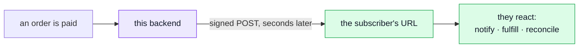
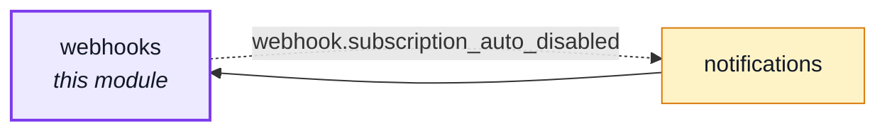
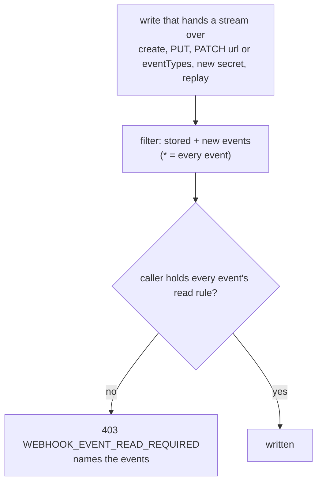
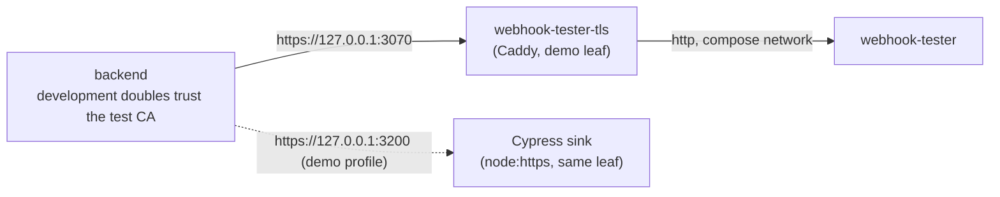

# webhooks

Outbound event delivery to a subscriber's own URL.

::: tip At a glance
**Owns** — subscriptions, the delivery log, signing, retries and auto-disable for outbound webhook delivery.
**Depends on** — nothing. The modules that publish events (`delivery`, `orders`, `payments`, `returns`, `example`) declare them; this module never imports them, and no reach back the other way.
**Breaks if you change** — an event name in any module's `asyncapi.webhooks.yaml`, or the queue payload shape in `asyncapi.internal.yaml`.
:::

## What a webhook is

A webhook is how this backend tells _someone else's_ server that something happened, without them
having to ask. A subscriber registers a URL once; from then on, every matching event becomes a
signed HTTP `POST` to that URL, seconds after it lands.

The direction is the whole point. A normal API waits to be called. A webhook is the reverse edge —
_this_ server does the calling — so the other side learns about an event the moment it happens
instead of polling "anything new?" on a timer.



Real uses, one mechanism:

- **A Slack channel that pings on every paid order** — through a thin translator in front of
  Slack's incoming-webhook URL. A delivery's body is `{ type: 'payment.succeeded', timestamp,
data: {orderId} }`; Slack requires a `text`/`blocks` body, so pointing a subscription straight
  at Slack's URL gets every delivery rejected until the subscription auto-disables.
- **A partner's fulfilment system that ships on order.** They subscribe to `order.created`; each
  delivery names the order (`data.orderId`), and their warehouse looks it up and starts packing
  without waiting on a nightly export.
- **A reconciliation endpoint that reverses failed or cancelled orders in near-real-time.**
  `payment.failed` and `order.canceled` reach a small endpoint of your own — a publicly reachable
  HTTPS one, whatever it does internally, since [the SSRF guard](../understand/defences/ssrf.md)
  refuses a private address — rather than a batch job noticing hours later.

The catch — and the reason [SSRF](../understand/defences/ssrf.md) is a live concern here — is that the
destination URL is chosen by whoever creates the subscription. Delivering to a URL a caller
supplies is exactly the shape an attacker abuses to make the server fetch something internal, so
every delivery goes through `infrastructure/adapters/ssrf-guard.ts` first — see
[The delivery path](#the-delivery-path).

## Its neighbourhood

<!-- module-graph:webhooks:start -->

_Solid arrows are imports. Dotted arrows are domain events — the return path an import
graph cannot see._



<!-- module-graph:webhooks:end -->

## Who can do what

Every rule this module declares and who holds it, role by role. The rule is what a route guard asks for; the set is what a role lists.

<!-- permissions:start -->

| Rule                         | Set                 | `guest` | `unverified` | `customer` | `manager` | `warehouse` | `support` | `editor` | `moderator` | `admin` | `operator` | Credential | What it lets them do                                                                                                                                                                                                                                                          |
| ---------------------------- | ------------------- | ------- | ------------ | ---------- | --------- | ----------- | --------- | -------- | ----------- | ------- | ---------- | ---------- | ----------------------------------------------------------------------------------------------------------------------------------------------------------------------------------------------------------------------------------------------------------------------------- |
| `read:WebhookSubscription`   | `WebhookDisplay`    | —       | —            | —          | ✅        | —           | —         | —        | —           | ✅      | —          | ✅         | Read this shop's webhook subscriptions, delivery log and event catalogue.                                                                                                                                                                                                     |
| `create:WebhookSubscription` | `WebhookManagement` | —       | —            | —          | ✅        | —           | —         | —        | —           | ✅      | —          | ✅         | Add a subscription, minting its first secret.                                                                                                                                                                                                                                 |
| `update:WebhookSubscription` | `WebhookManagement` | —       | —            | —          | ✅        | —           | —         | —        | —           | ✅      | —          | ✅         | Change a subscription, switch it on or off, rotate or drop a secret from its ring, and replay a delivery. The blast radius of all of them is the same — a party this shop did not intend gets signed deliveries, or the right one stops getting them — so they share one key. |
| `delete:WebhookSubscription` | `WebhookManagement` | —       | —            | —          | ✅        | —           | —         | —        | —           | ✅      | —          | ✅         | Remove a subscription. Separate from update because the blast radius is.                                                                                                                                                                                                      |

✅ held · `own` only the caller’s own rows · ⚡c / ⚡s needs a freshly proved session (critical / sensitive) ·
Credential: ✅ when an API key can be minted with the rule. Generated from the rules and sets in
`src/modules/*/authorization.yaml` and the roles in `shared/rules/authorization-roles.yaml`, asked of the
evaluator — [Authorization](../understand/authorization.md) explains the model.

<!-- permissions:end -->

## The story

The publishing modules (`delivery`, `orders`, `payments`, `returns`, `example`) can tell this module
that something happened; this module cannot ask them anything back, and it does not even import
their event name constants to listen for it. Each of them declares its own `publicEvents` on its `module.ts` manifest — a domain event name
mapped to a projection of that event's payload — and `webhooks/module.ts`'s `onRegistered` hook
collects every registered module's declarations (`kernel/registry.ts`'s `resolvePublicEvents`) and
subscribes to each one generically on the kernel's domain-event bus, the same shape
[`delivery`](./delivery.md) uses for `order.status_changed`. This module imports no sibling, and
nothing calls back into any publishing module's business logic.

**The public event catalogue is a contract, not an accident.** Each module that fires a webhook
declares its own events in `src/modules/<module>/asyncapi.webhooks.yaml` (`delivery`, `orders`,
`payments`, `returns`, `users`, and `example`, the one to copy). This module's `asyncapi.yaml` keeps only what every
event shares: the `subscriberEndpoint` server, the `WebhookHeaders` schema and the `Id` scalar
every fragment's resource ids `$ref` (a copy of the OpenAPI `Id`, since no AsyncAPI document can
`$ref` an OpenAPI file). A closed code in a payload (a return reason, a refund failure reason, a
dispute reason) `$ref`s the owning module's own `openapi.yaml` schema, and the bundler copies that
schema into the bundle ahead of the payloads that use it, so the REST and event contracts share one
list. The bundler merges the fragments into the `webhooks` section while this module exists (see
[Contract Fragmentation](../build/contract-fragmentation.md#module-owned-webhook-events)).

Three things read the same files, so they cannot drift apart:

- `asyncapi.public.yaml`, the contract a subscriber reads.
- `GET /webhooks/events`, which lists the events of the modules that are **registered**
  (`services/catalog.ts`, built in `onRegistered`).
- The subscribe check: `POST`, `PUT` and `PATCH` on a subscription answer 422 on an `eventTypes`
  name the catalogue does not list. `*` stays valid. A typo would otherwise be accepted and never
  fire; Stripe (`enabled_events`) and Shopify (topics) refuse the same way.
- The read check: 403 `WEBHOOK_EVENT_READ_REQUIRED`, [below](#who-may-subscribe-to-what).

## Who may subscribe to what {#who-may-subscribe-to-what}

`WebhookManagement` is a role's key to the integration, not a licence to read everything the
shop fires. A subscription is a standing hand-off of an event stream to a machine, like an API key,
and a key already needs "only rules you hold" (`api-keys/services/api-keys.ts#isMintable`). So each
event declares the rule that reads what it carries, in its own channel:

- `x-read-rule` in `src/modules/<module>/asyncapi.webhooks.yaml`: `public`, or a declared
  tenant-scoped rule with no `conditions` (an every-row staff rule: `display:Order`,
  `display:Payment`, `read:Return`, `read:User`). Own-rows rules such as `read:Order` are refused at
  boot: every customer holds them, so they would gate nothing.
- `services/catalog.ts` reads it with the channel names and throws at boot on a missing, undeclared,
  platform or conditioned value. `asyncapi.public.yaml` carries it whole, so the contract documents
  the permission per event.
- The check is literal, `heldRules(caller).has(rule)`, so it holds for a key as for a session.



| Door                                             | Checked against                                                                                                                  |
| ------------------------------------------------ | -------------------------------------------------------------------------------------------------------------------------------- |
| `POST /webhooks/subscriptions`                   | the requested filter                                                                                                             |
| `PUT`, or `PATCH` carrying `url` or `eventTypes` | the stored filter **and** the new one: narrowing then redirecting an admin's `*` stream is one call, and would otherwise pass    |
| `PATCH` of the description alone                 | nothing                                                                                                                          |
| `POST .../secrets`                               | the stored filter: the new secret signs for that stream, so it could forge `user.erased`                                         |
| `POST /webhooks/deliveries/{id}/replay`          | the delivery's event: a stored payload is re-sent to the current url                                                             |
| the delivery itself                              | `attemptDelivery` abandons a row whose event the filter no longer names (`exhausted`), so a retry never reaches a redirected url |

Where each flag shows: `GET /webhooks/events` gives every entry `actions.subscribe` (the form
disables the ones the caller cannot read), `actions.createSecret` is false while the stored filter
holds an unreadable event, and `actions.replay` is false for a delivery of one. The edit form locks
the url and events fields on such a subscription.

- **No re-check at delivery against the creator.** The subscription belongs to the shop, not to its
  creator: a demoted creator's subscriptions keep running. GitHub only hides events you cannot read
  at subscribe time; its revocation behaviour is undocumented.
- **A channel added later joins an existing `*` unchecked.** Only a holder of every read rule can write `*`
  (today: admin, or a key an admin mints), so the stream was the writer's to hand over.

A module reaching for the internal domain-event bus and calling it "public" would publish
internal coupling as an external promise; declaring the event in a fragment is what keeps that from
happening. The mapping (which domain event becomes which public name) lives on the owner's
`publicEvents`; the fragment says what a subscriber receives.

To add a webhook: write the fragment, add the `publicEvents` entry, run `npm run regenerate`.
`tests/cross-cutting/webhook-event-producers.test.ts` fails if a declared event has no producer.

## The delivery path {#the-delivery-path}

Full detail: [Webhook delivery, switches and updates](./webhooks-delivery.md#the-delivery-path).

## On, off, and auto-off {#on-off-and-auto-off}

A subscription is stored with two timestamps and no `enabled` flag, so the states cannot disagree.
The wire's `enabled` is derived (`!disabledAt`, in the model's serialisation transform, because the
list reads lean rows and never meets a presenter).

Full detail: [Webhook delivery, switches and updates](./webhooks-delivery.md#on-off-and-auto-off).

## What an update records {#what-an-update-records}

`PUT`/`PATCH` write an `admin.webhook_subscription.updated` audit row whose `metadata` says what
moved, through the shared `auditChanges` (`infrastructure/observability/audit-changes.ts`). The
event filter is recorded as `{ from, to }`. The `url` (a bearer secret: a receiver's address can
carry a token) and the `description` (free text) are recorded by name in `changedFields`, never by
value: the audit collection is append-only and never scrubbed on erasure, so a value that could be
personal must not enter it.

Full detail: [Webhook delivery, switches and updates](./webhooks-delivery.md#what-an-update-records).

## Managing it

Subscriptions, the secret ring and the delivery log all have an admin screen in the paired
`boilerplate-vue-frontend` — `webhooks` there, its own five routes over this module's thirteen
endpoints. "Usable via any HTTP client" is true too (nothing here requires the UI). See that repo's `docs/modules/webhooks.md` for the client side, including why
`createSecret`'s response never gets cached client-side.

Delivery payloads carry ids, amounts (decimal strings at the currency's own places, `"19.90"` EUR, `"1000"` JPY, like every API amount) and the return `reason` code, never a return's free text
(`note`, `declineMessage`). Delivery rows are kept `NODE_WEBHOOK_DELIVERY_RETENTION_DAYS` (30) days.

## Not wanted? Remove the module

There is no switch. Webhooks are on when this module is in the build, and a deployment that never
sends them removes it — [Removing a module](../build/module-lifecycle.md#removing-a-module). That
also removes the one place the backend fetches a tenant-supplied URL (the avatar download in `account` fetches a provider-supplied one; see
[Server-side request forgery](../understand/defences/ssrf.md)).

The standard procedure catches most of it: `tsc` stops on every file that imports the module
(`sweep:webhook-retries`, `scenarios/webhooks.ts`, the cross-cutting tests), and the
cross-cutting suite names the permissions, the page and the pairing entries. The module owns its
queue consumer, its required/forbidden env checks, and its delivery substrate (`consumers`,
its `config` slice (`config.ts`, on its own `module.ts`) with the required key and the forbidden demo sink; `transport/` for the signing
and delivery code) — deleting the folder deletes all of that too, with nothing left in `app/` or
`kernel/` to also touch. What still sits outside the module and **nothing flags** — delete these by
hand:

| Piece                         | Where                                                                                                                                                                                                                                         | Left behind, it…                    |
| ----------------------------- | --------------------------------------------------------------------------------------------------------------------------------------------------------------------------------------------------------------------------------------------- | ----------------------------------- |
| the retry-sweep script entry  | `sweep:webhook-retries` in `package.json`                                                                                                                                                                                                     | points at a deleted file            |
| the cron line and its comment | `docker/crontab`                                                                                                                                                                                                                              | fails every minute                  |
| the SSRF guard                | `src/infrastructure/adapters/ssrf-guard.ts` — generic, shared with `adapters/remote-image.ts` (the avatar download)                                                                                                                           | still used by the avatar download   |
| the environment               | the `NODE_WEBHOOK_*` lines in `.env-example`                                                                                                                                                                                                  | documents settings nothing reads    |
| the local test sink           | the `webhook-tester` service in `compose.override.yaml`, `WEBHOOK_TESTER_PORT`                                                                                                                                                                | runs for nothing                    |
| the sink's TLS                | `webhook-tester-tls` in `compose.override.yaml`, `docker/webhook-tester-tls.Caddyfile`, `scenarios/support/tls/`, `scenarios/tools/generate-webhook-sink-tls.ts` (`scenario:tls`), `scenarios/support/doubles/webhook-sink.ts` (the CA trust) | trusts a certificate nothing serves |

## Seeing it work

`npm run demo` seeds no subscription by default — nothing to deliver to. Start
`docker compose --profile integrations up webhook-tester webhook-tester-tls`, set
`NODE_WEBHOOK_DEMO_SINK_URL` to the proxy's base url (`.env-example` has the exact line), then
reseed. `scenarios/webhooks.ts` points a subscription at it and captures deliveries at
`https://127.0.0.1:${WEBHOOK_TESTER_PORT:-3070}` (your browser will not trust the certificate; the
captured requests are also at `GET /api/session/<id>/requests`).

Two things make this reachable at all, both narrowed on purpose:

- The sink is on loopback, which `ssrf-guard.ts` exists to refuse. It gets a one-origin exemption
  (host AND port; `scenarios/support/doubles/webhook-sink.ts`, registered by the development doubles) from
  the private-address check only. Production code has no exemption at all: nothing in `src/`
  registers one. The `https:` rule has no exemption, so the demo's URL is `https://` like every
  other and the edit form saves it.
- The seeded subscription's ring secret is a FIXED plaintext
  (`scenarios/webhooks.ts`'s `WEBHOOK_DEMO_SECRET`), not one a real `POST /webhooks/subscriptions`
  would mint — a minted secret is returned once and never stored in the clear, so nothing here
  could ever hand it to `webhook-tester` to verify against. Paste it into the tester's UI to check
  a captured delivery's `webhook-signature` header by hand.

## HTTPS in the demo

Every webhook URL is `https://` (the contract's `^https://`), the demo's included. A sink on
loopback therefore needs a certificate the backend trusts, and the demo supplies one without
touching production code:



| Piece                      | Where                                                                                  | Notes                                                                                                                                                                                                                                             |
| -------------------------- | -------------------------------------------------------------------------------------- | ------------------------------------------------------------------------------------------------------------------------------------------------------------------------------------------------------------------------------------------------- |
| test CA, leaf and leaf key | `scenarios/support/tls/webhook-sink-{ca,cert,key}.pem`                                 | committed; the leaf covers `127.0.0.1`, `localhost` and `webhook-tester-tls`; valid ten years                                                                                                                                                     |
| trust                      | `scenarios/support/doubles/webhook-sink.ts`                                            | the development doubles add the test CA to the process's roots when `NODE_WEBHOOK_DEMO_SINK_URL` is set (`tls.setDefaultCACertificates`), next to the SSRF exemption it pairs with. No launcher sets anything; production never loads the doubles |
| TLS proxy                  | `webhook-tester-tls` in `compose.override.yaml`, `docker/webhook-tester-tls.Caddyfile` | `--profile integrations`, loopback only; the tester itself publishes no port                                                                                                                                                                      |
| frontend copies            | `<frontend>/scripts/e2e/tls/`                                                          | `sync:frontend` copies the same three files; its Cypress sink serves the leaf                                                                                                                                                                     |

The private key is public on purpose: it is a fixture, valid only for loopback and one compose
name. The CA's own key is thrown away when the fixtures are made, and the CA is
**name-constrained** to those names, so trusting it on a developer machine lets nobody vouch for a
real host. GitHub secret scanning flags a committed private key once; the alert is closed as
`used_in_tests` (a user-only action in the repository's security settings).

**Remake** (before the ten years run out; a unit test fails a month ahead):

```sh
npm run scenario:tls      # needs the openssl CLI; rewrites the three files
npm run sync:frontend     # hands the same three to the paired frontend
```

**A twin trusts the same CA** the way its runtime does: PHP's cURL reads `CURLOPT_CAINFO` or
`SSL_CERT_FILE`, pointing at `webhook-sink-ca.pem`.

## Read next

- [Webhook delivery, switches and updates](./webhooks-delivery.md) — a deeper page of this module
- [Events & Logging](../understand/events-and-logging.md) — the event bus webhooks subscribe to
- [RabbitMQ](../understand/rabbitmq.md) — the broker behind delivery
- [The AsyncAPI workflow](../build/asyncapi-workflow.md) — how an event is declared
- [Modules overview](./start.md) — the whole context map
