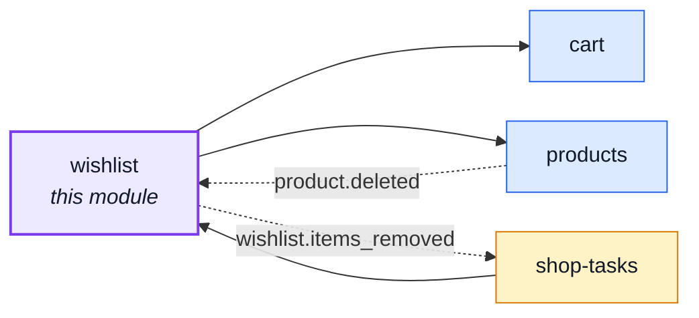
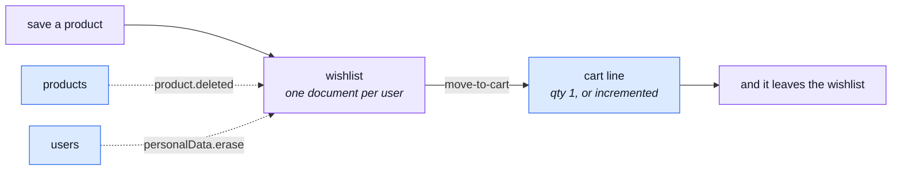

# wishlist

Saved products, one list per user. The smallest shop domain.

::: tip At a glance
**Owns** — one wishlist per user, holding product references and nothing else.
**Depends on** — [`products`](./products.md), [`cart`](./cart.md).
**Breaks if you change** — `WISHLIST_ITEMS_REMOVED`. [`shop-tasks`](./shop-tasks.md) imports that event name; nothing else depends on it.
:::

## Its neighbourhood

<!-- module-graph:wishlist:start -->

_Solid arrows are imports. Dotted arrows are domain events — the return path an import
graph cannot see._

<!-- module-graph:wishlist:end -->

## The story

The smallest domain in the repo, and a useful one to read first: it has the same shape as
[`cart`](./cart.md) — one document per user, product references, a unique index on `userId` — with
none of checkout's complexity.

It imports two modules, the same one-way arrows the cart declares, for the same reasons. A saved line
is meaningless without the product it points at (`products`), and the move-to-cart exit writes a cart
line, which is a `customer-supplier` demand on the cart's store (`cart`). The list belongs to an
account, but that is a field, not an import: `users`' erase hook reaches it through the manifest.

::: tip Almost nothing depends on it
Only `notifications` imports it, for the `wishlist.items_removed` event name. Deleting it means
dropping that listener too — follow [Removing a module](../build/module-lifecycle.md#removing-a-module);
`tsc` points at the import.
:::

Products and users reach back the same way they reach the cart: a deleted product must leave every
wishlist, and a destroyed account must take its wishlist with it. Both arrive as domain events, so
the import graph stays acyclic even though the domains are mutually aware.

A deleted product leaves a message behind: after the lines are pulled the module emits
`wishlist.items_removed` with the owners and the product's names, and
[`notifications`](./notifications.md) writes one row per owner. The wishlist itself never imports
the inbox.

## The cap

**A wishlist holds at most `NODE_WISHLIST_MAX` products** (default 250, also the most it can be set
to). `GET /wishlist` is never paginated, so the list is bounded where a product is saved; 250 is
commercetools' own shopping-list limit and stays under Zalando's "a few hundred" (#159). A NEW product
in a full list answers `409 WISHLIST_LIMIT_REACHED`; saving one already there stays a 200. The cap
lives in the write's own update pipeline (append only when the product is absent AND the list has
room), so a burst of saves cannot pass it, and the filter stays an equality on `userId` for the
reason in [the pipeline](#the-pipeline). Moving a product into a full cart answers the cart's
`409 CART_LINE_LIMIT_REACHED` and the product stays saved.

## Line availability

Each line comes back as `{ productId }` and nothing else. The frontend reads what each product can
do from its one availability store, through the batch read (`GET /products/availability?id=…`, 100
ids a call, so 250 lines are three calls): the same answer a cart line carries, so the two never
disagree (see [line availability](./cart.md#line-availability)). Serving it on the line too would
state one answer twice. A product the batch leaves out is removed (hidden or deleted).

| The product reads                   | The line shows                  | Move to cart                                                              |
| ----------------------------------- | ------------------------------- | ------------------------------------------------------------------------- |
| `in_stock`, `preorder`, `backorder` | normal / "Preorder, ships from" | ok                                                                        |
| `out_of_stock` (sold out)           | "Sold out"                      | nothing added: the line stays saved, a `MERCHANDISE_OUT_OF_STOCK` warning |
| `out_of_stock` (off sale)           | "Not available right now"       | the same                                                                  |
| left out of the batch               | "No longer available"           | refused: a hidden product is a 404                                        |

A move that stock held back (nothing added) answers 200 with the wishlist and `warnings[]`; the
product is removed from the list only when the cart actually took it.

A hidden product's line is kept and returns to a stock value when the product is shown again;
only a delete pulls it. Saving a hidden product stays a 404, so a new add never reveals one.

The personal-data export carries the stored lines only (`{ productId }`): availability is the
shop's live opinion of a product, not something the account holder saved.

## The pipeline

The whole module. Two imports out, two events in, one event out.

## Read next

- [`cart`](./cart.md) — the same shape, with the hard part attached
- [Adding & Removing a Module](../build/module-lifecycle.md) — the deletability procedure
- [Events & Logging](../understand/events-and-logging.md) — the two events this module listens for
- [Product Analytics](../understand/analytics.md) — the save/move funnel
