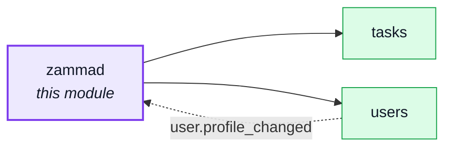
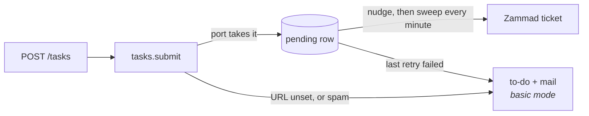

# zammad

An optional help desk: hands contact-form messages to a self-hosted Zammad, and keeps its copy of a customer inside the shop's erasure, export and profile rules.

::: tip At a glance
**Owns** — the messages waiting to be handed over, the `{account, Zammad customer}` mapping, and the profile-sync rows. Not the ticket: replies, status and history live in Zammad.
**Depends on** — [`tasks`](./tasks.md) (the port it installs, the to-do it falls back to), [`users`](./users.md) (the verified address, the profile it keeps current).
**Breaks if you change** — nothing imports it. It installs `registerContactDelivery` in `tasks` and listens to `user.profile_changed`.
:::

## Its neighbourhood

<!-- module-graph:zammad:start -->

_Solid arrows are imports. Dotted arrows are domain events — the return path an import
graph cannot see._

<!-- module-graph:zammad:end -->

## The story

Three things stay true whatever Zammad does:

- **Basic mode is untouched.** The support mailbox and the contact to-do are always in the code.
- **The module is inert while `NODE_ZAMMAD_URL` is unset.** The port answers "not me" and `tasks` files the to-do.
- **Removing the module returns the app to basic mode.** See [Removing the module](#removing-the-module).

## Configuration

| Variable                     | Meaning                                                                                                                                                             |
| ---------------------------- | ------------------------------------------------------------------------------------------------------------------------------------------------------------------- |
| `NODE_ZAMMAD_URL`            | Zammad's internal rails address on the `helpdesk` network (`http://zammad-railsserver:3000`), never nginx and never the public host. No default: unset means inert. |
| `NODE_ZAMMAD_API_TOKEN`      | The integration user's token. `NODE_ZAMMAD_API_TOKEN_FILE` stands in for it; in production it is the `zammad_api_token` secret file, and an empty file is unset.    |
| `NODE_ZAMMAD_GROUP`          | The Zammad group a contact message is filed in.                                                                                                                     |
| `NODE_ZAMMAD_RETENTION_DAYS` | Days a ticket is kept after the customer's last contact (default 730).                                                                                              |
| `ZAMMAD_PORT`                | The loopback port Zammad's nginx publishes on (compose only; the app never reads it).                                                                               |

The URL, token and group are set together: a URL without the other two refuses boot.

## The hand-over

The request never waits on Zammad (G13). `POST /tasks` stores a **pending row** and answers `202`.

| Step              | What happens                                                                                                                                                 |
| ----------------- | ------------------------------------------------------------------------------------------------------------------------------------------------------------ |
| Take              | `tasks.submit` screens the message. Spam stays local. Otherwise the port stores a pending row and starts an in-process nudge.                                |
| Send              | A claimed row (leased, like the outbox) becomes one `POST /api/v1/tickets`: group, customer, one `web` article from the customer with an HTML-escaped body.  |
| Our fields        | `shop_category`, `order_number`, `shop_sender_verified`, `request_ref` (the row's id) and `shop_account` (a link to the account in our admin).               |
| Retry             | A failure pushes the row out by the outbox's backoff, without jitter. The sweep `sweep:zammad-contacts` runs every minute as the safety net.                 |
| Unclear outcome   | A timeout, a 5xx or a 429 may have created the ticket. The next attempt searches `request_ref` first and adopts the ticket it finds; otherwise it resends.   |
| Last retry failed | The message becomes a to-do and the link-only mail goes to the support mailbox. The row is blanked to a tombstone that the fallback alert counts for a week. |

**Dedup.** Zammad has no idempotency key. `request_ref` is ours: a `condition` search with no `query`, which Zammad runs as plain SQL, with or without Elasticsearch.

**A missing `request_ref`.** Zammad drops a field it does not know. An answer without it is logged as an error: `zammad:setup` never ran.

**The link-only mail (L7).** While the module is on, the mail to the support mailbox carries `[#ref]` and the admin link and nothing else: no customer data, no `Reply-To`. A help desk reading that mailbox would otherwise file the visitor's words as a second conversation. The overdue and due-soon reminders are link-only too, and the erasure notice to the mailbox is not sent.

### The customer

Zammad's key for a customer is the email address. We add one thing, a local `{userId, zammadUserId}` mapping, written only under the **signed-in-sender rule**: the sender was signed in and the address they typed is their account's verified address. A guest, an unverified account or a different address gets a customer keyed by the address alone, with no mapping. A mapped account is sent as `customer: {id}`; anyone else as `customer_id: "guess:<email>"`.

## Profile sync

`user.profile_changed` carries field names, never values. The subscriber writes one row per account, and only when the **email** moved and the account has a mapping. `sweep:zammad-profiles` reads the **current** address and overwrites the customer's, so a burst of changes is one call. Only the address is sent: Zammad accepts a customer with an email alone, and a name is data it does not need.

Zammad refusing for good is logged and dropped: a `422` means the new address already belongs to another customer (Zammad has no merge, so staff move the tickets by hand, see [the staff guide](../use-the-shop/support.md)), a `404` means the customer is gone.

## Personal data

| Data                             | Export                            | Erase                                       |
| -------------------------------- | --------------------------------- | ------------------------------------------- |
| Pending messages                 | `zammad.pendingContacts`          | deleted by account id, or by verified email |
| The `{userId, zammadUserId}` row | `zammad.customerId`               | deleted                                     |
| The profile-sync row             | not exported (a pointer, no data) | deleted                                     |

The erase hook runs inside the erasure transaction. **The erase race:** a worker that created a ticket deletes its row by id afterwards. A row already gone means the account was erased while the call was in flight, so nothing is mapped and the error log names the Zammad customer id that was returned.

## Setup

The technician does this once, in Zammad, before setting `NODE_ZAMMAD_URL`.

1. **Two-factor on the Agent and Admin roles** (an authenticator app or a security key). Staff log in with a password; there is no SSO.
2. **Settings:** `api_password_access = false` (basic auth skips 2FA on the calendar feeds), `geo_ip_backend` off (it sends every client address to a third party), `ticket_last_contact_behaviour = based_on_customer_reaction`.
3. **Roles:** remove `user_preferences.access_token` from the Agent and Admin roles (a token skips 2FA). Turn off "New User Accounts" and `user_lost_password`. An admin resets a staff password.
4. **Turn off the default "auto reply (on new tickets)" trigger.** It fires on API tickets too, mails whatever address a visitor typed, and points customers at Zammad's portal. Basic mode sends the visitor nothing, and so does this.
5. **The integration user:** `integration@helpdesk.invalid`, in no notification group, with a random password nobody uses. Its role holds `ticket.agent` and `admin.data_privacy`, plus `create` and `read` on the intake group, and **not** `admin.user`.
6. **The token.** A user can only mint tokens for themselves and the access-token permission is removed, so use the Rails console: `Token.create!(action: 'api', user_id: <id>, persistent: true, expires_at: 12.months.from_now, preferences: {permission: ['ticket.agent', 'admin.data_privacy']})`. Put it in `NODE_ZAMMAD_API_TOKEN` (or the `_FILE`). **Rotation:** create a new token, deploy, delete the old one. Tokens coexist, so there is no gap.
7. **The fields:** `ZAMMAD_ADMIN_TOKEN=<an admin token> npm run zammad:setup`. It is idempotent and creates or updates `shop_category` (one option per `TaskCategory`), `order_number`, `request_ref`, `shop_sender_verified` and `shop_account`. Creating a field makes Zammad restart itself once; compose brings it back. Changing the options later needs neither migration nor restart.
8. **The email channel:** an IMAP + SMTP channel on the support mailbox, so staff replies leave from it and customer replies come back to it. Pointing `NODE_SUPPORT_EMAIL` at that mailbox is the usual choice; taking the module out means pointing it back.
9. **The privacy deadline:** `privacy` messages owe an answer within one month (GDPR Art. 12(3)). Add an SLA on `shop_category`; if an SLA condition cannot read a custom field, route `privacy` through a trigger that adds a tag and put the SLA on the tag.

**Reply-To.** Every transactional mail carries `Reply-To: NODE_SUPPORT_EMAIL`, so a customer's reply to an order mail becomes a ticket. That is intended: it is support traffic.

**Turning search on.** The module ships with `ELASTICSEARCH_ENABLED=false`: staff search is substring-only and Zammad's reports refuse to run. To turn it on, add an Elasticsearch service and set the variable; Zammad's init container rebuilds a missing index on its next start, so the switch is reversible. Nothing here needs it: the lookups use `condition` searches, which run as SQL.

## Watching it

| Signal                   | Where                                                                                                                           |
| ------------------------ | ------------------------------------------------------------------------------------------------------------------------------- |
| `ZammadHandoverStuck`    | The oldest waiting message is older than 15 minutes: the sweep is not running, or Zammad refuses.                               |
| `ZammadHandoverFellBack` | A message gave up and fell back to a to-do. Look at Zammad; the to-do is resolved in our admin.                                 |
| Zammad's health check    | [Gatus](../operate/gatus.md) reads `/api/v1/monitoring/health_check`, which also reports a failing email channel (IMAP errors). |

Both gauges are read from the database when Prometheus scrapes the app, not counted in the cron container, which nobody scrapes. The module is never part of `/readyz`: a help-desk outage must not take the shop down.

## Staff entry

The frontend shows a "Helpdesk" link to staff only when its own runtime setting `ZAMMAD_URL` (falling back to `VITE_ZAMMAD_URL`) is set. There is no `GET /config` change: the backend does not tell the frontend where Zammad is.

## Removing the module

Delete `src/modules/zammad/` and its line in `src/modules.ts`, then what the module owned outside its folder:

- `scripts/ops/zammad-setup.ts` and the `zammad:setup` and `test:zammad` scripts, with `jest.config.zammad.js`;
- the two `Zammad*` alerts in `docker/observability/prometheus.alert-rules.yaml` and their cases in the test file;
- `tests/support/zammad-stub.ts`, and the `NODE_ZAMMAD_*` block of `.env-example`.

The port goes with the module, so `tasks` files the to-do again and sends the full mail; point the mailbox back by hand.

**The module's data is personal data, so it does not stay behind.** Before deleting the code, let the pending messages drain: while `NODE_ZAMMAD_URL` is set the sweep hands each to Zammad or, after the last retry, falls it back to a to-do, so wait until `zammadcontacts` holds no `pending` row. (With the URL unset the sweep does nothing.) Then drop the three collections by hand: `zammadcontacts` (waiting messages and fallback markers), `zammadcustomers` (the account to Zammad customer map) and `zammadprofilesyncs`. Removing the code alone leaves them in the database. The deletability check passes: with the module gone, `tsc` and the `tasks` and cross-cutting suites stay green ([how to re-run it](../build/module-removal.md#re-running-the-deletability-check)).

## Libraries

None. The adapter uses `fetch`, `AbortSignal.timeout` and Zod, all already in the project.

## Read next

- [tasks](./tasks.md) — the port, the to-do and the lifecycle this module falls back to
- [Task lifecycle](./tasks-lifecycle.md) — jurisdiction and the hand-over's place in it
- [Support guide](../use-the-shop/support.md) — what staff do by hand
