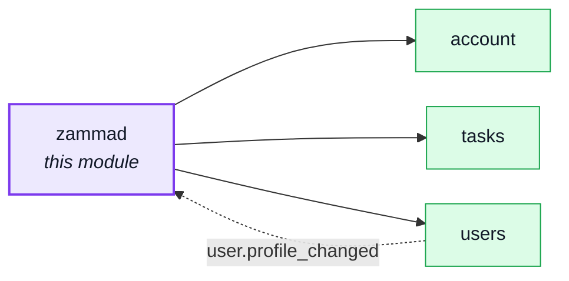
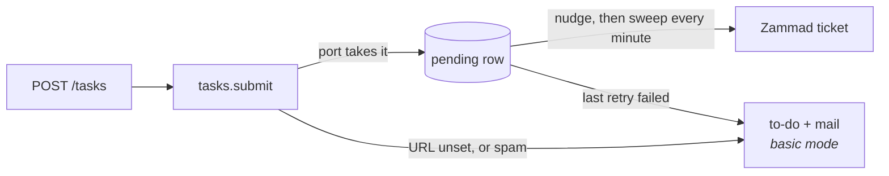
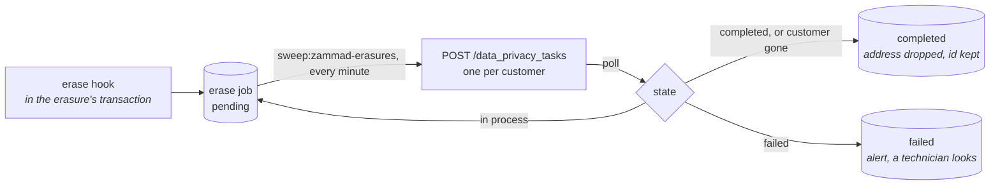

# zammad

An optional help desk: hands contact-form messages to a self-hosted Zammad, and keeps its copy of a customer inside the shop's erasure, export and profile rules.

::: tip At a glance
**Owns** — the messages waiting to be handed over, the `{account, Zammad customer}` mapping, the profile-sync rows and the erase jobs. Not the ticket: replies, status and history live in Zammad.
**Depends on** — [`tasks`](./tasks.md) (the port it installs, the to-do it falls back to), [`users`](./users.md) (the verified address, the profile it keeps current), [`account`](./account.md) (the erasure ledger's window, which the erase jobs outlive).
**Breaks if you change** — nothing imports it. It installs `registerContactDelivery` in `tasks` and listens to `user.profile_changed`.
:::

## Its neighbourhood

<!-- module-graph:zammad:start -->

_Solid arrows are imports. Dotted arrows are domain events — the return path an import
graph cannot see._

<!-- module-graph:zammad:end -->

## The story

Three things stay true whatever Zammad does:

- **Basic mode is untouched.** The support mailbox and the contact to-do are always in the code.
- **The module is inert while `NODE_ZAMMAD_URL` is unset.** The port answers "not me" and `tasks` files the to-do.
- **Removing the module returns the app to basic mode.** See [Removing the module](#removing-the-module).

## Configuration

| Variable                     | Meaning                                                                                                                                                             |
| ---------------------------- | ------------------------------------------------------------------------------------------------------------------------------------------------------------------- |
| `NODE_ZAMMAD_URL`            | Zammad's internal rails address on the `helpdesk` network (`http://zammad-railsserver:3000`), never nginx and never the public host. No default: unset means inert. |
| `NODE_ZAMMAD_API_TOKEN`      | The integration user's token. `NODE_ZAMMAD_API_TOKEN_FILE` stands in for it; in production it is the `zammad_api_token` secret file, and an empty file is unset.    |
| `NODE_ZAMMAD_GROUP`          | The Zammad group a contact message is filed in.                                                                                                                     |
| `NODE_ZAMMAD_RETENTION_DAYS` | Days a ticket is kept after the customer's last contact, else after its creation (default 730). Read by [the retention job](#retention).                            |
| `ZAMMAD_PORT`                | The loopback port Zammad's nginx publishes on (compose only; the app never reads it).                                                                               |

The URL, token and group are set together: a URL without the other two refuses boot.

## The hand-over

The request never waits on Zammad (G13). `POST /tasks` stores a **pending row** and answers `202`.

| Step              | What happens                                                                                                                                                                                    |
| ----------------- | ----------------------------------------------------------------------------------------------------------------------------------------------------------------------------------------------- |
| Take              | `tasks.submit` screens the message. A honeypot catch stays local; an email-check catch goes to Zammad as [spam](#spam). Otherwise the port stores a pending row and starts an in-process nudge. |
| Send              | A claimed row (leased, like the outbox) becomes one `POST /api/v1/tickets`: group, customer, one `web` article from the customer with an HTML-escaped body.                                     |
| Our fields        | `shop_category`, `order_number`, `shop_sender_verified`, `request_ref` (the row's id) and `shop_account` (a link to the account in our admin).                                                  |
| Retry             | A failure pushes the row out by the outbox's backoff, without jitter. The sweep `sweep:zammad-contacts` runs every minute as the safety net.                                                    |
| Unclear outcome   | A timeout, a 5xx or a 429 may have created the ticket. The next attempt searches `request_ref` first and adopts the ticket it finds; otherwise it resends.                                      |
| Last retry failed | The message becomes a to-do and the link-only mail goes to the support mailbox. The row is blanked to a tombstone that the fallback alert counts for a week.                                    |

**Dedup.** Zammad has no idempotency key. `request_ref` is ours: a `condition` search with no `query`, which Zammad runs as plain SQL, with or without Elasticsearch.

**A missing `request_ref`.** Zammad drops a field it does not know. An answer without it is logged as an error: `zammad:setup` never ran.

**The link-only mail (L7).** While the module is on, the mail to the support mailbox carries `[#ref]` and the admin link and nothing else: no customer data, no `Reply-To`. A help desk reading that mailbox would otherwise file the visitor's words as a second conversation. The overdue and due-soon reminders are link-only too, and the erasure notice to the mailbox is not sent.

### The customer

Zammad's key for a customer is the email address. We add one thing, a local `{userId, zammadUserId}` mapping, written only under the **signed-in-sender rule**: the sender was signed in and the address they typed is their account's verified address. A guest, an unverified account or a different address gets a customer keyed by the address alone, with no mapping. A mapped account is sent as `customer: {id}`; anyone else as `customer_id: "guess:<email>"`.

## Profile sync

`user.profile_changed` carries field names, never values. The subscriber writes one row per account, and only when the **email** moved and the account has a mapping. `sweep:zammad-profiles` reads the **current** address and overwrites the customer's, so a burst of changes is one call. Only the address is sent: Zammad accepts a customer with an email alone, and a name is data it does not need.

Zammad refusing for good is logged and dropped: a `422` means the new address already belongs to another customer (Zammad has no merge, so staff move the tickets by hand, see [the staff guide](../use-the-shop/support.md)), a `404` means the customer is gone.

## Personal data

| Data                             | Export                                               | Erase                                                                                      |
| -------------------------------- | ---------------------------------------------------- | ------------------------------------------------------------------------------------------ |
| Pending messages                 | `zammad.pendingContacts`                             | deleted by account id, or by verified email                                                |
| The `{userId, zammadUserId}` row | `zammad.customerId`                                  | deleted, after its id is copied into the erase job                                         |
| The profile-sync row             | not exported (a pointer, no data)                    | deleted                                                                                    |
| Zammad's own copy                | `zammad.customers`: customer, tickets, every article | an [erase job](#erasure) has Zammad delete the customer, their tickets, articles and files |

The erase hook runs inside the erasure transaction.

### Erasure {#erasure}

The row `{userId, zammadUserIds[], email, state}` is written **inside the erasure's transaction**, so it exists exactly when the account is gone. The ids come from the mapping, read before it is deleted. `email` is the account's address and is stored **only when verified**: anyone can sign up with a stranger's address, and looking it up would erase a stranger. It covers a person who wrote before they had an account.

`sweep:zammad-erasures` claims a job (leased) and, per customer:

| What it finds                            | What it does                                                                     |
| ---------------------------------------- | -------------------------------------------------------------------------------- |
| the verified address not yet looked up   | finds every customer holding it, once, and adds them                             |
| the customer is already gone from Zammad | counts it as done, files nothing                                                 |
| no task yet                              | `POST /api/v1/data_privacy_tasks {deletable_type: "User"}`                       |
| a `422` (a task is already queued)       | looks that task up in the list and follows it                                    |
| a task `in process`                      | waits for the next pass; never files a second one                                |
| a task `completed`                       | done                                                                             |
| a task `failed`                          | parks the whole job as `failed`: it is not retried                               |
| Zammad unreachable or refusing           | retries by the outbox's backoff; **never gives up**, because the erasure is owed |

When every customer is done the row becomes `completed`, **drops the address**, and stays until the erasure ledger forgets it (`NODE_ERASURE_LEDGER_RETENTION_DAYS`, 220 days): it is what [the replay](../operate/zammad.md#restore) reads. A `failed` or an hour-old `pending` job never expires. `ZammadEraseFailed` and `ZammadEraseStuck` say so.

**How long a task takes.** Zammad runs its Data Privacy tasks from a scheduler with a ten-minute period, so a task reaches `completed` up to about ten minutes after it was filed (five seen on a quiet instance). The sweep polls every minute until then.

**What Zammad's task removes:** the customer, their tickets and articles, their search-index entries, and the attachments and raw mail nothing else refers to.

**Mentions stay.** An article on **another** customer's ticket that names the person is not found: Zammad has no tool for it. The staff guide rule is to write the order number, not the name; the mention ends with that ticket's [retention](#retention). For the rare case, staff file a Ticket deletion task by hand.

**Zammad keeps a masked task row** (`j*e@e*e.com` and the ticket numbers) and its audit log keeps a password change someone else made, with the full name. A Ticket deletion task keeps the masked title. All of it is cleaned after 12 months. The [data retention page](../understand/data-retention.md#the-help-desk-zammad) says so.

**The erasure race.** A worker that created a ticket deletes its row by id afterwards. A row already gone means the account was erased while the call was in flight: nothing is mapped, and the worker writes an erase job for the customer the ticket created, **but only when that customer is the erased person's**: the sender was linked to the account (typed its verified address), or there was no account and the row went by the verified address. A signed-in sender who typed someone else's address made a customer that is the stranger's, which stays; the worker logs an error instead.

### Export {#export}

`zammad.customers` reads Zammad through its API on every export: the customer, their tickets, every article (**internal notes included, the author left out**: `from`, `to` and `cc` appear only on what the customer wrote) and **the files the customer sent**, base64 in the file itself. Art. 15(3) asks for a copy, and an export that named files without carrying them would look complete without being. It finds the account's mapped customer and any customer holding the verified address, and keeps only tickets that name that customer. A Zammad that ignores paging fails the export. **If Zammad cannot be read the whole export fails**: an incomplete Art. 15 answer must never look like a complete one.

## Retention {#retention}

`reap:zammad-retention` runs daily, leased, and files the same Data Privacy task the erase job uses. Zammad has no retention of its own, so the clock is ours.

| What                    | When it is deleted                                                                                             |
| ----------------------- | -------------------------------------------------------------------------------------------------------------- |
| A ticket                | its last customer contact, else its creation, is older than `NODE_ZAMMAD_RETENTION_DAYS` (730), open or closed |
| A customer              | created before that cutoff, holding the Customer role only, and with no ticket left                            |
| A suspected-spam ticket | tagged `suspected-spam` and older than 30 days                                                                 |

Agents, admins and the integration user carry another role and are never listed. Every search is only a net: each ticket is re-checked in code (its age, and for spam the tag read back) before a task is filed, so a Zammad that ignored a search condition cannot cause a mass deletion. Every page is read until a short one; the lease is 60 minutes. A full page that adds nothing new (Zammad ignoring `page`) fails the run, so the failure reaches `ScheduledJobStale`. The pass files tasks and does not follow them: one Zammad has not run by tomorrow answers `422` and is skipped. This relies on `ticket_last_contact_behaviour = based_on_customer_reaction`, so that every customer message moves the clock ([Setup](#setup)).

## Spam {#spam}

| Signal                                            | Where it goes                                                                                                                    |
| ------------------------------------------------- | -------------------------------------------------------------------------------------------------------------------------------- |
| Email check (a disposable or unreachable address) | Zammad, created already `closed`, tagged `suspected-spam`, with the `X-Zammad-Suppress-Notifications` header so nobody is mailed |
| Honeypot                                          | a closed local spam to-do, as in basic mode                                                                                      |

Zammad refusing `state: closed` on create makes the worker create the ticket and then close it, in the same step. After a lost answer the retry adopts the ticket it finds and tags it again. Either way the visitor got the ordinary `202`. Both kinds are deleted after **30 days**: the retention pass for the tickets, and a TTL index on `tasks` for the local to-dos (`tasks_spam_ttl`; a database that already exists needs `npm run db:sync`).

## Restore after Zammad alone is restored {#restore-replay}

A restored dump brings back customers erased after it. `npm run zammad:replay-erasures -- --since <dump time>` sets the erase jobs completed since then back to `pending`, runs one erase pass, and writes a restoration-log audit row (`zammad.erasures.replayed`). A customer the restored Zammad does not hold counts as done, so a customer created after the dump needs no special case. The order of the whole recovery is in [the runbook](../operate/zammad.md#restore). A whole-host restore is already covered: `ops:reapply-erasures` brings the erase hook back to life.

## Setup

The technician does this once, in Zammad, before setting `NODE_ZAMMAD_URL`.

1. **Two-factor on the Agent and Admin roles** (an authenticator app or a security key). Staff log in with a password; there is no SSO.
2. **Settings:** `api_password_access = false` (basic auth skips 2FA on the calendar feeds) and `geo_ip_backend` off (it sends every client address to a third party). `ticket_last_contact_behaviour = based_on_customer_reaction` is **done by `zammad:setup`** (step 7), which writes it only when Zammad holds another value. It is **not Zammad's default** (that is `check_if_agent_already_replied`, under which a customer's second message moves nothing), and the retention clock rests on it.
3. **Roles:** remove `user_preferences.access_token` from the Agent and Admin roles (a token skips 2FA). Turn off "New User Accounts" and `user_lost_password`. An admin resets a staff password.
4. **Turn off the default "auto reply (on new tickets)" trigger.** It fires on API tickets too, mails whatever address a visitor typed, and points customers at Zammad's portal. Basic mode sends the visitor nothing, and so does this.
5. **The integration user:** `integration@helpdesk.invalid`, in no notification group, with a random password nobody uses. Its role holds `ticket.agent` and `admin.data_privacy`, plus `create` and `read` on the intake group, and **not** `admin.user`.
6. **The token.** A user can only mint tokens for themselves and the access-token permission is removed, so use the Rails console: `Token.create!(action: 'api', user_id: <id>, persistent: true, expires_at: 12.months.from_now, preferences: {permission: ['ticket.agent', 'admin.data_privacy']})`. Put it in `NODE_ZAMMAD_API_TOKEN` (or the `_FILE`). **Rotation:** create a new token, deploy, delete the old one. Tokens coexist, so there is no gap.
7. **The fields and the last-contact setting:** `ZAMMAD_ADMIN_TOKEN=<an admin token> npm run zammad:setup`. It is idempotent: it sets `ticket_last_contact_behaviour` (and logs `settingsChanged`, empty when it was already right) and creates or updates `shop_category` (one option per `TaskCategory`), `order_number`, `request_ref`, `shop_sender_verified` and `shop_account`. Creating a field makes Zammad restart itself once; compose brings it back. Changing the options later needs neither migration nor restart.
8. **The email channel:** an IMAP + SMTP channel on the support mailbox, so staff replies leave from it and customer replies come back to it. Pointing `NODE_SUPPORT_EMAIL` at that mailbox is the usual choice; taking the module out means pointing it back.
9. **The privacy deadline:** `privacy` messages owe an answer within one month (GDPR Art. 12(3)). Add an SLA whose condition is `shop_category is privacy`: an SLA condition can read a custom field (confirmed on 7.2.3), so no tag is needed.

10. **A "Suspected spam" view:** an overview whose condition is the tag `suspected-spam`, so staff can glance over what the email check caught before the retention pass deletes it after 30 days. Nobody is mailed about them.

**Reply-To.** Every transactional mail carries `Reply-To: NODE_SUPPORT_EMAIL`, so a customer's reply to an order mail becomes a ticket. That is intended: it is support traffic.

**Turning search on.** The module ships with `ELASTICSEARCH_ENABLED=false`: staff search is substring-only and Zammad's reports refuse to run. To turn it on, add an Elasticsearch service and set the variable; Zammad's init container rebuilds a missing index on its next start, so the switch is reversible. Nothing here needs it: the lookups use `condition` searches, which run as SQL.

## Watching it

| Signal                   | Where                                                                                                                                        |
| ------------------------ | -------------------------------------------------------------------------------------------------------------------------------------------- |
| `ZammadHandoverStuck`    | The oldest waiting message is older than 15 minutes: the sweep is not running, or Zammad refuses.                                            |
| `ZammadHandoverFellBack` | A message gave up and fell back to a to-do. Look at Zammad; the to-do is resolved in our admin.                                              |
| `ZammadEraseFailed`      | Zammad reported a deletion task failed: an erased person may still be in the help desk. Look at the task in Zammad and at `zammaderasejobs`. |
| `ZammadEraseStuck`       | An erase job has waited over an hour: the sweep is not running, Zammad is unreachable, or its task is not moving.                            |
| Zammad's health check    | [Gatus](../operate/gatus.md) reads `/api/v1/monitoring/health_check`, which also reports a failing email channel (IMAP errors).              |

The gauges are read from the database when Prometheus scrapes the app, not counted in the cron container, which nobody scrapes. The module is never part of `/readyz`: a help-desk outage must not take the shop down.

## Staff entry

The frontend shows a "Helpdesk" link to staff only when its own runtime setting `ZAMMAD_URL` (falling back to `VITE_ZAMMAD_URL`) is set. There is no `GET /config` change: the backend does not tell the frontend where Zammad is.

## Removing the module

Delete `src/modules/zammad/` and its line in `src/modules.ts`, then what the module owned outside its folder:

- `scripts/ops/zammad-setup.ts` and `scripts/ops/zammad-replay-erasures.ts`, the `zammad:setup`, `zammad:replay-erasures` and `test:zammad` scripts, with `jest.config.zammad.js` and `jest.sequencer.zammad.js`;
- the four `Zammad*` alerts in `docker/observability/prometheus.alert-rules.yaml` and their cases in the test file;
- `tests/support/zammad-stub.ts`, `tests/integration/zammad-erasure.test.ts`, and the `NODE_ZAMMAD_*` block of `.env-example`.

The port goes with the module, so `tasks` files the to-do again and sends the full mail; point the mailbox back by hand.

**The module's data is personal data, so it does not stay behind.** Before deleting the code, let the pending messages drain: while `NODE_ZAMMAD_URL` is set the sweep hands each to Zammad or, after the last retry, falls it back to a to-do, so wait until `zammadcontacts` holds no `pending` row. (With the URL unset the sweep does nothing.) Let the erase jobs finish as well: `zammaderasejobs` must hold no `pending` or `failed` row, or an erased person is still in Zammad. Then drop the four collections by hand: `zammadcontacts` (waiting messages and fallback markers), `zammadcustomers` (the account to Zammad customer map), `zammadprofilesyncs` and `zammaderasejobs` (the completed rows are the replay's record). Removing the code alone leaves them in the database. The `tasks_spam_ttl` index stays: it belongs to `tasks`. The deletability check passes: with the module gone, `tsc` and the `tasks` and cross-cutting suites stay green ([how to re-run it](../build/module-removal.md#re-running-the-deletability-check)).

## Testing {#testing}

Three layers, each answering what the one before cannot:

| Layer              | Where                                                           | What it proves                                                               |
| ------------------ | --------------------------------------------------------------- | ---------------------------------------------------------------------------- |
| The double         | `tests/` of this module, against `tests/support/zammad-stub.ts` | Our logic: retries, dedup, the erase job's states, the export, retention.    |
| The adapter        | `tests/real-zammad/adapter.contract.test.ts`                    | That the real Zammad answers the calls the adapter makes the way it expects. |
| The journeys, GDPR | `tests/real-zammad/{journeys,gdpr}.test.ts`                     | That what we send is kept, and what we ask to be deleted is deleted.         |

The last two run with `npm run test:zammad` against a booted Zammad (`NODE_TEST_ZAMMAD_URL`, `NODE_TEST_ZAMMAD_TOKEN`, `NODE_TEST_ZAMMAD_ADMIN_TOKEN`; an unset variable fails the run, it never skips it). `npm test` ignores them. The `zammad` job in `ci.yml` boots the pinned services, runs `npm run zammad:setup`, mints the two tokens and runs the suites on every push, so a bump of the Zammad pin is proven before it merges ([Upgrade](../operate/zammad.md#upgrade)). The journeys wait for Zammad's own Data Privacy scheduler (a ten-minute tick), so a run takes about ten minutes. `jest.sequencer.zammad.js` runs the GDPR file last: its retention case files a deletion for everything older than its shifted clock.

**What the real Zammad confirmed (7.2.3):**

| Question                                                                                | Answer                                                                                                                                                                                                   |
| --------------------------------------------------------------------------------------- | -------------------------------------------------------------------------------------------------------------------------------------------------------------------------------------------------------- |
| A `condition` search on `request_ref` finds the ticket                                  | Yes, without Elasticsearch (tested); with it, untested.                                                                                                                                                  |
| `customer_id: "guess:<email>"` makes, then reuses, a customer                           | Yes. `customer: "guess:<email>"` answers 422, so the adapter sends `customer_id`.                                                                                                                        |
| A ticket can be created with `state: closed`                                            | Yes, in one call.                                                                                                                                                                                        |
| `X-Zammad-Suppress-Notifications` silences a create                                     | Yes, for a token with `ticket.agent`: an agent watching the group gets nothing, and gets notified of an ordinary create.                                                                                 |
| `POST /tags/add`, and reading tags back                                                 | Yes. The read answers `{"tags": [...]}`, not a bare list; adding a tag twice is a no-op.                                                                                                                 |
| The conditions `ticket.tags` (contains one) and `ticket.created_at` (before (absolute)) | Yes, together.                                                                                                                                                                                           |
| A user search by address without Elasticsearch                                          | Yes, exact address found.                                                                                                                                                                                |
| `/users?expand=true` lists role names                                                   | Yes (`["Customer"]`, `["Agent"]`), which is what keeps retention off staff.                                                                                                                              |
| `tickets/search` honours `per_page=100` and `page`                                      | Yes: 101 tickets come back in two pages.                                                                                                                                                                 |
| The Data Privacy task                                                                   | Lists at `GET /data_privacy_tasks`, states `in process` and `completed`; a second task for the same object answers 422 "already queued". Deletes the customer, their tickets, articles and stored files. |
| An SLA on a custom field (`shop_category`)                                              | Yes: tickets of that category get an escalation time, others none.                                                                                                                                       |
| `last_contact_at` under `based_on_customer_reaction`                                    | Moves on a customer's message, not on an internal note. Under Zammad's default setting it does not move on the second message.                                                                           |

## Libraries

None. The adapter uses `fetch`, `AbortSignal.timeout` and Zod, all already in the project.

## Read next

- [tasks](./tasks.md) — the port, the to-do and the lifecycle this module falls back to
- [Task lifecycle](./tasks-lifecycle.md) — jurisdiction and the hand-over's place in it
- [Support guide](../use-the-shop/support.md) — what staff do by hand
