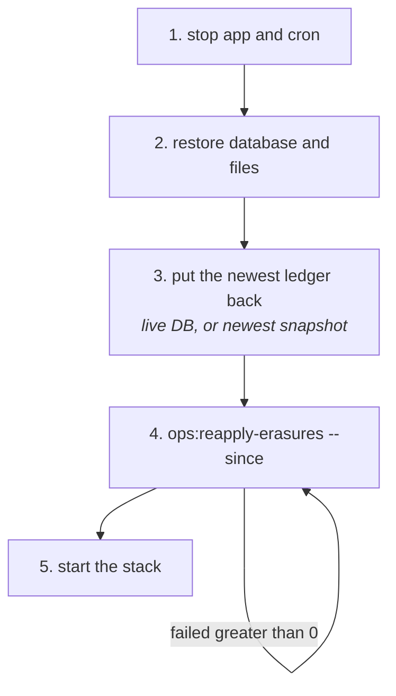

# Restoring

Restore the database and the uploads, and handle erasures after a restore.

## Before you start

- A reachable restic repository and its `restic_password`.
- A stack with an empty or replaceable database.

## Steps

### 1 · Restoring

The drill proves the machinery. For a real incident:

| Situation                                           | Restore command                                                                        | Why                                                                                                                                                          |
| --------------------------------------------------- | -------------------------------------------------------------------------------------- | ------------------------------------------------------------------------------------------------------------------------------------------------------------ |
| Give one client its own data back                   | `mongorestore --archive --ssl --sslCAFile ... --nsInclude="<client>.*" --drop`         | `--nsInclude` and `--oplogReplay` cannot be combined; this restores the client's collections as of the dump's end, not perfectly cross-collection consistent |
| Disaster recovery: the host, or the volume, is gone | `mongorestore --archive --ssl --sslCAFile ... --oplogReplay` into a **fresh** instance | Full, oplog-consistent. Restoring `admin` and `config` over a LIVE replica set's own identity is not what you want, hence a fresh target                     |

Both read the dump from restic: `restic dump <snapshot> mongodump.archive | mongorestore --archive ...`.
The Database Tools spell TLS `--ssl --sslCAFile`, and the bundled `database` requires it.

1. **Stop the writers.** `docker compose stop app cron`. They stay stopped until step 5.
2. **Restore the database**, then the files (`restic restore <files snapshot> --target <dir>`, then copy
   into the `uploads` volume and `storage/mail-spool`).
3. **Put the newest erasure ledger back.** The restored copy only knows erasures from before the snapshot.
    - **The live database still answers:** copy its `erasureledgers` collection over the restored one
      (`mongodump --collection erasureledgers`, then `mongorestore --nsInclude="<db>.erasureledgers" --drop`).
    - **The host is gone:** restore the **newest** snapshot's `erasureledgers` the same way
      (`--nsInclude` cannot be combined with `--oplogReplay`, so this is its own `mongorestore` run after the
      full restore of step 2).
4. **Re-apply the erasures, before anything starts:**

    ```sh
    docker compose --env-file "clients/$COMPOSE_PROJECT_NAME/.env" -f compose.yaml -f compose.production.yaml \
        run --rm --no-deps cron \
        node --import tsx scripts/ops/reapply-erasures.ts --since <the snapshot time, ISO> --snapshot <restic id> --by <your name>
    ```

    `--env-file` is not optional: without it the client's settings never reach `cron` and the script stops
    with "DB connection refused by configuration". A manual run also needs `APP_IMAGE` exported: the image
    currently deployed, the image on the last line of `clients/<name>/deploys.log` (`docker/deploy.sh` sets
    it for you). `docker compose` stands for your engine's compose: `podman compose` where the engine is
    podman (the repo's `npm run compose` picks it).

    Run it in `cron`: it mounts `uploads`, so an erased account's avatar is deleted again too, and the
    production image has no npm. `--no-deps` because step 1 stopped `app` and `cron`, and `run` would
    otherwise start their dependencies. Step 1 is the guard: it does not check that the app and cron are stopped, and the purge job (which has no
    HTTP port to probe) must not run beside it. It erases again each account the ledger names since `--since`,
    keeping the original erasure date, and writes one restoration-log audit row (`auth.erasures.reapplied`: who,
    which snapshot, the counts and ids). Safe to repeat; it exits non-zero while
    any account could not be erased.

5. **Start the stack** and look: log in, open an order, fetch an image. Mail, stock alerts, the purge job
   and webhooks only ever see the already-erased state.
6. **Reconcile with the payment provider.** The restored database forgets every payment and refund
   made after the snapshot, while the provider still holds them. The sweep and the refund sync only
   reach payments the restored database still has, so compare by hand: open the provider dashboard's
   payments and disputes since the snapshot and check each against the app. Each one the app lacks is
   a buyer charged with no order: refund it at the provider, or re-create the order by hand. The
   payment sweep (`sweep:payment-effects`) runs by itself every 5 minutes once step 5 starts cron.
   Run `POST /payments/{id}/refunds/sync` on each payment refunded at the provider since the
   snapshot. The shop assumes it owns its provider account: money
   moved there by anything else is not reconciled.

#### Erasures after a restore

A backup kept for six months holds accounts erased since. GDPR's accepted standard (the ICO's guidance, the
EDPB's 2025 enforcement report) lets a backup keep them until it ages out, **if** they stay "beyond use" and
**every erasure is re-applied after a restore, before use** (SDM Baustein 60, M60.S10). This repo's promise is
exactly that: [Data retention](../understand/data-retention.md#backups-and-erasure).



The list is the **erasure ledger** (`erasureledgers`): `{ userId, at, kind }`, written inside the erasure's own
transaction (an owner's schedule and cancel too; a staff cancel reaches it a moment later, through the outbox), kept `NODE_ERASURE_LEDGER_RETENTION_DAYS` (220 by default, above the oldest backup with the default
keep knobs; raise it with them). Raise `BACKUP_KEEP_MONTHLY` and the ledger must outlive it, or a restore of the
oldest snapshot brings back an account the ledger has forgotten.

**Deletion locks follow the ledger too.** Besides `erased`, the ledger records `scheduled` (with the
`purgeAt` the owner was promised, stored and never recomputed) and `canceled`. For each account the command
applies the latest event since `--since`: `erased` always wins; otherwise a later `scheduled` locks the account
at the stored date (and ends its sessions), a later `canceled` clears the lock even if `purgeAt` has passed,
and cancel-then-ask-again stays scheduled. The log prints the counts and then the ids of every account in each outcome (`erased`, `alreadyGone`, `rescheduled`, `unscheduled`, `unchanged`, `failed`): the restored audit log lost the rows written after the snapshot, so these ids are the record.
No manual check is needed before starting the stack.

**Only if the ledger is lost** (the host, and the newest snapshot's copy): fall back to the audit events, which
are shorter-lived (`auditlogs` keeps 180 days, `NODE_AUDIT_RETENTION_DAYS`; Loki 7 by default).

- **The database still answers:**

    ```js
    db.auditlogs.find(
        {
            action: {
                $in: ['admin.user.erased', 'system.user.erased', 'auth.account_delete.completed']
            },
            outcome: 'success',
            timestamp: { $gt: ISODate('<the snapshot time>') }
        },
        { action: 1, targetId: 1, actorUserId: 1, timestamp: 1 }
    );
    ```

    The erased user is `targetId` for the admin and system events, `actorUserId` for a self-deletion.

- **The database is gone:** the same events were logged as Winston lines in Loki
  (`{service="api"} |= "user.erased"`), if the logs survived off the host.

Then erase each listed user again (admin `DELETE /users/{id}?hardDelete=true`) **before step 5**. If no source
survives, write it in the incident log, as the
[Art. 33 runbook](../understand/data-protection.md#breach-runbook-art-33-—-72-hours) already asks: the erasures that
could not be re-applied, and why.

### 2 · Uploaded images and the mail spool {#uploaded-images-and-the-mail-spool}

The dump covers the database only. Two named volumes hold durable state of their own: `uploads`
(uploaded images) and the `mail-spool/` directory of `storage` (queued outbound mail a restart must
not lose). A restore that skips them brings back rows pointing at files that no longer exist, so the
backup container mounts both read-only and backs them up as plain files.

**`storage/documents/` is deliberately left out.** It holds rendered invoice and credit-note PDFs, a
regenerable copy of the frozen rows: losing it costs a re-render, never data.

**Moving to a new host:** restore the files snapshot onto the new host's volumes before the new
stack's first boot (`restic restore latest --tag files --target <dir>`, then copy into the volumes).
Skipping this looks fine until a customer clicks a broken image or the reaper finds no mail queued
that a customer swears was sent.

## Read next

- [Backups](./backups.md)
