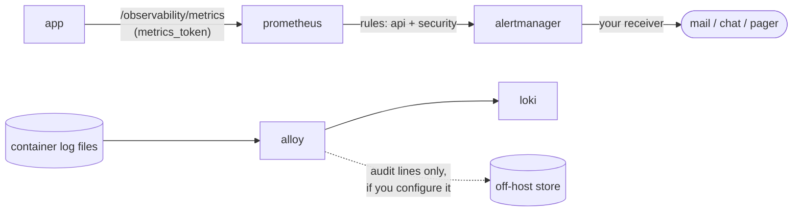

# Monitoring and alerts on a first deploy

Turn on the monitoring set and prove one alert reaches you.

## Before you start

- The stack is up and healthy: [Check it worked](./first-deploy.md#check-it-worked).
- A way to receive mail or a webhook for alerts.

## Steps

### 1 · Monitoring and alerts {#monitoring-and-alerts}

The `monitoring` profile adds five services, **off by default**: Prometheus (scrapes `app` and
evaluates the alert rules), Alertmanager (routes what fires), node_exporter (the host's disk, for
`DiskAlmostFull`), Loki (stores container logs) and Alloy (ships them). Turn it on with `COMPOSE_PROFILES=bundled,monitoring`. There is no Grafana: it costs
about a gigabyte of memory and the alerts do not need a screen.

- **No host ports.** Prometheus and Alertmanager have web UIs with no login, so none of the five
  publishes a port; they reach each other and `app` over the compose network. Reach a UI with
  `docker compose exec` or an SSH tunnel, not a published port.
- **One credential.** Prometheus scrapes with the `metrics_token` secret file the app reads its own
  `NODE_METRICS_TOKEN` from, so rotating the token is one edit.
- **The rules** are the files the local stack loads: `docker/observability/prometheus.alert-rules.yaml`.
  The `security` group carries a "tune to your traffic" comment on every threshold.
- **You need an alert receiver.** Alerts that fire into nothing are a dashboard nobody opens.
  With no `ALERT_*` knob set, Alertmanager sends every alert to `null`, which notifies no one.
  Set `ALERT_EMAIL_TO` / `ALERT_EMAIL_FROM` (sent through the app's own `NODE_SMTP_*`),
  `ALERT_WEBHOOK_URL` (ntfy with a templated URL, or a bridge for anything else) and `ALERT_HEARTBEAT_URL` in the
  client's `.env`. [Alert routing](prometheus.md#alert-routing) has the table.
- **Prove it once, on staging.** `docker compose ... stop app`: within about two minutes
  `[FIRING] ApiDown` reaches your `ALERT_*` receiver, and `start app` sends the resolution. Then stop
  `alertmanager`: Gatus reports the missing heartbeat ([the drill](gatus.md#the-local-drill)).
  An alert nobody has ever seen fire is not known to work.
- **Logs.** Alloy tails the engine's container log files (Docker: `/var/lib/docker/containers`; set
  `CONTAINER_LOGS_PATH` for Podman, together with `CONTAINER_LOG_DRIVER=k8s-file`, because Podman's
  default driver writes no file). It reads the Docker and the Podman format at once. It sits inside
  the client's trust domain: [what it can read](#what-the-log-shipper-can-read).
- **The audit stream, off the host.** An audit trail the application can write is one an attacker
  who owns the application can rewrite, so the strongest copy lives on a system the application
  cannot reach. The pipeline can forward the lines tagged `log_type=audit` to a target you choose:
  copy `docker/observability/alloy.audit-forward.example.alloy`, fill in the target, and point
  `ALLOY_AUDIT_FORWARD_CONFIG` at the copy. Where it goes is yours to pick; the options worth
  weighing are object storage with object lock (WORM retention), a separate log host, or a managed
  log service with its own access control. This boilerplate picks none: **with no target there is
  no off-host copy**, and the audit entries live only in the host's logs and the application's
  database. Why not a protected database instead: its role needs `createIndex`, so a compromised
  app could plant a TTL index with `expireAfterSeconds: 0` and wipe the trail.

Traces are not in the profile: set `OTEL_EXPORTER_OTLP_ENDPOINT` to a collector you already run (an
empty value is a valid choice and means no traces leave the process). To run Tempo and Grafana here
anyway, copy their definitions from `compose.override.yaml` into your own override file rather than
layering the development file onto production (`-f compose.yaml -f compose.production.yaml -f compose.override.yaml` drags the
dev bind-mounts back in).

### What the log shipper can read {#what-the-log-shipper-can-read}

Alloy is the one container in the profile that reaches past its own files.

- **What it mounts:** the engine's whole container directory, read-only (`CONTAINER_LOGS_PATH`),
  and it runs as root, because the engine's log files are root-owned.
- **What it can read:** every container's log on the host, and each container's config file
  (Docker keeps it as config.v2.json, Podman as userdata/config.json). That file holds the container's
  environment, which here means `_FILE` paths and never a secret value: the secrets are
  [files in `clients/<name>/secrets/`](first-deploy.md#secrets), bind-mounted, and never under that
  directory. `docker/deploy-drill.sh` inspects `app`, `cron` and `setup` for a plain value.
- **So:** it sits inside the client's trust domain, like the host's root. **One client per machine** is
  the supported shape ([tenancy](../understand/tenancy.md), the README's Silo line).
- **Two stacks on one host** ([Two Client Stacks](two-client-stacks.md)): with `monitoring` on, each
  Alloy reads the other stack's logs, audit lines and personal data included, and forwards them if
  `ALLOY_AUDIT_FORWARD_CONFIG` is set. Run that set-up without the profile, or accept the shared trust.

See [Docker & Podman](../build/docker-and-podman.md) for what each of those containers does and
[Observability Reference](./observability-reference.md) for how the app talks to them.

## Read next

- [Getting Started — Production](./first-deploy.md)
