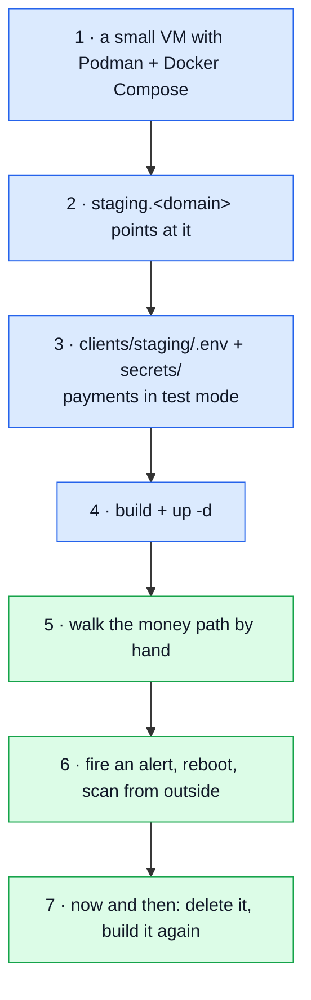

# A staging copy

Rehearse a deploy on a copy before the real one.

## A staging copy

The test suite proves the code. It cannot prove the install: a real certificate, mail that lands in
an inbox, a firewall, a reboot. Staging is where those get checked, before a customer does it for you.

Staging is production in everything but its data: same compose file, same image, a throwaway machine.

1. **A machine.** Any small VM that runs Podman, with Docker Compose as its
   [compose provider](../build/docker-and-podman.md#the-compose-provider-behind-podman-compose).
   [Hosting](./hosting.md) has what it needs.
2. **A name.** A DNS record for `staging.<domain>` pointing at the VM, then the proxy:
   [Putting a reverse proxy in front](./first-deploy-proxy-and-storage.md#putting-a-reverse-proxy-in-front).
3. **Configuration.** A client called `staging`, exactly as in [First run](./first-deploy.md#first-run) and [Secrets](./first-deploy.md#secrets).
    - Mail: a real SMTP account, so you see what a customer sees, with
      [SPF, DKIM and DMARC](./deployment-hardening.md#email-authentication-spf-dkim-dmarc) published.
    - Payments: the provider's **test** keys, never live ones.
4. **Boot it.** The same two commands as [First run](./first-deploy.md#first-run), with `COMPOSE_PROJECT_NAME=staging`,
   then [Check it worked](./first-deploy.md#check-it-worked).
5. **Walk the money path by hand**, at `https://staging.<domain>`, and again after every deploy:
    - `/livez` and `/readyz` answer;
    - sign up, and the verification mail arrives;
    - log in, add a product, check out, pay with a test card;
    - the order turns `paid`, and the confirmation mail arrives;
    - delete the account.
6. **The three things only a real host can show:**
    - an alert reaches you: [Prove it once](./first-deploy-monitoring.md#monitoring-and-alerts);
    - a reboot brings everything back: [Surviving a reboot](./first-deploy.md#surviving-a-reboot);
    - from another machine, only 80 and 443 answer and TLS is clean:
      `nmap -Pn -p- staging.<domain>`, `testssl.sh staging.<domain>`,
      and `curl -sI https://staging.<domain>/livez` to see the headers after Traefik.
7. **Rebuild from scratch now and then.** A stack only ever upgraded in place hides what works only
   because of leftovers.

## Read next

- [Getting Started — Production](./first-deploy.md)
