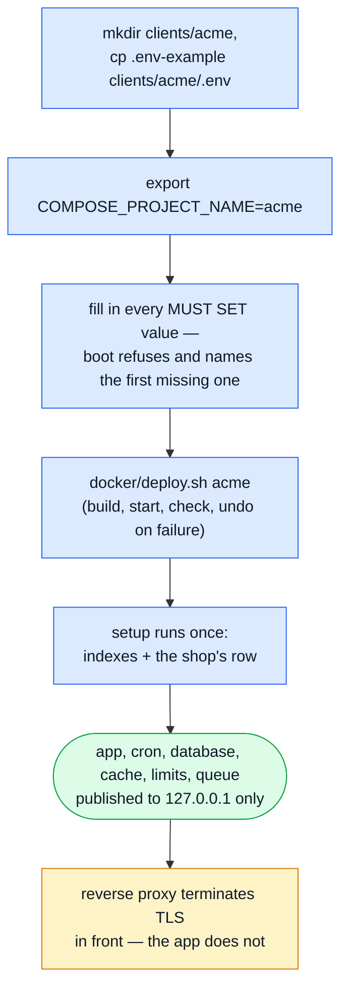
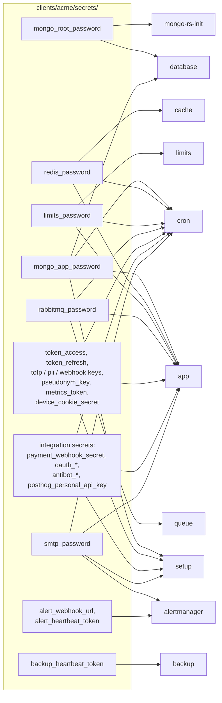

# Getting Started — Production

The deployment shape of this stack, not the development one. `compose.override.yaml` (loaded with `compose.yaml` when you run no `-f`) bind-mounts the
working tree and brings up the whole observability estate because seeing everything is the point
of a dev box. `compose.production.yaml` is the other half, always run as `-f compose.yaml -f compose.production.yaml`: it runs the **built** image, binds
the API port to loopback only, and keeps to what a host needs: `app`, `cron`, the one-shot `setup`, the datastores (`database`, `cache`, `limits`, `queue`), with `database`, `cache`, `limits` and `queue` in the `bundled` profile, on by default (`COMPOSE_PROFILES=bundled` in `.env-example`), and three opt-in profiles: `backup` (the backup job), `restore-drill` (the restore drill) and `monitoring` (`prometheus`, `alertmanager`, `loki`, `node-exporter`, `alloy`) — see [Monitoring and alerts](./first-deploy-monitoring.md#monitoring-and-alerts).

## Before you start

- A host that runs Podman or Docker with Compose: [Ways to deploy](./ways-to-deploy/index.md).
- A checkout of this repository on that host.
- A domain name for the API, for the proxy step.

::: warning Read this alongside the file, not instead of it
Every decision below — why the port is loopback-only, why it is one process per container, why observability is
absent — is explained inline in `compose.production.yaml` and `docker/Dockerfile`
themselves. This page is the short version; the compose file is the source of truth.
:::

## Steps

### 1 · First run {#first-run}

A production stack serves **one client organisation**. It is named, and the name picks up that
client's configuration:



```bash
mkdir -p clients/acme
cp .env-example clients/acme/.env
export COMPOSE_PROJECT_NAME=acme
```

`COMPOSE_PROJECT_NAME` does two jobs at once: it prefixes every container, network and volume, and
it selects `clients/acme/.env` below. Unset, the stack refuses to start rather than guessing. To
run a second client on the same host, repeat with a different name and a different `NODE_PORT` —
nothing is shared between them.

Then edit `clients/acme/.env` and set real values. One early choice: `NODE_SESSION_MODE`, how people stay signed in (`jwt`, the default, or `cookie`), which decides whether the two signing secrets are needed at all — see [Choosing the session mode](../modules/account-sessions.md#choosing-the-session-mode). Changing it later signs everyone out. The credentials and keys are **not** in this file
(see [Secrets](#secrets)); delete their lines from your copy. Delete the `NODE_SEED_*` demo
passwords too: production never seeds, and they would sit in the app's environment for nothing. Rather than a hand-copied list here —
which goes stale the moment a new setting is added — boot itself tells you what it needs: start the
stack with the shipped placeholders still in place and it refuses, naming the first one it hit.

`.env-example`'s own `MUST SET` markers (Part A) and its production-only block (Part D6) are the
complete list; `MONGO_ROOT_USER` defaults to `root`, `MONGO_APP_USER` and `MONGO_DB` default to
`api`, `RABBITMQ_USER` defaults to `guest`. The root account is maintenance-only — the app itself
authenticates as `MONGO_APP_USER`, a `readWrite` user scoped to `MONGO_DB` and created by
`docker/mongo-init.js` the first time the volume is empty.

### 2 · Secrets {#secrets}

Every credential and key is **one file** under `clients/acme/secrets/`, and compose hands each
service only the files it needs. A secret in an environment variable shows in `docker inspect` and
in every child process; a file mounted into one container does neither, and the Mongo root password
exists in exactly two containers, neither of them the app.



Create them once, before the first `up`. Hex output, because Redis reads its password from a
whitespace-delimited config line:

```bash
mkdir -p -m 0700 "clients/acme/secrets"
for name in mongo_root_password mongo_app_password mongo_backup_password restic_password \
            redis_password limits_password rabbitmq_password \
            token_access token_refresh totp_encryption_key pii_encryption_key \
            webhook_secret_encryption_key pseudonym_key metrics_token device_cookie_secret; do
  openssl rand -hex 32 > "clients/acme/secrets/$name"
  chmod 0644 "clients/acme/secrets/$name"
done
# The integrations: fill in the ones you use. An empty file is unset.
for name in smtp_password payment_webhook_secret oauth_google_client_secret \
            oauth_github_client_secret antibot_altcha_secret antibot_turnstile_secret \
            posthog_personal_api_key alert_webhook_url alert_heartbeat_token \
            backup_heartbeat_token; do
  : > "clients/acme/secrets/$name"
  chmod 0644 "clients/acme/secrets/$name"
done
```

- **Backups:** `mongo_backup_password` is the `backup` role's login
  ([Backups](backups.md#the-database-login)); `database` creates the account from it, so a bundled
  stack needs the file even with the `backup` profile off. `restic_password` encrypts the repository: keep
  a copy off the host. The `backup` profile also mounts `restic_repository_env` (the repository's own
  login as `NAME=value` lines; create it empty with `: > clients/acme/secrets/restic_repository_env`).
- **Modes:** the files are `0644` inside a `0700` directory. Compose ignores `uid`/`mode` for a file
  secret, and Redis (uid 999) and node (uid 1000) must both read it; the directory is what keeps
  other host users out.
- **How the app reads them:** `NODE_TOKEN_ACCESS_FILE=/run/secrets/token_access` and its siblings,
  set by the compose file. The URLs carry no password; each password file is merged into its URL
  ([Secrets as files](configuration.md#secrets-as-files)).
- **Managed Mongo, Redis or RabbitMQ:** compose refuses to start a service whose secret file is
  missing. Put the managed password **in the file** and leave it out of the URL: a password left
  inside the URL sits in `.env`, and so in `docker inspect`. Leaving the file **empty** reads as
  unset, and the password in your `NODE_DB_URI` / `NODE_REDIS_URL` / `NODE_RABBITMQ_URL` stands.
- **Integrations** (SMTP, payments, OAuth, antibot, PostHog erasure): one file each, `smtp_password`,
  `payment_webhook_secret` (it may hold the `new,old` ring), `oauth_google_client_secret`,
  `oauth_github_client_secret`, `antibot_altcha_secret`, `antibot_turnstile_secret` and
  `posthog_personal_api_key`. Fill in the ones you use; an **empty file is unset**, which is how
  an optional secret stays optional. Delete the matching `NODE_*` lines from the client's `.env`: a
  plain `NODE_X=value` left there is still read, and shows in `docker inspect` ([the empty-file
  rule](configuration.md#secrets-as-files)). `NODE_SMTP_PASS` also reaches `alertmanager`, as the same file.
- **Alerts and heartbeats** (monitoring and backup profiles): `alert_webhook_url` and
  `alert_heartbeat_token` reach `alertmanager`, `backup_heartbeat_token` reaches `backup`; empty
  is unset. A push channel's URL is a credential, so it is a file too. The heartbeat URLs
  (`ALERT_HEARTBEAT_URL`, `BACKUP_HEARTBEAT_URL`) stay in `.env`: the token is the credential.
- **Public values stay in `.env`:** the OAuth client IDs, the Turnstile site key, the bank IBAN
  printed on invoices and the public `NODE_POSTHOG_API_KEY` ingestion key.
- **RabbitMQ:** the 4.x image refuses `RABBITMQ_DEFAULT_PASS_FILE`, so the password goes into a
  config file the broker reads; **Redis** gets it the same way, never on a command line.
- **Rotating** a Mongo or broker password: [security.md](../understand/security.md#database-credential-and-key-rotation);
  then rewrite the file and recreate the services that mount it.

**Bundled or managed backing services.** `COMPOSE_PROFILES=bundled` (`.env-example`'s default)
starts the `database`/`cache`/`queue` containers below. Pointing at a managed MongoDB, Redis or
RabbitMQ instead is two edits, not a compose-file change: set `NODE_DB_URI`/`NODE_REDIS_URL`/
`NODE_RABBITMQ_URL` to the managed connection string, and clear `COMPOSE_PROFILES` so the bundled
containers never start. The bundled `database` requires TLS and its default `NODE_DB_URI` already
carries `tls=true&tlsCAFile=/ca-dir/...` against the self-signed CA `mongo-entrypoint.sh` mints
([Reaching the store](../understand/defences/data-layer.md#reaching-the-store)) — a managed provider's own
connection string supplies its own TLS, so this is a bundled-default concern only.

**The managed database user.** Give the app a user with `readWrite` on its own database and
nothing else — never the provider's root or admin account. The bundled `database` already works
this way (`MONGO_APP_USER`, created by `docker/mongo-init.js`); a managed cluster needs the same
user created by hand. `readWrite` is enough for everything the app does, `setup`'s `db:sync`
index builds included.

```bash
docker/deploy.sh acme
```

One command: it builds the `app` image (`setup` and `cron` run that image rather than building their
own), starts the stack, waits until `setup` exited 0 and `app` and `cron` are healthy, and records
the release in `clients/acme/deploys.log`. A release that does not come up healthy is replaced by
the previous one on the spot; `docker/deploy.sh acme --rollback` does the same on demand. See
[Deploy and rollback](deploy-and-rollback.md).

The file is named twice — once by `--env-file`, once by `env_file:` inside the compose file —
because compose reads it through two separate channels. `--env-file` resolves the `${...}`
substitutions in the compose file itself; `env_file:` is what the container receives. Naming only
one of them silently gives every client the same application config.

That builds the `runtime` stage of `docker/Dockerfile` (multi-stage: type-checks in a build stage, ships only
production dependencies in the runtime stage), runs `setup` once — indexes and the shop's row, see
[the first admin](./first-deploy-after-launch.md#the-first-admin) — then starts the API, `cron`, and (bundled profile) `database`, `cache`,
`limits` and `queue` — the production names for Mongo, the cache Redis, the rate-limit Redis and RabbitMQ. No bind mount, no hot reload:
what's running is exactly what was built.

### 3 · Check it worked {#check-it-worked}

```bash
docker compose --env-file "clients/acme/.env" -f compose.yaml -f compose.production.yaml logs -f app
curl http://127.0.0.1:3000/livez     # liveness probe
docker compose --env-file "clients/acme/.env" -f compose.yaml -f compose.production.yaml ps
docker compose --env-file "clients/acme/.env" -f compose.yaml -f compose.production.yaml exec app env | grep -iE 'pass|secret|token|key'

```

- `ps`: every service `healthy`, or `exited (0)` for the one-shot `setup` and `mongo-rs-init`.
- `env | grep`: **only `_FILE` paths** (`NODE_TOKEN_ACCESS_FILE=/run/secrets/token_access`), plus
  public values such as the OAuth client IDs. A secret value here was put straight into the client's
  `.env`: move it into its file. A test checks the compose file, but only this sees the `.env`.

The port is published to `127.0.0.1`, not `0.0.0.0` — reachable from the host, not from the
network. That is deliberate, see [Putting a reverse proxy in front](./first-deploy-proxy-and-storage.md#putting-a-reverse-proxy-in-front).

### 4 · Surviving a reboot {#surviving-a-reboot}

Rootless Podman has no daemon, so `restart: unless-stopped` alone does nothing at boot: nobody is
there to read it. Two commands, once per host, as the user that runs the stacks:

```bash
loginctl enable-linger "$USER"                     # keep this user's services running with nobody logged in
systemctl --user enable --now podman-restart.service # at boot, start every container marked unless-stopped / always
```

Check it once on staging: reboot the VM, then `ps` from [Check it worked](#check-it-worked). Uploaded
images survive too: they are on a named volume. Docker needs none of this; its daemon restarts them.

## The first admin

Create the first administrator once the stack is healthy: [After the first deploy](./first-deploy-after-launch.md#the-first-admin).

## Publish a disclosure contact

Point the app at a security contact: [After the first deploy](./first-deploy-after-launch.md#publish-a-disclosure-contact).

## The first third-party integration

Wire SMTP, payments or OAuth: [After the first deploy](./first-deploy-after-launch.md#the-first-third-party-integration).

## What's different from dev

A table of dev against production: [Proxy, uploads and backups](./first-deploy-proxy-and-storage.md#what-s-different-from-dev).

## Putting a reverse proxy in front

The API listens on loopback; TLS goes in front: [Proxy, uploads and backups](./first-deploy-proxy-and-storage.md#putting-a-reverse-proxy-in-front).

## Uploaded images do not outlive the container

Mount a volume or lose uploads on redeploy: [Proxy, uploads and backups](./first-deploy-proxy-and-storage.md#uploaded-images-do-not-outlive-the-container).

## Backups

Turn on the backup profile: [Proxy, uploads and backups](./first-deploy-proxy-and-storage.md#backups).

## Monitoring and alerts

Enable the monitoring set and prove an alert: [Monitoring and alerts](./first-deploy-monitoring.md#monitoring-and-alerts).

## A staging copy

Rehearse on a second stack named `staging`: [A staging copy](./first-deploy-staging.md#a-staging-copy).

## Read next

| You want to                                      | Read                                                              |
| ------------------------------------------------ | ----------------------------------------------------------------- |
| Create the first admin                           | [After the first deploy](./first-deploy-after-launch.md)          |
| Put TLS in front, keep uploads, back up          | [Proxy, uploads and backups](./first-deploy-proxy-and-storage.md) |
| Watch it                                         | [Monitoring and alerts](./first-deploy-monitoring.md)             |
| Rehearse first                                   | [A staging copy](./first-deploy-staging.md)                       |
| Run the dev stack instead                        | [Getting Started](../build/run-locally.md)                        |
| Understand every container, dev or production    | [Docker & Podman](../build/docker-and-podman.md)                  |
| Run two client stacks on one host                | [Two Client Stacks](./two-client-stacks.md)                       |
| Pick a host that can run this                    | [Hosting](./hosting.md)                                           |
| Back up what a stack holds                       | [Backups](./backups.md)                                           |
| Understand why one stack serves one client       | [Tenancy](../understand/tenancy.md)                               |
| See every host port and its env var              | [Pairing & Ports](../build/pairing-and-ports.md)                  |
| Understand graceful shutdown under SIGTERM       | [Clustering & Shutdown](../understand/clustering.md)              |
| Look up a file in `docker/` or the compose files | [Ops & Assets](../reference/ops.md)                               |
